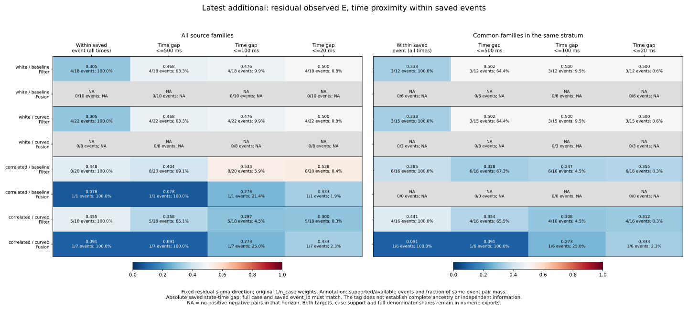
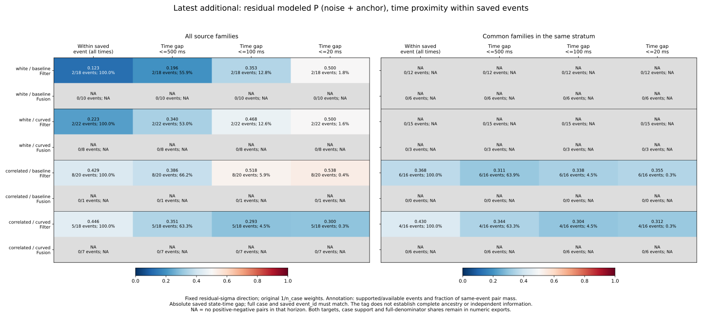
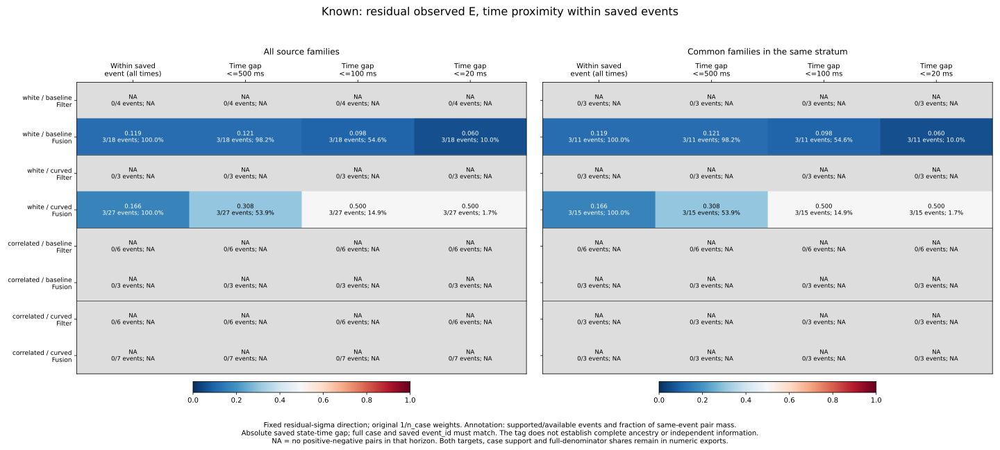
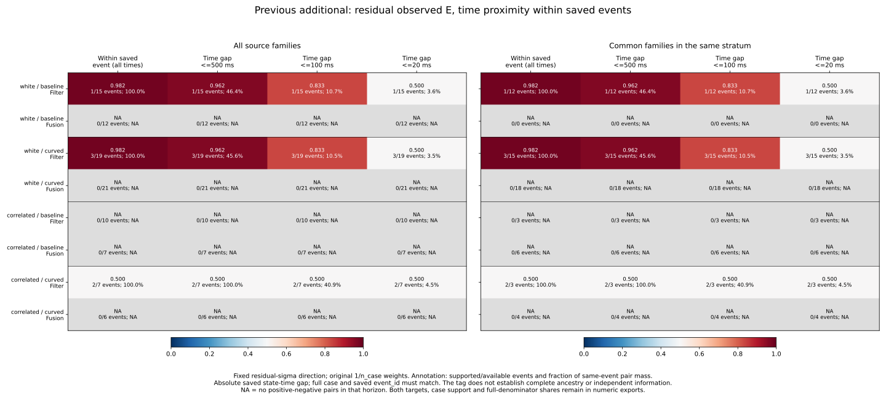
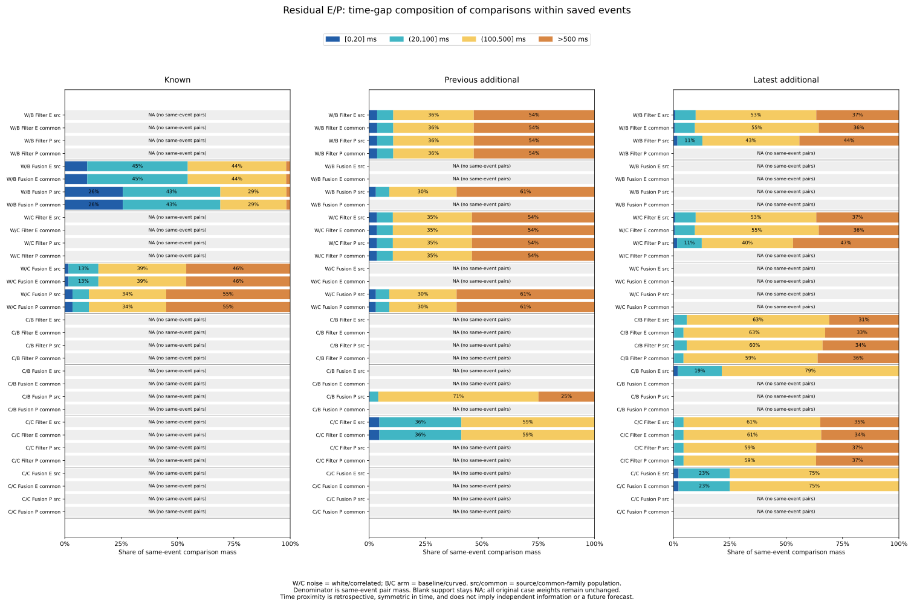

# Time proximity within saved source events

The preceding event-conditioned AUCs depend on which times are compared.
At <=20 ms the latest Filter residual-E AUC is .500 in white noise, .538 for
correlated/baseline and .300 for correlated/curved in the source population.
Common-family selection changes the latter two to .355 and .3125. This does not
support a uniform high-score/outside ordering: the near-time comparisons cover
only 4–8 source events/cases and .002879–.011207% of full pair mass. The earlier
additional cohort's white-noise event AUC near .98 becomes .50 at <=20 ms.

The [protocol](protocol.md) was committed as ba99d9d before these outcomes, from
main 61cf12c7fd407b3cf69192ede32202534e7f1600. No simulations, cutoff fitting,
score direction changes or estimator/control changes were made.

## Population, time definition and accounting

Reuse all 32,985 reconstructed pair references, of which 10,995 are saved
Recovery/Preview states in 157 represented cases and 275 saved source events.
Keep all 972 planned cases, 324 families and the 3,997-event census. Known seeds
269/270/271, previous additional 274/275/276 and latest additional 277/278/279
remain separate, across both noises/arms, all five strata, both midpoint/residual
targets, all three scores and E/P/U. Mixed planners and source/common_family
eligibility are unchanged. Every state retains 1/n_case from its full parent
RP history, before stratum/population selection; there is no event reweighting.

A comparison requires the same full case key and same single saved census
event_id. This tag does not enumerate Fusion sample ancestry or establish an
independent information stream. Existing strict joins and the raw existing_new
partition metadata are preserved. Matching times or underlying source_event_id
values never merge events or cases.

Use the absolute saved state-time gap, after rounding to nearest integer
microseconds with ties to even and an error tolerance of 1e-7 seconds. All
10,995 current times reconstruct with **zero** error. The four disjoint bins
are [0,20], (20,100], (100,500] and >500 ms, with inclusive upper endpoints.
Cumulative <=20/100/500 ms metrics sum their exact rational pair masses before
division. High score means outside; ties contribute half; outside is norm
strictly >.10 m. A zero denominator retains blank AUC, not zero.

Comparisons are symmetric in time: the positive state may precede the negative
state. Selected timestamps do not establish continuity or a recorded transition.
No gaps are interpolated, chains stitched or future outcomes forecast.

## Latest Filter: residual E

All AUCs below use the fixed residual_sigma direction. The event column is the
preceding all-time within-event AUC, retained unchanged. Full-precision fields,
both targets and all scores/labels remain in [ranking-summary.csv](ranking-summary.csv).

| Noise / arm | Population | All event times | <=500 ms | <=100 ms | <=20 ms |
| --- | --- | --- | --- | --- | --- |
| white / baseline | source | 0.305263 | 0.468278 | 0.475728 | 0.500000 |
| white / baseline | common_family | 0.333333 | 0.502463 | 0.500000 | 0.500000 |
| white / curved | source | 0.305263 | 0.468278 | 0.475728 | 0.500000 |
| white / curved | common_family | 0.333333 | 0.502463 | 0.500000 | 0.500000 |
| correlated / baseline | source | 0.448297 | 0.404299 | 0.533283 | 0.537891 |
| correlated / baseline | common_family | 0.385388 | 0.327818 | 0.347297 | 0.355172 |
| correlated / curved | source | 0.455090 | 0.357996 | 0.296667 | 0.300000 |
| correlated / curved | common_family | 0.441077 | 0.353596 | 0.308333 | 0.312500 |

White-noise source .305 becomes .468/.476/.500 as the horizon shortens. The
common-family .333 becomes .502/.500/.500; .502 at 500 ms is not a robust
separation. Correlated/baseline source .448 becomes .404/.533/.538, whereas
common-family .385 becomes .328/.347/.355. Correlated/curved remains below .5
at all three horizons in both populations. The fixed time restriction therefore
changes ranking and can change which side of .5 a descriptive AUC falls on.

The <=20 ms denominator is small even when every class-supported event retains
at least one nearby pair. Counts below are saved opposite-label state pairs,
not independent trials. Event counts use the same stratum/population denominator;
case counts are cases contributing at least one such pair.

| Noise / arm | Population | Pair entries | Supported/available events | Supported cases | Share of event pairs | Share of full pairs |
| --- | --- | --- | --- | --- | --- | --- |
| white / baseline | source | 8 | 4/18 | 4 | 0.765550% | 0.005744% |
| white / baseline | common_family | 6 | 3/12 | 3 | 0.634921% | 0.009089% |
| white / curved | source | 8 | 4/22 | 4 | 0.765550% | 0.002879% |
| white / curved | common_family | 6 | 3/15 | 3 | 0.634921% | 0.004503% |
| correlated / baseline | source | 14 | 8/20 | 8 | 0.396350% | 0.011207% |
| correlated / baseline | common_family | 11 | 6/16 | 6 | 0.297801% | 0.009385% |
| correlated / curved | source | 10 | 5/18 | 5 | 0.299401% | 0.007156% |
| correlated / curved | common_family | 8 | 4/16 | 4 | 0.299289% | 0.007373% |

For correlated/baseline, common-family selection removes three of the 14 pair
entries, spanning two of eight supporting cases/events. All concordant <=20 ms
mass in the source group is among the removed families: concordant mass changes
from .0004938271604938272 to zero. The remaining case weights are unchanged;
this is a population/support change, not a reversal applied to the score.
Repeated planners and common histories do not create independent replication.

## Latest Filter: modeled P and the Fusion support limit

P is noise plus anchor; E includes P and the unmodeled drift/transport vector.
Use the original closed-disk labels independently, preserving signed cancellation.

| Noise / arm | Population | All event times | <=500 ms | <=100 ms | <=20 ms | <=20 ms pair entries |
| --- | --- | --- | --- | --- | --- | --- |
| white / baseline | source | 0.123008 | 0.196453 | 0.353145 | 0.500000 | 4 |
| white / baseline | common_family | NA | NA | NA | NA | 0 |
| white / curved | source | 0.222672 | 0.339695 | 0.467742 | 0.500000 | 4 |
| white / curved | common_family | NA | NA | NA | NA | 0 |
| correlated / baseline | source | 0.429047 | 0.386095 | 0.517966 | 0.537891 | 14 |
| correlated / baseline | common_family | 0.367695 | 0.311326 | 0.337696 | 0.355172 | 11 |
| correlated / curved | source | 0.446108 | 0.350827 | 0.293333 | 0.300000 | 10 |
| correlated / curved | common_family | 0.429854 | 0.344471 | 0.304167 | 0.312500 | 8 |

White-noise source modeled-P AUCs .123/.223 reach .5 at <=20 ms, each supported
by four pair entries in two cases/events. Common-family white modeled P has no
within-event class support, so all nearby AUCs remain NA. Correlated near-time
P values closely follow E here; they do not establish a calibrated probability
or a bound on total error.

For latest Fusion residual E, white noise has no within-event class pairs in
either population. Correlated/baseline source uses one event in one JPS case:
all-time and <=500 ms AUC .077922, <=100 ms .272727 and <=20 ms .333333, with
only three <=20 ms pair entries. Its common-family population has no records.
Correlated/curved uses one event/case: .090909/.090909/.272727/.333333 in both
populations, again three near-time entries. Their <=20 ms full pair shares are
1.948052% for baseline source, .068027% for curved source and .198413% for curved
common-family. These few cases do not establish general Fusion behavior.
Latest Fusion modeled P remains NA within events at every horizon in every
condition/population, including curved conditions with defined between-case P
ranking. Time restriction cannot manufacture missing class support.

## Earlier cohorts and comparison composition

Known Filter residual E remains class-missing in all four conditions. Known
white/baseline Fusion changes from .118716 within-event to .120869/.097926/
.059590 at <=500/100/20 ms, with three supporting events/cases and seven nearest
pair entries. White/curved Fusion changes from .165755 to .307692/.500/.500,
with three supporting events/cases and six nearest pair entries. The <=20 ms
full pair shares are .123156% and .000933% respectively in the source population.
All known correlated Fusion within-event E AUCs remain undefined. Common-family
white Fusion AUCs match the source values, while their coverage denominators differ.

Previous additional white Filter residual E changes from .982143/.982456 for
baseline/curved to .961538 at <=500 ms, .833333 at <=100 ms and .500 at <=20 ms.
Source support is one/three cases/events and two/six nearest pair entries;
<=20 ms covers only .001026%/.001822% of full pair mass. Common-family AUCs
match these values. Correlated/baseline Filter has no within-event E class pairs;
correlated/curved stays .5 at every horizon, using two events/cases and only two
nearest pair entries. All previous additional Fusion within-event E AUCs remain
NA. A high all-time same-event AUC need not survive comparing nearby states.

The last figure partitions all same-event pair mass without discarding the
>500 ms bin. For example, latest source Filter E has only .2994–.7656% of its
same-event pair mass at <=20 ms; those already conditional denominators are
small fractions of full pair mass. Across the complete 2,160 ranking cells,
414 have within-event class support and all 414 retain some <=20 ms support.
The same number of defined AUCs does not mean the horizons carry equal mass.
The unmodeled-U target is single-class throughout these saved RP states.

## Reproduction and independent verification

See the [README](../../README.md#time-proximity-within-saved-source-events) for
commands using only tracked inputs, fresh output directories and a fresh evidence
filename, without Python -O. Python's standard library runs the collector;
Matplotlib/NumPy produce plots, and NumPy runs the independent verifier.

- **603 Python tests passed**, including 17 new exact-boundary, tie, time-grid,
  missing-class, full-case/event isolation, inherited-weight, cache and closure tests.
- **1,335,976 preceding-field comparisons** match the original source/event map,
  complete census/support, event rankings, aggregate rankings, event-pair bins,
  family eligibility and planned case-stratum audit.
- **21 collector artifacts** (20 CSVs and sources.json) repeat byte for byte.
  Four time bins exactly reconstruct each event's original five rational pair
  masses before export and sum to every preceding same-event comparison.
- **13 plot artifacts** (five SVGs, five PNGs, two numeric CSVs and plot provenance)
  repeat byte for byte. All five figures were inspected; numeric exports retain
  192 complete ranking rows and 768 time-bin rows across both targets and E/P.
- **2,375,573 independent comparisons** pass. The standalone verifier imports no
  analyzers, reconstructs all 10,995 raw states and 21,990 target rows, source
  labels/score ticks, exact window/family joins and original weights. It rounds
  original projection timestamp strings using Decimal and evaluates NumPy
  positive-negative pair masks, independently of the collector's integer loops.
  It checks every new CSV field and every prior ranking/audit field, all numeric
  plot exports, input/helper/script/protocol/output hashes and plot hashes.

The bundle retains all 3,997 events, 1,375 event-support rows, 9,900 event-rankings,
972 planned cases, 324 families and 4,860 case-stratum audits. New tables contain
10,995 source-time audit rows, 3,300 score-independent event-time-support rows,
2,160 expanded rankings and 8,640 time-bin rows. Empty strata stay explicit in
the copied event-support table; no fabricated event ranking rows are added.
[sources.json](sources.json), [plot-sources.json](plot-sources.json) and
[independent-verification.json](independent-verification.json) record the exact
fingerprints and verification counts. PNG previews stay reproducible in scratch;
SVGs and full numeric inputs are tracked.

The cohorts and their outcomes were already observed. Time proximity, saved
event identity, repeated states and planner variants do not establish independent
trials, confidence intervals, online predictive performance or physical-world
validation. No new live control outcomes were measured: historical held goals
remain 140->140 and latest 62->60.
