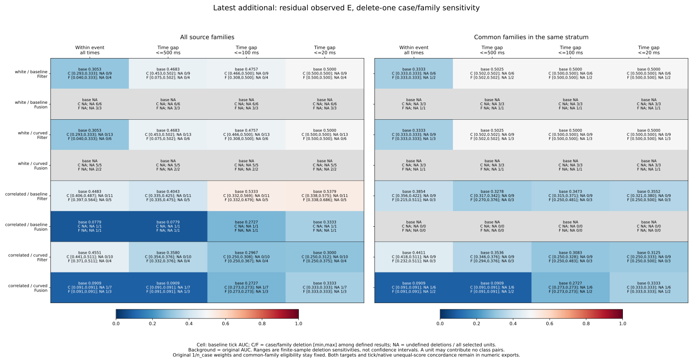
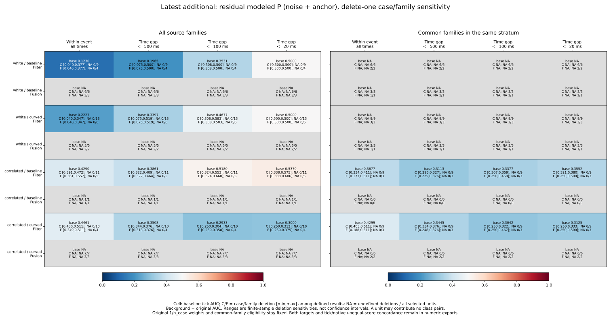
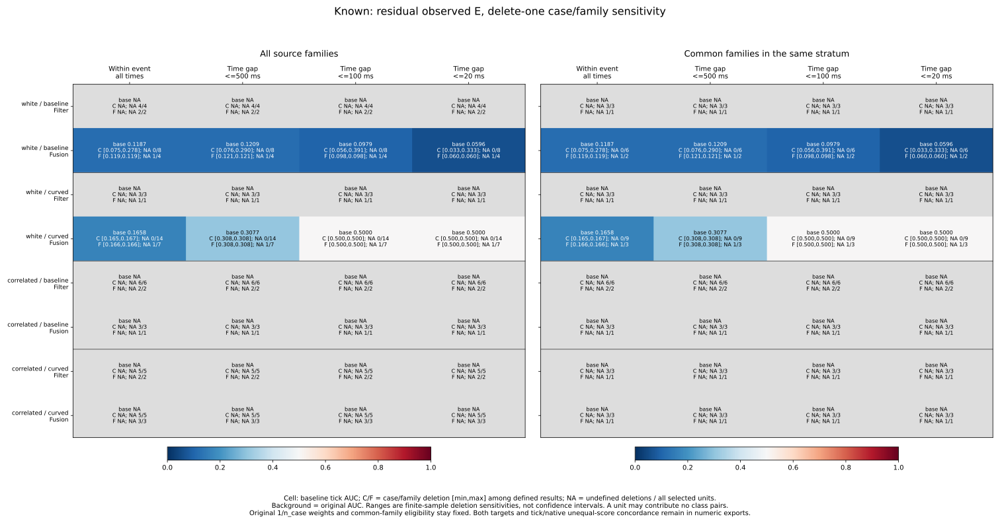
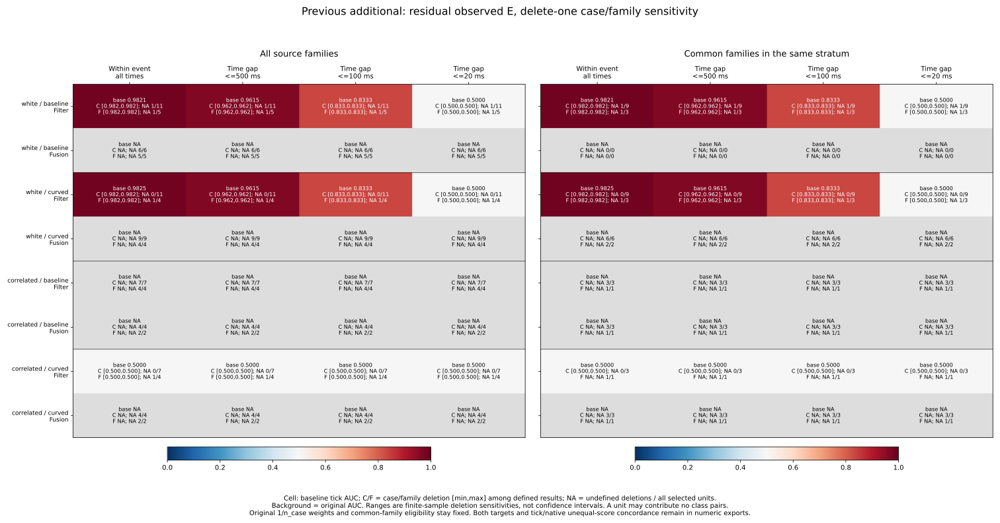
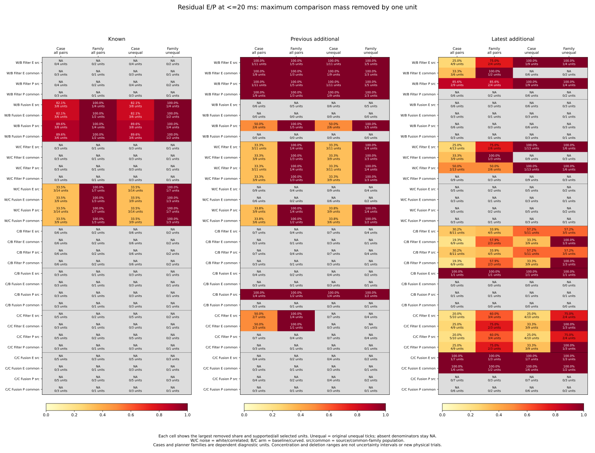

# Delete-one case and planner-family sensitivity

The latest correlated/baseline Filter residual-E AUC at <=20 ms changes from
.537891 to .338150 when case C0149 is removed. Removing its family F050 gives
the same result. Its unequal-score concordance changes from .571791 to zero.
This small above-.5 aggregate is sensitive to one of the already observed cases;
no deletion is adopted as a new result or a score-selection rule.

A flat deletion range can also hide lost support. Latest white-noise common-
family Filter AUC stays .5 for every **defined** family deletion, but removing
one family eliminates all class pairs. Earlier additional white/curved Filter
AUC near .982456 survives every one-case deletion, yet all its within-event
class support belongs to one planner family. Cases sharing that family do not
supply independent replication.

The [protocol](protocol.md) was frozen as 0c2dcd8 from main
ed41fa20d10f93a75384a4077f021fb290fb328e before new deletion outcomes. All
[preceding score-tie results](../event-score-ties/report.md), time/event/case
accounting and source tables remain unchanged and are referenced through pinned
hashes. No simulations, fitting, cutoff, score direction or control changes
were made.

## Frozen deletion units and preserved weights

Reuse all 32,985 pair references, 10,995 RP states and 157 represented cases,
with the full 972-case plan, 324 families and 3,997-event census. Keep known
269/270/271, previous additional 274/275/276 and latest additional 277/278/279,
both noises/arms, all five strata, both targets, all scores and E/P/U labels.
Original source/common_family selections are fixed before deletion. A case is
its full case key; a family removes only planner from that key. Removing a
family removes all its selected planner cases, while removing one case keeps
its family's other selected planners. Eligibility is not recomputed.

Each unit must have at least one selected RP state, independent of labels or
pair support. This gives 554 case-unit and 228 family-unit audit entries across
70 nonempty selections (782 entries, reusing the same observed cases). Empty
selections retain summaries and no fabricated deletions. Planned zero-record
cases/families remain explicit in the preceding pinned audits. Pair-free units
are retained, including deletions that change record counts but no pair mass.

All surviving states retain original 1/n_case weights from the full RP parent
history, before mode/population selection. No cases/events/families are
renormalized. Compare only the same full case and same saved census event_id;
that tag is not complete Fusion ancestry or an independent information stream.
Retain all-event and cumulative <=500/100/20 ms scopes, inclusive integer-
microsecond endpoints, original ticks and strict saved-score ordering.

Within-event pair masses add across cases. The collector checks exact rational
case contributions against every preceding precision-scope field and subtracts
one case or family contribution at a time. AUCs divide summed remaining masses;
no event/deletion AUCs are averaged. Original high-score/outside labels use the
closed .10 m inside disk and half credit for ties. Unequal-score concordance
C/(C+D) remains conditional on different pairs, with a potentially smaller
supporting population. A zero denominator keeps a blank metric and change.

## Latest Filter residual E at <=20 ms

All tables below use residual_sigma. Case/family ranges include every selected
unit's deletion, including pair-free no-ops, and use only defined resulting
metrics. The NA fraction reports undefined deletions / all selected units;
these are exhaustive diagnostic deletions, not independent trials or confidence
intervals. Tick and saved-score order coincide for this score, so native AUCs
and conditional concordances match their tick counterparts.

| Noise / arm | Population | Baseline AUC | Case deletion range | Case NA | Family deletion range | Family NA |
| --- | --- | --- | --- | --- | --- | --- |
| white / baseline | source | 0.500000 | 0.500000–0.500000 | 0/9 | 0.500000–0.500000 | 0/4 |
| white / baseline | common_family | 0.500000 | 0.500000–0.500000 | 0/6 | 0.500000–0.500000 | 1/2 |
| white / curved | source | 0.500000 | 0.500000–0.500000 | 0/13 | 0.500000–0.500000 | 0/6 |
| white / curved | common_family | 0.500000 | 0.500000–0.500000 | 0/9 | 0.500000–0.500000 | 1/3 |
| correlated / baseline | source | 0.537891 | 0.338150–0.574569 | 0/11 | 0.338150–0.685549 | 0/5 |
| correlated / baseline | common_family | 0.355172 | 0.320512–0.380342 | 0/9 | 0.250000–0.500000 | 0/3 |
| correlated / curved | source | 0.300000 | 0.250000–0.312500 | 0/10 | 0.250000–0.375000 | 0/4 |
| correlated / curved | common_family | 0.312500 | 0.250000–0.333333 | 0/9 | 0.250000–0.500000 | 0/3 |

In correlated/baseline source, one of 11 case deletions and one of five family
deletions cross strictly from above to below .5. C0149/F050 removes 30.179266%
of the near-time pair mass and all concordant unequal-score mass. The case
range is .338150–.574569; the family range is .338150–.685549. The removed unit
belongs to the existing selected population; its deletion is reported alongside
all alternatives, without redefining eligibility or fitting a score direction.

Common-family correlated/baseline case deletions stay below .5 (.320512–.380342);
family deletions range .25–.5. Reaching exactly .5 is not a strict side flip.
Correlated/curved source/common case and family deletions also remain at or below
.5 in this near-time scope. These finite-sample statements do not establish
predictive performance outside the saved cases.

White-noise source has two pair-supporting families; deleting one can remove
75% of all near-time pair mass. Its AUC remains .5. Common-family white has
only one pair-supporting family: removing it loses the entire denominator,
despite the zero-width range among the other defined deletions. A narrow range
must therefore be read together with the NA counts and support concentration.

The corresponding unequal-score concordance makes support loss more visible:

| Noise / arm | Population | Baseline unequal | Case deletion range | Case NA | Family deletion range | Family NA |
| --- | --- | --- | --- | --- | --- | --- |
| white / baseline | source | 0.500000 | 0.500000–0.500000 | 1/9 | 0.500000–0.500000 | 1/4 |
| white / baseline | common_family | NA | NA | 6/6 | NA | 2/2 |
| white / curved | source | 0.500000 | 0.500000–0.500000 | 1/13 | 0.500000–0.500000 | 1/6 |
| white / curved | common_family | NA | NA | 9/9 | NA | 3/3 |
| correlated / baseline | source | 0.571791 | 0.000000–0.640341 | 0/11 | 0.000000–0.842302 | 0/5 |
| correlated / baseline | common_family | 0.000000 | 0.000000–0.000000 | 0/9 | 0.000000–0.000000 | 1/3 |
| correlated / curved | source | 0.000000 | 0.000000–0.000000 | 0/10 | 0.000000–0.000000 | 0/4 |
| correlated / curved | common_family | 0.000000 | 0.000000–0.000000 | 0/9 | 0.000000–0.000000 | 1/3 |

For white source, both unequal pair entries belong to one case/family; deleting
that unit makes conditional concordance undefined even though all-pair AUC
stays .5 on tied comparisons. White common-family has no unequal-score support
at baseline, so every deletion's conditional result remains NA. Correlated/
baseline common-family and correlated/curved common-family can likewise lose
all unequal pairs under one family deletion while retaining a defined all-pair
AUC. Undefined conditional concordance is not a zero or a sign change.

## All event times and modeled P

The same fixed analysis is retained over all event times, so the horizon is not
selected from the resulting ranges. The table reports strict side-flip deletion
counts; a defined baseline/deletion must lie on opposite strict sides of .5.
Baseline .5 departures and support loss are counted separately in the CSV.

| Noise / arm | Population | Baseline AUC | Case deletion range | Family deletion range | Case flips | Family flips |
| --- | --- | --- | --- | --- | --- | --- |
| white / baseline | source | 0.305263 | 0.293151–0.333333 | 0.040000–0.333333 | 0 | 0 |
| white / baseline | common_family | 0.333333 | 0.333333–0.333333 | 0.333333–0.333333 | 0 | 0 |
| white / curved | source | 0.305263 | 0.293151–0.333333 | 0.040000–0.333333 | 0 | 0 |
| white / curved | common_family | 0.333333 | 0.333333–0.333333 | 0.333333–0.333333 | 0 | 0 |
| correlated / baseline | source | 0.448297 | 0.405641–0.486590 | 0.397186–0.563657 | 0 | 1 |
| correlated / baseline | common_family | 0.385388 | 0.355523–0.422089 | 0.214865–0.511244 | 0 | 1 |
| correlated / curved | source | 0.455090 | 0.441077–0.511244 | 0.371173–0.511244 | 1 | 1 |
| correlated / curved | common_family | 0.441077 | 0.417747–0.511244 | 0.232143–0.511244 | 1 | 1 |

Unlike the <=20 ms common-family white case, the source white all-time AUC
remains below .5 under every defined case/family deletion. Correlated all-time
ranges can cross .5: grouping the repeated planner histories as families changes
which single-unit deletions suffice. None of these ranges is a confidence band.

For the supported latest modeled-P near-time Filter cells, AUC/ranges match
residual E. White modeled-P source has unequal pairs in only one case/family;
common-family white P is class-missing at baseline. The fixed modeled-P figure
also retains every other horizon, both arms/populations and Fusion. Every latest
Fusion modeled-P within-event scope remains undefined. Removing observations
cannot manufacture a missing opposite class or add independent cases.

## Families and earlier cohorts

Known white Fusion residual-E within-event support lies in one family for each
arm, even though three planner cases contribute. Family deletion therefore
produces an undefined AUC once; other pair-free-family deletions leave it unchanged.
At <=20 ms the source case range is .032720–.333333 for baseline, versus a
constant .5 for curved; family range values among defined deletions remain the
original .059590/.5. The figures keep the undefined family deletion explicit.
Known Filter and correlated Fusion residual E remain class-missing.

Previous additional white/baseline Filter has one supporting case/family; removing
it makes every scope undefined. White/curved has three supporting planner cases
in one family. One-case deletion leaves a constant all-time .982456 and near-time
.5, but removing that family eliminates all support. Correlated/curved Filter's
two supporting cases also share one family, with all-tie .5 comparisons; family
removal eliminates the AUC and unequal-score concordance was already undefined.
These repeated planners should not be treated as independent confirmation.
All previous additional Fusion E within-event scopes remain class-missing.

Across all scores/targets/labels/populations/scopes, the following counts refer
to scope cells, with repeated states and nested scopes. Each deletion kind has
8,640 summary cells; the table counts only cells with a defined baseline AUC.
It records whether any deletion loses AUC support or crosses .5 strictly, not
probabilities of those outcomes. Native and unequal-score equivalents remain
complete in the numeric tables.

| Cohort | Deletion kind | Defined baseline cells | Some support loss | Some strict side flip |
| --- | --- | --- | --- | --- |
| known | case | 336 | 144 | 24 |
| known | family | 336 | 336 | 0 |
| new | case | 564 | 228 | 0 |
| new | family | 564 | 528 | 0 |
| fresh | case | 756 | 60 | 109 |
| fresh | family | 756 | 180 | 148 |

The final figure shows maximum removed total/unequal comparison shares and
supported/all selected unit counts at <=20 ms. Latest correlated/baseline source
has at most 30.179266% of total mass in one case and 33.901450% in one family;
57.179108% of unequal mass lies in a single case/family. Common-family unequal
mass can be entirely in one family, even where no one case owns all of it.
Latest correlated Fusion's supported near-time E comparisons all lie in one
case/family; deleting that unit eliminates the denominator. Other source cases
or families, when present, contribute no opposite-label event pairs.

## Reproduction and independent verification

See the [README](../../README.md#delete-one-case-and-planner-family-sensitivity)
for commands using only tracked inputs, fresh directories and an unused evidence
filename, without Python -O. Aggregation uses the standard library; plotting
requires Matplotlib/NumPy and the independent verifier requires NumPy. No raw
rollouts, new simulations or Rust rebuild are required.

- **633 Python tests passed**, including 15 new tests of exact hand-calculated
  case/family deletions, unequal original weights, fixed common-family eligibility,
  direct remaining-state recalculation of every metric/support at all scopes,
  preceding-field reconstruction, pair-free no-ops, all-tie/missing classes,
  support loss, strict-half rules, stratum weights and case/event isolation.
- **852,165 preceding-field comparisons** match the fixed case/family/source/
  time/score audits and every original precision-scope field. All preceding
  CSV bytes remain unchanged and their input hashes are pinned.
- **Four collector artifacts** (three CSVs and sources.json) repeat byte for byte:
  782 selection/unit audit entries, all 56,304 delete-one rows and all 17,280
  scope/kind summaries. No outcome-based unit deletion is omitted or adopted.
- **13 plot artifacts** (five SVGs, five PNGs, two numeric CSVs and provenance)
  repeat byte for byte. All five figures were inspected. Numeric exports retain
  1,536 full summary rows across both targets plus 192 focused concentration
  rows; all four tick/native AUC/concordance metrics remain available.
- **7,455,467 independent comparisons** pass. The standalone verifier imports no
  analyzers, reconstructs 10,995 raw states/21,990 targets and original parent
  weights, checks Decimal saved-score order and every preceding audit/ranking/
  precision field, and evaluates direct NumPy state-pair masks for every remaining
  unit selection. It computes exact Fraction masses from direct pair counts and
  original n_case, preserving exact comparisons to .5 without borrowing the
  collector's contribution subtraction. It verifies every new CSV field, numeric
  plot row and input/helper/script/protocol/output/plot hash.

[sources.json](sources.json), [plot-sources.json](plot-sources.json) and
[independent-verification.json](independent-verification.json) record the precise
hashes and verification counts. [unit-audit.csv](unit-audit.csv) identifies each
unit's selected cases/families and original mass;
[delete-one.csv](delete-one.csv) retains every removed/remaining contribution;
[influence-summary.csv](influence-summary.csv) retains ranges and support/side
counts. Full planned case/family/event/loss/cutoff accounting stays accessible
in the pinned preceding bundles. SVGs and numeric exports are tracked; PNGs
remain reproducible in scratch.

These cohorts and outcomes were already observed. Deleting dependent cases or
planner families does not supply independent trials, jackknife errors, confidence
intervals or physical-world validation. No new live control outcomes were measured:
historical held goals remain 140->140 and latest 62->60.
