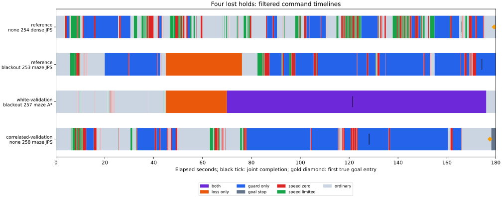

# 平滑化で残った未完了例と保持喪失4組の診断

[移動補償した平滑化の比較](../motion-filter/report.md)で保持を失った4組のうち、2組は最初の目標進入が177.60秒・179.36秒で、残り時間が足りませんでした。残る2組は目標へ入らず、末尾30秒にも長い待機があります。相関ノイズの新規未完了30例では、19例が末尾30秒の移動0.1未満でした。再発動を減らしても、到着の遅れや長い復帰待機は残っています。

今回は前回の記録を使う事後診断です。制御・閾値・シードを変更せず、新しい性能評価や追加の走行実験も行っていません。

## 対象

既知シード253〜255と新規256〜258について、従来の `joint` が保持し、`filtered` が保持しなかった全4組を対象にしました。さらに、新規シード・相関1秒ノイズの `filtered` の時間切れ全30例を調べています。1例が重なり、候補33軌跡と、4組の成功した従来軌跡が対象です。

4組の待機比較は、各組の従来群の成功時刻に揃えました。末尾の診断は、候補の150秒を超え180秒までの指令区間が対象です。待機は欠落待機またはガードの和集合で、重なりは1回だけ数えます。

| ノイズ・欠落 | seed・地図・計画器 | 従来の成功時刻 | 同時刻までの従来の待機 | 同時刻までの平滑化の待機 | 初回目標進入 |
|---|---|---:|---:|---:|---:|
| 既知・相関1秒・なし | 254・dense・JPS | 166.14秒 | 47.80秒 | 49.50秒 | 179.36秒 |
| 既知・相関1秒・45〜75秒欠落 | 253・maze・JPS | 174.34秒 | 88.28秒 | 125.88秒 | なし |
| 新規・独立・45〜75秒欠落 | 257・maze・A* | 121.44秒 | 46.50秒 | 76.46秒 | なし |
| 新規・相関1秒・なし | 258・maze・JPS | 128.16秒 | 42.58秒 | 59.74秒 | 177.60秒 |

全4組で共通時刻までの待機は増えていますが、この差だけで到着時刻の差を説明したものではありません。分岐後の経路、速度、観測、目標停止も異なります。

黒線は従来群の成功時刻、金の菱形は候補の最初の真の目標進入です。色は候補の指令区間を表し、車体が静止していた時間とは異なります。状態の優先順は欠落＋ガード、欠落のみ、ガードのみ、目標停止、速度上限0、速度制限、通常です。

## 到着が遅かった2組

既知・相関1秒・none・seed254・dense・JPSは179.36秒に初めて目標へ入りました。終了時の真の目標距離は0.09855ですが、速度は0.10031で、連続保持は0秒でした。新規・相関1秒・none・seed258・maze・JPSは177.60秒に入り、終了距離0.01640、速度0.000139、保持1.20秒でした。

元のシミュレータは、最初に条件を満たした端点でも0.02秒を保持時間へ加算します。この仕様を含めた理想的な保持時間の上限は `180 − 初回進入時刻 + 0.02` です。上の2例では最大0.66秒・2.42秒で、停止や観測を理想化しても、当該の初回進入時刻のまま10秒を満たすことはできません。170.02秒の進入なら理想上は10秒、170.04秒なら9.98秒となる境界もテストしています。

## 目標に入らなかった保持喪失2組

既知・相関1秒・blackout・seed253・maze・JPSの末尾30秒は、ガード待機23.70秒、移動1.29445でした。新規・独立・blackout・seed257・maze・A*では欠落待機とガードの重なりが26.14秒、移動1.13668でした。後者は窓内で同時復帰に必要な連続1秒へ達し、終了前に動き始めていますが、目標距離9.91のまま時間切れです。両例を「最後まで完全に静止していた」とは分類していません。

## 相関ノイズの新規未完了30例

この30例に接触はなく、すべて180秒の時間切れでした。分類は初回進入を先に見て、未進入例だけを末尾30秒の移動で分けています。

| 分類 | 件数 / 30 |
|---|---:|
| 初回目標進入が遅く、理想の保持時間も10秒未満 | 2 |
| 未進入、末尾移動0.1以上 | 9 |
| 未進入、末尾移動0.1未満 | 19 |

遅い2例は、none・seed256・dense・A*（初回173.92秒、最大保持6.10秒）と、上のnone・seed258・maze・JPSです。

移動0.1未満の19例は、終了時にすべてガードが有効で、14例は欠落待機も有効でした。19例のうち17例は末尾30秒をすべて待機に使っています。欠落待機も有効な14例では、この窓内で同時復帰の全条件を連続して満たした最長時間は最大でも0.70秒で、必要な1秒に達していません。ガードだけの5例には同時復帰タイマーの説明を適用しません。

さらに19例中17例では、終了時の真の中心距離が、その時点のノイズ尺度で観測年齢0としたガード解除の最小余裕以下でした。同じ17例は復帰直線の最小余裕以下でもあります。全予測は始点を含むため、真姿勢を仮に使ったとしても、この位置から予測距離がそれらの余裕を超えることはできません。これはオフラインの必要条件で、実際の観測側の判定や停止原因を真値へ置き換えたものではありません。

前回、従来群が接触し平滑化群が時間切れとなったrandom・seed258・maze・JPSもこの19例に含まれます。候補の終了中心距離は0.75634、ガード解除の最小余裕は0.83284、復帰の最小余裕は0.88284で、末尾30秒はすべて待機でした。接触回避と、その位置から復帰できることは別の条件です。

## 速度プローブにも平滑化姿勢を使う局所計算

確認地点では、速度上限を調べる弧の姿勢だけを既存の平滑化姿勢へ置き換え、操舵と距離余裕は維持しました。速度上限が変わった場合は、新しい予定速度で停止予測を計算し直しています。現在の速度0での予測が通るだけで、正の速度へ復帰できるとは扱っていません。

末尾の237確認地点のうち、欠落待機中に速度上限が0から正になる地点は4か所ありました。しかし4地点すべてで復帰直線の距離条件が残り、うち2地点では観測年齢とサンプル数も不足していました。全237地点で、全同時復帰条件を新たに満たす地点は0でした。

確認地点は、静止中で観測年齢0.5秒の時点、窓内の最初の静止した速度上限0の待機、ガード・欠落待機からの全解除、最終判断を選んだものです。時刻の無作為標本や全ステップの置換ではなく、件数を時間割合に変換できません。瞬間的に条件を満たしても連続1秒の確認は別に必要で、今回は制御を変えた軌跡も再生成していません。

今回の確認では、速度プローブの姿勢を揃えるだけで復帰する根拠は得られませんでした。次の候補は、平滑化を保ちつつ、停止前から復帰に必要な距離を保てるかを調べる案です。一律の余裕拡大は以前の比較で保持を減らしているため、再発動・待機・保持を合わせて評価する必要があります。

## 検証と再実行

候補33軌跡と従来4軌跡の326,504物理区間を照合しました。全候補の平滑化を独立した座標系アンカーで再構成し、両群のガード状態・同時復帰タイマーも再構成しています。237地点で実際の停止予測と速度プローブを正確な幾何で検証し、姿勢を置換した速度プローブ、その指令による推定姿勢・真姿勢の停止予測も計算しました。真姿勢は診断にのみ使っています。

保存済みの走行要約・シミュレータ・シード・入力経路と照合し、生軌跡、解析コード、ヘルパーのハッシュを [sources.json](sources.json) に記録しました。解析の再実行で全CSVと実行情報のバイト単位の一致を確認しています。保持時間の端点、分類境界、指令区間の時刻、姿勢置換の幾何の新しい5テストと、再利用する区間・幾何の既存14テストが通過しました。

[READMEの手順](../../README.md#diagnose-remaining-motion-filter-timeouts)で再実行できます。[lost-pairs.csv](lost-pairs.csv) は4組の共通時刻比較、[timeout-cases.csv](timeout-cases.csv) は33例の分類と状態、[summary.csv](summary.csv) は新規相関30例の分類、[checkpoints.csv](checkpoints.csv) は幾何と局所置換、[timeline.csv](timeline.csv) は図の指令区間です。

結果を使って選んだ失敗群の事後診断であり、改善効果や全体の失敗率の推定ではありません。相関ノイズ下に残る問題は短い再発動だけでなく、到着の遅れ、長い待機、復帰余裕を下回る停止位置にも分かれています。
