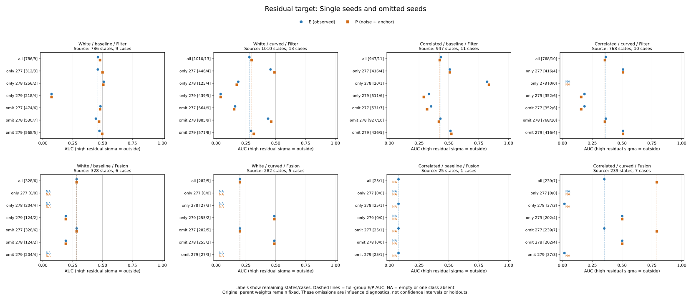
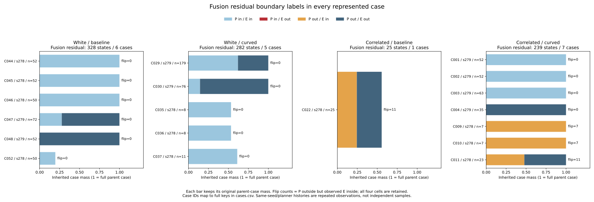
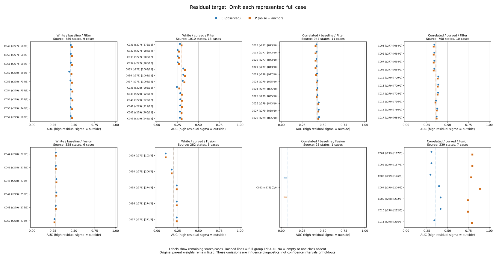
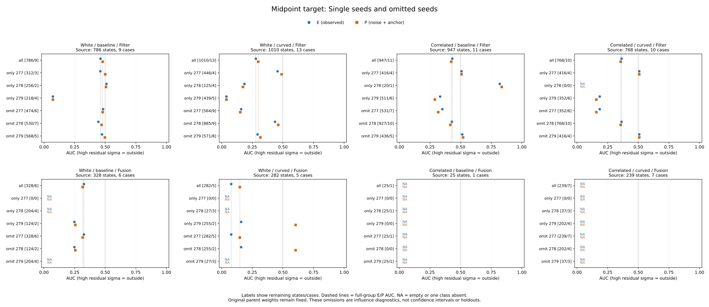
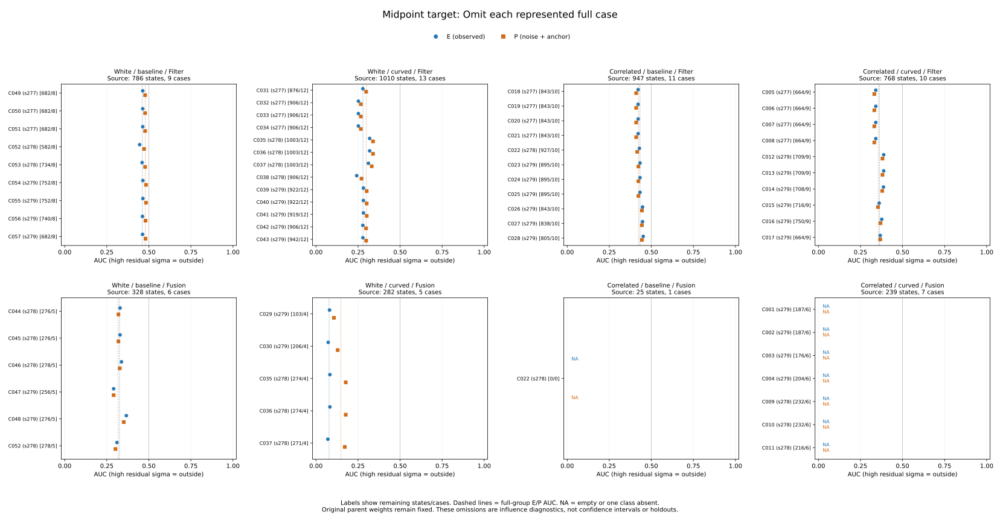

# Additional-seed case and seed influence

The previous **.792 P-only residual AUC** in curved-correlated Fusion depends
on mixing seed streams. All **25 P-outside/E-inside states** come from seed 278,
random loss on dense_50x50, across three planners. Its P labels are all outside,
so seed 278 alone has **undefined P AUC**. Seed 279 has no label changes and
E/P AUC **.501**; seed 277 has no Fusion records on this audit selection.
The combined .792 is neither a within-seed replication nor an estimator repair.

## Fixed scope and weights

The [protocol](protocol.md) was committed as **12c30ae** before computing the
case/seed outcomes, after main 8ca2c17. Collector/tests are **8aba287** and
plots/reproduction **01f11a9**. The earlier aggregate outcomes were already
observed; this is retrospective diagnosis, with no new simulation, raw replay,
fit, score reversal, threshold selection or controller change.

The adapter reconstructs all **13,155 simultaneous references at 4,385 states**.
This follow-up fixes Recovery/Preview, all event kinds together, all_available,
both midpoint/residual targets, all three original scores and all original
strata plus fallback and pooled all. That yields **8,770 boundary-trace rows**
and 57 represented full-case keys. Other views, event-kind conditions and
budgets retain their previous saved results outside this bounded analysis.

Weights are **1/n_case over the full parent noise/arm/view group**, before mode
conditioning. Single/omitted case and seed subsets carry those weights unchanged.
Mixed cases can have mode mass below one. Every seed 277/278/279 is explicit,
including empty subsets and omissions that leave the data unchanged. Full case
IDs map to cohort/arm/loss/seed/map/planner in `cases.csv`.

E is the observed error, P=noise+anchor and U=drift+transport, so E=P+U in the
saved frame. Preserve signed cross energy in |E|²=|P|²+|U|²+2P·U. Norm >.10 m
is outside; the closed disk is inside. Arithmetic removal of U changes the
diagnostic target label; these true components are unavailable to an online
predictor. AUC keeps the high-score=outside direction, 1e-8 m score ticks and
half credit for ties. Empty or one-class AUCs stay undefined.

## Where the curved-correlated boundary changes occur

All seven cases below are correlated curved Fusion residuals. Counts are raw
states; case masses are one in this particular group. E/P outside fractions
use the inherited weights, not the fraction of all 239 raw rows.

| Case | Seed / loss / map / planner | States | E outside | P outside | P outside / E inside |
|---|---|---:|---:|---:|---:|
| C001 | 279 / blackout / dense_50x50 / A* | 52 | 0 | 0 | 0 |
| C002 | 279 / blackout / dense_50x50 / JPS | 52 | 0 | 0 | 0 |
| C003 | 279 / blackout / dense_50x50 / Theta* | 63 | 0 | 0 | 0 |
| C004 | 279 / blackout / maze_50x50 / A* | 35 | 35 | 35 | 0 |
| C009 | 278 / random / dense_50x50 / A* | 7 | 0 | 7 | 7 |
| C010 | 278 / random / dense_50x50 / JPS | 7 | 0 | 7 | 7 |
| C011 | 278 / random / dense_50x50 / Theta* | 23 | 12 | 23 | 11 |

Thus the 25 switching rows are **10.46% of raw states but 35.40% of inherited
case mass**. There are no opposite P-inside/E-outside crossings in these cases.
Their weighted E outside fraction is 21.74%, versus P 57.14%.

The source-event and time traces are narrowly localized:

| Case | Source event ID | Switching states | Saved state-time span (s) |
|---|---:|---:|---:|
| C009 | 3674 | 7 | 175.16–175.28 |
| C010 | 3688 | 7 | 175.16–175.28 |
| C011 | 3702 | 11 | 175.16–175.48 |

Across those rows, E norms are **9.9069–9.9908 cm**, P norms
**10.1639–10.2752 cm**, and U norms **.4037–.5067 cm**. Signed P/U cross energy
is negative, **-6.1054 to -5.3519 cm²**. A small component cancels enough of P
to cross the .10 m boundary. The trace retains every other state and both
targets, full event/case joins, all three ticks, vectors, margins and labels.
Repeated nearby states or planner variants do not supply independent evidence.

## Why the combined P AUC is high

For curved-correlated Fusion residual-sigma:

| Scope | States / cases | E AUC | P AUC |
|---|---:|---:|---:|
| All available | 239 / 7 | .351269 | .791564 |
| Only seed 277 | 0 / 0 | NA | NA |
| Only seed 278 | 37 / 3 | .017544 | NA |
| Only seed 279 | 202 / 4 | .501320 | .501320 |
| Omit seed 277 | 239 / 7 | .351269 | .791564 |
| Omit seed 278 | 202 / 4 | .501320 | .501320 |
| Omit seed 279 | 37 / 3 | .017544 | NA |

Every single-case P AUC is undefined: each of the seven cases has only one P
class. Only C011 has both observed E classes, with single-case E AUC .090909.
The combined P AUC consists entirely of **between-case comparisons**.

Sum ordered positive-case/negative-case numerators and denominators before
division. The P comparison denominator is 4 positive case-mass units × 3
negative units = **12**. It decomposes by seed as follows:

| Positive seed / negative seed | Numerator | Denominator | Block AUC | Share of denominator |
|---|---:|---:|---:|---:|
| 278 / 279 | 7.994811 | 9 | .888312 | 75% |
| 279 / 279 | 1.503960 | 3 | .501320 | 25% |
| 278 / 278 or 279 / 278 | 0 | 0 | NA | 0% |

Hence **.75×.888312 + .25×.501320 = .791564**. The .792 value largely compares
the seed-278 all-outside P population with seed-279 inside records. It does not
show that sigma orders P errors well within seed 278, where no inside class
exists. Even within seed 279, these are between-case, not within-case, pairs.

The observed E AUC also mostly uses between-case comparisons: their denominator
is **8.086957**, versus **.249527** for same-case comparisons, or 97.01% versus
2.99% of comparison mass. Case-pair entries preserve numerator, denominator,
concordant/tied/discordant mass and zero-class support for every score/target.
Block AUCs must not be averaged without their comparison denominators.

## Case omissions and other populations

Omitting any one of the seven curved-correlated Fusion cases leaves P AUC
between **.743216 and .888312** and E AUC between **.293964 and .415034**.
That stability to one case does not remove dependence on the seed mixture:
omitting the three seed-278 cases together returns E=P=.501320. Omitting all
seed-279 cases leaves P AUC undefined. These ranges are finite influence
diagnostics, not confidence intervals or fresh validation.

The other Fusion residual groups retain important missing support:

| Noise / arm | Only seed 278: states / cases, E AUC / P AUC | Only seed 279: states / cases, E AUC / P AUC |
|---|---|---|
| White / baseline | 204 / 4, NA / NA | 124 / 2, .192308 / .192308 |
| White / curved | 27 / 3, NA / NA | 255 / 2, .488376 / .488376 |
| Correlated / baseline | 25 / 1, .077922 / NA | 0 / 0, NA / NA |
| Correlated / curved | 37 / 3, .017544 / NA | 202 / 4, .501320 / .501320 |

Seed 277 has no Fusion records in all four cells under the original narrow
audit selection. White Fusion residual E/P labels never switch; all seed-278
white Fusion residuals are inside for both labels. Correlated-baseline switches
are all in **C022**, seed 278/random/maze_50x50/JPS, linked to event **3709** at
175.16–175.48 s. Its 11 switches out of 25 states carry **11/45** parent-case
mass, within Fusion mass **25/45**; reweighting this mode to a full unit case
would change comparisons against other cases in pooled results.

Both correlated Fusion midpoint E/P populations have only outside labels,
including every case/seed subset; their AUCs remain undefined. U alone stays
inside the disk throughout this scope, so all of its AUCs are also undefined.
Filter and midpoint influence results, including empty seed/mode populations,
remain in the full tables and the following figures.

## Validation and reproduction

All **40 complete-group component rows** and **360 complete-group ranking
rows** reproduce the preceding saved tables on this scope: **2,920 field
comparisons**. The complete outputs contain **756 component subset rows**,
**6,804 ranking subset rows** and **25,434 ordered case-pair rows**, including
empty/one-class and zero-comparison cells.

Python **527 tests pass**, including 11 new tests for score direction/ties,
unequal inherited weights, mixed modes, all three seeds, empty omissions,
full-case IDs, exact pair-mass decomposition, absent classes, defined AUC
differences and signed cancellation at the closed boundary. Both aggregation
runs match byte for byte across all **12 artifacts**. Both plot runs match
across **five SVGs, five PNGs, three numeric CSVs and plot provenance**; all five
figures were inspected. The CSVs expose **224 seed-AUC, 248 case-AUC and 19
boundary plot records**, with undefined entries retained.

A separate script imports no experiment/analyzer modules. It reconstructs the
4,385 focus states using NumPy vectors, independently preserves parent weights
and labels, calculates weighted AUC by direct positive/negative comparisons,
checks all subset metrics and case-pair blocks, and verifies all plotted values
and source hashes. **1,409,846 comparisons pass**, covering **2,868 defined AUCs**
and all undefined entries. Its fingerprint and evidence are saved in
`independent-verification.json`; the script remains in the scratch directory.

Use the [README commands](../../README.md#additional-seed-case-and-seed-influence)
to reproduce from tracked files. Protocol/input/helper bytes are pinned in
`sources.json`; accounting, support, all 3,997 opportunities, all 101/94 links
and both cutoff tables are copied unchanged. All **972 cases**, including the
324 additional cases and 202 additional timeouts, remain accounted for.
Analysis/replay/PNG/logs/independent script stay under
`/workspace/scratch/fresh-seed-case-influence`; portable CSV/JSON/SVG and this
report are saved here. Additional live outcomes remain **62 -> 60**. No new
seed streams, policy improvement, causal effect or real-world calibration claim
is supported by these repeated selected histories.
