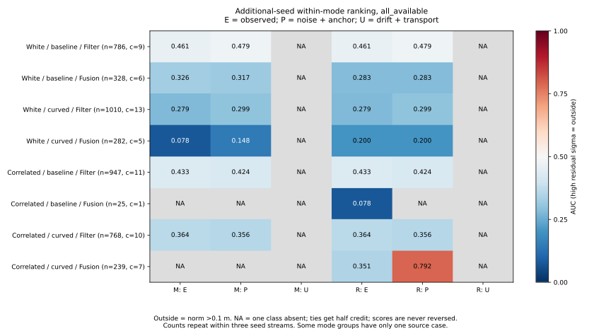
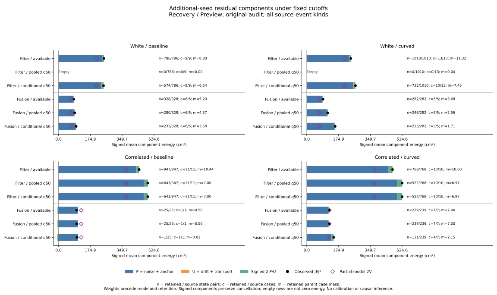
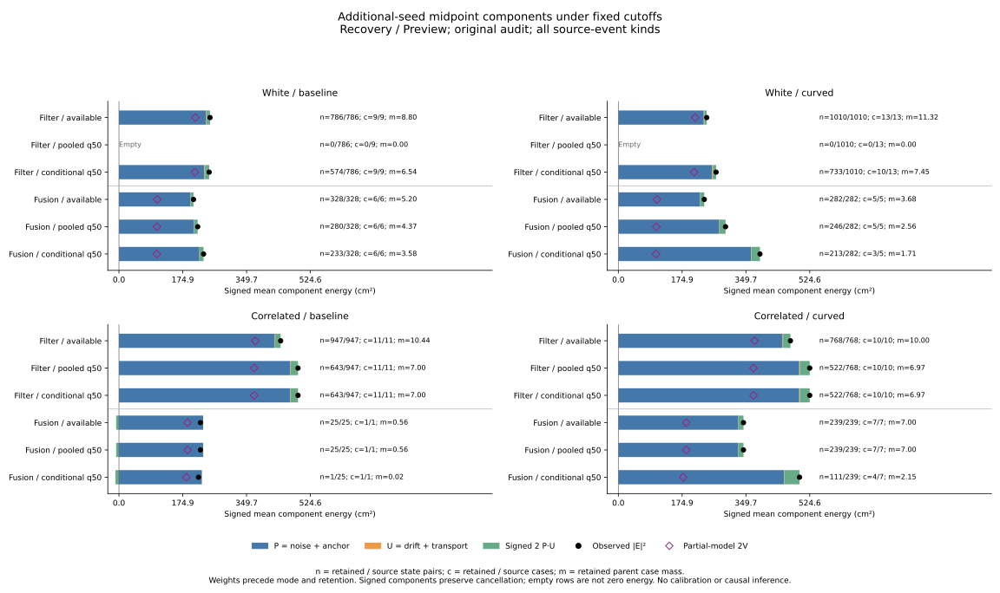

# Additional-seed components and fixed-direction rankings

Small omitted components can substantially change the .10 m boundary labels.
In additional-seed **correlated curved Fusion residuals**, drift-plus-transport
RMS is only **.501 cm**, but arithmetic removal changes the outside fraction
from **21.74% to 57.14%** and the fixed residual-sigma AUC from **.351 to .792**.
That differs from the preceding historical-cohort component result. It is a
saved-frame diagnostic, not a revised estimator or improved live controller.

The effect is not uniform. White Fusion residual labels do not change at all
under that removal: AUC stays **.283 / .200** in baseline/curved. Correlated
baseline Fusion has only **25 states from one case**; its P-only labels are all
outside, leaving that diagnostic AUC undefined.

## Fixed scope and reconstruction

The [protocol](protocol.md) was committed as **fda641e** before computing these
component outcomes; collector/tests are c2919e1 and plots/reproduction bc75984.
The source cutoff outcomes and support were already observed. This is
**retrospective component diagnosis**, with no untouched-validation claim,
simulation, raw replay, fitting, score reversal or threshold selection.

Use all **13,155 simultaneous pair references at 4,385 states**, in 57 cases
linked to 104 received opportunities from seeds 277/278/279. The three views
share states and both abstract targets share source inputs. Keep all 972
accounting cases, including 324 additional cases/202 additional timeouts, all
3,997 historical+additional opportunities and all 101/94 additional loss links.
Original audit selection, support and recorded live outcomes remain unchanged.

Each raw/recovery/preview pose contributes its saved 2D noise, anchor, drift
and transport vectors. Apply midpoint weights (.5,.5) or the saved residual
weights, including negative coefficients, to each component. Every reconstructed
target matches its saved vector/norm/outside label; all saved residual component
vectors match exactly. Inputs retain full case/state/time/event/estimator joins.

Let P=noise+anchor and U=drift+transport, so E=P+U in the recorded frame:

`|E|² = |P|² + |U|² + 2 P·U`.

All four component energies, six signed cross terms and this P/U identity are
preserved. The partial-model reference **2V** is two-axis model energy, while P
is the observed realization of noise plus anchor. Neither is substituted for
the observed E label. Norm >.10 m means outside; the closed .10 m disk is inside.
Component removal is arithmetic on saved vectors, not a counterfactual rollout
or an online predictor with access to these true error components.

## Additional-seed Fusion residuals

These are Recovery/Preview, all_available, all event kinds. **RMS values are
two-dimensional cm**; the model reference is sqrt(mean(2V)), not its per-axis
cutoff sigma. Parent case weights are computed before conditioning on mode.

| Noise / arm | State pairs / cases | E RMS | P RMS | U RMS | Partial-model RMS | E energy / 2V |
|---|---:|---:|---:|---:|---:|---:|
| White / baseline | 328 / 6 | 9.139 | 8.997 | .491 | 8.343 | 1.200 |
| White / curved | 282 / 5 | 9.473 | 9.278 | .479 | 8.354 | 1.286 |
| Correlated / baseline | 25 / 1 | 9.996 | 10.271 | .478 | 11.171 | .801 |
| Correlated / curved | 239 / 7 | 11.127 | 10.968 | .501 | 11.159 | .994 |

Filter residual RMS is **15.798 / 15.564 cm** in white baseline/curved and
**21.051 / 21.720 cm** in correlated baseline/curved; its U RMS is
**1.137 / 1.183 / 1.053 / 1.201 cm** in that order. The larger Filter errors
persist in the observed P components. Near-unit aggregate energy ratios do not
establish ranking quality or calibration in these selected repeated states.

## Boundary changes and ranking

The fixed score direction is high sigma = outside, using the original 1e-8 m
ticks and half credit for ties. AUC is blank when either class is absent. For
Recovery/Preview residual-sigma, all_available:

| Noise / arm / mode | Midpoint E AUC | Midpoint P AUC | Residual E AUC | Residual P AUC |
|---|---:|---:|---:|---:|
| White / baseline / Filter | .461 | .479 | .461 | .479 |
| White / baseline / Fusion | .326 | .317 | .283 | .283 |
| White / curved / Filter | .279 | .299 | .279 | .299 |
| White / curved / Fusion | .078 | .148 | .200 | .200 |
| Correlated / baseline / Filter | .433 | .424 | .433 | .424 |
| Correlated / baseline / Fusion | NA | NA | .078 | NA |
| Correlated / curved / Filter | .364 | .356 | .364 | .356 |
| Correlated / curved / Fusion | NA | NA | .351 | .792 |

U alone is inside the .10 m disk for **every source pair and both targets**,
so all of its diagnostic AUCs remain blank. A small U can still change whether
the sum E crosses the boundary. In Fusion residuals:

| Noise / arm | E outside | P outside | P outside but E inside: rows / inherited mass fraction |
|---|---:|---:|---:|
| White / baseline | 33.14% | 33.14% | 0 / 0% |
| White / curved | 33.58% | 33.58% | 0 / 0% |
| Correlated / baseline | 56.00% | 100.00% | 11 / 44.00% |
| Correlated / curved | 21.74% | 57.14% | 25 / 35.40% |

The opposite crossing (P inside but E outside) is zero in these four residual
groups. The 25/239 curved-correlated rows are 10.46% of raw rows, but 35.40% of
inherited case mass: giving rows or retained cases new equal weights would
change the diagnostic. The full tables retain both crossing directions and
all four E/P label combinations for every target/view/score/budget.

Mean signed P/U cross energy is **-5.806 cm²** in correlated baseline Fusion
residuals and **+3.252 cm²** in correlated curved Fusion residuals. The latter
can have a positive mean cross term while individual near-boundary records
undergo cancellation. Its total E RMS is slightly above P RMS even though its
outside fraction is lower. Dropping signed cross terms or assuming monotonic
benefit from component removal would lose these behaviors.

Both correlated Fusion midpoint groups have all E/P labels outside, so their
AUCs are undefined. The one-case correlated-baseline residual P labels also
have no inside class. Those are missing comparisons, not measured zero or .5
AUC. The curved residual P-only AUC does not establish a general score repair:
its target label changed, the true components are unavailable online, and its
seven selected cases are neither independent time samples nor new seed streams.

## Fixed selection and the high-error Filter additions

Use both original rules with no refit: 72 simultaneous pooled rules from the
unchanged 264-row pooled table, plus all 216 conditional rules. All budgets,
scores, views, event kinds and strata remain in the complete tables. Within
each parent noise/arm/event-kind/view group, 1/n_case weights precede both
stratification and retention; energies normalize by retained mass. Retained
cases do not receive new unit weights.

For the fixed residual-sigma q50 rule, pooled selection retains no white Filter
records. Conditional selection adds the following Filter populations:

| White arm | Retained pairs | E RMS cm | P RMS cm | U RMS cm | E outside | P outside |
|---|---:|---:|---:|---:|---:|---:|
| Baseline | 574 | 15.725 | 15.301 | 1.306 | 80.96% | 78.05% |
| Curved | 733 | 16.369 | 16.024 | 1.444 | 84.12% | 81.80% |

Arithmetic removal of U leaves those added populations' outside fractions
high. This describes the saved components behind the preceding cutoff result;
it does not identify a causal mechanism or justify changing the controller.

Fusion retention also changes: pooled -> conditional q50 keeps **280 -> 233**
white-baseline and **246 -> 213** white-curved pairs, **25 -> 1** correlated-
baseline pairs and **239 -> 111** correlated-curved pairs. The conditional
correlated-baseline Fusion component row is just one state from one case,
with parent mass .02222. Figures expose the source/retained counts and masses
and keep empty Filter retention visible. Ranking is evaluated on all_available
records, not on these tiny retained subsets.

## Validation and reproduction

The 13,155 reconstruction audits cover **26,310 target vectors**. Maximum vector
closure is **2.434e-14 m**; maximum residual component discrepancy is **0**.
All saved observed labels and score ticks are preserved. All **17,280 component
summary rows** match preceding retained counts/cases/masses/coverage, observed
outside rows/mass/fraction and RMS for both methods/targets: **224,640 field
comparisons**, with maximum numerical discrepancy **2.776e-17**.

Python **516 tests pass**, including 11 new adapter regressions for negative
saved weights/cancellation, missing or duplicate pair/pose support, full-case
joins, event/estimator mismatches, fixed labels/ticks, parent weights, unsupported
conditional fits, empty retention, fixed AUC direction, ties and one-class AUCs.
The existing component identity tests remain part of the suite.

Both aggregation runs match byte for byte across all **10 artifacts** (nine
CSVs plus provenance). Both plot runs match across three SVGs, three PNGs, two
numeric CSVs and plot provenance; all three figures were inspected. The two
numeric series contain all **48 energy and 48 AUC plot values**, including NA.

A separate script with no analyzer imports independently reconstructs target
energies with NumPy vectors, uses integer common-denominator parent weights,
and evaluates AUC with direct weighted positive/negative pair comparisons.
It checks all summary rows, 2,160 ranking rows, all 708 defined AUC values,
undefined classes, copied sources/cutoffs and all plotted values/hashes:
**1,061,040 comparisons**. Its fingerprint and evidence are preserved in
`independent-verification.json`.

Use the [README commands](../../README.md#additional-seed-error-components-and-fixed-direction-rankings)
to reproduce from tracked files; raw histories and Rust builds are unnecessary.
Inputs, helper/protocol bytes and inherited validation scope are pinned in
`sources.json`. Analysis/replay outputs, PNGs, logs and the independent script
remain under `/workspace/scratch/fresh-seed-components`; portable CSV/JSON/SVG
artifacts and this report are saved here. Live outcomes remain **62 -> 60**.
Repeated selected records from three additional seed values support these
finite diagnostics, not confidence intervals, causal attribution or real-world
calibration claims.
