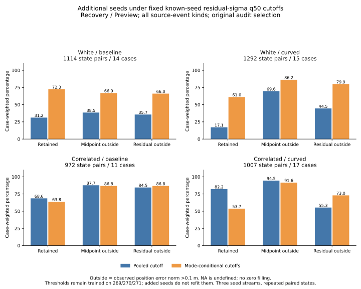
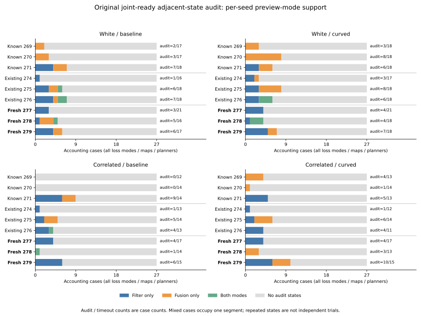

# Fixed cutoffs on additional seeds under the original audit selection

The additional seeds supply Filter audit cases beyond the original seed 271,
but the original selection still produces sparse and uneven mode support.
Seed **277 supplies no selected Fusion states** in either noise or arm;
seed **278 supplies no selected Filter states in correlated curved**. The
preceding broad immediate-event census had both modes in every one of those
seed/noise/arm cells. The different selection matters even on identical raw
histories.

For the prespecified Recovery/Preview residual-sigma **q50** comparison,
mode-conditional cutoffs have a **higher retained residual-outside fraction
in all four noise/arm groups** than the pooled cutoff. White-noise coverage
increases; correlated-noise coverage decreases. Midpoint outcomes differ:
conditional midpoint-outside fractions decrease slightly in correlated noise.
These are descriptive, target-specific results under immutable rules.

## Scope and fixed protocol

The [protocol](protocol.md) was committed as **b428e78** before computing these
narrow-audit outcomes. Collector/tests are 7c904e2, original-parameter noise
correlation reconstruction is 14061a2, and plotting/reproduction is b5c009d.
No threshold is fitted or changed. Both final aggregation runs use the same
collector and unchanged helpers.

Seeds 277/278/279, their 324 live trajectories and broad mode census were
observed in the preceding study. This is a prespecified application of the
original audit to those preserved records, not a claim of untouched validation
for the entire dataset. There is no new simulation or controller change.
The original known Filter training cases remain concentrated in 271; additional
records do not enter the training set in this study.

For every timeout opportunity at logged 150--180 s, examine adjacent decisions
from offset -1 through immediate to +75 intervals, clipped at 180 s. Select both
endpoints when at least one is on the joint route with active_ready true. Union
states within case/time and preserve all source events attached by selected
transitions. Do not condition on observed error, score, mode or raw zero loss.
Decision inputs use physical truth from the preceding row.

| Population | All cases | Timeouts replayed | Cases with selected states | Selected states | Simultaneous pairs |
|---|---:|---:|---:|---:|---:|
| Historical 269/270/271 and 274/275/276 | 648 | 368 | 100 | 6,610 | 19,830 |
| Additional 277/278/279 | 324 | 202 | 57 | 4,385 | 13,155 |
| Combined accounting | 972 | 570 | 157 | 10,995 | 32,985 |

The saved score/pose/projection files contain the additional records; historical
records are reconstructed and checked against their existing artifacts. All
972 cases remain in accounting and support tables. The additional cohort has
145 timeouts and 122 non-timeouts without selected audit states, rather than
267 missing cases. Its selected states refer to **104 received opportunities**;
all 1,414 broad opportunities, including 252 misses, remain in `events.csv`.
The absence of selected missed-event states follows from the fixed selection.

There are 4,228 additional selected adjacent transitions and **101 raw-zero
loss links**, 94 command-only. Links are post-phase joint_lost transitions with
speed_cap_zero; mask 16 identifies command-only links. The three simultaneous
views share states and loss references, so their 13,155 rows are not independent
new observations.

## Mode support by additional seed

The table pools loss modes/maps/planners within a seed/noise/arm cell. Each
cell has 27 accounting cases. `Audit / timeout` reports distinct cases, while
Filter/Fusion state counts refer to Recovery/Preview. Filter/Fusion case counts
overlap for mixed cases and must not be added without subtracting that overlap.

| Noise | Seed | Arm | Audit / timeout cases | Filter / Fusion states | Filter / Fusion cases | Mixed cases |
|---|---:|---|---:|---:|---:|---:|
| White | 277 | Baseline | 3 / 21 | 312 / 0 | 3 / 0 | 0 |
| White | 277 | Curved | 4 / 21 | 446 / 0 | 4 / 0 | 0 |
| White | 278 | Baseline | 5 / 16 | 256 / 204 | 2 / 4 | 1 |
| White | 278 | Curved | 4 / 18 | 125 / 27 | 4 / 3 | 3 |
| White | 279 | Baseline | 6 / 17 | 218 / 124 | 4 / 2 | 0 |
| White | 279 | Curved | 7 / 18 | 439 / 255 | 5 / 2 | 0 |
| Correlated | 277 | Baseline | 4 / 17 | 416 / 0 | 4 / 0 | 0 |
| Correlated | 277 | Curved | 4 / 17 | 416 / 0 | 4 / 0 | 0 |
| Correlated | 278 | Baseline | 1 / 14 | 20 / 25 | 1 / 1 | 1 |
| Correlated | 278 | Curved | 3 / 13 | 0 / 37 | 0 / 3 | 0 |
| Correlated | 279 | Baseline | 6 / 15 | 511 / 0 | 6 / 0 | 0 |
| Correlated | 279 | Curved | 10 / 15 | 352 / 202 | 6 / 4 | 0 |

Across the additional cohort, Filter has **3,511 states in 43 cases**, Fusion
has **874 states in 19 cases**, and **5 cases** use both modes. Thus the case
union is 43+19-5=57. All three additional seed values supply some Filter cases
under this selection, while several evaluation cells lack Fusion or Filter.
The existing shared known-seed cutoffs remain defined for both preview modes;
an empty evaluation mode is distinct from missing training support.

All selected actual-recovery inputs are recovery_mean, reproducing the original
audit's input kind. The new recovery_fallback_single stratum is explicitly
reported but empty. There are no unsupported populated conditional groups:
the 4,320-row grid contains **768 populated/complete and 3,552 empty rows**.
Empty fractions remain blank. The fallback rule would leave a whole conditional
group undefined if it were represented without a training fit; all_available
would still retain all available records.

## Immutable cutoffs and primary outcomes

The **72 simultaneous pooled and 216 conditional rules used here** retain
their original bytes and known-seed training provenance. The copied pooled
table has 264 rows: its 192 unused lagged rules remain to preserve the original
file fingerprint; no lagged pairs are evaluated here. Both arms share each rule.
The primary Recovery/Preview residual-sigma q50 cutoffs, in per-axis cm, are:

| Noise | Pooled | Filter | Fusion |
|---|---:|---:|---:|
| White | 5.916838 | 10.198039 | 5.899652 |
| Correlated | 13.610597 | 13.610597 | 7.877054 |

Observed outside labels use the two-dimensional midpoint/residual error norm
>.1 m; equality at .1 m remains inside. Score quantization is the original
1e-8 m ties-to-even rule. Parent case weights are 1/n_case within each
noise/arm/event-kind/view group before stratification or retention, so each
case contributes total mass 1. Retained risks divide retained outside mass by
retained mass; they do not reweight retained cases or average subgroup risks.

Each table entry below is **pooled -> conditional**, in percent, all source
event kinds and all estimator strata:

| Noise / arm | State pairs / cases | Retained coverage | Midpoint outside among retained | Residual outside among retained |
|---|---:|---:|---:|---:|
| White / baseline | 1,114 / 14 | 31.18 -> 72.35 | 38.52 -> 66.86 | 35.66 -> 66.04 |
| White / curved | 1,292 / 15 | 17.09 -> 61.05 | 69.57 -> 86.23 | 44.53 -> 79.86 |
| Correlated / baseline | 972 / 11 | 68.65 -> 63.80 | 87.69 -> 86.75 | 84.45 -> 86.75 |
| Correlated / curved | 1,007 / 17 | 82.20 -> 53.69 | 94.50 -> 91.57 | 55.29 -> 72.99 |

In white baseline, the conditional rule adds 574 state pairs with parent case
mass 6.54384 and residual-outside fraction 80.96%; it removes 47 with mass
.78088 and outside fraction 21.21%. In white curved it adds 733 with mass
7.44798/outside 84.12% and removes 33 with mass .85368/outside 10.98%.
The widened Filter cutoff and slightly narrower Fusion cutoff retain different
populations, rather than supplying extra independent cases.

In correlated noise the Filter cutoff is unchanged, while the Fusion cutoff
shrinks. Baseline removes 24 pairs with mass .53333 and residual-outside 54.17%;
curved removes 128 with mass 4.84689/outside 21.96%. There are no conditional-only
pairs in either correlated primary group. Their residual-outside fractions rise
after removing those lower-risk records. Midpoint fractions move in the other
direction, so a claim about both targets improving or worsening is unsupported.

Across all three residual-sigma quantile budgets for this view, conditional
residual-outside fractions exceed pooled in **11 of 12 reporting cells**.
The exception is correlated baseline q25: coverage .61% -> 63.60%, with retained
residual-outside 100% -> 86.71%. These cells reuse the same underlying cases;
the count is not 12 independent trials. The complete CSV retains that exception,
all three scores, all budgets, both targets and every event-kind/stratum cell.
No cutoff or preferred method is selected from these outcomes.

## Reconstruction and validation

The historical regression reproduces all **6,610 states, 19,830 simultaneous
pairs and 6,912 original comparison rows**, including source-event unions,
estimator strata, every score tick/outside label and 550/509 loss references.
It performs **1,746,384 field comparisons**, with maximum model/error floating
discrepancy **0**. Exact historical comparison metrics match the saved values.
Noise correlation is reconstructed from the original tau parameter, rather
than using its rounded log representation.

| Cohort | Timeout histories | Replayed intervals | Selected states | Selected transitions |
|---|---:|---:|---:|---:|
| Known white | 106 | 954,000 | 1,890 | 1,731 |
| Known correlated | 80 | 720,000 | 547 | 524 |
| Existing-new white | 105 | 945,000 | 3,267 | 3,073 |
| Existing-new correlated | 77 | 693,000 | 906 | 859 |
| Additional white | 111 | 999,000 | 2,406 | 2,301 |
| Additional correlated | 91 | 819,000 | 1,979 | 1,927 |

Total replay covers **5,130,000 intervals** in all 570 timeout histories. Logged
window/fusion counts match throughout; selected actual/preview/motion poses
agree within 1e-8, with maximum discrepancy below 1.23e-9 m/rad. Sample/anchor
covariance, four-component closure, projection degeneracy and negative weights
use unchanged helpers. Physics/contact/live outcomes are inherited from the
previously verified trajectories; this offline analysis changes no rollout,
held-goal result or default setting.

Python **505 tests pass**, including 10 new checks for clipped/overlapping
event windows, joint-ready endpoint selection, frozen-window independence,
untrained fallback handling, parent weights, event unions, empty groups and
mixed/no-audit support. Both aggregation runs match byte for byte across all
12 artifacts. Both plot runs match across two SVGs, two PNGs, two numeric CSVs
and plot provenance; both figures were inspected.

An independent script with no analyzer imports performs **759,472 comparisons**
against saved projections, scores, labels, raw-zero links, immutable cutoffs,
all 4,320 comparison rows, case support, all 60 plotted values and input/helper
hashes. It derives case weights using integer common denominators before
stratification and retention, and checks both targets, RMS, overlaps and signed
deltas. Its source fingerprint and linked historical-source fingerprint are in
`independent-verification.json`.

Use the [README commands](../../README.md#transfer-the-fixed-cutoffs-under-the-original-audit-selection)
to repeat the study against the preserved raw paths. Source hashes, exact scope
and historical regression evidence are in `sources.json`. Raw histories, logs,
analysis/replay outputs, PNGs and the independent script are preserved under
`/workspace/scratch/fresh-seed-cutoff-transfer`. Portable CSV/JSON/SVG files and
this report are saved here. Results describe selected repeated states from
three additional seed streams; they do not establish causal sensor effects,
real-world calibration or a reason to change the controller/default.
