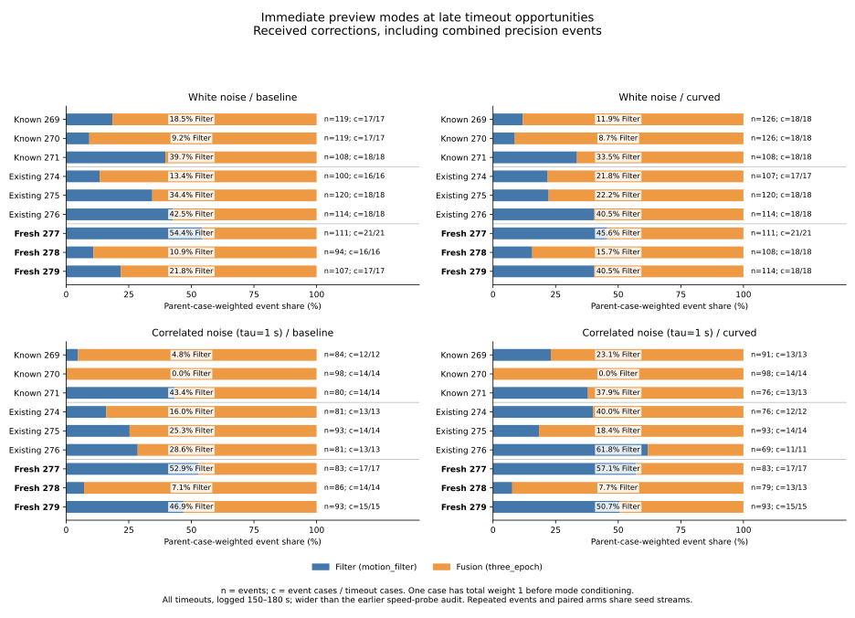
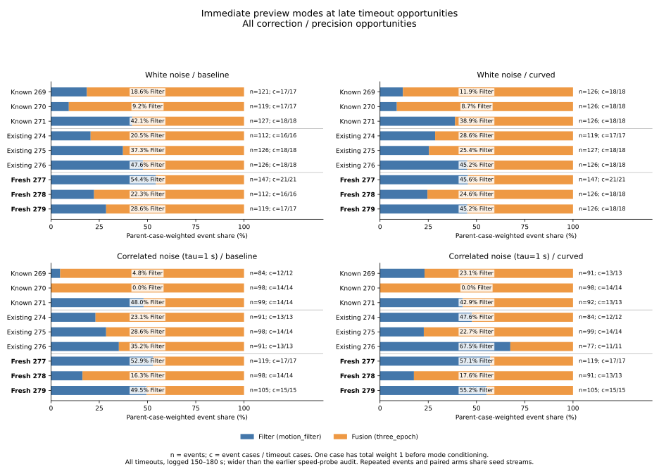

# Additional seeds and immediate timeout-mode support

All three additional seeds **277/278/279** supply both Filter and Fusion
preview records in each noise/arm group of the fixed late-timeout census.
Support remains uneven: among received corrections, correlated-noise Filter
case-weighted shares range from **7.14% to 57.14%** across these seed/arm cells.
These counts establish available records in this census; they do not validate
the earlier cutoffs or their retained-error behavior.

The fresh live comparison has **62 -> 60 held cases** out of 162 per arm,
with **2 gained and 4 lost holds** for curved relative to straight. No fresh
trajectory has a contact or leaves the map. The fixed controller has not been
changed in response to these results.

## Fixed collection and populations

The [protocol](protocol.md) was committed as **834dc0e** before generating any
new trajectories. Collector/tests were committed as f12aa36, reproduction/plots
as 092127e, and explicit audit-map/dependency pins as 3744772. The last edit
adds validation/provenance without changing the event selection or summaries.
Both final aggregation runs use that same final source.

Use the unchanged simulator SHA-256
`81711bb44ae1741c5f0e1f71180b047284bf098066f9b1246915130b094f9228`,
the padded fixtures and the previous fixed parameters. Cross the three new
seeds with tau=0/1 s, epoch/curved, none/random/blackout, three maps and three
planners: **324 trajectories, 162 pairs**. All runs finish; no seed or outcome
is replaced. Their raw provenance records protocol commit 834dc0e, a clean
tree and Rust 1.99.0. Raw trajectories plus runner artifacts occupy
**2,052,610,645 bytes**, excluding the deterministic-repeat copies.

| Population | Accounting trajectories | Timeouts in census | Immediate opportunities |
|---|---:|---:|---:|
| Historical 269/270/271 and 274/275/276 | 648 | 368 | 2,583 |
| Additional 277/278/279 | 324 | 202 | 1,414 |
| Saved combined accounting | 972 | 570 | 3,997 |

Non-timeouts stay in accounting and receive explicit no-event support rows.
The census samples every correction or precision activation at logged
150--180 s in every timeout, once immediately after update. It does not select
on gate readiness, movement, correction receipt, position error or release.
Decision inputs are compared with physical truth from the preceding row;
the final 180 s event is retained with truth time 179.98 s.

The new 1,414 opportunities are exactly seven scheduled events per timeout:
**1,162 received and 252 missed**. There are no late precision-only or combined
events in these new runs. Those categories remain explicit in the complete
summary grid. All 202 fresh timeouts have received events; none disappears
when reporting `received_any`. Actual inputs at those received events include
**544 raw fallbacks and 618 recovery means**; neither is dropped.

Three new seed values do not constitute 324 independent trials. Arms are
paired, maps/planners/noise and loss conditions reuse the prescribed seeds,
and events repeat within each trajectory. This is a fixed-simulator extension;
no confidence interval, causal correction benefit or real-world claim follows.

## Received-event mode support on every new seed

Filter is `motion_filter`; Fusion is `three_epoch`. Each cell pools the three
loss modes and all maps/planners while keeping noise, arm and seed separate.
Filter/Fusion case counts overlap when a case uses both modes. `Mixed` exposes
that overlap; their union equals `Cases`. Shares give each parent case total
weight 1 across its received events before conditioning on preview mode.

| Noise | Seed | Arm | Events Filter / Fusion | Cases | Filter / Fusion cases | Mixed | Filter weighted share |
|---|---:|---|---:|---:|---:|---:|---:|
| White | 277 | Baseline | 44 / 67 | 21 | 13 / 11 | 3 | 54.42% |
| White | 277 | Curved | 31 / 80 | 21 | 10 / 12 | 1 | 45.58% |
| White | 278 | Baseline | 7 / 87 | 16 | 6 / 16 | 6 | 10.94% |
| White | 278 | Curved | 13 / 95 | 18 | 7 / 17 | 6 | 15.67% |
| White | 279 | Baseline | 22 / 85 | 17 | 11 / 16 | 10 | 21.85% |
| White | 279 | Curved | 45 / 69 | 18 | 13 / 17 | 12 | 40.48% |
| Correlated | 277 | Baseline | 27 / 56 | 17 | 9 / 8 | 0 | 52.94% |
| Correlated | 277 | Curved | 32 / 51 | 17 | 13 / 8 | 4 | 57.14% |
| Correlated | 278 | Baseline | 4 / 82 | 14 | 4 / 14 | 4 | 7.14% |
| Correlated | 278 | Curved | 4 / 75 | 13 | 4 / 13 | 4 | 7.69% |
| Correlated | 279 | Baseline | 40 / 53 | 15 | 10 / 12 | 7 | 46.86% |
| Correlated | 279 | Curved | 46 / 47 | 15 | 13 / 12 | 10 | 50.67% |

Across the fresh received census there are **113 Filter cases, 156 Fusion
cases and 67 mixed cases**, giving 202 distinct cases. Event shares and case
shares differ. For white baseline, Filter has 73/312 events (23.40%) while its
parent-case-weighted share is 31.28%. Longer received-event histories therefore
must not silently receive more case weight.

The all-opportunity plot also retains misses. For example, seed 278 correlated
baseline has Filter weighted share 16.33% across all 98 events and 7.14% across
86 received events. These are different reporting populations, rather than
alternative fits of a selected threshold. All event-kind/loss-mode/per-seed
rows, including empty groups with blank fractions, remain in `summary.csv`.

## Why the old audit concentration cannot be transferred directly

The preceding seed-exclusion result concerns the **selected speed-probe audit
states**: every known Filter source case there comes from seed 271. This new
census includes all immediate late timeout events and does not reproduce that
narrow state selection, its component projections or its cutoff evaluation.
It also retains actual raw fallbacks. The populations must be kept distinct.

Recounting the historical data under this same wider definition already finds
received Filter cases outside 271:

| Historical noise | Seed | Filter cases baseline / curved |
|---|---:|---:|
| White | 269 | 4 / 5 |
| White | 270 | 2 / 5 |
| White | 271 | 11 / 11 |
| Correlated | 269 | 1 / 8 |
| Correlated | 270 | 0 / 0 |
| Correlated | 271 | 11 / 10 |

Thus the old result describes support after its audit selection; it was never
a statement that the other simulator seeds cannot use Filter. The new seeds
provide fresh mode records for a later fixed-definition audit, while the
earlier missing-fit and risk findings remain unchanged. No new data enter any
pooled/conditional fit here, and no new score, cutoff, error fraction or AUC is
chosen. Establishing transfer for the narrow audit would require applying
that full selection/projection procedure to these new histories separately.

## All fresh live outcomes

Baseline and curved each have 81 cases per noise and 27 per loss mode. Timeouts
are the complement of held cases; contact and out-of-bounds counts are zero
in every row. Gains/losses are paired outcomes, so a net zero can hide changes.

| Noise | Loss mode | Held baseline -> curved | Gained / lost | Both held | Mean both-held time delta (s) | Mean common-horizon wait delta (s) |
|---|---|---:|---:|---:|---:|---:|
| White | All | 27 -> 24 | 0 / 3 | 24 | 0.000 | +2.314 |
| White | None | 11 -> 9 | 0 / 2 | 9 | 0.000 | +3.830 |
| White | Random | 6 -> 6 | 0 / 0 | 6 | 0.000 | +4.208 |
| White | Blackout | 10 -> 9 | 0 / 1 | 9 | 0.000 | -1.097 |
| Correlated | All | 35 -> 36 | 2 / 1 | 34 | -1.893 | -1.614 |
| Correlated | None | 14 -> 15 | 1 / 0 | 14 | -3.639 | -2.159 |
| Correlated | Random | 8 -> 8 | 0 / 0 | 8 | -0.542 | +0.144 |
| Correlated | Blackout | 13 -> 13 | 1 / 1 | 12 | -0.757 | -2.827 |

Deltas are curved minus baseline. Across all 162 pairs, the 58 both-held pairs
have mean completion delta -1.110 s. All pairs have mean matched waiting delta
+0.350 s; each pair uses its own common horizon. Neither denominator includes
fabricated completion times for timeouts. Every hold-changing pair is:

| Noise | Loss mode | Seed | Map / planner | Baseline -> curved |
|---|---|---:|---|---|
| White | None | 278 | Maze / Theta* | Held -> timeout |
| White | None | 279 | Maze / Theta* | Held -> timeout |
| White | Blackout | 278 | Maze / A* | Held -> timeout |
| Correlated | None | 278 | Maze / A* | Timeout -> held |
| Correlated | Blackout | 278 | Maze / A* | Timeout -> held |
| Correlated | Blackout | 278 | Maze / Theta* | Held -> timeout |

These additional outcomes do not revise the earlier 140 -> 140 cohort result
or justify enabling curved preview by default.

## Validation and reproduction

The existing runner checks noise, observations, motion/fusion, recovery,
hold/timers and exact stopping/terminal geometry on every new trajectory.
The collector additionally checks every Euler transition, radius-.5 swept
contact, map bound and paired shared physical/sensed prefix, and replays every
timeout's complete observation history.

| Fresh cohort | Physical intervals | Timeout replay intervals | Shared prefix intervals | Exact preview checkpoints | Maximum event pose discrepancy (m/rad) |
|---|---:|---:|---:|---:|---:|
| White | 1,278,484 | 999,000 | 168,675 | 1,541 | 1.254e-9 |
| Correlated | 1,202,069 | 819,000 | 198,358 | 1,377 | 1.134e-9 |

Totals are **2,480,553 physical intervals**, **1,818,000 timeout replay
intervals**, **367,033 shared-prefix intervals** and **2,918 geometry checks**.
At each census event, reconstructed actual/preview/motion poses agree with the
logged inputs within 1e-8. Audit-map bytes are explicitly checked against the
simulator's hashed obstacle input. The first white epoch-none-277 invocation
was repeated with the same binary: the complete trajectory/result CSV files,
containing all nine cases, are byte-identical.

Python: **495 tests passed**, including 13 new regression tests for receipt
unions, parent weighting, mixed cases, empty denominators, seed/loss separation,
scheduled endpoint coverage, duplicate rejection, mode/count consistency,
preceding-row truth and paired gains/losses. The locked offline release build
and all **19 simulator example Rust tests** pass. Both final aggregations
match byte for byte across seven CSVs plus `sources.json`; both plot runs
match across two SVGs, two PNGs, the 72-row values CSV and plot provenance.
Both figures were inspected.

A separate script with no analyzer imports checks all 972 accounting cases,
3,997 event records, 6,804 case-support rows, 1,344 summary rows, 162 new pairs,
64 outcome groups and the 72 plotted rows. It matches all 1,414 fresh events
directly to the raw CSV, checks historical immediate snapshots, derives shares
with integer common-denominator weights, and checks paired command/wait/time
records and source hashes. Its final comparison count is recorded in
`independent-verification.json`.

Use the [README commands](../../README.md#additional-seeds-and-an-immediate-timeout-mode-census)
for full reruns. Raw records, repeat invocations, logs, final analysis/replay,
PNG previews and the independent check script are preserved under
`/workspace/scratch/fresh-seed-mode-census`. Portable CSV/JSON/SVG files and this
report are in this directory. `sources.json` pins historical inputs, fresh raw
and verifier artifacts, simulator/fixture/helper/protocol bytes, the repeated
binary and its exact invocation. Repeating analysis against these same raw
paths produces identical outputs; regenerated raw runs elsewhere intentionally
have different path/timestamp provenance fingerprints.
