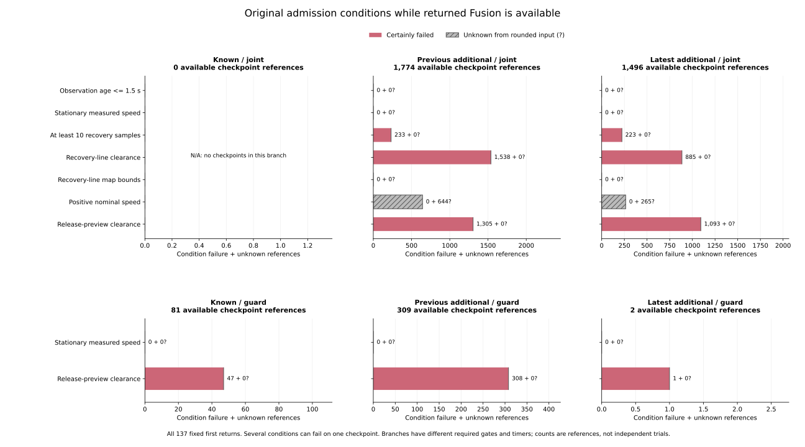

# Admission conditions and timers after Fusion returns

Readiness occurs briefly after some first Fusion returns, but neither original
admission timer reaches its release threshold. Across the fixed observed
available spells, joint loss-recovery evidence reaches at most **0.46 s of the
required 1 s**, and guard-release evidence reaches at most **0.10 s of the
required 0.5 s**. Failed clearance conditions and interrupted timer records
are explicit. Rounded nominal zeros leave 25 aggregate readiness decisions
unresolved from scalar inputs; their recorded timers do not advance.

The [protocol](protocol.md) was committed as `c67a458` from main `dd64cd8`
before examining new condition masks or resets. It follows all 137 preceding
first returns, preserving all 3,997 original census anchors, 972 planned cases,
324 families, 570 timeout histories and 10,995 RP records in 157 parent cases.
No controller, retention parameter, rollout or RP selection changed.

## Branches and consecutive readiness

Joint admission applies when loss recovery is pending, derived from the prior
loss-pause flag or a current missed scheduled correction. It requires age,
stationary speed, ten recovery samples, recovery-line clearance, recovery-line
map bounds, a positive nominal command and release-preview clearance. Guard
release without a pending loss pause requires stationary speed and release
clearance. Fusion availability is not an extra admission condition.

| Observed available-spell measure | Joint recovery | Guard release |
|---|---:|---:|
| Returned anchor references | 120 | 17 |
| Available checkpoint references | 3,270 | 392 |
| Ready ticks from recorded counter transitions | 101 | 36 |
| Anchors with at least one ready tick | 8 | 3 |
| Counter resets from a positive value | 24 | 18 |
| Anchors with a reset | 8 | 1 |
| Largest logged active counter | 23 ticks / 0.46 s | 5 ticks / 0.10 s |
| Required consecutive ready count | 50 ticks / 1 s | 25 ticks / 0.5 s |
| Observed releases | 0 | 0 |

The eight joint anchors with ready ticks are all in the latest partition.
Guard readiness supplies 34 ticks in the known partition and one each in the
previous and latest additional partitions. These are reused anchor/checkpoint
references, not independent trials or time-exposure weights.

The 42 available-phase resets belong to nine anchors. Joint resets have a
certain recovery-clearance failure in three references and a certain release-
clearance failure in six. The other 15 have no certainly failed scalar gate:
nominal positivity remains unknown at a printed zero, while the timer records
a reset. All 18 guard resets have a certain release-clearance failure. The
89 separate next-loss boundaries add one further reset and 88 zero-counter
waits; they are excluded from the available-spell counts above.

Initial counters are carried from the original predecessor. For `C0501`, anchor
80 returns at 175 s in the guard branch with two prior ticks (0.04 s); its
largest observed counter is five ticks. The audit does not restart every timer
at a Fusion return. All other returned anchors have a zero initial counter.

## Simultaneous condition failures and uncertainty

| Joint condition, 3,270 available references | Pass | Fail | Unknown |
|---|---:|---:|---:|
| Observation age <=1.5 s | 3,270 | 0 | 0 |
| Absolute measured speed <=0.02 | 3,270 | 0 | 0 |
| Recovery sample count >=10 | 2,814 | 456 | 0 |
| Recovery-line clearance | 847 | 2,423 | 0 |
| Recovery-line map bounds | 3,270 | 0 | 0 |
| Positive nominal command | 2,361 | 0 | 909 |
| Release-preview clearance | 872 | 2,398 | 0 |

Several necessary conditions can fail at once. For example, 1,494 joint
references fail both clearance conditions without failing the sample count;
233 also fail the sample count. All masks are saved without choosing a
priority cause. Overall joint readiness is certainly false in 3,144 references,
certainly true in 101, and unknown from rounded inputs in 25.

The 909 nominal-sign unknowns are printed nine-decimal zeros whose source
value could be a small positive number. In 884 of those references another
condition certainly fails. The remaining 25, in four full cases, have no
certain failure and all other conditions pass. Their timers consistently
indicate a nonready decision. This observed aggregate transition is retained
alongside the unknown individual nominal gate, rather than relabeling it from
timer evidence. True stop-latch zeros would be exact source zeros; none of
these joint nominal unknowns obtains that refinement.

All 392 guard references pass the stationary condition. Release clearance
passes in 36 and fails in 356, with no interval uncertainty. Joint-only gates
are marked not_applicable in this branch.

The figure uses available checkpoints only and sums the original noises,
arms and modes within each partition. It keeps joint/guard denominators
separate and shows the empty known-joint branch as N/A. Numeric exports retain
all original condition/category cells, including empty ones.

## A recorded reset while Fusion remains available

For the previously fixed case `C0149` (latest correlated/baseline/random,
seed 278, maze JPS), anchor 3708 returns at 175 s. Its seven joint conditions
are certainly satisfied for 23 consecutive checkpoints from 175.18 through
175.62 s. At 175.64 s the recovery-line clearance condition fails, clearing
the 0.46 s timer while Fusion is still available.

| Logged time | Condition result | Timer after decision |
|---|---|---:|
| 175.00 s | Insufficient recovery samples | 0 s |
| 175.18 s | All seven conditions pass | 0.02 s |
| 175.62 s | All seven conditions pass | 0.46 s |
| 175.64 s | Recovery-line clearance fails | 0 s |
| 176.52 s, first next Fusion loss | Age, samples and both clearances fail | 0 s |

The earlier anchor 3705 in the same case has one available checkpoint at
170 s before a TTL loss. Its sample and both clearance conditions fail, and
its timer remains zero. These sequences describe the original algorithm's
recorded inputs and counters; they are not counterfactual release experiments.

## Clock, rounding and timer verification

The source observation clock is `step as f64 * 0.02`; last-observation time
updates on received corrections or precision activation. Reconstructing its
binary64 multiply/subtract order matches all **5,130,000** printed timeout
decision ages. Audited ages retain exact hex encodings. Logged pose truth time
and rounded six-place age are not substituted for the source clock.

The pinned source computes recovery_margin and speed_margin with identical
expressions in these arms. The audit verifies their normalized source text
and uses the logged speed-margin interval, avoiding an assumed drift parameter.
Nine-decimal scalars use half-unit rounding intervals (5e-10), a 1e-12 numerical
guard and global sin/cos Lipschitz endpoint bounds for the 0.6 m segment.
Counts/flags and the round-tripping measured-speed field retain their source
precision. Strict clearance/positive-command inequalities and inclusive map
bounds remain distinct.

The recorded evidence values uniquely decode to integer 20 ms counters.
Transitions retain carried counters, positive increments, resets, zero waits
and threshold releases separately. Certain interval conjunctions must match
the timer-derived ready flag. Unknown individual conditions remain unknown.
This verifies selected source-condition/timer consistency with rounded inputs;
it does not replay unrounded controller trajectories or map-clearance geometry.

## Saved artifacts and reproducibility

[admission-decisions.csv](admission-decisions.csv) saves all 3,751 decision
references, including 3,662 available references and 89 next-loss boundaries.
[admission-runs.csv](admission-runs.csv) compresses them into 974 maximal
branch/phase/certainty/readiness/mask/action runs. [anchor-admission.csv](anchor-admission.csv)
keeps all 3,997 original anchors. The 15 no-return episodes retain their lower
bounds and blank new fields; the 18 original TTL-limit anchors without a next
checkpoint remain outside observed-loss denominators. Each of the 48 returns
at 180 s contributes one observed available tick and has an unknown future end.

[admission-summary.csv](admission-summary.csv) keeps 336 fixed original cells,
with planned/timeout/held counts, empty categories and unknowns. Original
all-census and received-census masses each close to 570; RP mass closes to
157. Weights precede selection, exact Fraction masses precede division, and
distinct case counts/maximum counters are excluded from additive closure.
Both implementations pass 9,240 additive mode/category comparisons. Ready/reset
shares condition on returned anchors; empty denominators stay blank.

Both readers freshly hash/stream all 108 original raw files (6,043,185,194 bytes)
and validate all 5,130,570 timeout grid rows, including initial rows. Original
census flags/identifiers are rejoined at 3,997 events; 33,328 comparisons join
preceding control snapshots/runs back to raw inputs. The standalone verifier
imports no analyzers. It uses 60-digit Decimal intervals and separate Decimal
Taylor-series trigonometry, enumerates both ready states for recorded counter
transitions, and reconstructs maximal runs with SQLite 3.53.1 window functions
over uncompressed decisions. The [independent evidence](independent-verification.json)
records **758,387 new field comparisons**, **155,883 original join comparisons**,
all input/helper/source/protocol/output/plot hashes, 252 numeric plot summary
rows and all 137 returned-anchor plot rows. Native metadata evidence remains
inherited; no new native metadata replay is claimed.

All **909 Python tests** pass, including 24 new tests for interval boundaries,
rounded/source-forced zeros, exact ages, trigonometric bounds, simultaneous
failures, branch applicability, 49/50 and 24/25 counter boundaries, carried
counters, resets, inconsistent records, SQL runs, endpoint censoring, case/grid
isolation, fixed unequal parent measures, blank shares, closure and nonmutation.
All five collector CSV/provenance artifacts and all five figure/export/provenance
artifacts repeat byte for byte. The figure was inspected. Source manifest SHA-256:
`f83beeea16ed0eb61846be0c3ce58299ec4ef8df29f37ea8dc50261938bfc056`.

See the [README](../../README.md#admission-conditions-and-timers-after-fusion-returns)
for commands. Historical held goals remain 140->140 and latest 62->60. The
audit adds no new error/AUC, eventual-release probability, independent trial
or causal controller-benefit estimate.
