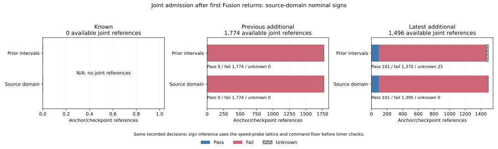

# Nominal command signs from the original source domain

All **25 previously unresolved joint readiness references** have an exact
zero nominal command under the pinned source's value domain. The speed probe
returns zero, its speed cap is exactly zero, and an otherwise positive uncapped
command is reduced to zero before admission is evaluated. Timer transitions
are checked only after this inference. Across the 3,270 available joint
references, refined readiness is **101 pass, 3,169 fail, zero unknown**.

The [protocol](protocol.md) was committed as `4111f21` from main `d703438`
before reading new raw speed-probe/cap/uncapped-command outcomes. The audit
retains all 972 planned cases, 324 families, 570 timeout histories, 3,997 census
anchors, 137 first returns and 3,751 decision references. It adds source-domain
columns alongside the preceding interval result, preserving that result.

## Why a printed nominal zero is identifiable here

The original speed probe has 41 possible returns: `k*0.05` for `k=0..40`.
The initial unsafe test returns zero; the first unsafe chord returns
`(step-1)*0.05`; exhausting the 40-step probe returns 2.0. Their nine-place
representations uniquely identify the source lattice member.

The cap expression is `(-0.15 + sqrt(0.15^2 + free_distance)).clamp(0,1)`.
The unchanged expression, extracted and compiled with stdlib Rust, gives:

| Free distance | Cap, nine-place display | Exact binary64 cap bits |
|---|---:|---|
| 0 | 0.000000000 | `0000000000000000` |
| 0.05, first positive lattice point | 0.119258240 | `3fbe87b5421c530e` |
| 2.0, exhausted probe | 1.000000000 | `3ff0000000000000` |

The native harness uses rustc 1.99.0 (b940084d7 2026-09-28). All six original
cohort provenance files match their pinned hashes and record this same compiler
version; their hashes and compiler fields were also checked when packaging.

An unlatched command before this cap is at least 0.1, including after the
joint-recovery min(0.4). The stationary-Fusion flag implications establish
joint recovery and anticipatory speed, so the earlier nonjoint pause-zero
branch cannot apply. A latched stop is exact zero. Thus the nominal command
is either exact zero or at least 0.1: a nine-place zero cannot conceal a small
positive nominal command in this source domain.

Both readers check the printed identity `round9(min(a,b)) =
min(round9(a),round9(b))` using decimal nanounits. This identity follows from
monotone rounding; it does not reconstruct an unrounded uncapped speed. Exact
cap bits also permit the original `measured_speed > cap + 1e-9` braking check.
Later pause/guard overrides are checked separately from the earlier nominal
command capture. They do not supply the nominal-sign inference.

## Refined returned-spell results

| Available-spell measure | Preceding interval result | Added source-domain result |
|---|---:|---:|
| Joint nominal gate pass | 2,361 | 2,361 |
| Joint nominal gate fail | 0 | 909 |
| Joint nominal gate unknown | 909 | 0 |
| Joint conjunction pass | 101 | 101 |
| Joint conjunction fail | 3,144 | 3,169 |
| Joint conjunction unknown | 25 | 0 |
| Guard conjunction pass / fail / unknown | 36 / 356 / 0 | 36 / 356 / 0 |

All 909 formerly ambiguous available joint nominal gates have the cap-zero
reason. Of these, 884 also have another failed necessary condition; 25 have
nominal positivity as their sole failed condition. No joint returned-spell
zero is attributed to a stop latch. The 392 available guard references include
158 cap-zero nominal commands, but nominal positivity is not a condition of
guard-only release, so their admission results are unchanged.

The 25 newly resolved conjunctions belong to four latest-white/random cases
with seed 278. Each original loss anchor is at 170 s and its first return at
175 s. Their uncapped command is always 0.400000000 and their stop latch is
false; free distance, cap and nominal command are all zero.

| Full case / anchor | Arm | Scenario / planner | Newly resolved references | Times | Resets |
|---|---|---|---:|---|---:|
| C0226 / 2959 | curved | dense / A* | 1 | 175.26 s | 1 |
| C0227 / 2973 | curved | dense / JPS | 1 | 175.26 s | 1 |
| C0228 / 2987 | curved | dense / Theta* | 2 | 175.26, 175.30 s | 2 |
| C0310 / 2994 | epoch | maze / A* | 21 | scattered from 175.18 to 176.26 s | 11 |

The 15 resets above have nominal positivity as the sole failed condition;
the other ten newly resolved references wait at a zero counter. All 24
available joint resets can now be described by complete failed masks:
15 nominal-only, three nominal plus release clearance, one recovery clearance
plus nominal, three release-clearance-only, and two recovery-clearance-only.
Several necessary conditions can fail together; no priority cause is assigned.
All 18 available guard resets still fail release clearance.

The 89 next-loss boundaries remain separate: 84 joint and five guard. Their
conjunctions all fail; 26 joint and three guard nominal commands have cap-zero
reasons. The one boundary reset remains a guard release-clearance failure.
No recorded release, resume, final positive returned-spell command or timer
threshold changes. Earlier timer maxima remain 0.46 s of the joint 1 s
threshold and 0.10 s of the guard 0.5 s threshold.

The figure sums the original noises, arms and modes within each partition,
using available joint references only. The previous additional partition has
1,774 failures before and after refinement. The latest has 1,496 references:
101 pass, 1,370 fail and 25 unknown before; 101 pass and 1,395 fail afterward.
Known has no joint references and remains visibly N/A.

## Full-grid consistency and original measures

Both readers freshly hash/stream the 108 original raw files, totaling
6,043,185,194 bytes. They validate complete unique trajectories, including
5,130,570 timeout grid rows with initial states, and check the entire command
chain at all **5,130,000 noninitial timeout decisions**.

| Structural nominal-command reason, full timeout decisions | Count |
|---|---:|
| Positive uncapped command and positive cap | 3,232,234 |
| Zero cap, unlatched | 1,895,544 |
| Stop latch, positive cap | 2,222 |
| Stop latch and zero cap | 0 |
| Total | 5,130,000 |

These counts span the full recorded timeout histories, separate from the
returned-spell reference denominator. Pending joint recovery accounts for
2,236,009 decisions and the other pause branch for 2,893,991.
The dense full-grid export retains all 864 cohort/arm/mode/seed/branch/reason
cells, including zero cells.

All 3,997 anchors remain represented. The 3,860 nonreturns have blank new
fields. All 48 censored returns at 180 s retain one observed available tick
and an unknown future end; the 15 no-return episodes keep their preceding
lower bounds. The 18 TTL-limit anchors without a next checkpoint remain
outside observed-loss denominators.

Original census and received-census masses each close to 570; RP mass closes
to 157 over all 10,995 RP records. Weights precede selection and use exact
Fractions before division. Four of 137 returns have prior unknown readiness;
zero have refined unknown readiness. Seventy-four returns have a source-zero
nominal command at some available checkpoint. Their original census masses
are respectively 4/7, zero and 74/7, against returned mass 137/7, so these
particular raw and case-mass shares coincide. This does not make checkpoints
independent trials. Empty summary denominators stay blank.

## Artifacts and verification

[command-lattice.csv](command-lattice.csv) saves all 41 cap values and bits;
[timeout-command-counts.csv](timeout-command-counts.csv) saves the full-grid
counts; [command-decisions.csv](command-decisions.csv) saves all 3,751 audited
references with prior/refined gates, masks, reasons, raw command inputs and
observed timer records. [anchor-command-sign.csv](anchor-command-sign.csv)
keeps all 3,997 anchors and parent measures. [command-summary.csv](command-summary.csv)
keeps the 336 original cells. Both implementations check 10,032 additive
mode/category comparisons; distinct case counts are not additive.

The [standalone evidence](independent-verification.json) uses Decimal/nanounit
raw parsing and a native source-cap lookup independently of collector floats.
It imports no analyzers, independently rejoins original census accounting and
preceding raw decision fields, reconstructs all refined masks/anchor measures/
summaries, and checks every saved field and input/helper/source/protocol/raw/
output/plot hash. The plot exports retain all 252 original-mode summary cells
and all 137 returned anchors. The final evidence records 718,481 new field
comparisons and 155,883 original census/accounting join comparisons; the
246 native-lattice fields belong to the new comparisons.

All **930 Python tests** pass, including 21 new tests for numeric/domain
boundaries, exact zeros, structural reasons, min rounding, later overrides,
braking thresholds, inference before timer checks, guard applicability, raw
joins/grid isolation, censoring, original unequal parent measures, blank/zero
shares and closure. The native harness passes four source-domain tests and
checks all 41 cap bits/displays against the collector. All six collector
table/provenance artifacts repeat byte for byte. The figure was inspected;
its SVG/PNG, two exports and provenance also repeat byte for byte.

Source manifest SHA-256:
`2090042807aaef058d8c43eee5b112ab0ef658b934b1bccad29e81a5af4bc62b`.
See the [README](../../README.md#nominal-command-signs-from-the-source-domain)
for commands. Earlier geometry, clocks, timers and native Fusion metadata
validation are explicitly inherited from the pinned admission proof. This
audit verifies the finite command domain and its logged consistency. It does
not replay unrounded map geometry or controller trajectories. A zero probe
does not distinguish an unsafe starting point from an unsafe first chord,
nor identify a particular obstacle or wall. No controller tuning, new rollout,
causal benefit or eventual-release probability is introduced.
