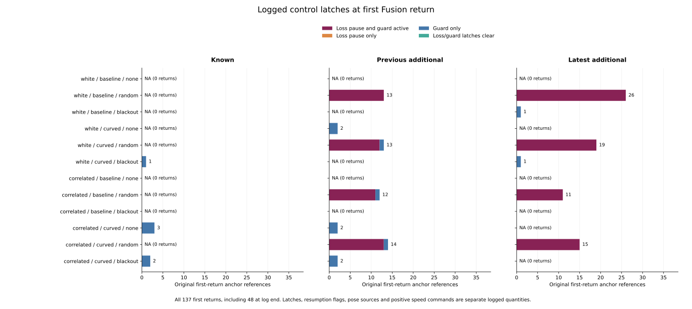

# Logged controls around first Fusion returns

At all **137 fixed first Fusion returns**, the stopping guard is active.
During their observed available checkpoints, the final target-speed command
is always zero and no resumption is logged. The recovery pose branch and
nominal command still vary. These separate records connect the preceding
availability audit to the original controller's recorded outputs.

The [protocol](protocol.md) was committed as `5317c1b` from main `3e11620`
before reading these control outcomes. It retains all 3,997 original anchors,
972 planned cases, 324 families, 570 timeout histories and 10,995 original RP
records in 157 parent cases. No controller, simulation or RP selection changed.

## Latches, sources and commands at return

| Partition | First returns | Loss pause and guard | Guard only | Positive nominal command anywhere in available spell | Sample count reaches 10 |
|---|---:|---:|---:|---:|---:|
| Known | 6 | 0 | 6 | 1 | 0 |
| Previous additional | 58 | 49 | 9 | 42 | 23 |
| Latest additional | 73 | 71 | 2 | 56 | 19 |
| Total | 137 | 120 | 17 | 99 | 42 |

There are no loss-only or clear-latch returns in this fixed population. All
120 loss-paused returns use a recovery mean with one sample; the other 17
guard-only returns have zero recovery samples and use raw fallback. Fusion is
available in both groups. The source identifiers describe recovery/preview
pose branches, not the complete controller, a release or physical movement.

All 36 original cohort/noise/arm/mode conditions remain shown, including
conditions with no returned anchors. The 137 anchor references belong to 95
full cases; repeated anchors are retained and are not independent replications.

At the return checkpoint, 93 anchors have a positive nominal target-speed
command. Over the entire observed available spell, 99 have one. Nominal means
the candidate command at that same decision before the final loss/guard
overwrite. All final commands remain zero. A positive nominal command does
not constitute a positive final command, a release or motion.

## Behavior through the next loss or observed log endpoint

| Previously fixed spell category | Anchors | Available checkpoint references | Recovery mean / raw fallback at return | Pose branch across observed next loss |
|---|---:|---:|---|---|
| TTL-ended after 20 ms | 42 | 42 | 42 / 0 | Mean -> mean in all 42 |
| Age-ended after 1.52 s | 47 | 3,572 | 42 / 5 | Mean -> fallback in 42; fallback -> fallback in 5 |
| Returned at 180 s, censored | 48 | 48 | 36 / 12 | Future next loss unknown |
| Total | 137 | 3,662 | 120 / 17 | 89 observed ends; 48 censored |

Across the 3,662 available checkpoint references, 3,270 have both loss pause
and guard and 392 have guard alone. There are **zero resumed, guard-triggered,
guard-released or positive-final-command checkpoints** inside these spells.
There are 2,595 positive-nominal-command references. These are counts of
anchor-checkpoint references, not time exposure or independent observations.

The 42 short TTL-ended spells have recovery sample count one at return and
two at the next-loss checkpoint, so the recovery mean remains selected when
Fusion loses its oldest group. In the 47 age-ended spells, 42 have 25 recovery
samples at age 1.50 s and zero at 1.52 s, changing to raw fallback. The other
five already use fallback with zero recovery samples. This matches the pinned
source's separate averaging-window age rule. At all 89 observed loss
boundaries, latch state and final-command positivity do not change.

The exact integer sample requirement of at least ten is not met at any return.
It is later met in 42 age-ended spells, over 2,814 available checkpoint
references. Reaching that count alone does not establish complete admission
readiness. Maximum logged recovery evidence ranges from zero to 0.46 s in
these spells, and no resumption is logged. The audit does not replay all
geometry/readiness gates or isolate which remaining condition prevented a
release. The pinned source uses a separate one-second admission timer.

For case `C0149` (latest correlated/baseline/random, seed 278, maze JPS), anchor
3705 returns at 170 s and loses Fusion at 170.02 s while retaining its recovery
mean. Anchor 3708 returns at 175 s and loses Fusion at 176.52 s, when its
recovery mean changes to raw fallback. Both anchors retain loss pause plus
guard throughout their available spells, have a positive nominal candidate
at some point, and have no positive final command or resumption. The latter
spell's maximum logged recovery evidence is 0.46 s.

## Censoring and original accounting

All 48 censored returned spells start at 180 s. Their one observed available
checkpoint and zero subsequent observed span remain distinct. The return and
censored-endpoint snapshot roles reference that same checkpoint; observed
end-change fields stay blank. Their current zero final command does not
establish what happens after the log.

The 15 original losses with no return retain their original elapsed lower
bounds and blank new control fields. The 18 original TTL-limit anchors without
a next checkpoint remain outside observed-loss/returned-spell denominators.
The remaining 3,827 anchors have no original observed loss. These six disjoint
categories, including the three returned categories above, exhaust all 3,997
original census anchors.

[control-summary.csv](control-summary.csv) keeps all 336 fixed cells, including
empty cells and planned/timeout/held counts. Original all-census and received
census masses each close to 570 case units; RP mass closes to 157. Parent
weights precede selection. Exact Fraction sums precede division. Resume and
positive-final-command shares among returned anchors are observed zeros;
cells without returns have blank shares. Counts of distinct cases can overlap
and are excluded from the 8,580 additive mode/category closure comparisons.

## Saved evidence and reproducibility

[anchor-controls.csv](anchor-controls.csv) retains every original anchor and
adds control records only for returned spells. [control-runs.csv](control-runs.csv)
saves 363 maximal tuple runs over 3,888 inclusive window checkpoint references
from return-20 ms through the next observed loss or log endpoint. Within-spell
measures exclude an observed next-loss checkpoint. [control-snapshots.csv](control-snapshots.csv)
saves all 500 fixed anchor/role references with raw flags/counts, commands,
evidence and descriptive release-clearance inputs.

Both readers freshly hash and stream all 108 original raw files, totaling
6,043,185,194 bytes. They validate the full trajectory membership and all
5,130,570 timeout grid rows, including initial rows. At every one of the
855,570 late checkpoints, loss pause forces zero final speed/steering, guard
alone forces zero final speed, and an unlatched controller uses nominal
commands. A resumed checkpoint must clear both latches. Numeric comparisons
use the printed commands with a 2e-9 tolerance. These checks validate logged
overwrite rules, not a complete controller or trajectory replay.

The standalone verifier imports no analyzers. It rejoins the original census,
independently parses the original Rust writer's unquoted scalar CSVs, and
uses SQLite 3.53.1 window functions over uncompressed controls to recover
maximal runs. It reconstructs all snapshot/anchor/run/summary fields, exact
weights, closures, 252 numeric plot summary rows and all 137 returned plot
rows. The [independent evidence](independent-verification.json) records
**607,953 new field comparisons** and **163,877 original join comparisons**,
plus source/helper/raw/protocol/output/plot hashes. The preceding native
metadata proof is pinned and inherited; this control audit does not run a
new Rust metadata replay.

All **885 Python tests** pass, including 19 new tests for distinct source and
latch identifiers, command overwrites, clear latches with zero commands,
resumed pulses, strict spell boundaries, endpoint censoring, absent returns,
case/grid isolation, SQL runs, fixed unequal parents, blank/zero shares,
closure and nonmutation. All five collector CSV/provenance artifacts and all
five figure/export/provenance artifacts repeat byte for byte. The figure was
inspected. Source manifest SHA-256:
`d4805319372227496c5b6fece67644ee1d16b04e16cbf9fd846281929508ddf5`.

See the [README](../../README.md#logged-controls-around-first-fusion-returns)
for rerun commands. Historical held goals remain 140->140 and latest 62->60.
These selected retrospective control records add no error/AUC estimate,
eventual resumption probability, independent trial or causal controller benefit.
