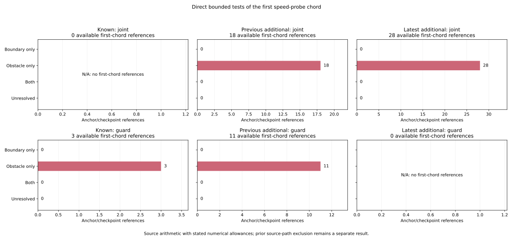

# Direct tests of the first speed-probe chord

All **61 previously inferred first-chord references directly fail the inflated
obstacle-margin test** under the frozen numerical allowances. Each has one
definite original obstacle ID, with no ambiguous witnesses, endpoint-boundary
failures or unresolved direct results. The two references among the preceding
25 nominal-only conjunction failures are confirmed against map records **420
(3,4)** and **1310 (34,35)**.

The [protocol](protocol.md) and [input pins](freeze-pins.json) were frozen in
`c74168b` from main `0836de7`. Cross-implementation numeric comparison tolerance
was clarified in `1adf61e` using a synthetic small-curvature example, before
reading selected steering/yaw outcomes. The target remains all 61 preceding
first_chord_by_exclusion references, keeping their inherited label separate
from the new direct test. All 3,751 decision references, 3,997 anchors, 137
first returns, 972 planned cases, 324 families and 570 timeouts remain present.

## The two preceding nominal-only resets

Both cases are latest-white/random with seed 278. Their original loss anchors
are at 170 s and first returns at 175 s. The original nominal command remains
zero; the present calculation does not change any controller decision.

| Case / anchor / logged time | Planner / arm | Original obstacle ID and coordinates | Direct chord gap interval to inflated margin |
|---|---|---|---|
| C0228 / 2987 / 175.30 s | dense Theta* / curved | 420: (3,4) | [-0.009894013831, -0.009893986302] |
| C0310 / 2994 / 176.16 s | maze A* / epoch | 1310: (34,35) | [-0.004783445446, -0.004783405258] |

The corresponding margin deficits are about **9.89 mm and 4.78 mm**. Initial
position gaps were positive in the preceding audit. The first endpoint's
rounded centers are respectively (2.123513550, 3.934255486) and
(34.306422843, 34.152430921). The source nominal steering values are
0.171688802 and -0.106591436 rad; sensed yaw centers are 1.443006652 and
0.641381126 rad. Their endpoint-displacement radii are approximately
1.23e-8 and 1.86e-8, far smaller than the margin deficits.

These remain estimated raw-sensed chord/margin tests, not true clearance or
collision labels. The inherited 0.02 s and 0.04 s counters reset to zero at
these references because nominal positivity fails while the other six joint
conditions pass. The earlier classification is preserved rather than replaced
by a new counterfactual command or release.

## All 61 direct tests

| Phase / branch | Audited | Obstacle only | Boundary only / both / unknown |
|---|---:|---:|---:|
| Available / joint | 46 | 46 | 0 / 0 / 0 |
| Available / guard | 14 | 14 | 0 / 0 / 0 |
| Next loss / joint | 1 | 1 | 0 / 0 / 0 |
| Next loss / guard | 0 | 0 | 0 / 0 / 0 |
| All | 61 | 61 | 0 / 0 / 0 |

The maximum endpoint-displacement radius is 3.175e-8. Even the obstacle upper
gap closest to zero is -0.000247126, remaining negative after all rounding and
numeric allowances. Every endpoint boundary lower gap exceeds 1.194. All 61
curvature intervals stay outside the near-zero fallback band; the smallest
absolute curvature bound is approximately 0.148674. The coarse fallback is
retained and tested but is unused in these observed references.

The figure uses the 60 available references, retaining separate joint and
guard denominators and empty branches. Joint counts are 18 in the previous
additional partition and 28 in the latest; guard counts are three known and
11 previous additional. The next-loss boundary remains outside this figure's
denominators. All 252 original-mode summary cells and all 137 returned anchors
are retained in the numeric plot exports.

Nineteen returned anchors have an available direct obstacle-only first-chord
reference. Their original census mass is 19/7 against returned mass 137/7,
so the raw and case-mass shares are both 19/137. These checkpoint references
and overlapping anchor histories are not independent trials.

## Source arithmetic and explicit numerical assumptions

Sensed yaw uses preceding truth yaw plus current noise_yaw plus bias_yaw in
the original two-addition order. The nominal steering field is captured before
the later pause/guard overwrites. The preceding x/y rectangles remain the
input to this audit. The first endpoint follows the original tan and curved
sin/cos-difference divisions at float(0.05) and float(0.4), including the
source's abs(curvature)<1e-9 straight branch.

Nine-place inputs retain half-unit radius 5e-10. Each interval arithmetic and
trigonometric operation has a frozen 1e-12 elemental allowance. Sin/cos use
global Lipschitz ranges; tan is monotone on the checked steering interval.
Curvature intervals meeting [-1e-6,1e-6] use the predeclared start rectangle
expanded by 0.06, preserving unknown results instead of selecting a branch.
The interval code keeps the source subtraction/division order.

Distance to the rounded-center segment is enclosed by the maximum endpoint
displacement, using the segment-distance Hausdorff/Lipschitz bound. A separate
1e-9 segment-comparison allowance and the original margin interval remain
explicit. All original map records and four endpoint walls are checked;
duplicate IDs and simultaneous witnesses are retained. First-chord blockers
cannot be removed by the source's margin+2 nearby filter.

The independent verifier uses 60-digit Decimal Taylor sin/cos, derived tan,
separate interval operations and Decimal projection/clamp distances. New
numeric enclosures compare within absolute 1e-9 and relative 1e-10 tolerance;
states, masks, witness IDs, flags, counts and inherited string fields must
agree exactly. This tolerance does not shrink the computed enclosures.
These are bounded calculations under stated numerical/platform allowances,
not a formal proof for every possible libm implementation.

## Saved evidence and reproducibility

Both readers freshly hash and stream all 108 original raw files, totaling
6,043,185,194 bytes, and validate all 5,130,570 timeout grid rows. They extract
110 selected/predecessor points for the 61 audited references. All six raw
provenance/compiler/map declarations and the complete pinned input/helper/code
chain are checked.

[first-chord-decisions.csv](first-chord-decisions.csv) keeps all 3,751 preceding
rows/columns and adds the audited flag and direct fields. The 3,690 unaudited
references retain blank new geometry fields. [anchor-first-chord.csv](anchor-first-chord.csv)
retains all 3,997 anchor rows and original measures, with blank new fields for
nonreturns. The 48 censored 180 s returns, 15 no-return lower bounds and 18
TTL-limit anchors without a next checkpoint retain their inherited accounting.
[first-chord-summary.csv](first-chord-summary.csv) keeps the same 336 cells.

Weights precede selection and use exact Fraction masses before shares. Census
and received masses each close to 570; RP mass closes to 157 over 10,995 RP
records. Both implementations check 6,336 new additive mode/category comparisons;
shares and distinct case counts remain nonadditive. Undefined shares stay blank.

The [independent evidence](independent-verification.json) records 1,404,428
field comparisons and 155,883 original census/accounting join comparisons.
The native harness compiles the unchanged full speed probe, original point
and segment distances, minimal VehicleState and extracted first-endpoint
arithmetic with stdlib rustc 1.99.0. All six native tests pass. All 61 rounded
centers have a safe initial test, return zero from the unchanged full probe
and agree with every direct definite/possible witness. The saved
[native inputs](native-centers.tsv) and [native trace](native-first-chord.csv)
are bound by the hashes in that evidence; row IDs follow the audited-reference
order. Center traces do not recover the unrounded original inputs.

All **970 Python tests** pass, including 18 new tests for angle ordering,
nominal versus final steering, interval operations/trig, near-zero fallback,
source endpoint enclosures, segment-interior blockers, Hausdorff bounds,
inclusive/ambiguous predicates, duplicate/simultaneous witnesses, safe-result
contradictions, blank unaudited fields, native source traces, original unequal
measures, censoring and closure. All four collector table/provenance artifacts
and all five figure/export/provenance artifacts repeat byte for byte. The
figure was inspected. Source manifest SHA-256:
`8e2697be1401ca6b576a9fe75163e5823d25474e7a352bb5b49e05fd9d2ee6c4`.

See the [README](../../README.md#direct-tests-of-the-first-speed-probe-chord)
for commands. Earlier initial geometry, admission/timer/command-domain and
Fusion metadata evidence remains explicitly inherited. No closed-loop trajectory,
new release, eventual-release probability or causal controller benefit is
estimated. All original commands, admission results and timer maxima remain
unchanged.
