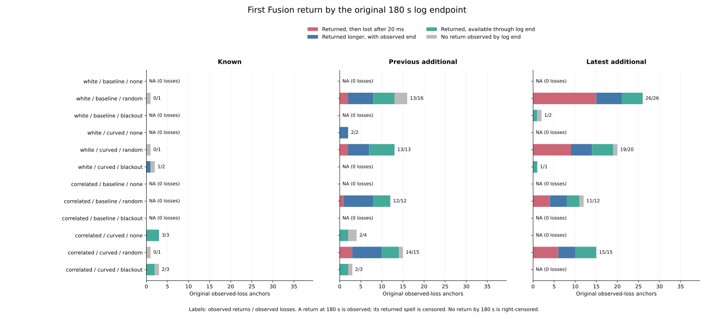
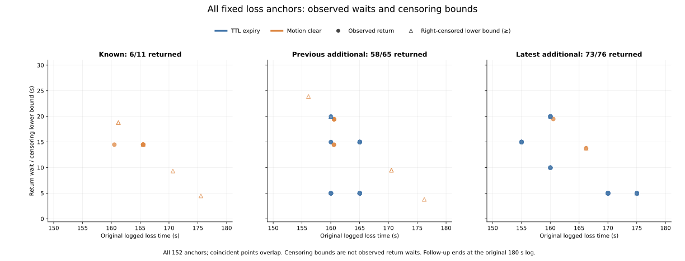

# First Fusion return after the fixed logged losses

Of the 152 previously fixed loss anchors, **137 have an observed first Fusion
return by 180 s** and **15 reach the log endpoint without an observed return**.
Of the 137 returns, 42 become unavailable again at the next 20 ms checkpoint,
47 have a fully observed return-to-unavailable span of 1.52 s, and 48 first
return exactly at 180 s with no subsequent observation. An observed first
return therefore does not establish sustained availability.

The [protocol](protocol.md) was committed as `f7c5a5c` from main
`f7a57444599acb4c0f543d702760fa4f19e9f49b`, before reading these post-window
outcomes. Implementation and [rerun instructions](../../README.md#follow-up-after-fusion-becomes-unavailable)
are in `6a9558c`. No controller setting, retention horizon or rollout changed.

## Fixed population and observation endpoint

The study retains all 972 planned full cases and 324 families, all 570 timeout
histories, all 3,997 census anchors and original RP accounting. The selected
losses remain the 128 TTL-expiry and 24 motion-clear anchors identified within
the preceding event-relative 1.50 s windows. Availability runs also retain
other transitions across the full late histories; those do not become new
loss anchors. Nonloss anchors keep their preceding label and blank follow-up
fields. Full identity includes cohort, noise, arm, loss mode, seed, scenario
and planner.

Both readers hash all 108 original raw files (6,043,185,194 bytes), validate
the 5,130,000 timeout decisions after initial rows, and compare logged group
count/availability at every decision. Maximal boolean runs cover all 855,570
inclusive 150..180 s checkpoints in all 570 timeout cases. The 5,190 saved
runs reconstruct that grid without gaps, overlaps or adjacent equal values.
They compress availability only; their checkpoint counts are not independent
physical trials or an assumed duration after the final point.

For every fixed observed loss, the first later available checkpoint through
180 s is a return. A return at 180 s is observed, but its returned spell is
right-censored with zero subsequent observed span. If no return is recorded,
the return time/wait stays blank and 180-loss_time is saved separately as a
censoring lower bound. No eventual outcome is inferred after the log ends.
The 18 prior TTL-limit census anchors without a next step stay outside the
152 observed-loss denominator; a future loss at those anchors is unobserved.

## Return and returned-spell outcomes

| Original loss operation | Observed losses | Returned, then lost after 20 ms | Returned longer, observed end | Returned at 180 s, future unobserved | No return before censoring |
|---|---:|---:|---:|---:|---:|
| TTL expiry | 128 | 42 | 44 | 37 | 5 |
| Motion clear | 24 | 0 | 3 | 11 | 10 |
| Total | 152 | 42 | 47 | 48 | 15 |

All 42 fully observed one-checkpoint returns have an oldest retained epoch
exactly at its inclusive 15 s limit when Fusion returns. Another 18 returns
at 180 s also sit at that limit, but have no observed next checkpoint. The
47 longer returned spells all have an observed logged span of 1.52 s.
Continuous-time transition instants and persistence between or after logged
checkpoints are not inferred.

| Cohort | Observed losses | Returned | No return before censoring | 20 ms returned spell | 1.52 s returned spell | First return at 180 s |
|---|---:|---:|---:|---:|---:|---:|
| Known | 11 | 6 | 5 | 0 | 1 | 5 |
| Previous additional | 65 | 58 | 7 | 8 | 27 | 23 |
| Latest additional | 76 | 73 | 3 | 34 | 19 | 20 |

The observed return fraction by the endpoint is 137/152 = 90.13%; the
original all-census case-mass fraction is 90.28%. TTL anchors have 123/128
observed returns (96.09%, original case-mass fraction 96.19%); motion anchors
have 14/24 (58.33%, case-mass fraction 58.64%). These describe selected
histories with different observed follow-up lengths. They do not estimate
eventual-return probabilities or rank controller performance.

Observed TTL return waits are 4.98 s (67 anchors), 9.98 s (8), 14.98 s (38)
and 19.98 s (10). Observed motion return waits range from 13.78 to 19.48 s.
The five censored TTL anchors have lower bounds of 4.98 or 19.98 s; the ten
censored motion anchors have bounds of 3.78..23.88 s. These bounds are not
substituted for observed return waits or averaged with them.

## Future opportunities and retained history

All 137 observed first returns occur at original received census opportunities,
with no precision-activation flag. Among returned TTL anchors, the number of
received opportunities after loss through first return is one for 75 anchors,
two for 36, three for 11 and four for one. Returned motion anchors require
three received opportunities for nine anchors and four for five. Thus the
next received opportunity does not always coincide with the first return;
the saved group counts/identities preserve the actual history at each event.

For the previously discussed latest correlated/curved/random seed-279 dense
A* case `C0073`, anchor 3727 loses Fusion at 160.02 s and first returns at
180 s, after 19.98 s. Its opportunity ledger shows:

| Opportunity time | Kind | Retained groups | Fusion available |
|---|---|---:|---|
| 165 s | missed | 0 | no |
| 170 s | received | 1 | no |
| 175 s | received | 2 | no |
| 180 s | received | 3 | yes |

At that return the retained epochs are 170, 175 and 180 s with sample counts
[25,25,1]. There is no subsequent logged span. The ledger establishes these
group states; it does not assign an unrecorded cause to every intervening reset.

Latest correlated/baseline/random seed-278 maze JPS case `C0149` illustrates
repeated anchor roles. Loss anchor 3705 at 155.02 s first returns at event
3708 at 170 s, with epochs 155, 165 and 170 s. That return lasts one logged
checkpoint and is lost at 170.02 s, the separate previously fixed loss anchor
3708. Its first return is at 175 s, followed by a 1.52 s observed spell. The
same physical opportunity can be a return for an earlier anchor and the
immediate event of a later anchor.

The 484 anchor-opportunity references correspond to 399 distinct full-case
opportunities: 284 references are at/before an observed first return, 154
are later, and 46 belong to anchors with no observed return. These reused
references remain explicit and are not independent replications. All 10,995
original RP records, including the 1,599 earlier preview disagreements, retain
their original selection; no future RP states are newly selected.

## Verification and reproducibility

Saved results contain 5,190 availability runs, 3,997 anchor rows, 484 opportunity
references and 528 fixed summary cells, including empty operation selectors.
All-census and received-census masses separately close to 570 original case
units; RP mass closes to 157. Parent weights precede loss/return/operation
selection, and exact Fraction masses are summed before shares. No weighting
by the number of selected losses is introduced. Distinct case counts can
overlap across operations/outcomes and are excluded from additive closure.
The collector and verifier check 5,760 additive mode/operation count/mass sums.

The standalone verifier imports no analyzers. It reuses pinned original-census
join/native-compiler helpers, runs all six unchanged original Rust tests, and
independently reads the raw files with the original Rust observe implementation.
Every timeout decision matches raw availability/group count. Every late
checkpoint in every timeout case is requested, rather than collector-selected
return times. Independent maximal native runs locate first returns and spell
endpoints and reconstruct all saved fields, opportunity references, parent
measures, 396 plotted summary rows and 152 plotted loss rows.

The [independent evidence](independent-verification.json) records **501,559
successful new field comparisons**, **71,946 original-census join comparisons**,
all **5,130,000 decisions** and **855,570 late points**, six original Rust tests,
108 native trace hashes and input/helper/source/protocol/output/plot hashes.
Rust 1.99.0 compiles unchanged source slices with `--edition=2021 -O` and active
assertions. Dummy zero pose/steering limit the check to metadata; fused
positions are ignored. This is not pose-error or controller trajectory replay.

All **847 Python tests** pass, including 21 new tests covering endpoint returns,
right censoring, one-checkpoint and censored returned spells, non-event returns,
repeated anchors, case/opportunity isolation, inclusive run grids, fixed unequal
parent measures, blank/zero denominators, closure and nonmutation. All five
collector artifacts repeat byte for byte. All seven figure/export/provenance
artifacts, including scratch PNGs, also repeat byte for byte; both final figures
were inspected. Source manifest SHA-256:
`076db5ab572c491d53a88f14493006e830ba75be637bae6a3dd5bd24ebdc3cc7`.

Historical held goals remain 140->140 and latest 62->60. No new errors, AUC,
cutoff, retention tuning, live outcomes, calibration, independent-trial estimate
or causal mode benefit is added.
