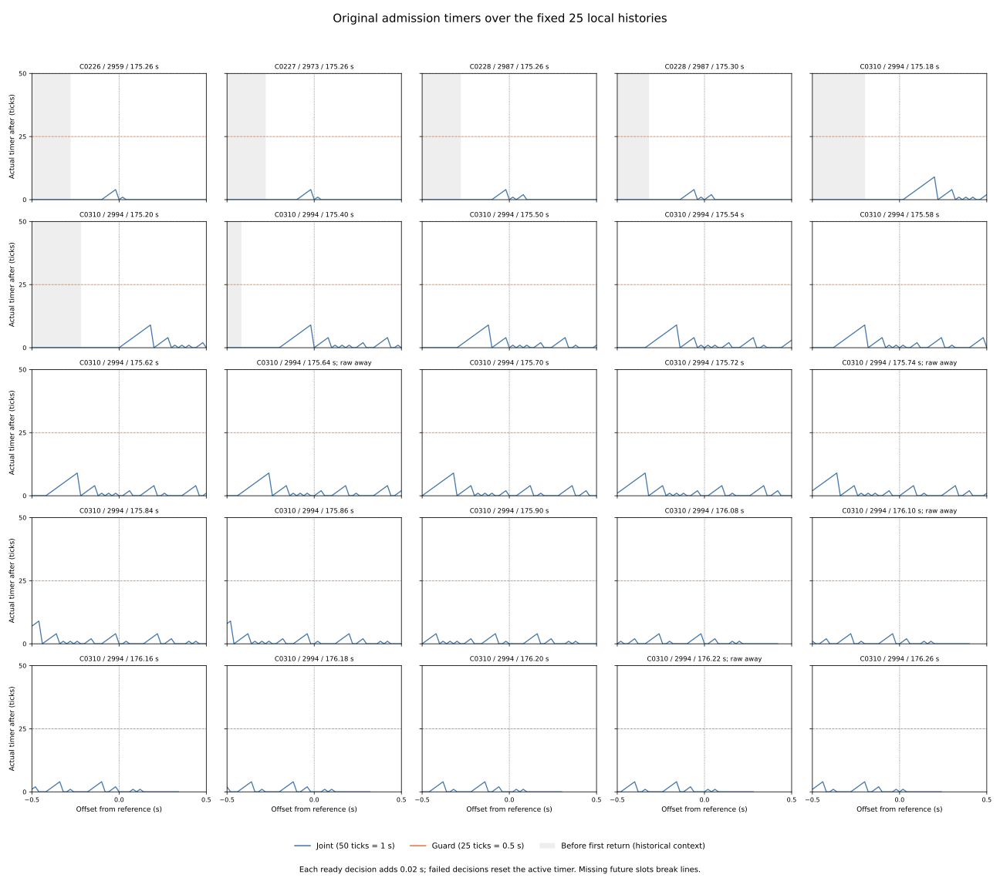

# Local admission gates and actual recovery timers

At the inherited first later-clear point, 22 of the 23 originally blocked raw
points also satisfy the complete source admission conjunction. Each advances
the joint evidence counter from zero to one tick (0.02 s). The remaining
reference has a positive nominal command but fails recovery clearance, so its
counter stays zero. A clear start point alone does not establish clearance of
the original recovery segment.

All 25 fixed reference windows contain both known-pass decisions and timer
resets at positive offsets. Across the included context, the longest known-pass
segment has nine ticks, adding 0.18 s of evidence over a 0.16-s checkpoint span.
The largest actual before/after counter is also nine ticks, below the joint
release threshold of 50 ticks (1 s). No release occurs in these included
contexts. A later clear point can permit a ready decision while the required
consecutive evidence still fails to accumulate to the threshold.

[Protocol](protocol.md) and [pins](freeze-pins.json) were committed at
`c8487d3`, from main `b47c3939135776bb698989181cb1e7c599ab2285`, before
extracting new local gates, timers or segments. The preceding 25 nominal-only
references remain fixed, including the four raw-away, 15 reset, 23 initial-
unsafe and two first-chord references. These are overlapping retrospective
groups, not independent trials. Original outcomes remain inherited.

## Fixed context, branches and gate rules

Retain all 1,275 planned slots, offsets -25..25 at 50 Hz. Of these, 1,215 are
included reference/offset pairs, representing only 247 unique case/step contexts
in four histories. The 60 slots at/after the original next loss stay missing;
no horizon is extended. Roles remain 82 before-return historical contexts,
1,108 available contexts and 25 current references. Slots add no decision
references or follow-up. The original 972 cases, 324 families, 570 timeouts,
3,997 anchors, 137 returns, 3,751 decision references, 1,096 zero probes and
336 summary cells remain intact.

Every included slot uses the joint branch; there are no guard-only or
not-applicable slots, and no unknown conjunctions. Joint admission requires
age <= 1.5 s, absolute measured speed <= 0.02, at least ten samples, recovery
clearance strictly above its margin, inclusive shrunk-map bounds for the
0.6-m recovery segment, positive nominal command and release clearance strictly
above its margin. Guard-only admission uses stationary speed and release
clearance, with a 25-tick threshold. Fusion availability is not an extra gate
and does not itself reset a timer.

Nominal sign comes independently from the source finite cap domain and stop
latch. The 41 free distances are k*0.05, k=0..40. Zero distance gives exactly
zero cap, whereas positive caps exceed the unlatched command floor of 0.1.
Raw cap strings, nanounit min identities, command range, overrides and braking
flags are checked. All observed nominal zeros here have reason cap_zero; none
is inferred from counter behavior. Other source gates retain their original
rounding intervals (H=5e-10, P=1e-12), exact binary64 age/roundtrip speed and
strict/inclusive comparisons. Unknown intervals would remain unresolved.

| Subgroup | Side | Joint pass | Joint fail | Joint unknown | Guard / N/A | Missing | Accumulate / reset / stay zero |
| --- | --- | --- | --- | --- | --- | --- | --- |
| all25 | pre | 281 | 344 | 0 | 0 / 0 | 0 | 281 / 85 / 259 |
| all25 | post | 194 | 371 | 0 | 0 / 0 | 60 | 194 / 88 / 283 |
| raw_away4 | pre | 56 | 44 | 0 | 0 / 0 | 0 | 56 / 20 / 24 |
| raw_away4 | post | 31 | 53 | 0 | 0 / 0 | 16 | 31 / 13 / 40 |
| reset15 | pre | 169 | 206 | 0 | 0 / 0 | 0 | 169 / 42 / 164 |
| reset15 | post | 103 | 247 | 0 | 0 / 0 | 25 | 103 / 51 / 196 |
| initial23 | pre | 263 | 312 | 0 | 0 / 0 | 0 | 263 / 80 / 232 |
| initial23 | post | 190 | 333 | 0 | 0 / 0 | 52 | 190 / 85 / 248 |
| first_chord2 | pre | 18 | 32 | 0 | 0 / 0 | 0 | 18 / 5 / 27 |
| first_chord2 | post | 4 | 38 | 0 | 0 / 0 | 8 | 4 / 3 / 35 |

At offset zero, all 25 fail nominal alone; 15 reset and ten stay at zero. Each side above excludes offset zero. Counts include overlapping windows.

| Simultaneous failed gates | Pre | Reference | Post |
| --- | --- | --- | --- |
| none (pass) | 281 | 0 | 194 |
| age;samples;clearance;nominal;release | 70 | 0 | 0 |
| age;samples;clearance;release | 2 | 0 | 0 |
| age;samples;release | 10 | 0 | 0 |
| clearance | 14 | 0 | 69 |
| clearance;nominal | 14 | 0 | 65 |
| nominal | 145 | 25 | 145 |
| nominal;release | 0 | 0 | 23 |
| release | 0 | 0 | 69 |
| samples | 67 | 0 | 0 |
| samples;clearance;nominal;release | 4 | 0 | 0 |
| samples;nominal | 8 | 0 | 0 |
| samples;release | 10 | 0 | 0 |

No unknown masks occur. The bounds and stationary predicates pass throughout; age/sample/recovery/release/nominal failures retain all simultaneous causes rather than choosing one.

## Inherited first later-clear checkpoints

The preceding point-history audit fixes these offsets: one, two or three ticks after the 23 blocked references. No new later-clear search is performed. The two currently clear first-chord references have blank first-later-clear fields.

| Subgroup | Audited | Nominal positive | Joint pass | Joint fail: clearance | Unknown | Counter 0→1 / 0→0 |
| --- | --- | --- | --- | --- | --- | --- |
| all25 | 23 | 23 | 22 | 1 | 0 | 22 / 1 |
| raw_away4 | 4 | 4 | 4 | 0 | 0 | 4 / 0 |
| reset15 | 13 | 13 | 12 | 1 | 0 | 12 / 1 |
| initial23 | 23 | 23 | 22 | 1 | 0 | 22 / 1 |
| first_chord2 | 0 | 0 | 0 | 0 | 0 | 0 / 0 |

All 23 nominal signs are positive and all counters start at zero. The one
failure is C0310 / anchor 2994 / reference 175.90 s, at offset +3 (175.96 s).
Its failed mask is clearance alone; its nominal command and other gates pass.
All four raw-away references pass at their inherited +1 clear checkpoints,
but that decision adds only the first tick of the required 50.

## Known-pass segments and actual carried counters

A segment is consecutive included slots with the same branch and a known-pass source conjunction. Fail/unknown/missing, branch changes and a preceding recorded release break it. L checkpoints span (L-1)/50 s and add L/50 s evidence; context boundaries do not date the full onset/end. Unknown would break this diagnostic without proving an actual unrounded failure.

| Segment length L | Segments |
| --- | --- |
| 1 | 91 |
| 2 | 34 |
| 3 | 2 |
| 4 | 53 |
| 8 | 1 |
| 9 | 10 |

The 191 segments reconstruct all 475 known-pass slots. Eight touch the left
context limit and six touch a right context limit or subsequent missing slot.
Four begin with carried evidence (one, one, six and seven ticks); the other
187 begin at zero. Actual counters are checked separately, so a local segment
shortened by the context boundary is never mistaken for the full evidence run.
All segments are joint and none contains a recorded release.

| Subgroup | Segments | Max L: all / post | Max actual before / after / post after | References with post pass / reset |
| --- | --- | --- | --- | --- |
| all25 | 191 | 9 / 9 | 9 / 9 / 9 | 25 / 25 |
| raw_away4 | 35 | 9 / 4 | 9 / 9 / 4 | 4 / 4 |
| reset15 | 109 | 9 / 4 | 9 / 9 / 4 | 15 / 15 |
| initial23 | 181 | 9 / 9 | 9 / 9 / 9 | 23 / 23 |
| first_chord2 | 10 | 4 / 2 | 4 / 4 / 2 | 2 / 2 |

Guard segment maxima are zero because no guard branch is observed; actual guard counter maxima are blank. Post segment counts clip to strictly positive offsets, independently of all-context counts.

## Clear points versus source admission

| Subgroup | Raw clear + nominal zero | Raw clear + not ready | Raw clear + ready | Mean clear + not ready |
| --- | --- | --- | --- | --- |
| all25 | 25 | 266 | 475 | 670 |
| raw_away4 | 4 | 25 | 87 | 101 |
| reset15 | 15 | 190 | 272 | 422 |
| initial23 | 22 | 229 | 453 | 607 |
| first_chord2 | 3 | 37 | 22 | 63 |

These are full-context slot counts and can overlap across references.
The 741 raw-clear slots divide into 266 not-ready and 475 ready slots. The
25 raw-clear nominal-zero slots are a subset of the not-ready slots. Mean
points are clear at 670 not-ready slots. Point predicates retain the original
fixed obstacle sets and do not replace the curved first chord, straight
recovery segment, release probe or boundaries.

## All 25 original references

First-clear offsets are inherited steps. FC gives the source conjunction at that point; N/A applies to the two current-clear first-chord references. L and counter maxima are ticks. Complete gate masks, intervals, strings and timer transitions remain in the CSVs.

| Case / anchor | Time s | First clear offset / FC | Max L all / post | Max actual before / after / post | Raw clear + zero |
| --- | --- | --- | --- | --- | --- |
| C0226 / 2959 | 175.26 | 1 / pass | 4 / 1 | 4 / 4 / 1 | 0 |
| C0227 / 2973 | 175.26 | 1 / pass | 4 / 1 | 4 / 4 / 1 | 0 |
| C0228 / 2987 | 175.26 | 1 / pass | 4 / 2 | 4 / 4 / 2 | 2 |
| C0228 / 2987 | 175.3 | N/A | 4 / 2 | 4 / 4 / 2 | 2 |
| C0310 / 2994 | 175.18 | 2 / pass | 9 / 9 | 9 / 9 / 9 | 1 |
| C0310 / 2994 | 175.2 | 1 / pass | 9 / 9 | 9 / 9 / 9 | 1 |
| C0310 / 2994 | 175.4 | 1 / pass | 9 / 4 | 9 / 9 / 4 | 1 |
| C0310 / 2994 | 175.5 | 1 / pass | 9 / 4 | 9 / 9 / 4 | 1 |
| C0310 / 2994 | 175.54 | 1 / pass | 9 / 4 | 9 / 9 / 4 | 1 |
| C0310 / 2994 | 175.58 | 1 / pass | 9 / 4 | 9 / 9 / 4 | 1 |
| C0310 / 2994 | 175.62 | 2 / pass | 9 / 4 | 9 / 9 / 4 | 1 |
| C0310 / 2994 | 175.64 | 1 / pass | 9 / 4 | 9 / 9 / 4 | 1 |
| C0310 / 2994 | 175.7 | 3 / pass | 9 / 4 | 9 / 9 / 4 | 1 |
| C0310 / 2994 | 175.72 | 2 / pass | 9 / 4 | 9 / 9 / 4 | 1 |
| C0310 / 2994 | 175.74 | 1 / pass | 8 / 4 | 9 / 9 / 4 | 1 |
| C0310 / 2994 | 175.84 | 2 / pass | 4 / 4 | 9 / 9 / 4 | 1 |
| C0310 / 2994 | 175.86 | 1 / pass | 4 / 4 | 9 / 9 / 4 | 1 |
| C0310 / 2994 | 175.9 | 3 / fail | 4 / 4 | 9 / 4 / 4 | 1 |
| C0310 / 2994 | 176.08 | 2 / pass | 4 / 2 | 4 / 4 / 2 | 1 |
| C0310 / 2994 | 176.1 | 1 / pass | 4 / 2 | 4 / 4 / 2 | 1 |
| C0310 / 2994 | 176.16 | N/A | 4 / 1 | 4 / 4 / 1 | 1 |
| C0310 / 2994 | 176.18 | 3 / pass | 4 / 1 | 4 / 4 / 1 | 1 |
| C0310 / 2994 | 176.2 | 2 / pass | 4 / 1 | 4 / 4 / 1 | 1 |
| C0310 / 2994 | 176.22 | 1 / pass | 4 / 1 | 4 / 4 / 1 | 1 |
| C0310 / 2994 | 176.26 | 1 / pass | 4 / 1 | 4 / 4 / 1 | 1 |

The two fixed first-chord examples remain C0228 / 2987 / 175.30 s and
C0310 / 2994 / 176.16 s. Both reset at the reference despite a clear raw
start point, with nominal as the only failed gate. Their maximum post counters
are two and one ticks, respectively. Their 25 and 17 observed positive slots
retain the original missing-slot limits and inherited first-chord failures.

## Original measures and frozen figure

Original weights are formed before selection. Census/received/RP masses remain
570 / 570 / 157 with 10,995 RP records. All 336 summary cells are retained,
with 6,600 new additive mode/category closure comparisons. Nonreturns retain
blank new fields and empty share denominators remain blank. Available flags
can overlap and use all 137 returns as their original denominator.

| Available anchor flag | Anchors | Original case mass | Raw / case-mass share |
| --- | --- | --- | --- |
| Raw clear + nominal zero | 2 | 2/7 | 2/137 |
| First clear + not ready | 1 | 1/7 | 1/137 |
| Post reset | 4 | 4/7 | 4/137 |

The frozen 5x5 figure keeps original order, x range +/-0.5 s and shared
0..50-tick axes. It marks the reference and both thresholds; grey marks
before-return context and missing slots break lines. All four raw-away labels
remain explicit. PNG was visually inspected. SVG, 1,275 plot slots, 252
original-mode summary cells, 137 returns and plot provenance are tracked.

## Independent validation and repeatability

Both readers freshly hash/stream 108 files (6,043,185,194 bytes), validate
5,130,570 timeout grid rows and 570 noisy initial branches, then replay four
selected window histories (36,000 steps). Exact preceding raw strings, margins,
window counts/clear metadata and inherited point enclosures are checked.
All 1,133 included slots at/after first return join the original decision by
event and source step, agreeing on gates, masks, nominal sign/reason and timer.
Before-return contexts do not receive fictional original decision references.

The standalone verifier imports no analyzers or plotters. It independently
reconstructs source gates, observed readiness, segments, selected metrics and
weights, using pinned Decimal admission/window and source-command helpers.
New numeric comparisons use abs 1e-9 / rel 1e-10; states, counts, IDs and
inherited/raw strings compare exactly. Tolerances do not narrow intervals.

The verifier performs 5,016,324 comparisons beyond 155,883 original identity comparisons, checking all five tables, plot exports and provenance pins.

Unchanged Rust window, finite cap, recovery bounds/ready and joint/guard
timer fragments are compiled with `rustc 1.99.0 (b940084d7 2026-09-28)`. Native window
counts match all 36,000 steps, with 1,215 context queries. The full 41-value
cap lattice is checked, and 1,215 native admission traces match known source
predicates and actual readiness/counters/flags. Unknown-center mismatches:
0. Native tests: 9 window + 4 command + 8 admission = 21.

Native admission inputs use rounded logged scalars, exact age/roundtrip speed,
and counters reconstructed by repeated original DT additions. Guard-entry
flags are inputs; no guard-entry geometry, whole-map probe or new closed-loop
rollout is replayed. This is conditional rounded-input validation, not recovery
of original unrounded values or a change to controller/outcome labels.

All **1,096 Python tests pass**, including 21 new tests for boundaries, source
sign independent of timers, simultaneous failures, guard/not-applicable,
49/50 and 24/25 thresholds, carried/reset/new-pause counters, unknown/missing/
branch/release segment breaks, endpoint limits, span versus evidence, fixed
first-clear joins, exact count/raw strings, original weights and closures.
Two collector runs are byte identical across all five CSVs and sources.
Two plot runs are byte identical across SVG, PNG, three CSV exports and provenance.

Use the [README commands](../../README.md#check-local-admission-gates-and-actual-timers)
with new output/work directories and without Python -O. Activate the saved
toolchain or provide --rustc. Both readers accept --raw-roots. The 21 tracked
study files follow. Full replay inputs, compiler products, logs, PNG and
reproduction metadata stay in scratch.

| Artifact | Contents |
| --- | --- |
| [anchor-local.csv](anchor-local.csv) | 3,997 rows × 622 columns |
| [freeze-pins.json](freeze-pins.json) | protocol / provenance / figure |
| [independent-verification.json](independent-verification.json) | protocol / provenance / figure |
| [local-admission.svg](local-admission.svg) | protocol / provenance / figure |
| [local-decisions.csv](local-decisions.csv) | 3,751 rows × 427 columns |
| [local-slots.csv](local-slots.csv) | 1,275 rows × 142 columns |
| [local-summary.csv](local-summary.csv) | 336 rows × 684 columns |
| [native-admission-inputs.tsv](native-admission-inputs.tsv) | 1,215 rows × 23 columns |
| [native-admission.csv](native-admission.csv) | 1,215 rows × 17 columns |
| [native-checkpoints.tsv](native-checkpoints.tsv) | 1,215 rows × 4 columns |
| [native-contexts.csv](native-contexts.csv) | 1,215 rows × 6 columns |
| [native-lattice.csv](native-lattice.csv) | 41 rows × 6 columns |
| [native-window.csv](native-window.csv) | 1,215 rows × 6 columns |
| [plot-local.csv](plot-local.csv) | 1,275 rows × 142 columns |
| [plot-return-values.csv](plot-return-values.csv) | 137 rows × 622 columns |
| [plot-sources.json](plot-sources.json) | protocol / provenance / figure |
| [plot-values.csv](plot-values.csv) | 252 rows × 684 columns |
| [protocol.md](protocol.md) | protocol / provenance / figure |
| [ready-runs.csv](ready-runs.csv) | 191 rows × 31 columns |
| [sources.json](sources.json) | protocol / provenance / figure |
| [report.md](report.md) | this report |

Evidence pins (SHA-256):

| Artifact | SHA-256 |
| --- | --- |
| sources.json | 855f9efd9a43a20251c58d3db043c8947c920c54d82aec1ae42cb9b1777a175c |
| independent-verification.json | 884fb4bca980ec2baf35fd7df28d6a51a5280ec01a9ff671a38f46bc4ef62770 |
| plot-sources.json | 0323ae52a0a4cac2d792d8f016202e4f9c97d128aac57140221a3c763f3c89cc |
