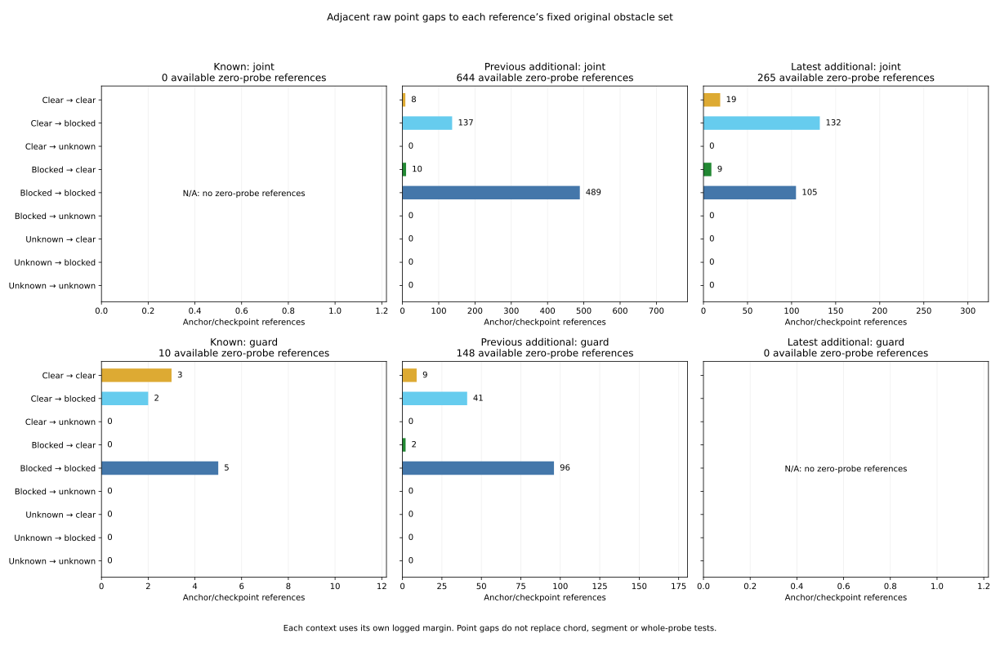

# Adjacent point gaps to fixed original obstacle sets

The preceding 25 nominal-only conjunction failures have larger raw position
steps than mean steps, but their raw distances to the fixed original blockers
decrease in 21 cases and increase in four. Raw point gaps cross from clear to
blocked in 15, remain blocked in eight, and remain clear in the two inherited
first-chord cases. Mean point gaps remain clear in all 25. Every one of these
25 contexts has an increasing logged margin (rounded center change 0.0004 m).
These signed measurements describe the recorded inputs and original predicates.

[Protocol](protocol.md) and [pins](freeze-pins.json) were committed at
`67177ce` from main `9941ce31dcfacd75aa948c0041965565ff1d0bd6` before new
predecessor distances/margins were extracted. The unchanged original obstacle
IDs were selected by the preceding initial-unsafe/direct-first-chord tests.
All earlier outcomes and the original 972 cases, 324 families, 570 timeouts,
3,997 anchors, 137 returns, 3,751 decision references and 336 summary cells
are retained. Predecessor n-1 is historical context, never new follow-up.

## Point intervals and signed changes

For every selected reference, use ALL original definite obstacle IDs, retaining
duplicate coordinates and original global map row IDs. Both contexts use their
own raw `speed_margin` string, for both raw and mean points. The pinned source
contract checks that recovery and speed margin expressions agree. No drift
arguments are inferred from incomplete historical command provenance.

For point distance d and margin m, gap g=d-m. Raw points are reconstructed in
source addition order; means are reconstructed from original retained members,
with raw fallback for an empty window. Means here differ slightly from the
separately rounded logged recovery coordinates used in the earlier segment
audit. The map constants retain their binary64 values.

Use nine-decimal half-unit H=5e-10 and elemental allowance P=1e-12. Raw point
coordinate radius is R=3H+2P; nonempty mean radius is R+2P, fallback radius R.
Each coordinate difference to a fixed obstacle is padded by its point radius
and P, then rectangular minimum/maximum squared norms bound the distance,
with P padding on sqrt and a zero floor. Margin bounds use logged value +/-H;
interval subtractions add P. Take the minimum lower and upper distances across
the entire fixed set, subtract the common context margin, and save center ties
and all possible minimum IDs. Individual witnesses retain every obstacle.

Clear requires gap lower>0; blocked requires upper<=0; otherwise unknown.
Distance change is toward only if its upper<0, away only if its lower>0;
zero-containing changes remain unresolved. Gap/margin directions use the same
strict signed test. Check Delta gap = Delta distance - Delta margin with
rounded-center residual<=P and overlapping direct/predicted intervals. Native
rounded changes must lie inside both enclosures. These conditional bounds use
rounded logs and elemental allowances; they are not a formal floating proof.

## Fixed-set point-gap transitions

Columns preserve all nine states, including the five transitions involving an
unknown gap. The original-25 column is a fixed subset of the 887 comparable
pairs; comparable means both windows nonempty, as defined in the preceding
turnover study. All 1,096 references still receive both raw and mean results.

| Previous → current | All raw (1,096) | All mean (1,096) | Comparable raw (887) | Comparable mean (887) | Original 25 raw | Original 25 mean |
| --- | --- | --- | --- | --- | --- | --- |
| clear → clear | 39 | 343 | 27 | 330 | 2 | 25 |
| clear → blocked | 316 | 60 | 265 | 9 | 15 | 0 |
| clear → unknown | 0 | 0 | 0 | 0 | 0 | 0 |
| blocked → clear | 22 | 2 | 19 | 0 | 0 | 0 |
| blocked → blocked | 719 | 691 | 576 | 548 | 8 | 0 |
| blocked → unknown | 0 | 0 | 0 | 0 | 0 | 0 |
| unknown → clear | 0 | 0 | 0 | 0 | 0 | 0 |
| unknown → blocked | 0 | 0 | 0 | 0 | 0 | 0 |
| unknown → unknown | 0 | 0 | 0 | 0 | 0 | 0 |

The 1,035 current raw blocked points retain the original initial-unsafe
classifications; the 61 clear current raw points retain their original
first-chord failures. A clear start point does not describe the next curved
0.05-m chord. Mean point gaps do not replace the original straight 0.6-m
recovery segment, boundary or whole-map checks. No contact or outcome labels
are changed.

| Phase / branch | N | Raw clear→blocked | Raw blocked→blocked | Raw clear→clear | Raw blocked→clear | Mean clear→blocked | Mean blocked→blocked | Mean clear→clear | Mean blocked→clear |
| --- | --- | --- | --- | --- | --- | --- | --- | --- | --- |
| available / joint | 909 | 269 | 594 | 27 | 19 | 15 | 566 | 328 | 0 |
| available / guard | 158 | 43 | 101 | 12 | 2 | 43 | 101 | 12 | 2 |
| next / loss / joint | 26 | 4 | 21 | 0 | 1 | 2 | 21 | 3 | 0 |
| next / loss / guard | 3 | 0 | 3 | 0 | 0 | 0 | 3 | 0 | 0 |

## Distance, margin and gap directions

| Selection | Point | Toward | Away | Unresolved | Gap narrower | Gap wider | Gap unresolved |
| --- | --- | --- | --- | --- | --- | --- | --- |
| all | raw | 691 | 405 | 0 | 678 | 418 | 0 |
| all | mean | 745 | 351 | 0 | 757 | 339 | 0 |
| comparable | raw | 556 | 331 | 0 | 560 | 327 | 0 |
| comparable | mean | 610 | 277 | 0 | 639 | 248 | 0 |
| original25 | raw | 21 | 4 | 0 | 21 | 4 | 0 |
| original25 | mean | 21 | 4 | 0 | 23 | 2 | 0 |

| Selection | Margin increase | Margin decrease | Unresolved |
| --- | --- | --- | --- |
| all | 1052 | 44 | 0 |
| comparable | 887 | 0 | 0 |
| original25 | 25 | 0 | 0 |

The prior 15 nominal-only resets are contained in the original 25. All 15
raw distances move toward their fixed blockers and raw gaps narrow. Thirteen
cross clear-to-blocked and the two first-chord starts remain clear. Their mean
gaps stay clear in all 15; mean distances move toward in 12 and away in three,
while mean gaps narrow in 14 and widen in one. The logged margin increases
in all 15. A distance increase alone does not guarantee a widening gap.

## Signed change envelopes (metres)

Each interval below is the minimum lower / maximum upper across the entire
specified subset. It is a descriptive range, not uncertainty on a population
mean, a confidence interval or a causal effect. No fitted cutoff is used.

| Selection | Quantity | Min lower / max upper |
| --- | --- | --- |
| all | raw_distance_change | [-0.51056047341325217, 0.29424249347551468] |
| all | raw_gap_change | [-0.51096047441525216, 0.29384249447751465] |
| all | mean_distance_change | [-0.51056047341325217, 0.1697853215857176] |
| all | mean_gap_change | [-0.51096047441525216, 0.26938532258771763] |
| all | point_margin_change | [-0.19960000100100009, 0.00040000100100014971] |
| comparable | raw_distance_change | [-0.49303477967762566, 0.29424249347551468] |
| comparable | raw_gap_change | [-0.49343478067962565, 0.29384249447751465] |
| comparable | mean_distance_change | [-0.10361438488239941, 0.07285829063090013] |
| comparable | mean_gap_change | [-0.10401438588439957, 0.072458291632900157] |
| comparable | point_margin_change | [0.00039999899899987321, 0.00040000100100014971] |
| original25 | raw_distance_change | [-0.45681354495542181, 0.20925065781491162] |
| original25 | raw_gap_change | [-0.45721354595742181, 0.20885065881691176] |
| original25 | mean_distance_change | [-0.020946921268319672, 0.0059722286122698923] |
| original25 | mean_gap_change | [-0.021346922270319715, 0.0055722296142700165] |
| original25 | point_margin_change | [0.00039999899899987321, 0.00040000100100014971] |

Original-25 current raw fixed-set gap envelope is [-0.30092385018085521, 0.010662407008861586] m; current mean envelope is [0.015480684806056333, 0.080248749738745323] m. Both raw and mean maximum rounded-center closure residuals are 5.5511151231257827e-17 m, below P.

## Two predeclared first-chord examples

**C0228 / anchor 2987 / 175.3 s**, original obstacle ID 420. Both raw and mean point transitions are clear-to-clear. Logged margin changes from 0.888442712 to 0.888842712 m.

| Quantity | Previous | Current |
| --- | --- | --- |
| raw gap | [0.063515598870711759, 0.063515602907716878] | [0.00099284525810114941, 0.00099284963255998884] |
| mean gap | [0.078746109305939255, 0.078746113353178632] | [0.072990181048893737, 0.072990185071819341] |

| Quantity | Adjacent change interval |
| --- | --- |
| raw distance | [-0.062122756648615683, -0.062122750239151904] |
| mean distance | [-0.0053559313032848447, -0.0053559252351200511] |

**C0310 / anchor 2994 / 176.16 s**, original obstacle ID 1310. Both raw and mean point transitions are clear-to-clear. Logged margin changes from 0.905642712 to 0.906042712 m.

| Quantity | Previous | Current |
| --- | --- | --- |
| raw gap | [0.063188752052683567, 0.063188757182725014] | [0.010662402255577441, 0.010662407008861586] |
| mean gap | [0.038738901208437905, 0.038738906294509511] | [0.028088966556436536, 0.028088971636823355] |

| Quantity | Adjacent change interval |
| --- | --- |
| raw distance | [-0.052126353926147527, -0.052126346044822115] |
| mean distance | [-0.010249938737072939, -0.010249930572614674] |

Their inherited direct first-chord gaps remain negative, as documented in
[the first-chord report](../fusion-return-first-chord/report.md). These two
examples were fixed before new extraction; they are not selected extrema.

## Anchors, original measures and figure

Original denominators are reconstructed before geometry selection. The audit
retains 10,995 RP records and exact original census/received/RP masses
570 / 570 / 157. All new additive mode/category closures pass (19,800 checks).
Nonreturns have blank new counts and flags. Empty share denominators stay
blank. Available flags can overlap; they do not partition returned anchors.

| Available flag | Anchors | Original case mass | Raw / case-mass share of all 137 returns |
| --- | --- | --- | --- |
| Raw clear→blocked | 41 | 41/7 | 41/137 |
| Mean clear→blocked | 20 | 20/7 | 20/137 |
| Raw toward and mean away | 18 | 18/7 | 18/137 |

The frozen 2x3 figure shows all nine raw transitions for each original partition
and joint/guard branch. Empty branches remain explicit. The exports keep all
252 original-mode summary cells and 137 returns. PNG was visually inspected;
SVG/CSV/provenance are tracked.

## Independent verification and reproducibility

Both readers freshly hash/stream 108 raw files (6,043,185,194 bytes), validate
5,130,570 timeout grid rows and 570 noisy initial branches, and replay the
63 selected histories / 567,000 steps. There are 1,450 unique context points
and 2,192 role-specific queries for the same 1,096 references. Window count,
logged-mean enclosures, inherited current/predecessor centers and raw strings
are checked. The 1,100 witness rows retain four multi-obstacle references.

The standalone verifier imports no analyzers/plotters. New geometry uses
60-digit Decimal, comparing numeric fields at abs 1e-9 / rel 1e-10 while
states, IDs, counts, inherited and raw strings compare exactly. Tolerance does
not narrow intervals. It performs 3,744,466 comparisons beyond 155,883
original identity comparisons. Earlier outcomes remain inherited through the
pinned transitive chain.

`rustc 1.99.0 (b940084d7 2026-09-28)` compiles the unchanged original window
fragment and original Point2D struct/new/distance. Native window checks pass
all 567,000 counts and trace 2,192 contexts; the point harness checks 4,400
raw/mean point-obstacle pairs and the declared gap/distance change intervals.
Window native tests: 9; point native tests: 6. Means in point queries use the
native rounded reconstruction; they remain inside independently reconstructed
mean bounds. This does not replay the rest of the controller or recover
unrounded historical samples.

All **1,053 Python tests pass**, including 20 new tests covering inclusive
gap equality, strict directions, rectangle bounds, margin changes, minimum
switches, duplicate-coordinate IDs, first-chord distinction, fallback, native
mapping, exact raw strings, nonreturns and unequal measures. Collection was
repeated: all four tables and sources are byte identical. Both figure runs
match byte for byte across SVG, PNG, two CSV exports and plot provenance.

Re-run the [README commands](../../README.md#compare-adjacent-point-gaps-to-fixed-original-blockers)
with fresh directories; activate the saved Rust toolchain or pass `--rustc`.
Both readers accept `--raw-roots`. All 18 tracked study files are below; full
native replay input, compiler products, run logs and PNG remain scratch.

| Artifact | Contents |
| --- | --- |
| [anchor-point.csv](anchor-point.csv) | 3,997 rows × 484 columns |
| [freeze-pins.json](freeze-pins.json) | protocol / provenance / figure |
| [independent-verification.json](independent-verification.json) | protocol / provenance / figure |
| [native-checkpoints.tsv](native-checkpoints.tsv) | 2,192 rows × 4 columns |
| [native-contexts.csv](native-contexts.csv) | 2,192 rows × 6 columns |
| [native-point-inputs.tsv](native-point-inputs.tsv) | 4,400 rows × 12 columns |
| [native-point.csv](native-point.csv) | 4,400 rows × 3 columns |
| [native-window.csv](native-window.csv) | 2,192 rows × 6 columns |
| [plot-return-values.csv](plot-return-values.csv) | 137 rows × 484 columns |
| [plot-sources.json](plot-sources.json) | protocol / provenance / figure |
| [plot-values.csv](plot-values.csv) | 252 rows × 528 columns |
| [point-clearance.svg](point-clearance.svg) | protocol / provenance / figure |
| [point-decisions.csv](point-decisions.csv) | 3,751 rows × 342 columns |
| [point-summary.csv](point-summary.csv) | 336 rows × 528 columns |
| [point-witnesses.csv](point-witnesses.csv) | 1,100 rows × 67 columns |
| [protocol.md](protocol.md) | protocol / provenance / figure |
| [sources.json](sources.json) | protocol / provenance / figure |
| [report.md](report.md) | this report |

Evidence pins (SHA-256):

| Artifact | SHA-256 |
| --- | --- |
| sources.json | 6752d0e1aa13908e5b402e63f1079d1fac692c68fc70c66129a930e31ec09d58 |
| independent-verification.json | d6f0254d3e70a4bb371ac1cc17cb2cbf506e4f1b6af12751a0201f8df21ab901 |
| plot-sources.json | c5ffa25959469ec87038533ad17599c2f925b58c5385f48074b921d8a756ba9c |

The repository contains only this audit, reproducible evidence and README
instructions. Original Rust/controller/lock files remain at their pinned
versions. This retrospective diagnostic supplies signed point measurements;
it does not establish successful motion or authorize a pose substitution.
