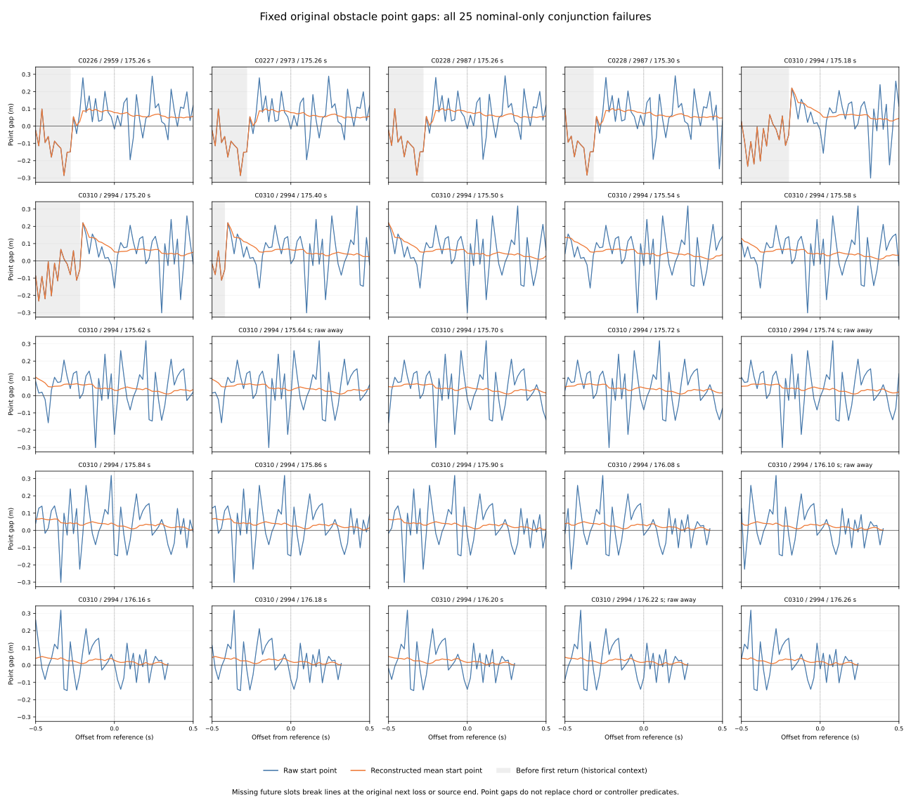

# Local point-gap histories of the original 25 references

All 23 currently blocked raw start points have a certain clear point 1–3
recorded steps later (0.02–0.06 s), strictly before the original next loss.
The four preceding raw-away references were already in blocked runs of two
or three checkpoints; all four have a clear point at the very next step.
The two inherited first-chord references have clear raw start points at the
reference, and retain their original first-chord failures.

All 25 current mean points are clear. Every one of the 565 included positive-
offset mean points is also clear. These are point predicates on recorded inputs,
not controller recovery, successful motion or a change in outcomes.

[Protocol](protocol.md) and [pins](freeze-pins.json) were committed at
`55822f5`, from main `9cc0426a527c3b200a0c7312e9d964a7b06932ae`, before new
context gaps or run lengths were extracted. All preceding 25 references with
prior_certainty=unknown were selected in original order, including all four
raw-away cases and the 15 nominal-only resets. Earlier audits and outcomes
remain inherited: 972 cases, 324 families, 570 timeouts, 3,997 anchors,
137 returns, 3,751 decision references, 1,096 zero probes and 336 summary cells.

## Fixed context and missing slots

Every reference has exactly 51 planned slots, offsets -25..25 at 50 Hz
(-0.5..+0.5 s). Negative offsets before the first return remain historical
context. Positive offsets stop strictly before the original first next loss;
the source bound is step 1..9000. Unavailable slots retain metadata and blank
new geometry/raw fields. No context slot becomes a new decision or follow-up.

Of 1,275 planned slots, 1,215 are included and 60 are excluded at/after next
loss. No source-bound slots are missing. The 60 excluded slots belong to seven
references; 18 have the complete positive half-second. Counts below are
reference/offset pairs, including overlaps. There are only 247 unique case/step
contexts, from four histories. Neither the 25 references nor their context
slots are independent statistical trials.

| Slot status | Count |
| --- | --- |
| observed | 1215 |
| at_or_after_next_loss | 60 |

| Included context role | Count |
| --- | --- |
| before_return | 82 |
| available_context | 1108 |
| reference | 25 |

| Missing positive slots per reference | References |
| --- | --- |
| 0 | 18 |
| 4 | 1 |
| 5 | 1 |
| 8 | 1 |
| 9 | 1 |
| 10 | 1 |
| 11 | 1 |
| 13 | 1 |

## Current-state runs and onset censorship

A run is the consecutive observed sequence of the current raw/mean state,
scanned backward from offset zero. L includes the current checkpoint; the
checkpoint span is (L-1)/50 s. A different or unknown state breaks a blocked/
clear run. If the left context limit or a missing slot is reached first, the
onset is left-censored and no predecessor-state bracket is supplied. These
are finite-grid spans, not exact continuous transition times.

For the 23 blocked raw references, run counts are 1 checkpoint in 15 cases,
2 in six, and 3 in two. Their spans are 0, 0.02 and 0.04 s. Fifteen are new
clear-to-blocked entries and eight were already blocked at the preceding step;
none has a left-censored raw onset. The two clear raw reference runs have
lengths two and three. The all25 raw distribution below includes those two.

Eighteen mean clear runs reach all 26 backward checkpoints (0.5 s span) and
are left-censored. The other seven runs have counts 10, 11, 14 (three), 16
and 21; their starts are bracketed by a preceding blocked point. The earlier
onsets of the 18 censored runs are not dated at -0.5 s.

| Fixed subgroup | N | Point | Current states | Run count: references | Left-censored onsets |
| --- | --- | --- | --- | --- | --- |
| all25 | 25 | raw | blocked: 23, clear: 2 | 1: 15, 2: 7, 3: 3 | 0 |
| all25 | 25 | mean | clear: 25 | 10: 1, 11: 1, 14: 3, 16: 1, 21: 1, 26: 18 | 18 |
| raw_away4 | 4 | raw | blocked: 4 | 2: 2, 3: 2 | 0 |
| raw_away4 | 4 | mean | clear: 4 | 26: 4 | 4 |
| reset15 | 15 | raw | blocked: 13, clear: 2 | 1: 13, 2: 1, 3: 1 | 0 |
| reset15 | 15 | mean | clear: 15 | 14: 3, 16: 1, 21: 1, 26: 10 | 10 |
| initial23 | 23 | raw | blocked: 23 | 1: 15, 2: 6, 3: 2 | 0 |
| initial23 | 23 | mean | clear: 23 | 10: 1, 11: 1, 14: 3, 21: 1, 26: 17 | 17 |
| first_chord2 | 2 | raw | clear: 2 | 2: 1, 3: 1 | 0 |
| first_chord2 | 2 | mean | clear: 2 | 16: 1, 26: 1 | 1 |

## First certain later clear

The later-clear search applies only to a currently blocked point. It records
the first included positive offset with a certainly clear gap. Unknowns before
that point do not turn it into an exact transition time. When no clear is found,
unknown/no-future/no-clear-observed remain separate; positive included/missing
counts retain the actual observation span. Current clear/unknown points use
current_not_blocked with blank later-clear fields.

All 23 blocked raw references have a first certain clear: 14 after one step,
six after two, and three after three. The original 15 reset subgroup contains
13 blocked raw points; eight first clear after one step, three after two and
two after three. Its other two points are the fixed first-chord cases. These
findings do not replace the curved chord, straight recovery segment, boundaries,
nominal-speed predicate or multi-tick controller admission conditions.

| Subgroup | Point | Clear observed | Unresolved | No future | No clear observed | Current not blocked | First-clear offset: references |
| --- | --- | --- | --- | --- | --- | --- | --- |
| all25 | raw | 23 | 0 | 0 | 0 | 2 | 1: 14, 2: 6, 3: 3 |
| all25 | mean | 0 | 0 | 0 | 0 | 25 | — |
| raw_away4 | raw | 4 | 0 | 0 | 0 | 0 | 1: 4 |
| raw_away4 | mean | 0 | 0 | 0 | 0 | 4 | — |
| reset15 | raw | 13 | 0 | 0 | 0 | 2 | 1: 8, 2: 3, 3: 2 |
| reset15 | mean | 0 | 0 | 0 | 0 | 15 | — |
| initial23 | raw | 23 | 0 | 0 | 0 | 0 | 1: 14, 2: 6, 3: 3 |
| initial23 | mean | 0 | 0 | 0 | 0 | 23 | — |
| first_chord2 | raw | 0 | 0 | 0 | 0 | 2 | — |
| first_chord2 | mean | 0 | 0 | 0 | 0 | 2 | — |

## Pre/post point-state counts

Each side plans 25 slots per reference, excluding offset zero. Subgroups overlap; missing is never counted as blocked or unknown. All 60 missing slots are positive offsets.

| Subgroup | Point | Side | Clear | Blocked | Unknown | Missing |
| --- | --- | --- | --- | --- | --- | --- |
| all25 | raw | pre | 396 | 229 | 0 | 0 |
| all25 | raw | post | 343 | 222 | 0 | 60 |
| all25 | mean | pre | 555 | 70 | 0 | 0 |
| all25 | mean | post | 565 | 0 | 0 | 60 |
| raw_away4 | raw | pre | 63 | 37 | 0 | 0 |
| raw_away4 | raw | post | 49 | 35 | 0 | 16 |
| raw_away4 | mean | pre | 100 | 0 | 0 | 0 |
| raw_away4 | mean | post | 84 | 0 | 0 | 16 |
| reset15 | raw | pre | 246 | 129 | 0 | 0 |
| reset15 | raw | post | 214 | 136 | 0 | 25 |
| reset15 | mean | pre | 329 | 46 | 0 | 0 |
| reset15 | mean | post | 350 | 0 | 0 | 25 |
| initial23 | raw | pre | 367 | 208 | 0 | 0 |
| initial23 | raw | post | 315 | 208 | 0 | 52 |
| initial23 | mean | pre | 514 | 61 | 0 | 0 |
| initial23 | mean | post | 523 | 0 | 0 | 52 |
| first_chord2 | raw | pre | 29 | 21 | 0 | 0 |
| first_chord2 | raw | post | 28 | 14 | 0 | 8 |
| first_chord2 | mean | pre | 41 | 9 | 0 | 0 |
| first_chord2 | mean | post | 42 | 0 | 0 | 8 |

## All 25 references in original order

Run count is current-state count, so the two chord rows describe clear raw runs. A mean count marked * is left-censored. Later-clear offsets are steps; multiply by 0.02 s. The complete rows, including raw strings and uncertainty bounds, are in the CSVs.

| Case / anchor | Time s | Inherited raw direction | Probe origin | Raw run | Mean run | Raw first later clear | Positive missing |
| --- | --- | --- | --- | --- | --- | --- | --- |
| C0226 / 2959 | 175.26 | toward | initial | 1 | 14 | 1 | 0 |
| C0227 / 2973 | 175.26 | toward | initial | 1 | 14 | 1 | 0 |
| C0228 / 2987 | 175.26 | toward | initial | 1 | 14 | 1 | 0 |
| C0228 / 2987 | 175.3 | toward | first chord | 2 | 16 | N/A | 0 |
| C0310 / 2994 | 175.18 | toward | initial | 1 | 10 | 2 | 0 |
| C0310 / 2994 | 175.2 | toward | initial | 2 | 11 | 1 | 0 |
| C0310 / 2994 | 175.4 | toward | initial | 1 | 21 | 1 | 0 |
| C0310 / 2994 | 175.5 | toward | initial | 1 | 26* | 1 | 0 |
| C0310 / 2994 | 175.54 | toward | initial | 1 | 26* | 1 | 0 |
| C0310 / 2994 | 175.58 | toward | initial | 1 | 26* | 1 | 0 |
| C0310 / 2994 | 175.62 | toward | initial | 1 | 26* | 2 | 0 |
| C0310 / 2994 | 175.64 | away | initial | 2 | 26* | 1 | 0 |
| C0310 / 2994 | 175.7 | toward | initial | 1 | 26* | 3 | 0 |
| C0310 / 2994 | 175.72 | toward | initial | 2 | 26* | 2 | 0 |
| C0310 / 2994 | 175.74 | away | initial | 3 | 26* | 1 | 0 |
| C0310 / 2994 | 175.84 | toward | initial | 1 | 26* | 2 | 0 |
| C0310 / 2994 | 175.86 | toward | initial | 2 | 26* | 1 | 0 |
| C0310 / 2994 | 175.9 | toward | initial | 1 | 26* | 3 | 0 |
| C0310 / 2994 | 176.08 | toward | initial | 1 | 26* | 2 | 4 |
| C0310 / 2994 | 176.1 | away | initial | 2 | 26* | 1 | 5 |
| C0310 / 2994 | 176.16 | toward | first chord | 3 | 26* | N/A | 8 |
| C0310 / 2994 | 176.18 | toward | initial | 1 | 26* | 3 | 9 |
| C0310 / 2994 | 176.2 | toward | initial | 2 | 26* | 2 | 10 |
| C0310 / 2994 | 176.22 | away | initial | 3 | 26* | 1 | 11 |
| C0310 / 2994 | 176.26 | toward | initial | 1 | 26* | 1 | 13 |

The two predeclared first-chord examples remain C0228 / anchor 2987 /
175.30 s and C0310 / anchor 2994 / 176.16 s. Their current raw clear runs have
2 and 3 checkpoints. Their mean clear runs have 16 and 26 checkpoints; the
second is left-censored. C0228 has all 25 positive contexts, whereas C0310
has 17 included and eight excluded at/after loss. Their later-clear search is
inapplicable because their current raw starts are already clear. Their earlier
[direct first-chord failures](../fusion-return-first-chord/report.md) remain
inherited.

## Point geometry and original measures

Every slot uses the entire original definite obstacle ID set, preserving
global map rows, ties and duplicate coordinates. Fixed-set minima do not add a
whole-map obstacle. Raw pose is reconstructed in original addition order;
nonempty recovery means use original retained members, and empty windows use
raw fallback. Each slot uses its own exact raw speed_margin string for both
point kinds. Current and preceding point fields are checked against the
preceding audit, including raw strings, counts, coordinates, minima and states.

The pinned point helper uses sqrt(dx^2+dy^2), half-unit H=5e-10 and elemental
allowance P=1e-12. Raw coordinate radius R=3H+2P; nonempty mean radius R+2P,
fallback R. Rectangle distance bounds add P at coordinate subtraction and
sqrt, clipping lower norms at zero; margins use logged value +/-H. Gap bounds
subtract intervals with P. Clear requires lower>0; blocked requires upper<=0;
otherwise unknown. These are conditional rounded-input arithmetic bounds,
not a formal floating proof or recovery of historical unrounded values.

All original measures are formed before selection: 10,995 RP records and
census/received/RP masses 570 / 570 / 157. New counts preserve all 336 cells
and pass 12,408 additive mode/category closure checks. Nonreturns have blank
new fields; empty share denominators remain blank. Available flags can overlap.

| Available flag | Anchors | Original case mass | Raw / case-mass share of 137 returns |
| --- | --- | --- | --- |
| Raw new blocked | 4 | 4/7 | 4/137 |
| Raw persisting blocked | 1 | 1/7 | 1/137 |
| Raw later clear | 4 | 4/7 | 4/137 |

## Frozen 5x5 figure

All references use original order, x range +/-0.5 s and a shared y range
spanning every included interval bound. The current reference and gap boundary
are zero lines. Missing slots break curves; grey regions mark before-return
historical context. The four inherited raw-away labels remain explicit. Narrow
rounding bands are retained even when not visible at this scale. PNG was
visually inspected; SVG, all 1,275 plot slots, all 252 original-mode summary
cells, all 137 returns and plot provenance are tracked.

## Independent validation and repeatability

Both readers freshly hash/stream 108 files (6,043,185,194 bytes), validate
5,130,570 timeout grid rows and 570 noisy initial branches, then replay only
the four histories containing a selected reference (36,000 steps). The
collector uses the pinned deque; the standalone verifier keeps admissions
since clear and selects the last 25. Original speed, exact age, pause,
clear/append/eviction/count rules and logged mean enclosures remain checked.
All earlier results are inherited through the pinned transitive chain.

The standalone verifier imports no analyzers or plotters. Slot planning, run
scanning, censorship, later-clear selection and aggregation are independent;
point/window arithmetic uses pinned 60-digit Decimal helpers. New numeric
fields compare at abs 1e-9 / rel 1e-10, while states, IDs, counts, inherited and
raw strings compare exactly. Tolerance does not narrow intervals.

The verifier performs 4,425,723 comparisons beyond 155,883 original identity comparisons. It independently verifies every exported table, plot export and provenance pin.

The unchanged original Rust window fragment and Point2D struct/new/distance
are compiled with `rustc 1.99.0 (b940084d7 2026-09-28)`. Native counts match
all 36,000 replayed steps. It traces 1,215 included window contexts and 2,430
rounded raw/mean point-obstacle pairs, checking distance/gap bounds and minima.
Small queries/traces are tracked; full scratch replay inputs are hash-pinned.
Native window tests: 9; native point tests: 6. This validates rounded contexts,
not original unrounded samples or a closed-loop controller replay.

All **1,075 Python tests pass**, including 22 new tests for endpoint priority,
strict loss exclusion, censored source end, historical context, duplicate
queries, unknown/missing run breaks, count/span distinction, onset censorship,
first certain clear, truncated/no future, duplicate-coordinate IDs, exact raw
strings, nonreturns and original unequal measures. Two collector runs are
byte identical across five tables and sources. Two plot runs are byte identical
across SVG, PNG, three CSV exports and provenance.

Use the [README commands](../../README.md#inspect-the-original-25-local-point-gap-histories)
with fresh output/work directories, without Python -O. Activate the saved Rust
toolchain or provide --rustc. Both readers accept --raw-roots. The 20 tracked
study files are listed below. Full replay input, compiler products, run logs,
PNG and reproduction metadata remain in scratch.

| Artifact | Contents |
| --- | --- |
| [anchor-history.csv](anchor-history.csv) | 3,997 rows × 575 columns |
| [freeze-pins.json](freeze-pins.json) | protocol / provenance / figure |
| [history-decisions.csv](history-decisions.csv) | 3,751 rows × 385 columns |
| [history-slots.csv](history-slots.csv) | 1,275 rows × 66 columns |
| [history-summary.csv](history-summary.csv) | 336 rows × 628 columns |
| [history-witnesses.csv](history-witnesses.csv) | 1,215 rows × 40 columns |
| [independent-verification.json](independent-verification.json) | protocol / provenance / figure |
| [native-checkpoints.tsv](native-checkpoints.tsv) | 1,215 rows × 4 columns |
| [native-contexts.csv](native-contexts.csv) | 1,215 rows × 6 columns |
| [native-point-inputs.tsv](native-point-inputs.tsv) | 2,430 rows × 12 columns |
| [native-point.csv](native-point.csv) | 2,430 rows × 3 columns |
| [native-window.csv](native-window.csv) | 1,215 rows × 6 columns |
| [plot-history.csv](plot-history.csv) | 1,275 rows × 66 columns |
| [plot-return-values.csv](plot-return-values.csv) | 137 rows × 575 columns |
| [plot-sources.json](plot-sources.json) | protocol / provenance / figure |
| [plot-values.csv](plot-values.csv) | 252 rows × 628 columns |
| [point-history.svg](point-history.svg) | protocol / provenance / figure |
| [protocol.md](protocol.md) | protocol / provenance / figure |
| [sources.json](sources.json) | protocol / provenance / figure |
| [report.md](report.md) | this report |

Evidence pins (SHA-256):

| Artifact | SHA-256 |
| --- | --- |
| sources.json | 41891a6cf0b16bd70edffa8e06579ccedec73a8e35e2802ce39666adbf30ff7d |
| independent-verification.json | fe4e5d14009b8310aed1bdda012ed5d0d58113c7a70ca2ec18e8b8f334b5bd64 |
| plot-sources.json | 80115d5a2c010586aa033105677198066308efc74d1d0a554cb4412d793cc40a |

Original Rust/controller/lock files retain their pinned versions. This bounded retrospective audit adds context and preserves all original outcome labels.
