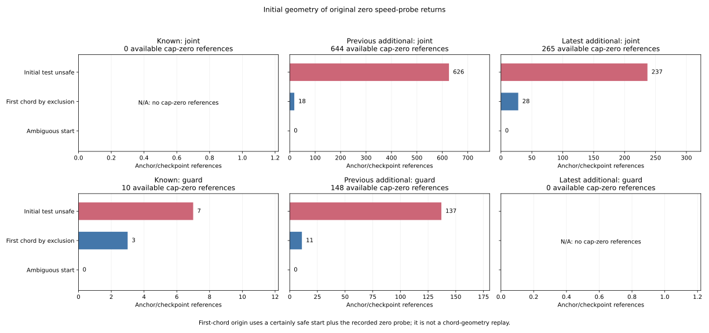

# Initial geometry of zero speed-probe returns

Of the **25 previously unresolved joint conjunctions**, now known to fail
nominal positivity, **23 have an initially unsafe raw sensed position and
two have a safe start followed by the first unsafe 0.05 chord**. All 23
initial failures violate the inflated obstacle margin. The two first-chord
origins follow by excluding the initial return path of the original source;
their unrounded chord geometry is not replayed. No rounded-input ambiguity
remains in these 25 initial tests.

The [protocol](protocol.md) was frozen in `56f1745`, with the original squared-
distance implementation clarified in `bdc91e7`, from main `4687814`. Both
commits precede inspection of new selected pose/noise/bias geometry. The audit
keeps all 972 planned cases, 324 families, 570 timeout histories, 3,997 census
anchors, 137 first returns and 3,751 preceding decision references.

## The fixed 25 references and their resets

All four full cases are latest-white/random with seed 278. Their original
loss anchor is at 170 s, first return at 175 s, uncapped command is 0.4 and
stop latch is false, as in the preceding command-domain audit.

| Case / anchor | Scenario / planner / arm | Initial unsafe | First chord by exclusion | Initial / first-chord nominal-only resets |
|---|---|---:|---:|---:|
| C0226 / 2959 | dense / A* / curved | 1 | 0 | 1 / 0 |
| C0227 / 2973 | dense / JPS / curved | 1 | 0 | 1 / 0 |
| C0228 / 2987 | dense / Theta* / curved | 1 | 1 | 1 / 1 |
| C0310 / 2994 | maze / A* / epoch | 20 | 1 | 10 / 1 |
| Total | | 23 | 2 | 13 / 2 |

The other ten references remain at a zero timer. The two first-chord references
are both resets, with these bounded initial obstacle margins:

| Case / logged time | Initial obstacle gap interval | Initial boundary lower gap | Carried timer -> after |
|---|---|---:|---:|
| C0228, 175.30 s | [0.000992845261, 0.000992849629] | 1.228836650 | 0.02 s -> 0 |
| C0310, 176.16 s | [0.010662402259, 0.010662407005] | 14.827796807 | 0.04 s -> 0 |

These are raw sensed-position gaps to the inflated speed margin, not true
vehicle clearances or collision labels. The preceding six other joint
conditions pass at these 25 references. In particular, recovery clearance
uses the recovery mean, whereas the speed probe uses the raw sensed position.
The present audit explains the probe's initial branch without treating those
different pose inputs as interchangeable.

## All returned-spell references

| Phase / branch | All references | Positive probe | Initially unsafe zero | First-chord zero by exclusion | Ambiguous zero |
|---|---:|---:|---:|---:|---:|
| Available / joint | 3,270 | 2,361 | 863 | 46 | 0 |
| Available / guard | 392 | 234 | 144 | 14 | 0 |
| Next loss / joint | 84 | 58 | 25 | 1 | 0 |
| Next loss / guard | 5 | 2 | 3 | 0 | 0 |
| All | 3,751 | 2,655 | 1,035 | 61 | 0 |

Available spells therefore have 1,067 cap-zero references: 1,007 initially
unsafe and 60 first-chord origins. The 29 separate next-loss boundaries have
28 initially unsafe zeros and one first-chord origin. These checkpoint
references are separate from anchor counts and are not independent trials.

All 1,035 certain initial failures have an obstacle-only failure mask. None
has a certainly failed map-boundary test. There are 1,031 references with one
definite original obstacle ID and four with two. Every witness ID is retained;
duplicate map records are not collapsed or interpreted as distinct physical
objects. No priority blocker is selected. All 2,716 remaining initial tests
are certainly safe, including the 61 zeros identified by source-path exclusion.

The figure uses available cap-zero references only, keeping joint and guard
denominators separate. Joint origins in the previous additional partition
are 626 initial and 18 first-chord; the latest has 237 and 28. Known guard
origins are seven initial and three first-chord, and previous additional guard
origins are 137 and 11. Empty branches remain visibly N/A. Numeric exports keep
all 252 original-mode summary cells and all 137 returned anchors.

Seventy-three returned anchors have an initially unsafe cap-zero reference,
and 19 have a first-chord zero. Eighteen have both; their union remains the
preceding 74 anchors with a zero nominal command. No return has an ambiguous
zero origin. The corresponding original census masses are 73/7 and 19/7,
against total returned mass 137/7, so these particular raw and case-mass
shares coincide. These overlapping anchor flags are not disjoint categories.

## Pose timing, map inputs and uncertainty

The raw row prints truth after state.update. The probe's sensed position
instead uses the preceding row's x/y plus the current row's noise and bias,
in the original two-addition ordering. Both times and all six pose scalars
are saved. Step-zero position or yaw noise is positive in all 570 timeout
histories, establishing the noisy sensed-pose branch directly from logs.
The current post-update truth, recovery mean and Fusion preview position
are not substituted for the raw sensed position.

Every nine-place scalar retains a half-unit radius of 5e-10. Summed coordinate
rectangles include a 1e-12 numerical guard, and distance/margin comparisons
retain another 1e-12 guard. All selected coordinates are finite and bounded;
margins are positive and below ten. The collector encloses minimum/maximum
distance from the rectangle to each obstacle. The independent verifier uses
60-digit Decimal coordinates, exact binary64 map values and squared distances
for each constraint comparison. Inclusive unsafe thresholds retain unknown
states at rounded equalities.

The smallest safe lower gap is 0.000139564393, and the closest unsafe upper
gap to zero is -0.000016488272. Both remain separated from zero after the
input and numerical guards. All 3,751 initial tests are therefore certain;
the ambiguity columns remain present with observed zeros.

The original map has 1,340 records: 204 open, 667 dense and 469 maze. Its
exact bytes are saved as [obstacle-map.csv](obstacle-map.csv), SHA-256
`59ff820ccbf076cfd90906da055c4f0b95c58207652d7d28610b294f6c51b3e4`.
Both readers check all six raw provenance hashes, their compiler version and
both arms' map declarations. An obstacle at distance <=margin necessarily
passes the source's nearby filter at margin+2; the audit checks all original
records and retains every definite/ambiguous wall and obstacle witness.

## Saved evidence and reproducibility

Both readers freshly hash and stream all 108 original raw files, totaling
6,043,185,194 bytes. They validate all 5,130,570 timeout grid rows and extract
3,888 selected/predecessor points. The initial tests perform **2,231,845**
obstacle comparisons. The rest of the timeout grid validates membership and
timing; this audit does not replay all 5,130,000 controller decisions.

[probe-decisions.csv](probe-decisions.csv) preserves every preceding command,
admission and timer column alongside reconstructed pose rectangles, initial
states and witnesses. [anchor-probe-origin.csv](anchor-probe-origin.csv)
preserves all 3,997 preceding anchor rows and columns, with blank new fields
for the 3,860 nonreturns. The 48 censored 180 s returns retain one observed
tick and unknown future ends. The 15 no-return episodes retain their lower
bounds; the 18 TTL-limit anchors without a next checkpoint remain outside
observed-loss denominators.

[probe-summary.csv](probe-summary.csv) retains the same 336 cells. Original
weights precede selection, with exact Fraction masses and blank undefined
shares. Census and received masses each close to 570; RP mass closes to 157
over all 10,995 RP records. All preceding anchor and summary fields agree with
the pinned results. Both implementations check 7,656 additive comparisons
for new counts/masses; distinct case counts and shares are not additive.

The [independent evidence](independent-verification.json) imports no analyzers
and records 1,078,082 field comparisons plus 155,883 original census/accounting
join comparisons. Its stdlib Rust harness extracts the unchanged initial
source test, actual Point2D squared-distance method and minimal VehicleState
from pinned sources. All five native tests pass, and rounded-center evaluations
agree with all 3,751 certain bounded results. This is a center cross-check,
not recovery of unrounded inputs or a curved-probe replay.

All **952 Python tests** pass, including 22 new tests for pose timing/order,
source noise branches, numeric guards, inclusive/ambiguous geometry, rectangle
enclosures, simultaneous/duplicate witnesses, source-path exclusion, positive
probe contradictions, raw joins, branch/phase counts, original unequal parent
measures, blank shares, censoring and closure. All five collector table/map/
provenance artifacts and all five figure/export/provenance artifacts repeat
byte for byte. The figure was inspected. Source manifest SHA-256:
`672d38cb611282f0be3b65f99b2b1bf5815e54c1c7829cbf0a23182b13505112`.

See the [README](../../README.md#initial-geometry-of-zero-speed-probe-returns)
for commands. Earlier admission geometry, timers, command-domain and Fusion
metadata evidence remains explicitly inherited from the pinned proof. No
admission result, timer maximum, release, resume, final returned-spell command,
controller parameter or rollout changes. First-chord origin does not identify
its exact unrounded contact point or obstacle. No causal controller benefit
or eventual-release probability is estimated.
