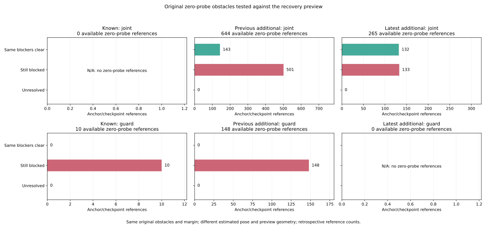

# Raw speed-probe obstacles versus recovery geometry

All 25 preceding nominal-only conjunction failures clear their original
obstacle and the complete map when tested with the logged recovery preview.
The speed probe uses the current sensed pose; recovery uses a stationary
sample mean when available. Their obstacle margins have the same source
expression. In these 25 references, raw and recovery starting positions are
separated by 0.0497925434–0.3486152390 coordinate units, with rounding retained.
This verifies a difference between the two estimated-geometry tests. It does
not establish that replacing either pose would make a controller safe or ready.

The [protocol](protocol.md) was frozen in a6efd76 from main
19afeccaef19bb2e590eeac130d42ffb0c059804. Column-name clarification 0733068 and
exact numeric serialization joins a2b1825 preceded extraction of new recovery
geometry outcomes. The latter accepts identical parsed binary64 inputs such
as 0.0 and 0.000000000, without a numeric tolerance. Retained preceding output
strings, identifiers, gate labels and flags remain exact. The
[freeze pins](freeze-pins.json) and [sources](sources.json) preserve the preceding
proof and its complete transitive inputs, helpers, code, raw logs and map.

## Complete zero-probe scope

Audit all 1,096 zero references: 1,035 original initial-test failures and 61
direct first-chord failures. All have definite original obstacle witnesses
and no definite wall witness. Preserve all witnesses, including duplicate map
coordinates with distinct row IDs. Recovery distances use those same records
and, separately, the entire original map; they do not select a convenient new
obstacle. Positive probes remain in the table with blank new geometry.

| Phase / branch | Zero refs | Same obstacles clear | Same obstacles blocked | Unknown | Entire map clear | Other map obstacle blocks after original obstacles clear |
| --- | ---: | ---: | ---: | ---: | ---: | ---: |
| Available / joint | 909 | 275 | 634 | 0 | 126 | 149 |
| Available / guard | 158 | 0 | 158 | 0 | 0 | 0 |
| Next-loss boundary / joint | 26 | 1 | 25 | 0 | 0 | 1 |
| Next-loss boundary / guard | 3 | 0 | 3 | 0 | 0 | 0 |
| All | 1,096 | 276 | 820 | 0 | 126 | 150 |

Of the 275 available joint references clearing the original obstacle records,
264 had failed the original initial test and 11 the original first chord.
The next-loss clear reference came from an initial-test failure. Thus 820
still fail on an original blocker in recovery geometry; another 150 fail the
recovery clearance condition because of a different map record. The full-map
result is blocked for 970 and clear for 126, with no rounding ambiguity.
All certain full-map results agree with the applicable inherited clearance
gate, and each recomputed clearance enclosure intersects its logged interval.

There are 921 joint references with nonempty recovery windows and 14 joint
references with zero samples. All 161 guard references have zero samples.
These zero-sample source branches use the raw fallback. Their maximum bounded
start displacement is 4.247e-9, consistent with the same starting estimate.
Do not describe every joint reference as a nonempty sample mean.

The figure includes all original-mode cells, both branches, all partitions
and empty cells. Available joint clear/blocked counts are 0/0 for known,
143/501 for previous additional and 132/133 for latest additional. Available
guard counts are 0/10, 0/148 and 0/0 respectively. Each panel has its own
explicit denominator. These are anchor/checkpoint references, not independent
trials or rates of successful motion.

## The preceding 25 conjunction failures

All other six joint predicates already passed in these 25 references. All
now have certain positive same-obstacle start/segment gaps and full-map gaps
at the recovery pose. Their recovery windows contain 10–25 samples. The
smallest full-map lower gap is 0.00195229698 and the largest upper gap is
0.07144788224. All 15 preceding nominal-only timer resets are among these
clear results. The old nominal predicate and timers remain unchanged.

| Case / anchor | Original initial-test failures | Original first-chord failures |
| --- | ---: | ---: |
| C0226 / 2959 | 1 | 0 |
| C0227 / 2973 | 1 | 0 |
| C0228 / 2987 | 1 | 1 |
| C0310 / 2994 | 20 | 1 |

For the two first-chord references, the source's original curved 0.05 chord
remains distinct from the straight 0.6 recovery preview. Both the pose and
preview geometry differ, so this comparison does not isolate a yaw, curvature
or averaging effect:

| Case / time | Same original obstacle ID / point | Recovery samples | Start separation enclosure | Recovery segment gap enclosure |
| --- | --- | ---: | --- | --- |
| C0228 / 175.30 | 420 / (3,4) | 16 | [0.1425010970, 0.1425011027] | [0.06292805059, 0.06292805587] |
| C0310 / 176.16 | 1310 / (34,35) | 25 | [0.1843427113, 0.1843427165] | [0.01171003967, 0.01171004495] |

For the other 23, the raw sensed starting point itself failed the inflated
margin while the recovery start and complete preview pass. That establishes
different estimated starting conditions under the same obstacle margin.
Neither test measures true collision clearance. These remain retrospective
diagnostics of the recorded controller, with no new intervention or rollout.

## Original population and measures

Keep 972 cases, 324 families, 570 timeouts, 3,997 late anchors, 137 returns,
3,751 decision references and 336 summary cells. Do not turn a next-loss
boundary into an available decision, or extend the 48 censored returns beyond
180 s. Preserve 15 no-return bounds and 18 TTL-limit anchors. All preceding
command, admission, timer, Fusion, contact and held-goal fields are inherited.
Historical held goals remain 140→140 and latest additional remain 62→60.

Reconstruct original census and received case weights before selection and
original RP-parent measures. The 10,995 RP records and total case masses
570/570/157 remain unchanged. Among 137 returned anchors, 21 contain an
available reference clearing the original blockers (mass 21/7 = 3), 63 contain
a blocked reference (mass 63/7 = 9), and none contain an unknown. Ten anchors
contain both states, so these flags overlap. Their union is 74 and 63 returns
contain no available zero probe. For each flag, raw and original-case-mass
shares agree: 21/137 for clear and 63/137 for blocked. This equality follows from the original
1/7 weights on all returns. Tests also exercise unequal original weights.

## Numerical and independent verification

Nine-decimal recovery coordinates/yaw/margin retain half-unit 5e-10. Endpoint
intervals propagate the source's binary64 0.6 constant, global sin/cos
Lipschitz ranges and 1e-12 elemental allowances. Point/segment comparisons
retain the original projection/clamp rule and a 1e-9 numerical allowance.
The maximum endpoint-displacement/Hausdorff radius is 1.136059e-9. The nearest
positive original-blocker segment lower gap is 0.000309699810; the nearest
positive full-map lower gap is 0.001952296980; the closest blocked full-map
upper gap is -0.000541527887. No threshold or allowance was tuned to outcomes.
These numerical bounds are conditional on the stated arithmetic assumptions.

Both readers freshly hash and stream all 108 raw files, 6,043,185,194 bytes,
validating 5,130,570 timeout grid rows and 570 noisy initial branches. They
extract 1,450 unique selected/predecessor points, check recovery inputs against
the raw logs and reconstruct raw sensed x/y from preceding truth plus current
noise and bias. The verifier imports no analyzers or plotters. Pinned standalone
helpers supply the independent reader/map/Taylor functions; new geometry uses
60-digit Decimal endpoints, norm rectangles and projection distances.

The [independent proof](independent-verification.json) records 1,889,158 new/
inherited-field comparisons and 155,883 original identity joins, 5,544 new
additive closure checks, and every field of 252 plot summary cells and 137
returned-anchor exports. Earlier source initial/first-chord and command/timer
reconstructions are inherited from the pinned proof, not freshly repeated here.

Stdlib Rust compiles the unchanged recovery preview/clearance source fragment,
original Point2D distance and point_segment_distance. All 1,096 rounded logged
recovery poses produce native endpoints and clearances inside the independent
enclosures. Six native tests cover straight/rotated previews, segment interior,
endpoints, duplicate points and inclusive contact. Saved
[native inputs](native-centers.tsv) and [native trace](native-recovery.csv) are
hash-pinned in the proof. These checks do not reconstruct unrounded sample
means or replay a closed-loop trajectory.

The full Python suite passes **991 tests**, including 21 new tests. The four
collector artifacts and five plot artifacts (including scratch PNG) reproduce
byte for byte. The PNG was inspected. The README records reproduction commands;
SVG, tables and provenance are tracked. Application/library source and lockfiles
are unchanged, so no new Cargo build or controller performance claim is needed.
