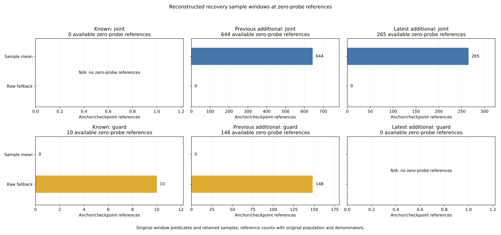

# Recovery sample membership and bounded mean reconstruction

The original recovery-window processing reproduces every logged sample count
in the 63 histories containing a selected zero-probe reference: 567,000 decision
steps. At all 1,096 selected references, reconstructed mean enclosures intersect
the logged recovery coordinates, and circular yaw checks agree within their
declared rounding bounds. There are 921 nonempty windows and 175 raw fallbacks.
The preceding 25 nominal-only conjunction failures use 10–25 samples; 18 have
already evicted older entries. Their differing raw/recovery geometry is consistent
with the recorded sample-window behavior, rather than evidence of a count error.

The [protocol](protocol.md) was frozen in 204d754 from main
fe8152e9331cd4a93682fbf87379d45af98253d9 before reading new membership/mean/
decomposition outcomes. Commit 446a339 specified canonical center zero for a
full-circle enclosure before extraction; no actual reference needs this weak-
resultant branch. [Freeze pins](freeze-pins.json), [sources](sources.json) and
the [independent proof](independent-verification.json) preserve the complete
preceding input/helper/code/raw chain. Geometry, command, admission, timer and
Fusion labels remain inherited and unchanged. There is no controller change
or new rollout.

## Reconstructed source windows

The source clears retained samples on received correction, precision activation,
missed scheduled correction, measured speed above 0.02, or exact observation
age above 1.5. It then appends if paused, stationary and within age, and removes
the oldest sample if capacity exceeds 25. A clear can therefore leave one new
sample. All simultaneous clear reasons and source ordering are retained.

Admission uses the pause state before recovery updates, reconstructed from the
preceding logged post-step flag and current missed correction. The next step
uses the current logged post-step flag. Age uses binary64 n*0.02-last_step*0.02,
and speed uses the roundtrip measured_speed field. This avoids substituting
rounded age or v at the source thresholds. The rest of the controller is not
replayed.

| Phase / branch | Audited refs | Nonempty mean | Raw fallback | Growing, 1–24 | Full, 25 | Older entries evicted |
| --- | ---: | ---: | ---: | ---: | ---: | ---: |
| Available / joint | 909 | 909 | 0 | 260 | 649 | 639 |
| Available / guard | 158 | 0 | 158 | 0 | 0 | 0 |
| Next-loss boundary / joint | 26 | 12 | 14 | 12 | 0 | 0 |
| Next-loss boundary / guard | 3 | 0 | 3 | 0 | 0 | 0 |
| All | 1,096 | 921 | 175 | 272 | 649 | 639 |

The latest clear reason is received for 1,079 references and age for 17.
Tests cover the other source clear predicates and simultaneous conditions,
without claiming those reasons occur as the latest clear in this selection.
Ten full windows have exactly 25 admissions since clear and have not yet
evicted anything; full capacity and an eviction are distinct results.

[window-lineage.csv](window-lineage.csv) contains 19,259 retained member
instances and 175 explicit raw_fallback rows, for 19,434 total. Members remain
in original oldest-to-newest order. A fallback row has sample_order zero and
does not invent a retained sample. Overlapping windows can reuse inputs, so
these rows and decision references are not independent trials.

Available joint references are all means: 0 known, 644 previous additional,
265 latest additional. Available guard references are all raw fallbacks:
10 known, 148 previous additional, 0 latest additional. Empty panels retain
their denominator and N/A label. All 252 original-mode summary cells and all
137 returned anchors are exported, including empty cells.

## The preceding 25 conjunction failures

All 25 have nonempty windows with counts 10 (one), 11 (one), 14 (three),
16 (one), 21 (one), and 25 (18). All 18 full windows have evicted older entries.
All 15 nominal-only timer resets use nonempty means. The old nominal predicate
and timer transitions are not relabeled by these reconstruction results.

The two previously identified first-chord failures provide concrete membership
examples; both last cleared on the received correction at 175.00 s:

| Case / anchor / time | Retained source times | Members | Admissions since clear | Evictions | Rounded-input mean x / y |
| --- | --- | ---: | ---: | ---: | --- |
| C0228 / 2987 / 175.30 | 175.00–175.30 | 16 | 16 | 0 | 2.038171346250 / 4.0028563693125 |
| C0310 / 2994 / 176.16 | 175.68–176.16 | 25 | 59 | 34 | 34.442286060960 / 34.177208995000 |

The C0310 mean retains the latest 25 admissions, rather than all 59 since the
correction. Membership step IDs are recorded explicitly; reconstruction does
not assume all windows are contiguous. Native replay uses the unchanged source
window update and mean arithmetic with rounded sensed inputs.

The x/y difference between each reconstructed mean and current sensed pose
is decomposed into signed mean-minus-current prior-truth, noise and bias terms.
The terms sum as vectors; their norms are not additive. Observed norm ranges
below are rounded descriptions of the computed components:

| Component | All 1,096 references | Preceding 25 |
| --- | --- | --- |
| Prior-truth term | 0 to 3.18e-14 | 9.93e-16 to 2.25e-14 |
| Noise term | 0 to 0.344229 | 0.046331 to 0.344229 |
| Bias term | 0 to 0.004800001 | 0.001800000 to 0.004800001 |

The prior-truth term is at arithmetic roundoff at logged precision. Maximum
signed-vector closure residual is 4.558e-14, below the frozen 1e-12 allowance.
This is an algebraic decomposition of recorded rounded inputs, not an isolated
causal attribution of policy failure or evidence of successful motion. Logged
truth is used for this audit only; no true pose is added to the controller.

## Rounding and independent computation

Nine-place truth/noise/bias components retain half-unit H=5e-10. Sensed centers
use the source's two-addition order with radius 3H+2P, P=1e-12. Sum/division
allowances give radius 1.504e-9 for nonempty x/y means and 1.502e-9 for raw
fallback. Each mean enclosure must intersect the corresponding logged recovery
coordinate interval of radius H. Reconstructed centers need not fall inside
that narrower output interval: their inputs were also rounded.

The maximum absolute x/y center-versus-log residual is 1.000004e-9, and maximum
circular yaw log error is 1.233880e-9. All yaw enclosures are bounded circles,
with radii from 1.502e-9 to 4.264593e-9. Sine/cosine Lipschitz intervals and the
resultant-vector displacement bound retain angle uncertainty, including wrap
at pi. A weak resultant would keep a full-circle enclosure, tested synthetically.
These are conditional arithmetic allowances, not a proof for all platform libm
implementations or recovery of unavailable unrounded simulator samples.

Both readers freshly hash/stream all 108 original files (6,043,185,194 bytes),
validate 5,130,570 timeout grid rows and 570 noisy initial branches, and replay
windows only for the selected 63 histories. The collector uses a bounded deque;
the standalone verifier independently stores admissions since the latest clear
and selects the last 25. It imports no analyzers or plotters. Pinned standalone
helpers supply hashes/identities and Taylor sin/cos; new computation uses
60-digit Decimal intervals and a separate 80-digit atan series with half-angle
reduction and quadrant handling. Every new field, lineage input string and plot
export is checked. Numeric comparison tolerance does not narrow enclosures.

The proof records 2,642,662 new/inherited-field comparisons, 155,883 original
identity joins and 5,016 new additive closure checks. Native Rust 1.99 compiles
the unchanged window-update/mean fragment, original VehicleState constructor
and DT. It reproduces all 567,000 selected-history sample counts and traces
1,096 rounded-input means inside the independent enclosures. Nine native tests
cover every clear reason, simultaneous clears, clear-then-append, inclusive
thresholds, binary64 age edges, capacity/order, post-release retention,
circular wrap and empty fallback.

[Native checkpoint queries](native-checkpoints.tsv) and [trace](native-window.csv)
are hash-pinned in the proof. The 567,000-row native replay input remains scratch
and hash-pinned, reproducible by the independent raw reader. No closed-loop
trajectory or all-570-history window replay is claimed as new evidence.

## Original accounting and validation

Keep 972 cases, 324 families, 570 timeouts, 3,997 anchors, 137 returns,
3,751 decision references and 336 summary cells. Preserve all preceding columns,
48 censored returns, 15 no-return bounds, 18 TTL-limit anchors, 10,995 RP records,
and census/received/RP case masses 570/570/157. Historical held goals remain
140→140 and latest additional remain 62→60; these are inherited outcomes.

Among returned anchors, 60 contain an available nonempty window, 14 contain an
available raw fallback, and 30 contain an eviction. Their original census masses
are 60/7, 14/7 and 30/7. Raw and original-case-mass shares agree here at
60/137, 14/137 and 30/137 because each original return has weight 1/7. Eviction
overlaps the mean flag. Tests also exercise unequal original denominators.
Nonreturns keep blank new fields and empty share denominators remain blank.

The complete Python suite passes **1,014 tests**, including 23 new tests. All
five collector artifacts and five plot artifacts, including scratch PNG,
reproduce byte for byte. The PNG was inspected. README commands reproduce the
audit. Application/library code, parameters and lockfiles are unchanged.
