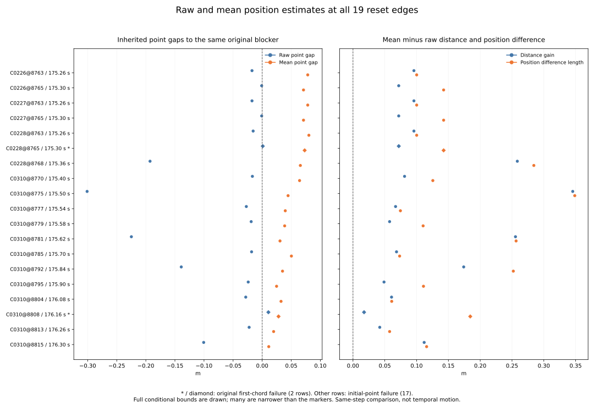

# Raw and mean position differences at the 19 reset edges

All 19 mean position estimates are farther from their same original blocker
than the corresponding raw position estimates, under the inherited rectangles
and frozen interval padding. The distance gains are approximately
0.017426564–0.345440905 m; position-difference lengths are approximately
0.057584984–0.348615237 m. Eighteen linear terms are outward and one is inward.
The inward case still increases distance because its positive quadratic term
exceeds the magnitude of its negative linear term.

These are two position estimates at one recorded step. The difference is not
temporal robot motion. Seventeen pairs retain blocked raw / clear mean point
gaps; two retain clear / clear point gaps and their separate directly unsafe
first-chord evidence. Point-distance gains do not establish a safe curved
probe, a release, successful motion or a counterfactual controller outcome.

[Protocol](protocol.md) and [pins](freeze-pins.json) were committed at
`5c2697e`, from main `810409fa265762d614261016c85f8cd398365ab6`, before
deriving displacement lengths, gains or squared-distance decompositions.

## Frozen selection and exact joins

Reuse exactly the preceding 19 distinct case/source-step resets and 19 single
original blocker witnesses, representing 185 overlapping window endings.
Retain all 17 initial-unsafe origins and two first-chord origins; the ambiguous
category remains empty. No time, object or outcome was newly selected.

Each probe joins one witness by exact edge, metadata, case, event, 50-Hz source
step, phase, branch, origin, obstacle ID/order and original multiplicity.
All 469 probe fields and all 72 witness fields (under witness_) are copied as
exact strings, including source input rectangles, margin, masks and outcomes.
Map coordinates retain their original strings and one-based global IDs:
420 at (3, 4), or 1310 at (34, 35). No coordinate deduplication is introduced.

The inherited 25 contexts, 60 missing future slots, 972 cases, 324 families,
570 timeouts, 3,997 anchors, 137 returns, 3,751 decisions, 1,096 zero probes,
336 original cells and preselection weights/outcome labels stay unchanged.
Distinct resets and overlapping endings are descriptive records from four
histories and two families, not new independent trials.

## Spatial identity and conditional intervals

Let u = raw - obstacle and v = mean - raw. The audit evaluates v_x/v_y,
u_x/u_y, ||v||, distance gain, point-gap gain, linear term 2 u dot v, quadratic
term ||v||^2, observed d_mean^2-d_raw^2, their prediction and both residuals:

```
d_mean^2 - d_raw^2 = 2 u dot v + ||v||^2
gap_gain - distance_gain = 0  (same current margin for both points)
```

There is no normalization or division by the raw distance. Recomputed center
distances use sqrt(dx^2+dy^2) and match inherited obstacle-distance witnesses.
Each inherited distance minus gap center matches the current common margin.
Both residual centers have magnitude <=1e-10 and both residual intervals
contain zero. The largest absolute center identity residual is
2.7755575615628914e-16 m^2; every margin-cancellation center residual is zero.

Source point/distance/gap rectangles remain intact. Each interval addition or
subtraction pads endpoints by P=1e-12. Multiplication takes all four endpoint
products, padded by P. Squaring uses zero as its lower candidate when the
input straddles zero, otherwise the smaller endpoint square; its lower bound
is clipped at zero after padding. The sum of displacement-component squares
also clips its lower bound at zero; sqrt uses padded, nonnegative bounds.
Factor two uses the same interval product rule.

These enclosures are conditional on the inherited reconstructed input boxes
and the frozen elemental-padding rule. They do not recover hidden unrounded
states or constitute an unconditional numerical-error proof. Comparison
tolerances do not narrow intervals. Gain is increase only if its lower bound
is positive, decrease only if its upper bound is negative, otherwise unknown;
the linear term uses the same strict rule for outward/inward/unknown.

## All 19 fixed pairs

The table preserves original case/step order. Values shown are rounded centers;
every full enclosure is in [displacements.csv](displacements.csv). The length
and gain columns use metres; the linear/quadratic columns use square metres.
An asterisk marks an inherited first-chord failure.

| Edge | Time s | Length m | Distance gain m | Linear m^2 | Quadratic m^2 | Linear sign | Ending multiplicity |
| --- | --- | --- | --- | --- | --- | --- | --- |
| C0226@8763 | 175.26 | 0.100137387 | 0.095810302 | 0.165960326 | 0.010027496 | outward | 1 |
| C0226@8765 | 175.30 | 0.142501099 | 0.071917076 | 0.112583326 | 0.020306563 | outward | 1 |
| C0227@8763 | 175.26 | 0.100137387 | 0.095810302 | 0.165960326 | 0.010027496 | outward | 1 |
| C0227@8765 | 175.30 | 0.142501099 | 0.071917076 | 0.112583326 | 0.020306563 | outward | 1 |
| C0228@8763 | 175.26 | 0.100137387 | 0.095796867 | 0.166314040 | 0.010027496 | outward | 2 |
| C0228@8765 * | 175.30 | 0.142501099 | 0.071997336 | 0.113008632 | 0.020306563 | outward | 2 |
| C0228@8768 | 175.36 | 0.284302841 | 0.258336583 | 0.346181891 | 0.080828105 | outward | 2 |
| C0310@8770 | 175.40 | 0.125527468 | 0.081093251 | 0.132571804 | 0.015757145 | outward | 13 |
| C0310@8775 | 175.50 | 0.348615237 | 0.345440905 | 0.406742811 | 0.121532584 | outward | 14 |
| C0310@8777 | 175.54 | 0.074565305 | 0.066930160 | 0.114895252 | 0.005559985 | outward | 14 |
| C0310@8779 | 175.58 | 0.110240211 | 0.057553353 | 0.091939590 | 0.012152904 | outward | 14 |
| C0310@8781 | 175.62 | 0.256396391 | 0.255422112 | 0.341984386 | 0.065739109 | outward | 16 |
| C0310@8785 | 175.70 | 0.073332549 | 0.068459066 | 0.119608007 | 0.005377663 | outward | 17 |
| C0310@8792 | 175.84 | 0.252026566 | 0.174042884 | 0.231515181 | 0.063517390 | outward | 19 |
| C0310@8795 | 175.90 | 0.110815327 | 0.048777072 | 0.075635581 | 0.012280037 | outward | 19 |
| C0310@8804 | 176.08 | 0.060872337 | 0.060643964 | 0.106243472 | 0.003705441 | outward | 16 |
| C0310@8808 * | 176.16 | 0.184342714 | 0.017426564 | -0.001728509 | 0.033982236 | inward | 13 |
| C0310@8813 | 176.26 | 0.057584984 | 0.042087448 | 0.073002514 | 0.003316030 | outward | 10 |
| C0310@8815 | 176.30 | 0.115758164 | 0.111890956 | 0.179994077 | 0.013399953 | outward | 10 |

The single inward case is C0310@8808, 176.16 s, against ID 1310. Its linear
enclosure is [-0.0017285169613756976, -0.0017285018087785822] m^2; its quadratic
enclosure is [0.0339822347642739, 0.03398223754332983] m^2. The observed squared
distance change is [0.03225371951715326, 0.03225373402029621] m^2 and the
distance gain is [0.017426560548575033, 0.01742656838024583] m. This decomposition
explains the positive distance change despite a negative linear term; it does
not infer an intervening path between estimates. Its raw and mean point gaps
are both clear while the inherited original first chord remains unsafe.

## Descriptive counts and interval extrema

| Case selector | Physical resets | Overlapping endings | Gain increase / decrease / unknown | Linear outward / inward / unknown | Blocked raw / clear mean |
| --- | --- | --- | --- | --- | --- |
| all_cases | 19 | 185 | 19 / 0 / 0 | 18 / 1 / 0 | 17 |
| C0226 | 2 | 2 | 2 / 0 / 0 | 2 / 0 / 0 | 2 |
| C0227 | 2 | 2 | 2 / 0 / 0 | 2 / 0 / 0 | 2 |
| C0228 | 3 | 6 | 3 / 0 / 0 | 3 / 0 / 0 | 2 |
| C0310 | 12 | 175 | 12 / 0 / 0 | 11 / 1 / 0 | 11 |

The 17 initial-unsafe rows retain 170 ending multiplicities; the two chord rows
retain 15. All 19 conditional gains have positive lower bounds. These counts
do not apply a new weight or define a new rate of recovery.

The summary crosses all four cases plus all_cases with all three original
origins plus all_origins (20 cells). Nine count fields pass 81 additive
case/origin closure checks. Extrema are recomputed per cell, using min of all
lower bounds / min of all upper bounds for a minimum, and max / max for a
maximum. They are not selected by the center's row or summed across cells.
Empty cells retain zero counts and blank extrema.

Global extremum enclosures (unrounded CSV values):

| Quantity | Minimum enclosure m | Maximum enclosure m |
| --- | --- | --- |
| distance_gain | [0.017426560548575033, 0.01742656838024583] | [0.3454409009043149, 0.3454409088405014] |
| displacement_norm | [0.057584980466211355, 0.05758498814265619] | [0.3486152329438456, 0.3486152412341598] |



The fixed two-panel figure keeps every row, the full interval ranges and zero
references. Diamonds/asterisks mark both original chord failures. Some bounds
are narrower than the markers at this scale; full values remain in the exports.
PNG was visually inspected. SVG, every displacement row, all 20 summary cells
and plot provenance are tracked.

## Independent validation and bytewise replay

The standalone verifier imports no analyzers or plotters. It independently
joins inherited records and calculates spatial arithmetic with 60-digit Decimal,
starting from the inherited binary64-parsed point/distance/gap inputs. It checks
center distances, common margins, both residuals, finite/ordered enclosures,
strict interval signs, summaries and all exports. Copied strings, identities,
counts and categories compare exactly. New numeric values compare with
abs 1e-12 / rel 1e-10; interval signs never use that tolerance.

It performs 23,389 comparisons beyond 131,901 original census identity
comparisons. Complete transitive input/helper/Rust provenance, every preceding
study artifact and all current output/plot hashes are verified. The audit counts
19 fresh displacement-pair evaluations, zero fresh raw reads and zero fresh
native dataset runs. Previous geometric/native execution remains inherited.

All **1,162 Python tests pass**, including 26 new tests for outward, inward,
tangential, overshoot, zero raw distance, zero displacement, translated inputs,
unknown signs, nonzero/near-zero margins, common-margin cancellation, square
crossing zero, product bounds, invalid rectangles, inconsistent distances,
coordinates, states and margins, exact event/step/obstacle identities,
duplicate/missing witnesses, copied strings, empty cells, interval extrema and
additive count closures. The existing suite runs its own native unit fixtures;
these do not add a new dataset replay.

Two collector runs are byte identical across both CSVs and sources (3 files).
Two plot runs are byte identical across SVG, PNG, both CSV exports and provenance
(5 files). Use the [README commands](../../README.md#compare-raw-and-mean-positions-at-the-same-reset-step)
with fresh paths and without Python -O. The 11 tracked study files are listed
below; PNG, test logs, replay hashes and report-generation metadata stay in
scratch. Original controller/dependency/outcome files retain their pinned versions.

| Artifact | Contents |
| --- | --- |
| [protocol.md](protocol.md) | frozen method and validation |
| [freeze-pins.json](freeze-pins.json) | preceding main/source/proof/verifier pins |
| [displacements.csv](displacements.csv) | 19 rows × 585 columns |
| [displacement-summary.csv](displacement-summary.csv) | 20 rows × 19 columns |
| [sources.json](sources.json) | complete input/helper/code/output provenance |
| [independent-verification.json](independent-verification.json) | independent verification evidence |
| [reset-displacement.svg](reset-displacement.svg) | full fixed two-panel figure |
| [plot-displacements.csv](plot-displacements.csv) | 19 rows × 585 columns |
| [plot-values.csv](plot-values.csv) | 20 rows × 19 columns |
| [plot-sources.json](plot-sources.json) | plot input/output/script provenance |
| [report.md](report.md) | this report |

Evidence pins (SHA-256):

| Artifact | SHA-256 |
| --- | --- |
| sources.json | 5c41eca356ae027aa9fe062a7c60fcf9bc8949099951686f9589be20f1e752c1 |
| independent-verification.json | 0672f7f6616aab12dd07fe9341cb5f7a535a2fec814114c4e2f88020ac7eb326 |
| plot-sources.json | 4fe9404347fca9610bd2188493e5206fe582e15031a02da749d344dded3213fc |

Inherited reset-probes proof: `ba1acd798c92798c224de7759cbab28344b717d989bfbcfc5fa8018b2bd64122`.

| Inherited geometry study | Proof SHA-256 |
| --- | --- |
| [fusion-return-probe-origin](../fusion-return-probe-origin/independent-verification.json) | b6dbf95d64cdff2e052c671b48e17e172d54c9d8d7013514291b5369192e450b |
| [fusion-return-first-chord](../fusion-return-first-chord/independent-verification.json) | ad7182e599dc7d494c716f4ab7c06770a731833dddf06cd5e798f28edcdf6ec1 |
| [fusion-return-point-clearance](../fusion-return-point-clearance/independent-verification.json) | d6f0254d3e70a4bb371ac1cc17cb2cbf506e4f1b6af12751a0201f8df21ab901 |
