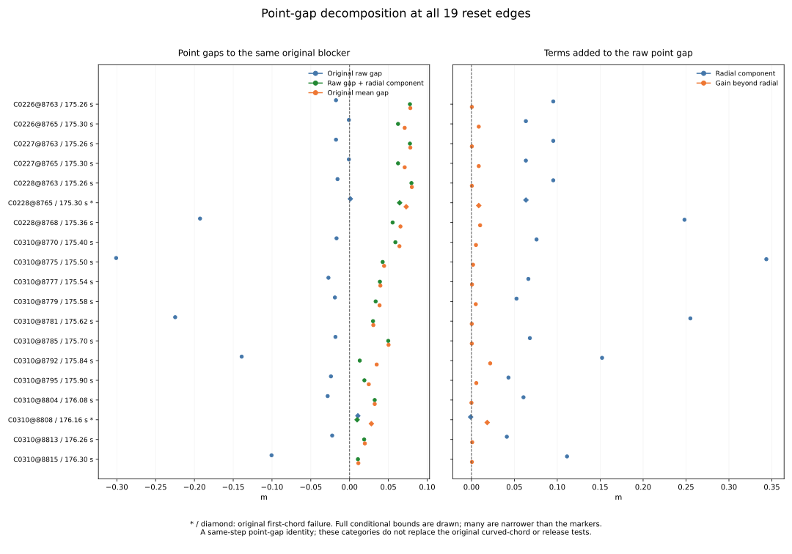

# Point-gap contributions at the 19 reset edges

All 17 originally blocked raw points have a clear interval after adding their
radial component to the raw gap. The other two pairs already have clear raw
and mean point gaps. No selected blocked-to-clear pair has a blocked or
unknown radial gap under the inherited boxes and frozen padding.

All 19 rebuilt mean gaps match the original mean gap and are clear. The two
already-clear pairs remain the original directly unsafe first-chord cases;
these point identities do not establish that a curved chord, release test or
controller recovery would succeed. Every comparison uses two estimates at one
recorded step, not elapsed robot motion or a trajectory between estimates.

[Protocol](protocol.md) and [pins](freeze-pins.json) were committed at
`67f9fe9`, from main `f12dee7faea7a8a35d2262ab702be03db9c9434d`, before
calculating new radial-gap values or point-category counts.

## Exact inherited selection and common margin

Keep all 19 preceding reset edges and their single original blocker witnesses,
17 initial-unsafe and two first-chord origins, and all 185 overlapping-ending
multiplicities. All 625 preceding projection columns remain exact strings,
including source identities, coordinates, rectangles, gaps, signs, masks,
earlier audits and outcomes. Blocker IDs stay 420 at (3, 4), or 1310 at
(34, 35). No new time, object, decision or outcome is selected.

The original 25 contexts, 60 missing future slots, 972 cases, 324 families,
570 timeouts, 3,997 anchors, 137 returns, 3,751 decisions, 1,096 zero probes,
336 cells and preselection weights remain inherited. Distinct resets and
overlapping endings are descriptive records from four histories and two
families, not independent new trials. This audit adds no trial denominator,
selected weight or recovery rate.

The current common-margin string must match the original decision literal
exactly. Its enclosure is retained intact. Original raw/mean point states
must agree with their own inherited gap intervals before any new arithmetic.

## Gap decomposition and interval rules

Let h_raw=r-m and h_mean=d-m be the original raw/mean gaps for the same blocker
and common margin m. Reuse the preceding radial component a and the finite
distance gain beyond radial e. The gap identity is:

```
radial_gap = h_raw + a
rebuilt_mean_gap = radial_gap + e = h_mean
radial_gap = (r+a) - m
h_mean = reconstructed_distance - m
h_mean - radial_gap = e
```

The new table adds nine center/lo/hi triples: radial_gap, rebuilt_mean_gap,
gap_identity_residual, radial_gap_from_endpoint, radial_gap_residual,
mean_gap_from_distance, distance_gap_residual, remainder_gap and
remainder_gap_residual. It also adds margin status, two point-gap states and
one frozen point-gap category. The radial gap is a term of this spatial
identity; it is not a replacement controller input or a simulated path.

Each interval addition/subtraction pads its endpoint result by P=1e-12.
Inherited boxes are never narrowed and gaps are never clipped to zero.
Every available residual center must have magnitude <=1e-10 and its full
interval must contain zero. Clear requires lower>0, blocked requires upper<=0,
otherwise unknown. An exact zero gap is blocked; a box crossing zero remains
unknown even if its center is positive.

For an incomplete original projection, keep the full source row, leave all
nine new triples blank, set both new states unknown and use
unresolved_projection status/category. Unrecognized statuses, invalid bounds,
inconsistent source states or changed margin literals fail. All 19 selected
projections are complete; none is dropped.

The arithmetic is conditional on inherited reconstructed inputs and the
frozen elemental padding. It does not recover hidden unrounded states or
provide an unconditional numerical-error proof. Numeric comparison tolerance
never changes a point classification or narrows an enclosure.

## All 19 fixed pairs

The table retains original case/step order. Values below are rounded centers
in metres; full bounds and all source fields remain in [margins.csv](margins.csv).
An asterisk marks the original first-chord failure.

| Edge | Time s | Original raw gap m | Raw gap + radial m | Original mean gap m | Gain beyond radial m | Category | Ending multiplicity |
| --- | --- | --- | --- | --- | --- | --- | --- |
| C0226@8763 | 175.26 | -0.017529809 | 0.077793492 | 0.078280493 | 0.000487002 | raw blocked; radial clear | 1 |
| C0226@8765 | 175.30 | -0.000890712 | 0.062504227 | 0.071026364 | 0.008522137 | raw blocked; radial clear | 1 |
| C0227@8763 | 175.26 | -0.017529809 | 0.077793492 | 0.078280493 | 0.000487002 | raw blocked; radial clear | 1 |
| C0227@8765 | 175.30 | -0.000890712 | 0.062504227 | 0.071026364 | 0.008522137 | raw blocked; radial clear | 1 |
| C0228@8763 | 175.26 | -0.015548119 | 0.079761377 | 0.080248748 | 0.000487371 | raw blocked; radial clear | 2 |
| C0228@8765 * | 175.30 | 0.000992847 | 0.064492575 | 0.072990183 | 0.008497608 | already clear | 2 |
| C0228@8768 | 175.36 | -0.192750436 | 0.055482553 | 0.065586146 | 0.010103594 | raw blocked; radial clear | 2 |
| C0310@8770 | 175.40 | -0.016831420 | 0.059009593 | 0.064261831 | 0.005252238 | raw blocked; radial clear | 13 |
| C0310@8775 | 175.50 | -0.300923848 | 0.042656021 | 0.044517057 | 0.001861036 | raw blocked; radial clear | 14 |
| C0310@8777 | 175.54 | -0.027250112 | 0.039056578 | 0.039680048 | 0.000623469 | raw blocked; radial clear | 14 |
| C0310@8779 | 175.58 | -0.018906356 | 0.033598368 | 0.038646997 | 0.005048629 | raw blocked; radial clear | 14 |
| C0310@8781 | 175.62 | -0.224817121 | 0.030233097 | 0.030604991 | 0.000371894 | raw blocked; radial clear | 16 |
| C0310@8785 | 175.70 | -0.018222593 | 0.049843232 | 0.050236473 | 0.000393241 | raw blocked; radial clear | 17 |
| C0310@8792 | 175.84 | -0.139078306 | 0.013121284 | 0.034964578 | 0.021843294 | raw blocked; radial clear | 19 |
| C0310@8795 | 175.90 | -0.024033067 | 0.019098063 | 0.024744006 | 0.005645943 | raw blocked; radial clear | 19 |
| C0310@8804 | 176.08 | -0.028253097 | 0.032375031 | 0.032390868 | 0.000015836 | raw blocked; radial clear | 16 |
| C0310@8808 * | 176.16 | 0.010662405 | 0.009719621 | 0.028088969 | 0.018369348 | already clear | 13 |
| C0310@8813 | 176.26 | -0.022420110 | 0.018795253 | 0.019667338 | 0.000872085 | raw blocked; radial clear | 10 |
| C0310@8815 | 176.30 | -0.100580591 | 0.010765761 | 0.011310365 | 0.000544605 | raw blocked; radial clear | 10 |

For the inward-radial example C0310@8808 at 176.16 s, the raw point is already
clear. Its raw gap is about 0.010662405 m; adding the negative radial component
leaves about 0.009719621 m; the gain beyond radial then gives the original
mean gap of about 0.028088969 m. Its separate first-chord test remains unsafe.
The other chord case, C0228@8765, also starts with a clear raw point. Neither
is counted as a blocked-to-clear point pair.

## Frozen categories, summaries and figure

The six exhaustive categories are unresolved_projection; already_clear for
original clear/clear pairs; blocked_to_clear_radial_clear / radial_blocked /
radial_unknown for original blocked/clear pairs according to their new radial
state; and other_point_states for all remaining original state pairs. Status
is resolved first. Categories describe point identities, not policy recoveries.

| Case | Physical resets | Overlapping endings | Raw blocked / radial clear | Already-clear pairs | Other categories |
| --- | --- | --- | --- | --- | --- |
| all_cases | 19 | 185 | 17 | 2 | 0 |
| C0226 | 2 | 2 | 2 | 0 | 0 |
| C0227 | 2 | 2 | 2 | 0 | 0 |
| C0228 | 3 | 6 | 2 | 1 | 0 |
| C0310 | 12 | 175 | 11 | 1 | 0 |

The 17 initial-unsafe rows retain 170 ending multiplicities; the two chord
rows retain 15. All radial and rebuilt mean gap intervals are clear. The
summary crosses four cases plus all_cases with the three original zero origins
plus all_origins (20 cells). Sixteen count fields pass 144 additive case/origin
closure checks. Status, each gap-state partition and category counts also sum
to physical_resets within every cell. Unresolved rows remain in counts/exports.

Extrema are recomputed from available bounds: min/min for minimum enclosures,
max/max for maximum enclosures. They are never summed or selected by a center's
row. Empty extrema stay blank. Global extrema are:

| Quantity | Minimum enclosure m | Maximum enclosure m |
| --- | --- | --- |
| radial_gap | [0.009719614364347276, 0.009719627389104866] | [0.07976137140805185, 0.0797613825998072] |
| rebuilt_mean_gap | [0.01131034966650095, 0.011310381323837949] | [0.08024873549554672, 0.08024875993050058] |
| remainder_gap | [1.582676830790561e-05, 1.5845559415682192e-05] | [0.021843283928849454, 0.02184330475174929] |



The fixed two-panel figure includes every row, full bound ranges, zero
references and both first-chord diamond/asterisk markers. Some intervals are
narrower than the plotted markers; all full values remain in the exports.
PNG was visually inspected. SVG, every margin row, all 20 summary cells and
plot provenance are tracked; unresolved statuses would remain explicit.

## Independent verification and bytewise replay

The standalone verifier imports no analyzers or plotters. It independently
calculates the new point-gap identities, strict states, frozen categories,
summaries, extrema and count closures with 60-digit Decimal from binary64-parsed
inherited inputs. It also checks original census joins, copied strings,
all exports and complete transitive input/helper/Rust provenance. Original
strings, IDs, categories and counts compare exactly; new numbers use abs 1e-12
/ rel 1e-10, never for point classification.

It performs 26,128 comparisons beyond 131,901 original census identity
comparisons. The maximum absolute center residuals are:

| Identity residual | Maximum absolute center value m |
| --- | --- |
| gap_identity_residual | 0.0 |
| radial_gap_residual | 5.551115123125783e-17 |
| distance_gap_residual | 2.220446049250313e-16 |
| remainder_gap_residual | 0.0 |

All **1,212 Python tests pass**, including 22 new tests for all blocked-to-clear
radial states, already-clear and other original point pairs, exact/near-zero
gap boundaries and margins, incomplete projections, preserved chord evidence,
invalid boxes/statuses/margins/states, corrupted geometry identities, residual
zero containment, exact strings, duplicate edges, retained unresolved rows,
empty summaries, endpoint extrema and additive closures. Existing native unit
fixtures run in the full suite; preceding native dataset execution remains
inherited evidence.

The audit counts 19 fresh margin-pair evaluations, zero fresh raw reads and
zero fresh native dataset runs. All controller/dependency files and original
outcomes retain their pinned versions.

Two collector runs are byte identical across both CSVs and sources (3 files).
Two plot runs are byte identical across SVG, PNG, both CSV exports and
provenance (5 files). Use the [README commands](../../README.md#decompose-point-clearance-at-the-same-reset-edges)
with fresh paths and without Python -O. The 11 tracked study files are listed
below; PNG, test logs, replay hashes and report-generation metadata stay in
scratch.

| Artifact | Contents |
| --- | --- |
| [protocol.md](protocol.md) | frozen method and checks |
| [freeze-pins.json](freeze-pins.json) | preceding main/source/proof/verifier pins |
| [margins.csv](margins.csv) | 19 rows × 656 columns |
| [margin-summary.csv](margin-summary.csv) | 20 rows × 30 columns |
| [sources.json](sources.json) | complete input/helper/code/output provenance |
| [independent-verification.json](independent-verification.json) | independent verification evidence |
| [reset-margin.svg](reset-margin.svg) | full fixed two-panel figure |
| [plot-margins.csv](plot-margins.csv) | 19 rows × 656 columns |
| [plot-values.csv](plot-values.csv) | 20 rows × 30 columns |
| [plot-sources.json](plot-sources.json) | plot script/input/output provenance |
| [report.md](report.md) | this report |

Evidence pins (SHA-256):

| Artifact | SHA-256 |
| --- | --- |
| sources.json | 98754f83cc35426f46abd5af33fa37f0f492ce9d7a79007058a9d1fe85c8560b |
| independent-verification.json | b65366c13bb48c3d4843233a45ebb593b15ad0562da5c3d013ec1f5233e8c898 |
| plot-sources.json | c3205f729a730ff87d59f5c7db799d9102ce14cdecca77440d68a9273f0fe123 |

Inherited projection proof: `ded0de2bce633fd9ba6c041c9355a032ee55d018cfe75c0a76a2f8f2ebbd534d`.

| Inherited geometry study | Proof SHA-256 |
| --- | --- |
| [fusion-return-probe-origin](../fusion-return-probe-origin/independent-verification.json) | b6dbf95d64cdff2e052c671b48e17e172d54c9d8d7013514291b5369192e450b |
| [fusion-return-first-chord](../fusion-return-first-chord/independent-verification.json) | ad7182e599dc7d494c716f4ab7c06770a731833dddf06cd5e798f28edcdf6ec1 |
| [fusion-return-point-clearance](../fusion-return-point-clearance/independent-verification.json) | d6f0254d3e70a4bb371ac1cc17cb2cbf506e4f1b6af12751a0201f8df21ab901 |
