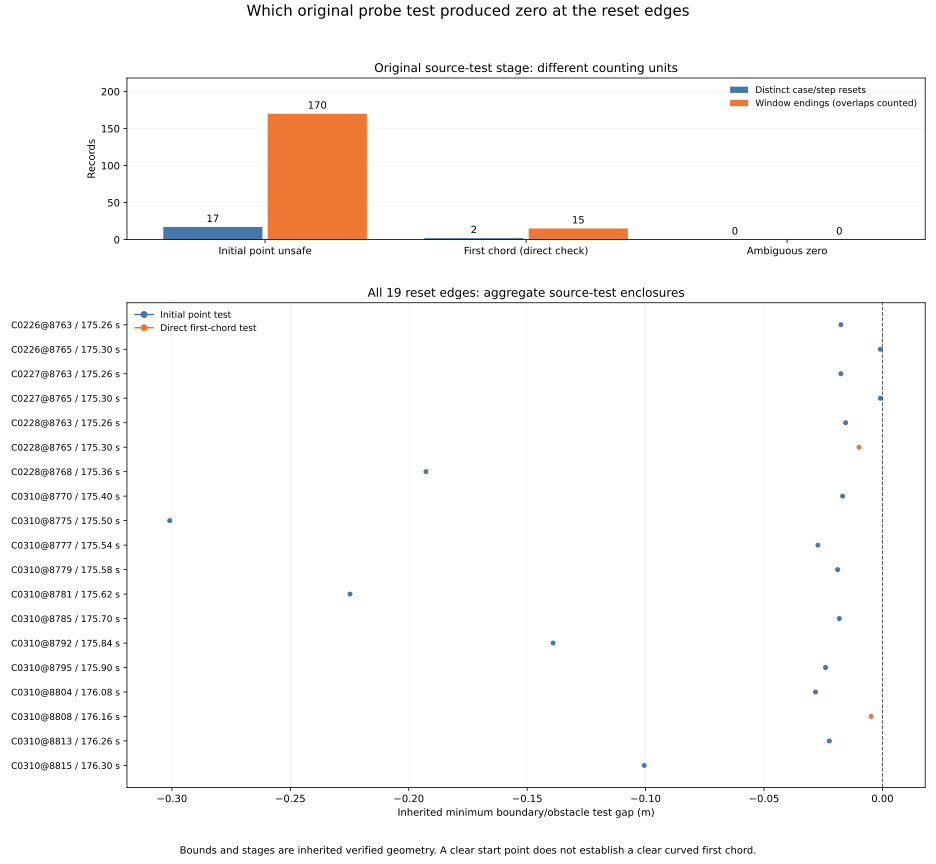

# Original probe evidence at the 19 distinct reset edges

Seventeen of the 19 distinct resets have a certainly unsafe initial point in
the original speed probe. The other two have a certainly safe initial point
and a directly verified unsafe first chord. All match global obstacle ID 420
at (3, 4), or ID 1310 at (34, 35). No selected zero remains geometrically
ambiguous under the inherited rounding enclosures.

The raw current point is blocked in the first 17 and clear in the two chord
cases. The mean current point gap to each original blocker is clear in all
19. These are recorded-input point predicates; they do not establish a clear
curved first chord, recovery segment, release probe or successful motion.

[Protocol](protocol.md) and [pins](freeze-pins.json) were committed at
`cdffa0d`, from main `f2dab0a36f92a52df9b3811588aa97b509dd25af`, before
joining the new reset-stage counts, IDs/coordinates or point witnesses.

## Exact selection and inherited evidence

Select exactly the preceding 19 distinct case/source-step resets, representing
185 overlapping window endings. Exclude the six context boundaries. The prior
25 references, 1,275 planned slots, 1,215 included pairs, 247 unique contexts,
60 missing future slots and 82 before-return contexts stay inherited. Original
972 cases, 324 families, 570 timeouts, 3,997 anchors, 137 returns, 3,751 decisions,
1,096 zero probes and 336 cells remain unchanged, with their original weights.
This join adds no decisions, follow-up, trials or selected weights.

Each reset has its original single event ID. Case, event and exact 50-Hz source
step identify its original decision; no nearest-time match is used. Metadata,
available/joint identity, every source gate, complete failed/unknown masks,
zero nominal command, cap-zero reason, positive before counter, zero after
counter, reset action and lost ticks agree. Every reset-edge field and all
427 original decision fields remain exact strings under decision_ in the new
table, including input scalars, geometry bounds, earlier audits and outcomes.

The original first_chord_by_exclusion category name is preserved. The later
direct first-chord audit supplies the additional unsafe test and bound checks;
the two joins require that direct evidence as well as a safe initial point.
Initial failures use the original initial bounds and mask. New aggregate gap
columns select the minimum inherited boundary/obstacle enclosure for the
applicable test; they are not per-obstacle gap calculations.

| Original origin | Distinct resets | Overlapping endings | Blocker rows | Maximum lost ticks |
| --- | --- | --- | --- | --- |
| all_origins | 19 | 185 | 19 | 9 |
| initial_unsafe | 17 | 170 | 17 | 9 |
| first_chord_by_exclusion | 2 | 15 | 2 | 2 |
| ambiguous_zero | 0 | 0 | 0 | — |

| Case | Distinct resets | Overlapping endings | Original blocker IDs |
| --- | --- | --- | --- |
| C0226 | 2 | 2 | 420 |
| C0227 | 2 | 2 | 420 |
| C0228 | 3 | 6 | 420 |
| C0310 | 12 | 175 | 1310 |

The two counting units are retained explicitly. Physical resets and overlapping window endings are descriptive records from four histories and two families, not independent trials.

## Global map and point-witness joins

The complete map retains 1,340 records, with global one-based IDs before
scenario filtering. Every selected original_blocker_ids/fixed_obstacle_ids
entry matches its stage-specific definite IDs, global map row and original
point-witness record, in original order. Case/scenario/metadata, obstacle order
and coordinates agree. Every witness field is copied; map coordinate strings
are also retained verbatim. Coordinate equivalence uses original binary64
parsing. Duplicate coordinates are never merged into a single global ID.

There is one original blocker row for each selected reset. The selected set has
two global IDs and two scenario/coordinate groups. Every original raw/mean
current point state agrees with its inherited gap bounds: clear requires lower
> 0, blocked requires upper <= 0, otherwise unknown. A clear raw start in a
chord case does not replace its separate unsafe segment test.

| Global ID | Scenario | Coordinates | Distinct resets | Overlapping endings |
| --- | --- | --- | --- | --- |
| 420 | dense_50x50 | (3, 4) | 7 | 10 |
| 1310 | maze_50x50 | (34, 35) | 12 | 175 |

## All 19 original reset edges

Initial/chord denotes the original failing probe stage. Raw/mean columns are point predicates against that fixed blocker. Exact intervals, full source masks and all original strings are preserved in the CSVs.

| Case / source step | Time s | Stage | Blocker ID | Raw / mean point | Lost ticks | Window multiplicity |
| --- | --- | --- | --- | --- | --- | --- |
| C0226@8763 | 175.26 | initial | 420 | blocked / clear | 4 | 1 |
| C0226@8765 | 175.3 | initial | 420 | blocked / clear | 1 | 1 |
| C0227@8763 | 175.26 | initial | 420 | blocked / clear | 4 | 1 |
| C0227@8765 | 175.3 | initial | 420 | blocked / clear | 1 | 1 |
| C0228@8763 | 175.26 | initial | 420 | blocked / clear | 4 | 2 |
| C0228@8765 | 175.3 | first_chord | 420 | clear / clear | 1 | 2 |
| C0228@8768 | 175.36 | initial | 420 | blocked / clear | 2 | 2 |
| C0310@8770 | 175.4 | initial | 1310 | blocked / clear | 9 | 13 |
| C0310@8775 | 175.5 | initial | 1310 | blocked / clear | 4 | 14 |
| C0310@8777 | 175.54 | initial | 1310 | blocked / clear | 1 | 14 |
| C0310@8779 | 175.58 | initial | 1310 | blocked / clear | 1 | 14 |
| C0310@8781 | 175.62 | initial | 1310 | blocked / clear | 1 | 16 |
| C0310@8785 | 175.7 | initial | 1310 | blocked / clear | 2 | 17 |
| C0310@8792 | 175.84 | initial | 1310 | blocked / clear | 4 | 19 |
| C0310@8795 | 175.9 | initial | 1310 | blocked / clear | 1 | 19 |
| C0310@8804 | 176.08 | initial | 1310 | blocked / clear | 4 | 16 |
| C0310@8808 | 176.16 | first_chord | 1310 | clear / clear | 2 | 13 |
| C0310@8813 | 176.26 | initial | 1310 | blocked / clear | 1 | 10 |
| C0310@8815 | 176.3 | initial | 1310 | blocked / clear | 1 | 10 |

The fixed chord examples remain C0228 / anchor 2987 / 175.30 s and
C0310 / anchor 2994 / 176.16 s. Their inherited first-chord aggregate gap
enclosures are approximately [-0.009894014, -0.009893986] m and
[-0.004783445, -0.004783405] m, respectively. Both have clear raw and mean
start-point gaps, but their direct first-chord tests are unsafe. Their resets
discard one and two ticks. The largest reset, nine ticks at C0310 / 175.40 s,
instead fails the initial probe point against ID 1310.

## Complete figure and descriptive summaries

The frozen figure shows grouped stage counts for the two explicitly different
counting units and every one of the 19 aggregate source-test enclosures in
case/step order. It retains the full bound range and a zero-gap reference;
narrow intervals remain in the exports even when not visible at this scale.
PNG was visually inspected; SVG, all reset/witness rows, all 20 summary cells
and plot provenance are tracked.

The summary crosses the four original cases plus all_cases with three original
zero-origin categories plus all_origins. Empty categories remain present, with
blank maximum lost ticks. Reset, overlapping-ending and blocker-row counts pass
27 additive case/origin closure checks. Distinct ID/coordinate sets and maxima
are recomputed for each cell rather than added across partitions. No new case
mass, rate of recovery or success claim is calculated.

## Independent validation and repeatability

The complete transitive input/helper/Rust chain, all preceding study artifacts,
decision table, point witnesses and map are pinned. Raw extraction, geometry
arithmetic and native dataset execution remain inherited. The new scripts
perform zero fresh raw reads, geometry evaluations or native dataset runs.
The original Rust/controller/dependency files and original outcome labels
retain their pinned versions.

The standalone verifier imports no analyzers or plotters. It independently
matches identities, selects inherited stage evidence, traverses map/witness
records, checks interval states with Decimal and aggregates counts/sets/maxima.
Copied strings, IDs, states and counts compare exactly; new aggregate minima
use abs 1e-12 / rel 1e-10. Tolerance does not narrow any inherited enclosure.

It performs 21,944 comparisons beyond 131,901 original identity comparisons, verifying all three tables, plot exports and provenance pins.

All **1,136 Python tests pass**, including 16 new tests for exact identity,
missing/duplicate keys, source-mask/reset/command disagreement, stage eligibility,
safe start versus direct chord, ambiguity, fixed-ID/order agreement, global IDs,
wrong scenarios/coordinates, duplicate coordinates, interval-state boundaries,
source-string preservation, empty cells and additive count closures. The full
existing suite also runs its native unit fixtures; this is separate from the
inherited native dataset evidence.

Two collector runs are byte identical across three tables and sources. Two
plot runs are byte identical across SVG, PNG, three CSV exports and provenance.
Use the [README commands](../../README.md#link-the-19-reset-edges-to-original-probe-evidence)
with fresh output directories and an unused proof filename, without Python -O.
There are 13 tracked study files; PNG, run logs, reproduction and report-generation
metadata stay in scratch.

| Artifact | Contents |
| --- | --- |
| [freeze-pins.json](freeze-pins.json) | protocol / provenance / figure |
| [independent-verification.json](independent-verification.json) | protocol / provenance / figure |
| [plot-reset-blockers.csv](plot-reset-blockers.csv) | 19 rows × 72 columns |
| [plot-reset-probes.csv](plot-reset-probes.csv) | 19 rows × 469 columns |
| [plot-sources.json](plot-sources.json) | protocol / provenance / figure |
| [plot-values.csv](plot-values.csv) | 20 rows × 9 columns |
| [probe-summary.csv](probe-summary.csv) | 20 rows × 9 columns |
| [protocol.md](protocol.md) | protocol / provenance / figure |
| [reset-blockers.csv](reset-blockers.csv) | 19 rows × 72 columns |
| [reset-probes.csv](reset-probes.csv) | 19 rows × 469 columns |
| [reset-probes.svg](reset-probes.svg) | protocol / provenance / figure |
| [sources.json](sources.json) | protocol / provenance / figure |
| [report.md](report.md) | this report |

Evidence pins (SHA-256):

| Artifact | SHA-256 |
| --- | --- |
| sources.json | 43e4109d5b9adbbc30acefe0a9583feb7724825c49e9448eb0d7d493e21a0858 |
| independent-verification.json | ba1acd798c92798c224de7759cbab28344b717d989bfbcfc5fa8018b2bd64122 |
| plot-sources.json | 93987243c78d935cdf539188616b89dcee89866e3109323c9d1f6ee0a9381921 |

Inherited geometry proofs:

| Study | Proof SHA-256 |
| --- | --- |
| [fusion-return-probe-origin](../fusion-return-probe-origin/independent-verification.json) | b6dbf95d64cdff2e052c671b48e17e172d54c9d8d7013514291b5369192e450b |
| [fusion-return-first-chord](../fusion-return-first-chord/independent-verification.json) | ad7182e599dc7d494c716f4ab7c06770a731833dddf06cd5e798f28edcdf6ec1 |
| [fusion-return-point-clearance](../fusion-return-point-clearance/independent-verification.json) | d6f0254d3e70a4bb371ac1cc17cb2cbf506e4f1b6af12751a0201f8df21ab901 |
