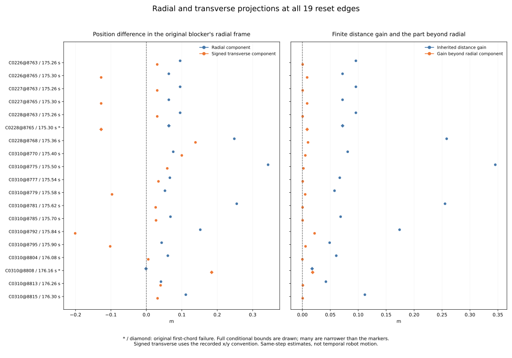

# Radial and transverse estimate differences at the 19 reset edges

All 19 frozen pairs have certified positive raw-distance and remainder-formula
denominators. Eighteen radial components are outward and one is inward. Signed
transverse components are positive in 13 and negative in six, in the recorded
x/y convention. All 19 distance gains exceed their radial component under the
inherited boxes and frozen padding.

The inward example, C0310@8808 at 176.16 s, has radial component approximately
-0.000942784 m and transverse component +0.184340303 m. These two components
reconstruct the preceding positive distance gain of 0.017426564 m. This
quantifies the earlier negative-linear/positive-quadratic decomposition using
radial and transverse position differences.

This is a comparison of two estimates at the same recorded step. No elapsed
robot motion, intervening path, safe replacement probe or counterfactual policy
outcome is established. Both original first-chord failures retain their direct
unsafe segment evidence, even though both point gaps are clear.

[Protocol](protocol.md) and [pins](freeze-pins.json) were committed at
`b994e63`, from main `1362b968aadf61b4173a28664836b975fac42dd1`, before
calculating these normalized projections, distance reconstructions or remainders.

## Exact inherited selection

The audit keeps all 19 preceding distinct reset edges and their original single
blocker witnesses, 17 initial-unsafe and two first-chord origins, and all 185
overlapping window-ending multiplicities. Every one of the preceding 585
displacement columns is copied as an exact string, including all raw/mean
rectangles, margin, IDs, masks, earlier geometry and outcome labels. IDs remain
420 at (3, 4), or 1310 at (34, 35); no new time or object is selected.

The original 25 contexts, 60 missing future slots, 972 cases, 324 families,
570 timeouts, 3,997 anchors, 137 returns, 3,751 decisions, 1,096 zero probes,
336 cells and all preselection weights remain inherited. Distinct resets and
overlapping endings are descriptive records from four histories and two
families, not independent new trials. No new denominator or recovery rate is
computed.

## Finite spatial projection identities

Let u=raw-obstacle, v=mean-raw, r=||u|| and d=||u+v||. For r_lo>0, evaluate
radial a=(u dot v)/r and signed transverse b=(u_x*v_y-u_y*v_x)/r. Their exact
finite-difference identities are:

```
||v||^2 = a^2 + b^2
d = sqrt((r+a)^2 + b^2)
distance_gain - a = b^2 / (d+r+a)   when the denominator is positive
```

The transverse sign is the algebraic cross-product sign in the recorded x/y
coordinate convention; it is not assigned a physical left/right meaning.
The last formula is not used when its denominator cannot be certified positive.

The collector reads the inherited u/v component enclosures, raw/mean distance
witnesses, displacement-squared enclosure and distance gain. It adds 12
center/lo/hi triples: radial_component, transverse_component, transverse_abs,
projection_norm_squared, projection_norm_residual, radial_endpoint,
reconstructed_distance, reconstruction_residual, distance_gain_beyond_radial,
rational_denominator, rational_remainder and remainder_residual; plus one
status and three strict sign classifications.

All inputs and available results must be finite and ordered. Existing interval
rules retain P=1e-12 elemental padding for add/subtract/product/square/sqrt,
clipping squared-sum/sqrt lower bounds at zero. Division evaluates all four
endpoint quotients, pads by +/-P and requires a denominator interval excluding
zero. Absolute value uses zero lower when its input crosses zero, otherwise
the smaller endpoint magnitude, with padded bounds and nonnegative lower
clipping. The gain-beyond-radial interval is never clipped at zero.

If r_lo<=0, the row remains with unresolved_raw_distance, blank new quantity
triples and unknown new signs. If r is certified positive but (d+r+a)_lo<=0,
only rational_remainder and remainder_residual remain blank and status is
unresolved_remainder_denominator. Synthetic zero/overshoot cases exercise both
paths. All 19 selected rows have complete status; none is dropped.

Every available identity residual has center magnitude <=1e-10 and its full
interval contains zero. Strict lower>0 / upper<0 classify positive/negative
(outward/inward for radial); otherwise the sign is unknown. Numeric comparison
tolerance never certifies a denominator or resolves an interval sign.

These are conditional enclosures based on the inherited reconstructed boxes
and the frozen padding rule. They do not recover hidden unrounded states or
provide an unconditional numerical-error proof.

## All 19 fixed pairs

The original case/step order is preserved. Values below are rounded centers in
metres; exact bounds are in [projections.csv](projections.csv). An asterisk
marks an inherited first-chord failure. Every listed projection is complete.

| Edge | Time s | Radial m | Signed transverse m | Inherited distance gain m | Gain beyond radial m | Ending multiplicity |
| --- | --- | --- | --- | --- | --- | --- |
| C0226@8763 | 175.26 | 0.095323300 | 0.030675147 | 0.095810302 | 0.000487002 | 1 |
| C0226@8765 | 175.30 | 0.063394939 | -0.127623058 | 0.071917076 | 0.008522137 | 1 |
| C0227@8763 | 175.26 | 0.095323300 | 0.030675147 | 0.095810302 | 0.000487002 | 1 |
| C0227@8765 | 175.30 | 0.063394939 | -0.127623058 | 0.071917076 | 0.008522137 | 1 |
| C0228@8763 | 175.26 | 0.095309496 | 0.030718012 | 0.095796867 | 0.000487371 | 2 |
| C0228@8765 * | 175.30 | 0.063499728 | -0.127570952 | 0.071997336 | 0.008497608 | 2 |
| C0228@8768 | 175.36 | 0.248232989 | 0.138594692 | 0.258336583 | 0.010103594 | 2 |
| C0310@8770 | 175.40 | 0.075841013 | 0.100026426 | 0.081093251 | 0.005252238 | 13 |
| C0310@8775 | 175.50 | 0.343579869 | 0.059037762 | 0.345440905 | 0.001861036 | 14 |
| C0310@8777 | 175.54 | 0.066306690 | 0.034108760 | 0.066930160 | 0.000623469 | 14 |
| C0310@8779 | 175.58 | 0.052504724 | -0.096933782 | 0.057553353 | 0.005048629 | 14 |
| C0310@8781 | 175.62 | 0.255050218 | 0.026239196 | 0.255422112 | 0.000371894 | 16 |
| C0310@8785 | 175.70 | 0.068065825 | 0.027289306 | 0.068459066 | 0.000393241 | 17 |
| C0310@8792 | 175.84 | 0.152199589 | -0.200879752 | 0.174042884 | 0.021843294 | 19 |
| C0310@8795 | 175.90 | 0.043131130 | -0.102077139 | 0.048777072 | 0.005645943 | 19 |
| C0310@8804 | 176.08 | 0.060628128 | 0.005447151 | 0.060643964 | 0.000015836 | 16 |
| C0310@8808 * | 176.16 | -0.000942784 | 0.184340303 | 0.017426564 | 0.018369348 | 13 |
| C0310@8813 | 176.26 | 0.041215363 | 0.040215970 | 0.042087448 | 0.000872085 | 10 |
| C0310@8815 | 176.30 | 0.111346352 | 0.031653477 | 0.111890956 | 0.000544605 | 10 |

The C0310@8808 component/remainder enclosures are:

| Quantity | Conditional interval m |
| --- | --- |
| radial_component | [-0.0009427878902301638, -0.0009427796207567203] |
| transverse_component | [0.18434029849669284, 0.18434030751665434] |
| distance_gain_beyond_radial | [0.018369340168331756, 0.018369356271475994] |
| rational_remainder | [0.018369347239580416, 0.01836934920022729] |
| reconstructed_distance | [0.9341316743108633, 0.9341316878823964] |

Its outward-positive convention therefore gives a small negative radial
component and a larger positive transverse component. The gain beyond radial
is about 0.018369348 m. Adding it to the negative radial component recovers
the positive distance gain. This calculation does not infer a trajectory
between the raw and mean positions.

## Complete summaries and fixed figure

| Case | Physical resets | Overlapping endings | Complete projections | Radial outward / inward / unknown | Transverse positive / negative / unknown | Positive gain beyond radial |
| --- | --- | --- | --- | --- | --- | --- |
| all_cases | 19 | 185 | 19 | 18 / 1 / 0 | 13 / 6 / 0 | 19 |
| C0226 | 2 | 2 | 2 | 2 / 0 / 0 | 1 / 1 / 0 | 2 |
| C0227 | 2 | 2 | 2 | 2 / 0 / 0 | 1 / 1 / 0 | 2 |
| C0228 | 3 | 6 | 3 | 3 / 0 / 0 | 2 / 1 / 0 | 3 |
| C0310 | 12 | 175 | 12 | 11 / 1 / 0 | 9 / 3 / 0 | 12 |

The 17 initial-unsafe rows retain 170 ending multiplicities and the two chord
rows retain 15. The summary crosses the same four cases plus all_cases with
three original zero origins plus all_origins (20 cells). Fourteen count fields
pass 126 additive case/origin closure checks; status and sign counts also sum
to physical_resets in every cell. Extrema use available interval endpoints,
with min/min for minimum enclosures and max/max for maximum enclosures. They
are recomputed per cell, never added or selected by a center's row. Empty
extrema remain blank; unresolved rows remain in every relevant count/export.

Global extremum enclosures (unrounded CSV values):

| Quantity | Minimum enclosure m | Maximum enclosure m |
| --- | --- | --- |
| radial_component | [-0.0009427878902301638, -0.0009427796207567203] | [0.343579862477006, 0.3435798750303592] |
| transverse_abs | [0.0054471463636972285, 0.005447154783721871] | [0.2008797465893608, 0.200879757385111] |
| distance_gain_beyond_radial | [1.582777030798574e-05, 1.5844557415602062e-05] | [0.021843284930849534, 0.02184330374974921] |



The fixed two-panel figure keeps all 19 labels, full bound ranges and zero
references. Both first-chord rows have diamond/asterisk markers. Intervals
narrower than their markers remain complete in the exports. PNG was visually
inspected; SVG, every projection row, all summary cells and provenance are
tracked. Unresolved statuses would remain explicit in labels and exports.

## Independent verification and bytewise replay

The standalone verifier imports no analyzers or plotters. It independently
computes the new projections, guarded division, absolute bounds, all three
identities, strict signs, statuses, extrema and count closures using 60-digit
Decimal from binary64-parsed inherited boxes. It also joins the original
census, verifies all copied source strings and checks every plot export and
complete transitive input/helper/Rust provenance. New numeric comparisons use
abs 1e-12 / rel 1e-10; copied strings, IDs, states and counts compare exactly.

It performs 24,870 comparisons beyond 131,901 original census identity
comparisons. The maximum absolute center residuals are:

| Identity residual | Maximum absolute center value |
| --- | --- |
| projection_norm_residual | 2.7755575615628914e-17 m^2 |
| reconstruction_residual | 2.220446049250313e-16 m |
| remainder_residual | 1.201296007113939e-16 m |

All **1,190 Python tests pass**, including 28 new tests for outward, inward,
tangential, mixed, rotated and small-inward examples; zero displacement/raw
distance; overshoot and zero-containing denominators; signed orientation;
endpoint division/absolute bounds; tiny positive denominators without a
tolerance cutoff; invalid bounds/distances; corrupted identities and required
zero containment; exact strings, duplicate edges, retained unresolved rows,
empty cells, interval extrema and additive closures. Existing native unit
fixtures run as part of the full suite; preceding native dataset execution
remains inherited evidence.

The audit counts 19 fresh projection-pair evaluations, zero fresh raw reads
and zero fresh native dataset runs. All controller/dependency files and
original outcomes retain their pinned versions.

Two collector runs are byte identical across both CSVs and sources (3 files).
Two plot runs are byte identical across SVG, PNG, both CSV exports and
provenance (5 files). Use the [README commands](../../README.md#resolve-radial-and-transverse-position-differences-at-the-reset-edges)
with fresh paths and without Python -O. PNG, test logs, replay hashes and
report-generation metadata remain in scratch.

| Artifact | Contents |
| --- | --- |
| [protocol.md](protocol.md) | frozen method and checks |
| [freeze-pins.json](freeze-pins.json) | preceding main/source/proof/verifier pins |
| [projections.csv](projections.csv) | 19 rows × 625 columns |
| [projection-summary.csv](projection-summary.csv) | 20 rows × 28 columns |
| [sources.json](sources.json) | complete input/helper/code/output provenance |
| [independent-verification.json](independent-verification.json) | independent verification evidence |
| [reset-projection.svg](reset-projection.svg) | full fixed two-panel figure |
| [plot-projections.csv](plot-projections.csv) | 19 rows × 625 columns |
| [plot-values.csv](plot-values.csv) | 20 rows × 28 columns |
| [plot-sources.json](plot-sources.json) | plot script/input/output provenance |
| [report.md](report.md) | this report |

Evidence pins (SHA-256):

| Artifact | SHA-256 |
| --- | --- |
| sources.json | 563b6549e56ae4ce085d861913ac956922b7617123088220bcd4335222ef7a23 |
| independent-verification.json | ded0de2bce633fd9ba6c041c9355a032ee55d018cfe75c0a76a2f8f2ebbd534d |
| plot-sources.json | 82d3e2a7f77d5cfb99b5443a192ccde0649e472e554c5cc16a9db512a5d549af |

Inherited displacement proof: `0672f7f6616aab12dd07fe9341cb5f7a535a2fec814114c4e2f88020ac7eb326`.

| Inherited geometry study | Proof SHA-256 |
| --- | --- |
| [fusion-return-probe-origin](../fusion-return-probe-origin/independent-verification.json) | b6dbf95d64cdff2e052c671b48e17e172d54c9d8d7013514291b5369192e450b |
| [fusion-return-first-chord](../fusion-return-first-chord/independent-verification.json) | ad7182e599dc7d494c716f4ab7c06770a731833dddf06cd5e798f28edcdf6ec1 |
| [fusion-return-point-clearance](../fusion-return-point-clearance/independent-verification.json) | d6f0254d3e70a4bb371ac1cc17cb2cbf506e4f1b6af12751a0201f8df21ab901 |
