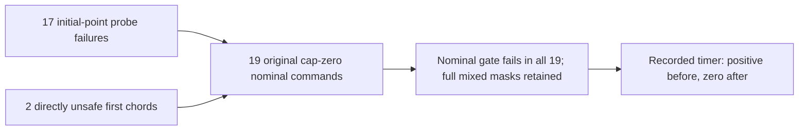

# Consolidated review of the 19 reset decisions

The six reset-evidence studies now have one replay command and a compact
19-row overview. Both complete replay runs reproduced every saved collector
table/source, SVG/CSV/plot manifest and standalone independent proof exactly.
All 64 generated evidence files, including the fresh PNGs and three new
overview files, were also byte identical between the two runs.

The overview connects point evidence to the original probe decision and timer
record. All 19 original commands have cap_zero and a failing nominal gate.
Seventeen original probes fail at the initial point; two fail at a directly
checked first chord. Mean point gaps to the original blockers are clear in
all 19. The original timers are positive before each decision and zero after
it, with the complete simultaneous failure masks preserved.

These records describe different predicates. The mean-point comparison is a
same-step retrospective audit; the original probe includes curved segments,
and the timer follows the original joint-gate decisions. This review adds no
controller modification, trajectory or counterfactual recovery result.

[Protocol](protocol.md) and the [frozen catalogue](freeze-pins.json) were
committed at `7184469` from main `eac4b2a1adfcc63f0fe56a27a04ac12b666250fd`.
This consolidates known outcomes and fixes an export/replay schema; it is not
a newly blinded experiment.

## Recorded decision chain



The diagram summarizes the original verified records. Fifteen distinct resets
fail nominal alone, three fail nominal plus release, and one fails clearance
plus nominal. The overview keeps every full mask rather than replacing mixed
failures with a single cause. Original native probe/timer execution remains
inherited evidence from the earlier audits.

The 17 initial failures have blocked raw points and clear mean points against
their fixed original blockers; adding their recorded radial components gives
clear radial-gap intervals. The two chord failures have raw and mean points
already clear, plus separate directly unsafe first-chord evidence. Their
deficit/radial fractions remain explicitly not applicable and blank.

## All 19 original decisions

The table preserves original case/step order. Point states refer to the same
original blocker. Timer values and lost ticks use original integer ticks;
ending multiplicity counts overlapping records, not independent experiments.
All source strings and full bounds remain in [reset-evidence.csv](reset-evidence.csv).

| Edge | Time s | Probe failure stage | Blocker | Raw / mean point | Full failed gates | Timer before → after | Lost ticks | Ending multiplicity |
| --- | --- | --- | --- | --- | --- | --- | --- | --- |
| C0226@8763 | 175.26 | initial | 420 @ (3, 4) | blocked / clear | nominal | 4 → 0 | 4 | 1 |
| C0226@8765 | 175.3 | initial | 420 @ (3, 4) | blocked / clear | nominal;release | 1 → 0 | 1 | 1 |
| C0227@8763 | 175.26 | initial | 420 @ (3, 4) | blocked / clear | nominal | 4 → 0 | 4 | 1 |
| C0227@8765 | 175.3 | initial | 420 @ (3, 4) | blocked / clear | nominal;release | 1 → 0 | 1 | 1 |
| C0228@8763 | 175.26 | initial | 420 @ (3, 4) | blocked / clear | nominal | 4 → 0 | 4 | 2 |
| C0228@8765 | 175.3 | first_chord | 420 @ (3, 4) | clear / clear | nominal | 1 → 0 | 1 | 2 |
| C0228@8768 | 175.36 | initial | 420 @ (3, 4) | blocked / clear | nominal;release | 2 → 0 | 2 | 2 |
| C0310@8770 | 175.4 | initial | 1310 @ (34, 35) | blocked / clear | nominal | 9 → 0 | 9 | 13 |
| C0310@8775 | 175.5 | initial | 1310 @ (34, 35) | blocked / clear | nominal | 4 → 0 | 4 | 14 |
| C0310@8777 | 175.54 | initial | 1310 @ (34, 35) | blocked / clear | nominal | 1 → 0 | 1 | 14 |
| C0310@8779 | 175.58 | initial | 1310 @ (34, 35) | blocked / clear | nominal | 1 → 0 | 1 | 14 |
| C0310@8781 | 175.62 | initial | 1310 @ (34, 35) | blocked / clear | nominal | 1 → 0 | 1 | 16 |
| C0310@8785 | 175.7 | initial | 1310 @ (34, 35) | blocked / clear | nominal | 2 → 0 | 2 | 17 |
| C0310@8792 | 175.84 | initial | 1310 @ (34, 35) | blocked / clear | nominal | 4 → 0 | 4 | 19 |
| C0310@8795 | 175.9 | initial | 1310 @ (34, 35) | blocked / clear | nominal | 1 → 0 | 1 | 19 |
| C0310@8804 | 176.08 | initial | 1310 @ (34, 35) | blocked / clear | nominal | 4 → 0 | 4 | 16 |
| C0310@8808 | 176.16 | first_chord | 1310 @ (34, 35) | clear / clear | nominal | 2 → 0 | 2 | 13 |
| C0310@8813 | 176.26 | initial | 1310 @ (34, 35) | blocked / clear | nominal | 1 → 0 | 1 | 10 |
| C0310@8815 | 176.3 | initial | 1310 @ (34, 35) | blocked / clear | clearance;nominal | 1 → 0 | 1 | 10 |

The largest recorded reset discards nine ticks at C0310@8770. Both chord rows,
C0228@8765 and C0310@8808, retain their original clear start-point predicates
and separate unsafe curved-chord evidence. A clear mean point alone does not
replace the original probe/release conditions.

## Six-study evidence index

The [study index](study-index.csv) retains each study's complete original audit
JSON with its own keys and units. Comparison counts are reported per study;
they are not summed as independent observations or evidence strength.

| Study / report | Existing figure | Collector files replayed | Plot files replayed | Independent comparisons | Original identity comparisons |
| --- | --- | --- | --- | --- | --- |
| [run-breaks](../fusion-return-run-breaks/report.md) | [SVG](../fusion-return-run-breaks/run-breaks.svg) | 6 | 7 | 329539 | 155883 |
| [reset-probes](../fusion-return-reset-probes/report.md) | [SVG](../fusion-return-reset-probes/reset-probes.svg) | 4 | 6 | 21944 | 131901 |
| [reset-displacement](../fusion-return-reset-displacement/report.md) | [SVG](../fusion-return-reset-displacement/reset-displacement.svg) | 3 | 5 | 23389 | 131901 |
| [reset-projection](../fusion-return-reset-projection/report.md) | [SVG](../fusion-return-reset-projection/reset-projection.svg) | 3 | 5 | 24870 | 131901 |
| [reset-margin](../fusion-return-reset-margin/report.md) | [SVG](../fusion-return-reset-margin/reset-margin.svg) | 3 | 5 | 26128 | 131901 |
| [reset-surplus](../fusion-return-reset-surplus/report.md) | [SVG](../fusion-return-reset-surplus/reset-surplus.svg) | 3 | 5 | 27114 | 131901 |

Collector counts include each sources.json. Plot counts include the SVG,
all CSV exports, plot-sources.json and fresh PNG. Each stage also has one
replayed independent proof. Per run this totals 22 collector files, 33 plot
files and six proofs (61 stage files), plus three new overview files.

The frozen catalogue pins 73 direct study artifacts and 18 stage scripts.
Each freshly executed standalone verifier also rechecks its complete further
transitive input/helper/Rust chain and original census joins. Hash checks in
the runner supplement these executions; they do not replace the independent
verifiers. Existing independent numerical methods remain those of the six
linked studies; this review is an orchestrator/exporter.

Each collector reads the committed preceding inputs it was designed to use.
The command replays all six stages against their original pins; it does not
rewire later stages to newly generated parent paths. Every new parent output
must nevertheless be byte identical to its committed baseline. The compact
overview is copied from the replayed final surplus table.

## One-command replay and outputs

From the repository root:

```bash
MPLCONFIGDIR=/tmp/reset-review-mpl python3 experiments/pose_observation_loss/review_reset_evidence.py \
  --output /tmp/fusion-return-reset-review
```

Use a fresh output directory outside the checkout and run without Python -O.
The runner uses the standard library; its existing plotters require Matplotlib.
It preserves the runtime environment and invokes each child with argument
vectors using the current Python executable. Full child stdout/stderr is
saved under OUTPUT/stages/STAGE/collector.log, plotter.log and verifier.log.
A failed child returns its original positive failure status; signal exits use
the conventional 128+signal status. Failed/incomplete stages do not publish a
completed review manifest. Existing output directories are rejected.

The fresh output contains:

| Output | Contents |
| --- | --- |
| reset-evidence.csv | 19 rows × 39 copied fields, preserving blanks and full gate masks |
| study-index.csv | six rows × 13 fields, including original audit JSON and proof links/hashes |
| review-sources.json | runner/protocol/freeze hashes, frozen inputs, all stage replay hashes and both CSV hashes |
| stages/STAGE/collector/ | freshly regenerated tables and original-format sources |
| stages/STAGE/figures/ | freshly regenerated SVG/PNG/CSV/plot provenance |
| stages/STAGE/independent-verification.json | freshly executed independent proof, byte identical to its frozen baseline |

Manifests contain repository-relative input paths and omit output-directory
names, timestamps and timing data. For a second replay choose another fresh
path. The saved evidence was checked with two full runs, including the fresh
PNG bytes. Six existing figures are linked above; no new geometry figure is
introduced.

## Validation and scope

All **1,250 Python tests pass**, including 15 new tests for exact source-string/
blank projection, duplicate/missing fields, malformed CSVs, strict output sets
and byte identity, changed script/proof/source metadata, fresh external output
paths and symlink resolution, argument vectors with spaces, captured streams,
preserved child failure status, no completion manifest after a failed stage,
and rejection of optimized Python. The full suite separately runs its existing
native unit fixtures with the activated saved Rust toolchain.

Both full review runs executed all six collectors, six plotters and six
standalone independent verifiers. Each run re-evaluated the existing 19
displacement, 19 projection, 19 margin and 17 ratio pairs. This is repeated
arithmetic on inherited boxes, not new source observations. Fresh raw
extractions and native dataset runs remain zero. Prior native dataset/probe
execution remains inherited evidence.

The original 19 resets, 185 overlapping endings, 25 contexts, 60 missing future
slots, 972 cases, 324 families, 570 timeouts, 3,997 anchors, 137 returns, 3,751
decisions, 1,096 zero probes, 336 cells, weights and original outcome labels
remain unchanged. The four histories and two families are descriptive records;
no new trial denominator, selected weight or recovery rate is introduced.

All earlier interval enclosures retain their conditional reconstructed-input
and elemental-padding assumptions. The compact export copies these bounds
without rounding or numerical conversion. Full studies remain the source for
their methods, limits and independent proofs.

Tracked review artifacts:

| Artifact | Contents |
| --- | --- |
| [protocol.md](protocol.md) | fixed review/replay method and schema |
| [freeze-pins.json](freeze-pins.json) | complete six-stage direct artifact/script catalogue |
| [reset-evidence.csv](reset-evidence.csv) | 19 rows × 39 copied fields |
| [study-index.csv](study-index.csv) | six rows × 13 index fields |
| [review-sources.json](review-sources.json) | successful fresh replay and export provenance |
| [report.md](report.md) | this review |

Full stage outputs, 18 logs per run, test logs and bytewise-comparison metadata
remain in scratch. The [README](../../README.md#review-and-replay-the-reset-evidence)
links the same command and notes the full suite's Rust requirement.

Evidence pins (SHA-256):

| Artifact | SHA-256 |
| --- | --- |
| reset-evidence.csv | d98eea7efdcc50fc88e473d0306501993d9c5174c88a0b30443b4ded3c7eca66 |
| study-index.csv | 96ff718938ad252c20e95f63357e7e5be291ca6e6288e2c410347d081facc6b6 |
| review-sources.json | ba103d3933edb43a0ec543400e5c4c076a4f6a6c6fb13e40ec6de725f2fa546b |

Replayed independent proofs (SHA-256):

| Study | Proof SHA-256 |
| --- | --- |
| [fusion-return-run-breaks](../fusion-return-run-breaks/independent-verification.json) | bb50761c35e3b49125861af5c93d339a43a95b337f24cd75737f4b86c50f0fdc |
| [fusion-return-reset-probes](../fusion-return-reset-probes/independent-verification.json) | ba1acd798c92798c224de7759cbab28344b717d989bfbcfc5fa8018b2bd64122 |
| [fusion-return-reset-displacement](../fusion-return-reset-displacement/independent-verification.json) | 0672f7f6616aab12dd07fe9341cb5f7a535a2fec814114c4e2f88020ac7eb326 |
| [fusion-return-reset-projection](../fusion-return-reset-projection/independent-verification.json) | ded0de2bce633fd9ba6c041c9355a032ee55d018cfe75c0a76a2f8f2ebbd534d |
| [fusion-return-reset-margin](../fusion-return-reset-margin/independent-verification.json) | b65366c13bb48c3d4843233a45ebb593b15ad0562da5c3d013ec1f5233e8c898 |
| [fusion-return-reset-surplus](../fusion-return-reset-surplus/independent-verification.json) | 1d312bee503cea16bb62ab7fddd1caeeb9bcb43252711a4dd37bb24e81fbb0f4 |
