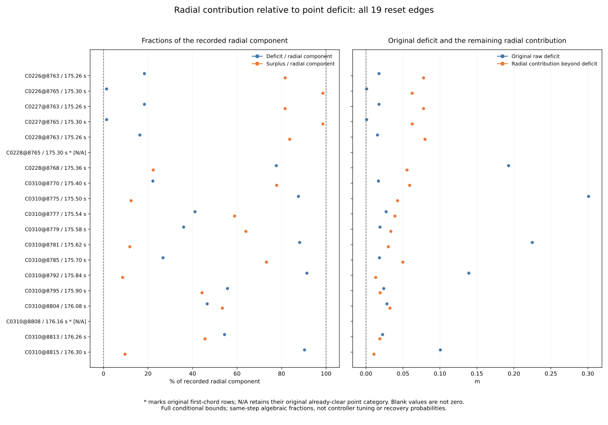

# Radial contribution relative to the original point deficit

All 17 preceding blocked-to-clear/radial-clear pairs have certified positive
radial denominators, required fractions below one and positive surplus
fractions. Their original raw deficits account for approximately
1.405020–91.378897% of the recorded radial components; the remainder accounts
for approximately 8.621103–98.594980%.

All 19 original rows remain present. The two already-clear first-chord pairs
are explicitly not applicable to these fractions and have blank new quantities,
not zero-valued deficit observations. Their direct unsafe chord evidence is
unchanged. The fractions describe a same-step spatial identity; they do not
tune a controller, simulate a smaller position difference, establish path
safety or define a recovery probability.

[Protocol](protocol.md) and [pins](freeze-pins.json) were committed at
`c880b45`, from main `e96f9067522d81ad1998fd7e2c7b07433d4580d2`, before
deriving new fractions or their descriptive ranges.

## Frozen eligibility and retained populations

Retain exactly the preceding 19 reset/blocker pairs, all 17 initial-unsafe and
two first-chord origins, and all 185 overlapping-ending multiplicities. Copy
all 656 preceding margin fields as exact strings, including identities,
rectangles, point states, earlier audits, masks and outcomes. Original blocker
IDs stay 420 at (3, 4), or 1310 at (34, 35). No new time, object or decision
is selected.

The original 25 contexts, 60 missing future slots, 972 cases, 324 families,
570 timeouts, 3,997 anchors, 137 returns, 3,751 decisions, 1,096 zero probes,
336 cells and all preselection weights remain inherited. Descriptive records
come from four histories and two families, not independent new trials. No
selected weight, trial denominator or rate is added.

For complete preceding margins, validate the raw/mean/radial gap states against
their boxes and require the original point category to agree. Only the frozen
blocked_to_clear_radial_clear category is eligible for ratios. All other
complete categories receive not_applicable_category status and not_applicable
classifications. Incomplete preceding margins receive unresolved_margin.
An eligible row whose radial lower bound is nonpositive receives
unresolved_radial_denominator. All noncomputed rows remain in every applicable
count/export, with blank new quantities.

All 17 eligible rows compute successfully and represent 170 of the inherited
ending multiplicities. The other two already-clear chord rows retain the
remaining 15. No selected eligible denominator is unresolved.

## Fractions and independent identity checks

Let h be the original raw gap, a the recorded radial component and H=h+a the
preceding radial gap. For a_lo>0, compute:

```
raw_deficit = 0 - h
radial_surplus = a - raw_deficit
required_fraction = raw_deficit / a
surplus_fraction = radial_surplus / a
gap_fraction = H / a
required_fraction + surplus_fraction = 1
surplus_fraction = gap_fraction
radial_surplus = H
```

The eight new center/lo/hi triples comprise the deficit, surplus, three
fractions and three residuals. Singleton zero/one values are exact. Conditional
addition/subtraction uses +/-1e-12 endpoint padding. Division evaluates all
four endpoint quotients, pads by +/-1e-12 and requires a denominator box
excluding zero; this audit specifically requires a positive radial lower bound.
Inputs and results must be finite and ordered.

All three residual centers must have magnitude <=1e-10 and all residual
intervals must contain zero. Every selected residual center is exactly zero
in the binary64 collector. Enclosures are retained intact; deficits, surpluses
and fractions are never clipped to zero/one. Independently calculated ratio
enclosures need not have complementary endpoints.

required_fraction_relation is below_one only when its upper bound is <1,
above_one only when its lower bound is >1, otherwise unknown. The surplus
fraction is positive only when its lower bound is >0, negative only when its
upper bound is <0, otherwise unknown. Nonapplicable rows use a separate
not_applicable classification. Numeric comparison tolerance never certifies
a denominator, narrows an interval or resolves a relation/sign.

These are conditional enclosures based on inherited reconstructed inputs and
the frozen padding. They do not recover hidden unrounded states or constitute
an unconditional numerical-error proof. A surplus percentage is a fraction
of the recorded radial component, not a recommended reduction of any filter
or controller setting.

## All 19 original rows

The table keeps original case/step order. Lengths are rounded centers in
metres; percentages use the recorded radial component as denominator. Full
bounds remain in [surplus.csv](surplus.csv). Asterisks mark original first-chord
rows. A dash is a blank/not-applicable quantity, not zero.

| Edge | Time s | Raw deficit m | Radial surplus m | Required % | Surplus % | Status | Ending multiplicity |
| --- | --- | --- | --- | --- | --- | --- | --- |
| C0226@8763 | 175.26 | 0.017529809 | 0.077793492 | 18.389847 | 81.610153 | complete | 1 |
| C0226@8765 | 175.30 | 0.000890712 | 0.062504227 | 1.405020 | 98.594980 | complete | 1 |
| C0227@8763 | 175.26 | 0.017529809 | 0.077793492 | 18.389847 | 81.610153 | complete | 1 |
| C0227@8765 | 175.30 | 0.000890712 | 0.062504227 | 1.405020 | 98.594980 | complete | 1 |
| C0228@8763 | 175.26 | 0.015548119 | 0.079761377 | 16.313295 | 83.686705 | complete | 2 |
| C0228@8765 * | 175.30 | — | — | — | — | not applicable | 2 |
| C0228@8768 | 175.36 | 0.192750436 | 0.055482553 | 77.649001 | 22.350999 | complete | 2 |
| C0310@8770 | 175.40 | 0.016831420 | 0.059009593 | 22.193032 | 77.806968 | complete | 13 |
| C0310@8775 | 175.50 | 0.300923848 | 0.042656021 | 87.584831 | 12.415169 | complete | 14 |
| C0310@8777 | 175.54 | 0.027250112 | 0.039056578 | 41.097078 | 58.902922 | complete | 14 |
| C0310@8779 | 175.58 | 0.018906356 | 0.033598368 | 36.008866 | 63.991134 | complete | 14 |
| C0310@8781 | 175.62 | 0.224817121 | 0.030233097 | 88.146218 | 11.853782 | complete | 16 |
| C0310@8785 | 175.70 | 0.018222593 | 0.049843232 | 26.772015 | 73.227985 | complete | 17 |
| C0310@8792 | 175.84 | 0.139078306 | 0.013121284 | 91.378897 | 8.621103 | complete | 19 |
| C0310@8795 | 175.90 | 0.024033067 | 0.019098063 | 55.720930 | 44.279070 | complete | 19 |
| C0310@8804 | 176.08 | 0.028253097 | 0.032375031 | 46.600641 | 53.399359 | complete | 16 |
| C0310@8808 * | 176.16 | — | — | — | — | not applicable | 13 |
| C0310@8813 | 176.26 | 0.022420110 | 0.018795253 | 54.397459 | 45.602541 | complete | 10 |
| C0310@8815 | 176.30 | 0.100580591 | 0.010765761 | 90.331285 | 9.668715 | complete | 10 |

The two nonapplicable rows are C0228@8765 and C0310@8808. Both already have
clear raw/mean point gaps; their original failures concern the directly checked
curved first chord. Their original geometry remains in the copied columns.

## Summary counts and interval extrema

| Case | All physical resets | All ending multiplicities | Computed pairs | Computed ending multiplicities | Not applicable |
| --- | --- | --- | --- | --- | --- |
| all_cases | 19 | 185 | 17 | 170 | 2 |
| C0226 | 2 | 2 | 2 | 2 | 0 |
| C0227 | 2 | 2 | 2 | 2 | 0 |
| C0228 | 3 | 6 | 2 | 4 | 1 |
| C0310 | 12 | 175 | 11 | 162 | 1 |

The summary crosses the four original cases plus all_cases with all three
original zero origins plus all_origins (20 cells). All status and classification
categories are retained. Fifteen count fields pass 135 additive case/origin
closure checks; status/relation/sign counts also sum to physical_resets within
each cell. Nonapplicable classifications are distinct from unknown intervals.

Extrema use available boxes only: min/min for minimum enclosures, max/max for
maximum enclosures. They are recomputed per cell, never summed or selected by
a center's row. Empty/nonapplicable cells have blank extrema. Global enclosures
below use dimensionless ratios for the fractions and metres for radial_surplus:

| Quantity | Minimum enclosure | Maximum enclosure |
| --- | --- | --- |
| required_fraction | [0.014050165023066646, 0.014050235792587096] | [0.9137889177929509, 0.9137890153939353] |
| surplus_fraction | [0.08621097863908939, 0.0862110881740315] | [0.9859496449568422, 0.985949954227527] |
| radial_surplus | [0.010765753735347999, 0.010765768022338468] | [0.07976137140705186, 0.07976138260080719] |



The fixed two-panel figure shows the two fractions as percentages with zero/
100 references, then deficit/surplus lengths in metres with zero reference.
All 19 labels and full bound ranges remain present; the two original chord
rows have asterisks and N/A labels. Blank fractions are not plotted as zeros.
PNG was visually inspected. SVG, every surplus row, all 20 summary cells and
plot provenance are tracked.

## Independent verification and bytewise replay

The standalone verifier imports no analyzers or plotters. It independently
checks eligibility, interval divisions, identities, strict classifications,
summaries/extrema/count closures and original census joins using 60-digit
Decimal from binary64-parsed inherited boxes. All copied strings, IDs,
categories and counts compare exactly; new numbers use abs 1e-12 / rel 1e-10,
never for denominator certification or interval classification. It verifies
all plot exports and the complete transitive input/helper/Rust provenance.

It performs 27,114 comparisons beyond 131,901 original census identity
comparisons. All **1,235 Python tests pass**, including 23 new tests for
different deficit/surplus fractions, near-zero/near-one values, nonapplicable
and incomplete categories, unclipped wide boxes, strict boundary relations,
nonpositive/zero-containing radial denominators, invalid boxes/states/categories,
corrupt identities and required zero containment, exact strings, duplicate
edges, empty/nonapplicable cells, interval extrema, computed multiplicities
and additive closures. Existing native unit fixtures run in the full suite;
preceding native dataset execution remains inherited evidence.

The audit inspects 19 pairs and performs 17 fresh ratio-pair evaluations.
Fresh raw reads and native dataset runs remain zero. Controller/dependency
files and original outcomes retain their pinned versions.

Two collector runs are byte identical across both CSVs and sources (3 files).
Two plot runs are byte identical across SVG, PNG, both CSV exports and
provenance (5 files). Use the [README commands](../../README.md#measure-radial-surplus-relative-to-the-original-point-deficit)
with fresh paths and without Python -O. PNG, test logs, replay hashes and
report-generation metadata stay in scratch.

| Artifact | Contents |
| --- | --- |
| [protocol.md](protocol.md) | frozen method and checks |
| [freeze-pins.json](freeze-pins.json) | preceding main/source/proof/verifier pins |
| [surplus.csv](surplus.csv) | 19 rows × 683 columns |
| [surplus-summary.csv](surplus-summary.csv) | 20 rows × 29 columns |
| [sources.json](sources.json) | complete input/helper/code/output provenance |
| [independent-verification.json](independent-verification.json) | independent verification evidence |
| [reset-surplus.svg](reset-surplus.svg) | full fixed two-panel figure |
| [plot-surplus.csv](plot-surplus.csv) | 19 rows × 683 columns |
| [plot-values.csv](plot-values.csv) | 20 rows × 29 columns |
| [plot-sources.json](plot-sources.json) | plot script/input/output provenance |
| [report.md](report.md) | this report |

Evidence pins (SHA-256):

| Artifact | SHA-256 |
| --- | --- |
| sources.json | a98faabc9e2857d5dc5af2c5e078a7412fee0e8f7c3694780c2309a99eb2acd4 |
| independent-verification.json | 1d312bee503cea16bb62ab7fddd1caeeb9bcb43252711a4dd37bb24e81fbb0f4 |
| plot-sources.json | abf8627c9934a53818cb0012845ea4ff927d198b8b45919f35c9717fea42d483 |

Inherited margin proof: `b65366c13bb48c3d4843233a45ebb593b15ad0562da5c3d013ec1f5233e8c898`.

| Inherited geometry study | Proof SHA-256 |
| --- | --- |
| [fusion-return-probe-origin](../fusion-return-probe-origin/independent-verification.json) | b6dbf95d64cdff2e052c671b48e17e172d54c9d8d7013514291b5369192e450b |
| [fusion-return-first-chord](../fusion-return-first-chord/independent-verification.json) | ad7182e599dc7d494c716f4ab7c06770a731833dddf06cd5e798f28edcdf6ec1 |
| [fusion-return-point-clearance](../fusion-return-point-clearance/independent-verification.json) | d6f0254d3e70a4bb371ac1cc17cb2cbf506e4f1b6af12751a0201f8df21ab901 |
