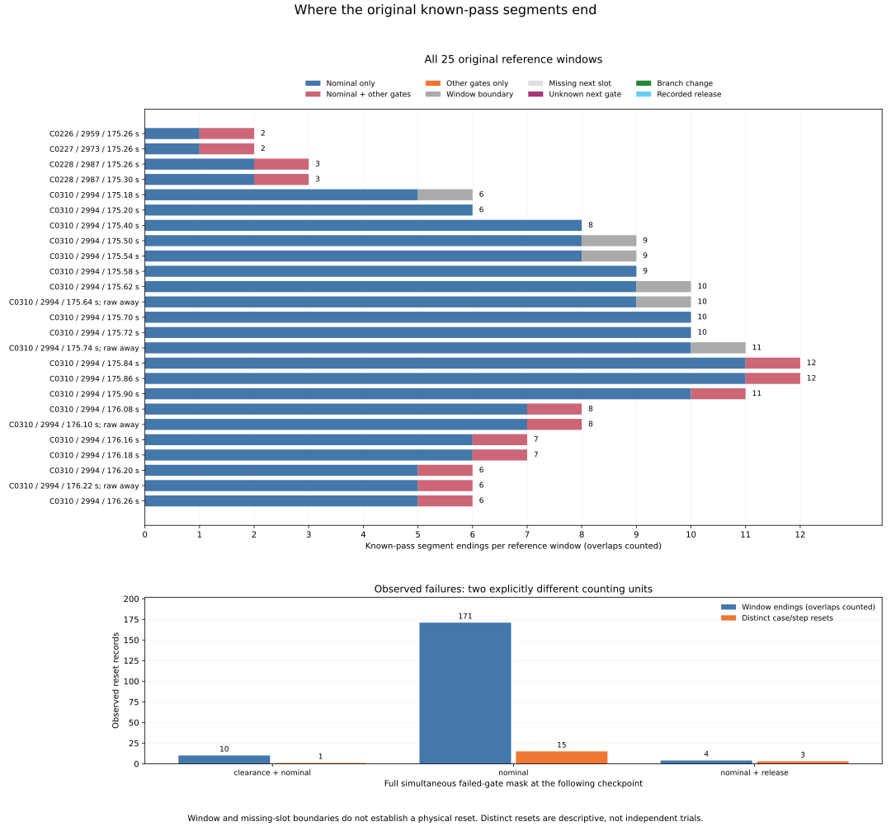

# Endings of the original known-pass segments

Of the 191 inherited known-pass segments, 185 end at an observed failed
decision and six reach the right context boundary. The 185 failures represent
19 distinct case/step resets after overlapping windows are deduplicated.
Every one has a zero nominal command from the inherited zero-cap source
domain: 15 fail nominal alone, one fails clearance plus nominal, and three
fail nominal plus release. There is no observed reset caused only by the
other gates in this fixed set.

The largest reset loses nine accumulated ticks (0.18 s) at C0310 / 175.40 s.
Its only failed gate is nominal. This explains where the preceding maximum
counter is lost within the recorded contexts; it does not predict recovery
after changing a gate or establish behavior outside these contexts.

[Protocol](protocol.md) and [pins](freeze-pins.json) were committed at
`6b6e75c`, from main `9d4ca904a64d1ebee693aa3bb79e8764deb0f7f7`, before
extracting new ending masks, loss amounts or distinct-reset counts.

## Fixed population and end classification

Reuse all preceding 25 references, 1,275 planned slots, 1,215 included pairs,
247 unique case/steps and 191 known-pass segments. The 60 slots at/after next
loss remain missing, with no horizon extension. The 82 before-return slots
remain historical contexts. Original populations remain 972 cases, 324 families,
570 timeouts, 3,997 anchors, 137 returns, 3,751 decisions, 1,096 zero probes
and 336 summary cells. Contexts do not add decisions, follow-up or trials.

The complete source conjunction defines a known-pass segment, with the same
branch, consecutive included slots and no internal release. Fail/unknown,
missing, branch changes and a preceding release break the scan. Every preceding
ready-runs.csv field and original order is checked. Each segment obeys carried
before + L = last after, or the source threshold with last after zero on
release. L checkpoints span (L-1)/50 s and add L/50 s of evidence.

End priority is recorded release, absent next planned slot, missing next slot,
branch change, then known failure or unknown at the same-branch neighbor.
Only a known failure with consecutive exact source steps, last after = next
before > 0, next after zero, action reset and observed ready false receives
a certified lost amount. Unknown or boundary endings do not receive an
invented failed gate or reset amount. All simultaneous failed gates survive.

| End status | Segments |
| --- | --- |
| gate_failure | 185 |
| right_context_limit | 6 |

There are no missing-context, unknown-boundary, branch-change or recorded-release ends in this set. All six boundary segments reach offset +25; their after counters are 1–3 ticks. The 60 excluded future slots remain excluded even though no known-pass segment ends directly against them.

| Full failed mask | Overlapping window endings | Distinct case/step resets |
| --- | --- | --- |
| clearance;nominal | 10 | 1 |
| nominal | 171 | 15 |
| nominal;release | 4 | 3 |

| Terminator side | Nominal only | Nominal + other | Other only | Total |
| --- | --- | --- | --- | --- |
| pre | 82 | 0 | 0 | 82 |
| reference | 15 | 0 | 0 | 15 |
| post | 74 | 14 | 0 | 88 |

The side is the terminator offset, not the segment start. All 15 reference-time resets fail nominal alone. All 14 mixed-mask window endings occur after the reference. These counts include the same physical reset in multiple windows.

## Original subgroups and lost evidence

| Fixed subgroup | N | Segments | Observed failures | Window boundary | Distinct resets | Nominal-only / mixed window failures | Max lost ticks all / post |
| --- | --- | --- | --- | --- | --- | --- | --- |
| all25 | 25 | 191 | 185 | 6 | 19 | 171 / 14 | 9 / 9 |
| raw_away4 | 4 | 35 | 33 | 2 | 12 | 31 / 2 | 9 / 4 |
| reset15 | 15 | 109 | 106 | 3 | 19 | 97 / 9 | 9 / 4 |
| initial23 | 23 | 181 | 175 | 6 | 19 | 163 / 12 | 9 / 9 |
| first_chord2 | 2 | 10 | 10 | 0 | 10 | 8 / 2 | 4 / 2 |

Subgroups overlap. A distinct reset is counted once within each subgroup containing it; the subgroup counts cannot be added as independent observations.

| Lost ticks per reset | Window endings | Distinct resets |
| --- | --- | --- |
| 1 | 87 | 9 |
| 2 | 32 | 3 |
| 4 | 53 | 6 |
| 9 | 13 | 1 |

Every reset amount includes evidence carried before the local segment.
Four segments have nonzero carried counts; their lost amounts are not replaced
by the visible checkpoint count. The sum of lost ticks is 480 across overlapping
window endings and 48 across distinct resets. These are sums of discarded
counter contents, not elapsed observation time or a new outcome measure.

## All 19 distinct recorded reset edges

Identity is exact case/source step. Repeated windows must agree on every source input, gate state, mask, nominal reason, counter and inherited native output. Multiplicity and ordered member references/native row IDs remain in reset-edges.csv. Distinct source edges are descriptive records from four histories and two families, not independent experiments.

| Case / source step | Time s | Full failed mask | Counter before → after | Window multiplicity |
| --- | --- | --- | --- | --- |
| C0226@8763 | 175.26 | nominal | 4 → 0 | 1 |
| C0226@8765 | 175.3 | nominal;release | 1 → 0 | 1 |
| C0227@8763 | 175.26 | nominal | 4 → 0 | 1 |
| C0227@8765 | 175.3 | nominal;release | 1 → 0 | 1 |
| C0228@8763 | 175.26 | nominal | 4 → 0 | 2 |
| C0228@8765 | 175.3 | nominal | 1 → 0 | 2 |
| C0228@8768 | 175.36 | nominal;release | 2 → 0 | 2 |
| C0310@8770 | 175.4 | nominal | 9 → 0 | 13 |
| C0310@8775 | 175.5 | nominal | 4 → 0 | 14 |
| C0310@8777 | 175.54 | nominal | 1 → 0 | 14 |
| C0310@8779 | 175.58 | nominal | 1 → 0 | 14 |
| C0310@8781 | 175.62 | nominal | 1 → 0 | 16 |
| C0310@8785 | 175.7 | nominal | 2 → 0 | 17 |
| C0310@8792 | 175.84 | nominal | 4 → 0 | 19 |
| C0310@8795 | 175.9 | nominal | 1 → 0 | 19 |
| C0310@8804 | 176.08 | nominal | 4 → 0 | 16 |
| C0310@8808 | 176.16 | nominal | 2 → 0 | 13 |
| C0310@8813 | 176.26 | nominal | 1 → 0 | 10 |
| C0310@8815 | 176.3 | clearance;nominal | 1 → 0 | 10 |

All 19 have source reason cap_zero, with no unknown gate mask. The nine-
tick reset at C0310@8770 appears in 13 overlapping windows. Counting those
13 records as separate physical resets would inflate that single event.

The fixed first-chord references remain C0228 / 2987 / 175.30 s and
C0310 / 2994 / 176.16 s. Their reference-time resets discard one and two
ticks, respectively, with nominal as the sole failed gate. Their inherited
clear raw starts and curved first-chord failures remain unchanged.

## All 25 original references

| Case / anchor | Time s | Runs | Nominal-only / mixed ends | Post nominal-only / mixed | Window boundary | Max lost all / post |
| --- | --- | --- | --- | --- | --- | --- |
| C0226 / 2959 | 175.26 | 2 | 1 / 1 | 0 / 1 | 0 | 4 / 1 |
| C0227 / 2973 | 175.26 | 2 | 1 / 1 | 0 / 1 | 0 | 4 / 1 |
| C0228 / 2987 | 175.26 | 3 | 2 / 1 | 1 / 1 | 0 | 4 / 2 |
| C0228 / 2987 | 175.3 | 3 | 2 / 1 | 0 / 1 | 0 | 4 / 2 |
| C0310 / 2994 | 175.18 | 6 | 5 / 0 | 5 / 0 | 1 | 9 / 9 |
| C0310 / 2994 | 175.2 | 6 | 6 / 0 | 6 / 0 | 0 | 9 / 9 |
| C0310 / 2994 | 175.4 | 8 | 8 / 0 | 7 / 0 | 0 | 9 / 4 |
| C0310 / 2994 | 175.5 | 9 | 8 / 0 | 6 / 0 | 1 | 9 / 4 |
| C0310 / 2994 | 175.54 | 9 | 8 / 0 | 5 / 0 | 1 | 9 / 4 |
| C0310 / 2994 | 175.58 | 9 | 9 / 0 | 5 / 0 | 0 | 9 / 4 |
| C0310 / 2994 | 175.62 | 10 | 9 / 0 | 4 / 0 | 1 | 9 / 4 |
| C0310 / 2994 | 175.64 | 10 | 9 / 0 | 4 / 0 | 1 | 9 / 4 |
| C0310 / 2994 | 175.7 | 10 | 10 / 0 | 4 / 0 | 0 | 9 / 4 |
| C0310 / 2994 | 175.72 | 10 | 10 / 0 | 4 / 0 | 0 | 9 / 4 |
| C0310 / 2994 | 175.74 | 11 | 10 / 0 | 4 / 0 | 1 | 9 / 4 |
| C0310 / 2994 | 175.84 | 12 | 11 / 1 | 4 / 1 | 0 | 9 / 4 |
| C0310 / 2994 | 175.86 | 12 | 11 / 1 | 4 / 1 | 0 | 9 / 4 |
| C0310 / 2994 | 175.9 | 11 | 10 / 1 | 3 / 1 | 0 | 4 / 4 |
| C0310 / 2994 | 176.08 | 8 | 7 / 1 | 2 / 1 | 0 | 4 / 2 |
| C0310 / 2994 | 176.1 | 8 | 7 / 1 | 2 / 1 | 0 | 4 / 2 |
| C0310 / 2994 | 176.16 | 7 | 6 / 1 | 1 / 1 | 0 | 4 / 1 |
| C0310 / 2994 | 176.18 | 7 | 6 / 1 | 1 / 1 | 0 | 4 / 1 |
| C0310 / 2994 | 176.2 | 6 | 5 / 1 | 1 / 1 | 0 | 4 / 1 |
| C0310 / 2994 | 176.22 | 6 | 5 / 1 | 1 / 1 | 0 | 4 / 1 |
| C0310 / 2994 | 176.26 | 6 | 5 / 1 | 0 / 1 | 0 | 4 / 1 |

## Original measures and complete figure

Original anchor weights are reconstructed before selection from the original
case anchor counts, received anchor counts and RP parent counts. Existing
decimal strings remain unchanged in the output; new exact_* Fraction columns
retain the rational values used for aggregation. Earlier decimal displays are
checked using their inherited numeric tolerance. New Fraction values, counts,
states, IDs and strings compare exactly; new seconds use abs 1e-12 / rel 1e-10.

Census/received/RP masses remain 570 / 570 / 157 with 10,995 RP records.
All 336 cells retain their original denominators. Nonreturns have blank new
metrics/flags; unselected returned anchors have zero/false. Empty share
denominators remain blank. The new reference/flag totals pass 3,036 additive
mode/category closure comparisons. Available flags can overlap and retain the
original 137 returned-anchor denominator.

| Available post-reset flag | Anchors | Exact original case mass | Raw share | Case-mass share |
| --- | --- | --- | --- | --- |
| nominal_only | 2 | 2/7 | 2/137 | 2/137 |
| nominal_with_other | 4 | 4/7 | 4/137 | 4/137 |
| other_only | 0 | 0 | 0 | 0 |

The frozen two-panel figure preserves all 25 references in original order,
shows all end categories and complete per-window totals, and compares every
observed full failure mask using explicitly different counting units. All four
raw-away labels remain. PNG was visually inspected. SVG, every ending/reset,
252 original-mode summary cells, 137 returns and plot provenance are tracked.

## Independent verification and repeatability

This audit postprocesses tracked, verified inputs. It pins all preceding study
artifacts, the full transitive input/helper chain and unchanged original Rust
sources. Raw hashes, 36,000-step window replay, the 41-value command domain
and native admission execution are inherited from the preceding audit. They
are not described as newly executed dataset validations here.

Both implementations recheck all 1,215 inherited native query/input/trace links
against exact local IDs, strings, binary64 age/speed, known gate bits and
observed counters/readiness/flags. End records preserve native last/next row
IDs, and distinct-edge grouping requires identical inherited native outputs.
Unknown centers would retain the prior uncertainty; this dataset has no
unknown conjunctions. Guard-entry geometry and unrounded historical scalars
are not newly reconstructed, and no rollout or outcome label is changed.

The standalone verifier imports no analyzers or plotters. Independent segment/end traversal, carry/reset arithmetic, physical grouping, original census joins and aggregation perform 329,539 comparisons beyond 155,883 original identity comparisons. It verifies all five tables, four plot exports and provenance pins.

All **1,120 Python tests pass**, including 24 new tests for full masks,
failure kinds, carried evidence, positive reset amounts, end priority,
guard/release thresholds, unknown/missing/branch changes, source adjacency,
physical duplication/agreement, counter/input/native mismatches, original
unequal measures, nonreturns, empty shares, exact reconstructed sevenths and
additive closures. The full existing suite also runs its native unit fixtures.
The preceding audit's 21 native dataset/source tests remain inherited evidence;
the new collector/verifier perform zero fresh raw reads and zero fresh native
dataset replay runs.

Two collector runs are byte identical across five tables and sources. Two plot
runs are byte identical across SVG, PNG, four CSV exports and provenance. Use
the [README commands](../../README.md#inspect-endings-of-the-original-known-pass-segments)
with fresh output directories and an unused proof filename, without Python -O.
There are 16 tracked study files; PNG, logs, reproduction and report-generation
metadata remain in scratch.

| Artifact | Contents |
| --- | --- |
| [anchor-breaks.csv](anchor-breaks.csv) | 3,997 rows × 46 columns |
| [break-summary.csv](break-summary.csv) | 336 rows × 53 columns |
| [freeze-pins.json](freeze-pins.json) | protocol / provenance / figure |
| [independent-verification.json](independent-verification.json) | protocol / provenance / figure |
| [plot-reset-edges.csv](plot-reset-edges.csv) | 19 rows × 36 columns |
| [plot-return-values.csv](plot-return-values.csv) | 137 rows × 46 columns |
| [plot-run-ends.csv](plot-run-ends.csv) | 191 rows × 64 columns |
| [plot-sources.json](plot-sources.json) | protocol / provenance / figure |
| [plot-values.csv](plot-values.csv) | 252 rows × 53 columns |
| [protocol.md](protocol.md) | protocol / provenance / figure |
| [reference-breaks.csv](reference-breaks.csv) | 25 rows × 40 columns |
| [reset-edges.csv](reset-edges.csv) | 19 rows × 36 columns |
| [run-breaks.svg](run-breaks.svg) | protocol / provenance / figure |
| [run-ends.csv](run-ends.csv) | 191 rows × 64 columns |
| [sources.json](sources.json) | protocol / provenance / figure |
| [report.md](report.md) | this report |

Evidence pins (SHA-256):

| Artifact | SHA-256 |
| --- | --- |
| sources.json | 83d3c06df66e4e331c05486bfe7df0bdb4197d8159f7c1820d767d287f4debaa |
| independent-verification.json | bb50761c35e3b49125861af5c93d339a43a95b337f24cd75737f4b86c50f0fdc |
| plot-sources.json | 9005f86bdba345a51277beb68b96d3801661b34b1a3f45277a2fd3a669004210 |
