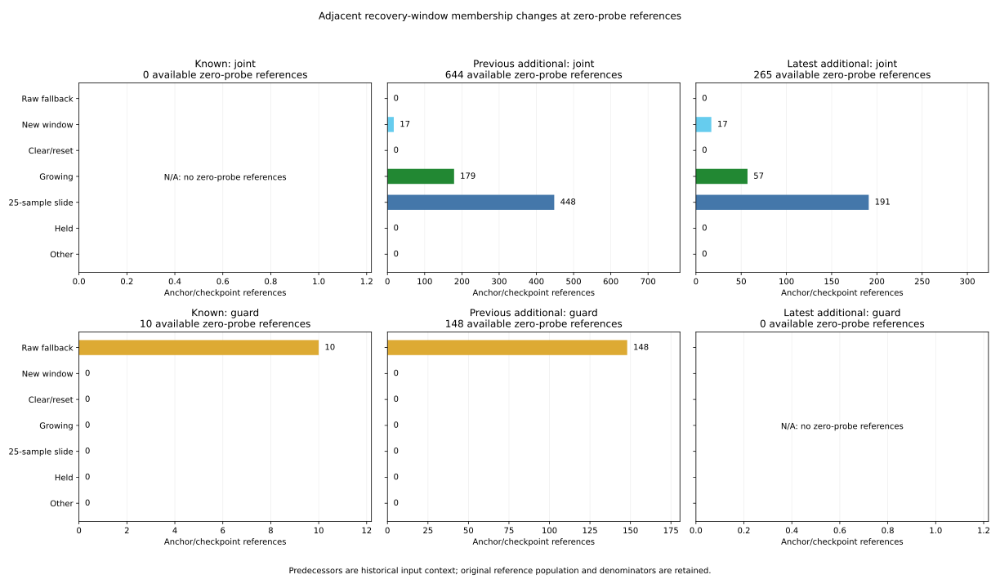

# Adjacent recovery-window updates and estimated-position steps

Among the 887 selected pairs with two nonempty windows, the current sensed
position changes more than the recovery mean in 877 pairs, and less in ten.
Each comparison uses disjoint norm enclosures under the declared numerical
model; none overlaps. All 25 preceding nominal-only conjunction failures have
a larger sensed-position step: seven growing windows and 18 full-window slides.
This describes adjacent recorded estimates. It does not establish statistical
noise reduction, a causal policy benefit or successful recovery.

The [protocol](protocol.md) was frozen in 9ce7700 from main
bd57feeb517c31034e78e703ff77048c6a25104d before reading new predecessor,
membership-change or position-step outcomes. [Freeze pins](freeze-pins.json),
[sources](sources.json) and [independent verification](independent-verification.json)
retain the complete preceding proof and input/helper/code/raw chain. All earlier
window, geometry, admission, command, timer and Fusion fields remain inherited.
No controller, parameter or rollout changes were made.

## Same selection, with preceding input context

Audit the same 1,096 zero-probe references, retaining all 3,751 decision rows,
3,997 anchors and 336 summary cells. Each original reference requests the source
step immediately before it and its current step: 2,192 context queries covering
1,450 unique source points. Queries sharing a point keep their original event
ID, reference time and explicit previous/current role. They are not additional
decision references. A predecessor before the first return is historical input
context and does not extend follow-up or become a newly available decision.

The original source window rules replay all 567,000 steps in the same 63
selected histories, with every logged sample count checked. Both contexts'
mean enclosures are checked against their logged coordinates/yaw. Ordered
membership, received/missed/precision/motion/age clears, exact binary64 age,
roundtrip measured speed and the pause state before updates retain the preceding
independently verified implementation.

| Phase / branch | Audited | Raw fallback | New nonempty window | Growing | 25-to-25 slide |
| --- | ---: | ---: | ---: | ---: | ---: |
| Available / joint | 909 | 0 | 34 | 236 | 639 |
| Available / guard | 158 | 158 | 0 | 0 | 0 |
| Next-loss boundary / joint | 26 | 14 | 0 | 12 | 0 |
| Next-loss boundary / guard | 3 | 3 | 0 | 0 | 0 |
| All | 1,096 | 175 | 34 | 248 | 639 |

Reset-with-two-nonempty-windows, held and other changes each have zero observed
references. They remain explicit classes, covered by tests. An empty current
window takes the fallback class; a nonempty current window after an empty
predecessor takes new. A first full 25-member window can still be growing.
The [member table](turnover-members.csv) records 20,248 union-of-members rows,
preserving shared/added/removed roles, both membership flags and exact raw
strings. Empty unions do not get fictional member rows.



Available joint counts are 17 new / 179 growing / 448 sliding for previous
additional data and 17 / 57 / 191 for latest additional data. Available guard
references are 10 known and 148 previous additional fallbacks. Empty panels
retain their explicit denominator and N/A label. The exports include all 252
original-mode summary cells and 137 returned anchors.

## Check the membership update and position-gap identity

Let m be the reconstructed recovery x/y mean, using the current sensed position
s when the window is empty, and let g=m-s. For each adjacent pair record:

```
mean_step = m_current - m_previous
raw_step  = s_current - s_previous
gap_step  = g_current - g_previous = mean_step - raw_step
```

When both memberships are nonempty, added and removed samples give a separate
prediction:

```
mean_step = (sum_added(s_i - m_previous)
             - sum_removed(s_i - m_previous)) / current_count
```

All 887 eligible predictions agree with direct mean differences. Maximum
rounded-center residual is 1.137e-14, below the frozen 1e-12 allowance. Every
source-native mean difference lies inside both the membership prediction and
direct mean-step enclosures. For a 25-to-25 slide, the formula reduces to
(newest-removed_oldest)/25. Growing windows use the previous mean and new
count; the slide formula is not applied to them. Empty-side membership-law
fields stay blank. The gap identity passes all 1,096 pairs, with zero recorded
rounded-center closure residual in the collector.

| Phase / branch | Two nonempty means | Raw step larger | Mean step larger | Overlap | Not comparable |
| --- | ---: | ---: | ---: | ---: | ---: |
| Available / joint | 875 | 865 | 10 | 0 | 34 |
| Available / guard | 0 | 0 | 0 | 0 | 158 |
| Next-loss boundary / joint | 12 | 12 | 0 | 0 | 14 |
| Next-loss boundary / guard | 0 | 0 | 0 | 0 | 3 |
| All | 887 | 877 | 10 | 0 | 209 |

All ten mean-step-larger cases are slides. Thus the mean is not presumed to
move less on every adjacent pair. Empty-side pairs stay not_comparable, rather
than contributing equal/raw-larger results to the 887-pair denominator.

The following ranges enclose the minimum lower and maximum upper norm bounds
across each fixed group; displayed endpoints are rounded outward:

| Fixed group | Raw-step norm envelope | Mean-step norm envelope | Gap-step norm envelope |
| --- | --- | --- | --- |
| All 1,096 | [0.0010495584, 0.6208051587] | [0.0003664979, 0.6208051587] | [0, 0.5278672901] |
| Comparable 887 | [0.0010495584, 0.5397950200] | [0.0003664979, 0.1110732567] | [0.0017554238, 0.5278672901] |
| Preceding 25 | [0.0475543868, 0.5397950200] | [0.0027982289, 0.0209626579] | [0.0333126094, 0.5278672901] |

These are estimated input changes over 0.02 s, not true vehicle displacement.
Many references and sample memberships overlap; counts are not independent
trials. The larger raw-step finding describes the selected recorded inputs,
without substituting a different pose in the controller.

## Fixed first-chord examples

The same two previously identified first-chord failures illustrate the two
update forms. All 25 preceding conjunction failures, including all 15
nominal-only timer resets, have a certainly larger raw step. Their original
nominal gate and timer outcomes remain unchanged.

| Case / anchor / time | Transition | Added source time | Removed source time | Raw-step norm enclosure | Mean-step norm enclosure |
| --- | --- | --- | --- | --- | --- |
| C0228 / 2987 / 175.30 | Grow 15→16 | 175.30 | None | [0.1274857432, 0.1274857516] | [0.0095000690, 0.0095000775] |
| C0310 / 2994 / 176.16 | Slide 25→25 | 176.16 | 175.66 | [0.2385349327, 0.2385349399] | [0.0111500533, 0.0111500618] |

The growing mean uses the incoming sample relative to its previous mean,
divided by 16. The sliding mean uses the difference between source steps 8808
and 8783 divided by 25, retaining 24 shared samples. Their gap-step norm
enclosures are [0.1179867307, 0.1179867475] and [0.2315060711, 0.2315060857].
These quantify the recorded adjacent difference; they do not isolate a change
in curved preview geometry or prove a safe recovery intervention.

## Bounds, independent verification and original measures

Use preceding H=5e-10, elemental P=1e-12 and sensed radius R=3H+2P. Mean
radius is R+2P when nonempty and R for fallback. Coordinate step radii retain
both contexts' uncertainty and elemental operations. Norm bounds come from
coordinate rectangles with a P guard; strict comparisons use disjoint bounds.
Membership-law sums/subtractions/division retain P at each operation. These
are conditional numerical assumptions; the original unrounded samples are
unavailable. Native rounded-input checks never narrow the enclosures.

Both readers freshly hash/stream all 108 files (6,043,185,194 bytes), validate
5,130,570 timeout grid rows and 570 noisy initial branches, and replay windows
only for the same selected 63 histories. The verifier imports no analyzers or
plotters. Pinned standalone replay/mean/native helpers supply separate window
membership and original source behavior; new vector arithmetic, membership
identities, norm intervals, aggregation and exports use 60-digit Decimal.

The proof records 3,265,473 new/inherited-field comparisons, 155,883 original
identity joins and 8,184 new additive closure checks. Original Rust 1.99 window
processing checks all 567,000 sample counts and traces both contexts through
2,192 queries. [Native queries](native-checkpoints.tsv), their explicit
[reference/role map](native-contexts.csv), and [native trace](native-turnover.csv)
are hash-pinned. The full replay wire stays scratch and hash-pinned. Nine
pinned native source tests execute again; no closed-loop trajectory is replayed.

Keep original 972 cases, 324 families, 570 timeouts, 3,997 anchors, 137 returns,
3,751 reference rows, 336 cells, 10,995 RP records and masses 570/570/157.
All preceding fields, 48 censored returns, 15 no-return bounds and 18 TTL-limit
anchors are preserved. Historical held goals remain 140→140 and latest
additional remain 62→60 as inherited outcomes. Before selection, original
denominators are reconstructed and exact Fraction masses are aggregated.

Among 137 returns, 25 have an available growing transition, 30 an available
slide and 33 an available raw-step-larger comparison. Their masses are 25/7,
30/7 and 33/7; raw/case-mass shares agree here at 25/137, 30/137 and 33/137
because original return weights are all 1/7. Flags overlap. Nonreturns keep
blank new fields and undefined shares stay blank; tests cover unequal weights.

The full Python suite passes **1,033 tests**, including 19 new tests. All five
collector artifacts and five plot artifacts (including scratch PNG) reproduce
byte for byte. The PNG was inspected. README commands reproduce the audit.
Application/library source, controller parameters and lockfiles are unchanged.
