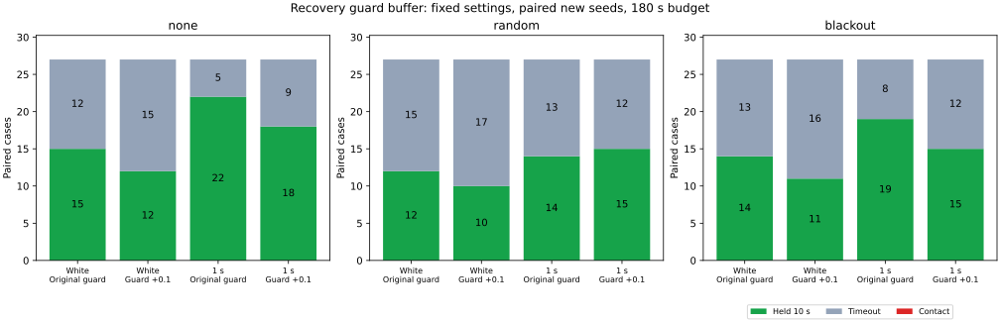

# 停止予測ガードの距離余裕を0.1増やす比較

停止予測ガードの余裕を復帰判定と揃える案では、新規シードの10秒保持成功が96/162から81/162に減りました。接触は両群とも0件でした。平均待機時間も82.50秒から97.99秒へ増えています。既知の停止8例のうち1例は保持できましたが、今回の条件での全体的な改善は見られません。実装は比較用のオプションとして残し、既定にはしません。

## 比較した変更

両群とも、これまでの診断で使った `joint` の同時復帰、広い経路、弧による速度制限を使います。ライブラリの既定コントローラや、同時復帰を使わない `paced` との比較ではありません。今回比較するのは停止予測の距離余裕だけです。

| 項目 | 従来の `joint` | 追加余裕の `buffered` |
|---|---|---|
| ガード開始余裕 | `0.5 + 2√2×sigma + 0.02×観測年齢` | `0.6 + 2√2×sigma + 0.02×観測年齢` |
| ガード解除余裕 | 開始余裕 + 0.05 | 開始余裕 + 0.05 |
| 欠落待機との同時解除 | 復帰条件とガード解除条件を1秒確認 | 同じ確認を、上の高い解除余裕で実施 |

ガードの開始・解除の両閾値が0.1増えます。開始を早める効果と解除を厳しくする効果は分離していません。独立したガード解除の0.5秒確認、復帰用の前方0.6の直線・平均観測窓、速度上限、制動則、車体半径0.5、目標の10秒保持、180秒の制限は同じです。補正受信・欠落・ノイズ革新を各対で揃え、両群とも真姿勢を制御判断に使いません。

停止予測の遠い障害物の枝刈りにも新しい余裕を渡しています。古い記録の距離下限を、後から大きい閾値と比べただけの解析ではありません。`RECOVERY_GUARD_BUFFER` は既定で無効で、有効化には `JOINT_RECOVERY=true` を要します。

## 既知例と新規例の結果

3地図×3計画器×欠落3条件を、独立ノイズと相関1秒のノイズで比較しました。新規評価はシード250〜252で固定し、結果を見た後の閾値変更やシード差し替えは行っていません。

| 対象・ノイズ | シード | 各群の件数 | 従来の保持 | 追加余裕の保持 |
|---|---|---:|---:|---:|
| 既知・相関1秒 | 244, 245 | 54 | 36 | 32 |
| 既知・独立 | 245 | 27 | 13 | 11 |
| 新規・独立 | 250〜252 | 81 | 41 | 33 |
| 新規・相関1秒 | 250〜252 | 81 | 55 | 48 |

比較の全486走行で接触・地図外への退出は0件、保持以外はすべて180秒の時間切れでした。新規162組では保持の獲得3件・喪失18件、既知81組では獲得1件・喪失7件です。接触0件は両群に共通で、追加余裕による接触低減の証拠にはなりません。

| 新規ノイズ | 欠落 | 従来の保持 / 27 | 追加余裕の保持 / 27 |
|---|---|---:|---:|
| 独立 | なし | 15 | 12 |
| 独立 | ランダム | 12 | 10 |
| 独立 | 45〜75秒 | 14 | 11 |
| 相関1秒 | なし | 22 | 18 |
| 相関1秒 | ランダム | 14 | 15 |
| 相関1秒 | 45〜75秒 | 19 | 15 |

## 待機時間

待機は欠落待機または停止ガードが有効な指令区間の和集合です。両方が有効な区間は1回だけ数え、目標停止だけの時間は加えません。制動中も含むため、静止時間とは異なります。「静止中の待機」は同じ和集合を判断前の測定速度0.02以下に限定したものです。

| 対象・ノイズ | 従来の平均待機 | 追加余裕の平均待機 | 従来の静止中の待機 | 追加余裕の静止中の待機 |
|---|---:|---:|---:|---:|
| 既知・相関1秒 | 62.07秒 | 82.77秒 | 59.72秒 | 78.90秒 |
| 既知・独立 | 91.55秒 | 103.35秒 | 88.02秒 | 98.51秒 |
| 新規・独立 | 99.09秒 | 111.07秒 | 94.47秒 | 106.26秒 |
| 新規・相関1秒 | 65.90秒 | 84.91秒 | 62.06秒 | 79.11秒 |

新規例をまとめると、平均待機は82.50→97.99秒、静止中の待機は78.26→92.68秒でした。180秒で時間切れとなり、終了前30秒の移動距離が0.1未満の例も46→58件に増えています。この分類は時間切れ例だけが対象で、独立した失敗原因の判定ではありません。

待機時間は各走行の終了までの観測値です。成功例には10秒の目標保持もあり、成功・時間切れで観測期間が異なります。固定した180秒すべてを走らせた場合の因果効果や、単位時間あたりの待機率とは扱いません。

## 既知の停止8例

[以前の停止診断](../recovery-stalls/report.md)で選び、[制動前の診断](../stop-entry/report.md)まで追った8例は、従来群ではすべて時間切れでした。追加余裕の群では、相関1秒・欠落なし・seed245・maze・JPSが179.08秒で保持に成功しました。真の目標範囲への初回進入は167.86秒、終了目標距離は0.02988でした。

| ノイズ・欠落 | seed・地図・計画器 | 追加余裕群の結果 | 終了目標距離 | 終了前30秒の移動距離 |
|---|---|---|---:|---:|
| 独立・ランダム | 245・maze・A* | 時間切れ | 30.49308 | 0.00000 |
| 独立・ランダム | 245・maze・JPS | 時間切れ | 30.97349 | 0.00000 |
| 相関1秒・なし | 245・dense・JPS | 時間切れ | 26.85425 | 20.09280 |
| 相関1秒・なし | 245・maze・JPS | 保持 | 0.02988 | 17.58872 |
| 相関1秒・ランダム | 244・maze・JPS | 時間切れ | 36.64149 | 0.00000 |
| 相関1秒・45〜75秒 | 244・maze・JPS | 時間切れ | 18.30447 | 13.38035 |
| 相関1秒・45〜75秒 | 245・dense・JPS | 時間切れ | 61.70500 | 0.00000 |
| 相関1秒・45〜75秒 | 245・maze・JPS | 時間切れ | 16.61929 | 3.58333 |

残る7例は時間切れです。この8例のうち、終了前30秒の移動距離が0.1未満だったものは4例になりました。移動が増えたことだけを到達成功とは扱っていません。表の窓は各走行の終了前30秒で、成功例は149.08〜179.08秒、時間切れ例は150〜180秒に対応します。区間の始点側は含まず、車体中心の変位を区間ごとに合計しています。

## 検証と再実行

実行情報のシミュレータハッシュと現在のソースの一致を確認しました。比較4走行の全486ケースと、元の既定条件のseed201・54ケースを再検証しています。

- 毎ステップの余裕式、速度上限、物理応答、対にしたノイズ・欠落、平均観測窓、目標保持、両方の解除タイマーを照合しました。ガードの全状態遷移も記録から独立に再構成しています。
- 既知例の従来群81件の結果は、保存済みの同時復帰比較の結果に一致しました。既定条件54件も保存結果に一致しました。
- 追加余裕群の全ガード開始・解除・欠落待機からの復帰と固定した確認地点を合わせた3,614地点で、停止予測、速度用の弧、復帰直線の幾何を独立に再計算しました。欠落待機からの全復帰312回を含みます。
- ガード開始の欠落、解除時の不正な有効状態、解除タイマーの破損、片方を残した欠落待機解除を注入した4記録は、検証がすべて拒否しました。
- Headless Releaseビルド、全ターゲットのClippy（警告をエラー扱い）、std有効のPure Pursuit単体テスト4件、Rust/Pythonの整形・構文チェックが通過しました。集計を再実行し、全CSVと実行情報の一致を確認しました。

[READMEの手順](../../README.md#compare-stopping-guard-and-recovery-distance-buffers)で同じ4走行と集計を再実行できます。走行・検証・集計はPython標準ライブラリとCargo、図の生成にはMatplotlibを使います。全結果は [all-results.csv](all-results.csv)、条件別集計は [summary.csv](summary.csv)、保持の獲得・喪失は [paired-holds.csv](paired-holds.csv)、待機とイベントは [control-events.csv](control-events.csv)、幾何確認は [preview-audit.csv](preview-audit.csv) にあります。

入力経路、シミュレータのハッシュ、シード、実行元コミット等は [sources.json](sources.json) に保存しました。シミュレータSHA-256は `0b9d8825531e820760ec2984cdeba1a11e4ac4f13f759acc0cd00bda54aa3cfe` です。生軌跡はリポジトリへ含めず、再実行で生成します。

同じ3地図と少数シードからの条件の組合せであり、486走行を独立な統計標本とは扱えません。ノイズ余裕も経験的な値です。今回確認できたのは、`joint` に追加余裕を適用すると一部の既知例は回復するものの、この固定条件では新規例の保持を減らし、待機を増やしたことです。
