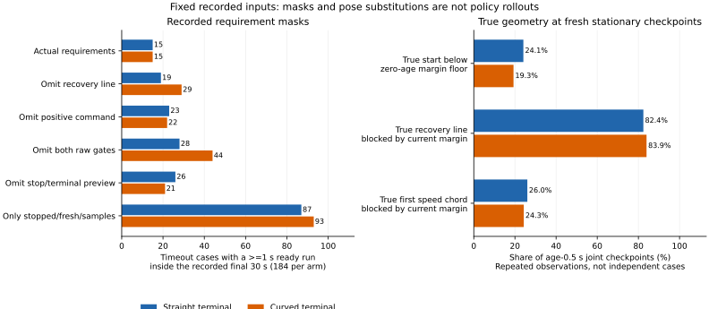

# 復帰直線と正の予定速度が欠測復帰を阻む条件

同じ記録の真姿勢で評価しても、観測後0.5秒の復帰直線は直線終端方式で342/415地点、曲線終端方式で387/461地点が必要な余裕に不足しました。一方、速度探索の最初の5cmは307/415、349/461地点で通過します。短い速度探索と0.6mの復帰直線は、同じ場所でも異なる制約になっています。

停止予測に使う推定姿勢への置換は、真では通れない地点を許可する数を減らしましたが、復帰直線では真で通れる地点を遮断する数が増えました。今回の結果から、この置換だけで復帰や目標保持が改善するとは判断できません。終盤に動けなかった注目の3ケースも、同じ真姿勢・直線・位置sigmaを維持する限り、観測の更新だけでは復帰直線の余裕不足が残ります。

## 対象と判定

[固定手順](protocol.md)を記録してから、前回の[走行実験](../terminal-arc-live/report.md)の全648ケースを会計に残し、両方式の時間切れ368ケースを解析しました。前回の指令差の有無による選別はしていません。「直線」はepoch方式、「曲線」は終端部分だけを曲線にしたcurved方式です。両方とも同じ欠測復帰直線を使います。

| 群 | 直線の時間切れ | 曲線の時間切れ |
|---|---:|---:|
| 既知seed・独立ノイズ | 52 | 54 |
| 既知seed・相関時間1秒 | 40 | 40 |
| 新seed・独立ノイズ | 52 | 53 |
| 新seed・相関時間1秒 | 40 | 37 |
| 合計 | 184 | 184 |

各ケースの最後30秒を0.02秒ごとに調べました。さらに終点、欠測復帰の判定中に静止・鮮度・サンプル数がそろった各補正期間の最初の行、その条件を満たす観測後0.5秒の行を選び、重複を除いた2,120地点を評価しました。補正期間は通常の観測補正と精密推定の開始で区切り、同じ期間の静止サンプルだけを使います。サンプル0の復帰姿勢は、実装どおり瞬時の観測姿勢へ戻します。

必要な余裕は`M=.6+2sqrt(2)*sigma+.02*age`、観測を更新した直後の下限は`M0=.6+2sqrt(2)*sigma`です。復帰は現在姿勢から前方0.6mの直線について、障害物距離は`>M`、地図境界からは`>=M`を要求します。速度探索は予定操舵による40線分・2mのうち、最初の0.05m線分が境界・障害物の両方から厳密に`>M`なら正の探索距離を持ちます。正の予定速度には、これに加えて目標停止前の指令が正であることが必要です。最初の線分の通過は、2m全部の通過を意味しません。

各地点で、瞬時の観測、実際の復帰入力、停止予測入力、真位置＋観測の向き、真位置＋復帰入力の向き、真姿勢の6通りを調べました。停止予測入力は利用可能なら補正期間内の融合位置、そうでなければ運動フィルターです。速度・予定操舵・位置sigma・観測からの経過時間は固定し、真姿勢は評価にだけ使いました。

## 観測後0.5秒でも残る幾何的な制約

この部分集合は直線415地点・87ケース、曲線461地点・93ケースです。各ケースの複数の補正期間を含み、独立な876試行ではありません。すべて欠測復帰の静止・鮮度・10以上のサンプル条件を満たし、目標停止前の予定指令も正です。

| 真姿勢での分類 | 直線：415地点 | 曲線：461地点 |
|---|---:|---:|
| 現在の中心距離が観測直後の下限M0より小さい | 100 (24.1%) | 89 (19.3%) |
| 0.6m復帰直線が現在の余裕Mに不足 | 342 (82.4%) | 387 (83.9%) |
| 最初の速度探索線分が現在の余裕Mに不足 | 108 (26.0%) | 112 (24.3%) |

真の中心距離がM0未満なら、同じ位置とsigmaから同じ余裕を要求する経路は、観測を更新しても開始点で条件を満たせません。ただし、この開始点の制約は189/876地点だけです。中心距離がM0以上でも、前方の復帰直線が障害物に近づく場合があります。開始点の余裕と経路全体の余裕を分ける必要があります。

## 入力姿勢を替えた局所判定

「過大許可」は推定で通過・真で遮断、「余分な遮断」は推定で遮断・真で通過です。実入力は復帰では復帰サンプルの姿勢、速度では瞬時の観測姿勢です。「予測入力」は停止予測姿勢への置換です。同じ観測後0.5秒の地点を使います。

| 方式・判定 | 入力 | 地点 | 推定で通過 | 真で通過 | 過大許可 | 余分な遮断 |
|---|---|---:|---:|---:|---:|---:|
| 直線・復帰 | 実入力 | 415 | 79 | 73 | 42 | 36 |
| 直線・復帰 | 予測入力 | 415 | 56 | 73 | 24 | 41 |
| 曲線・復帰 | 実入力 | 461 | 89 | 74 | 41 | 26 |
| 曲線・復帰 | 予測入力 | 461 | 69 | 74 | 22 | 27 |
| 直線・速度 | 実入力 | 415 | 270 | 307 | 32 | 69 |
| 直線・速度 | 予測入力 | 415 | 269 | 307 | 20 | 58 |
| 曲線・速度 | 実入力 | 461 | 292 | 349 | 30 | 87 |
| 曲線・速度 | 予測入力 | 461 | 294 | 349 | 18 | 73 |

速度では両方の判定ずれが減りました。復帰では過大許可が減る一方、余分な遮断が増えています。真位置を使い向きだけ実入力にした場合、完全な真姿勢との分類差は復帰で6/415・7/461、速度で0/415・2/461地点でした。予測入力の向きだけを分離する比較はしていません。

全8,480判定行で、推定が許可した経路の真の最小距離が物理半径0.5m以下となるものは0でした。これは固定余裕Mへの不足とは別の尺度です。停止予測入力を速度へ使えば予定速度自体と後続の停止予測も変わるため、両方を置換した復帰可否や新しい保持結果は計算していません。

## 記録内の連続成立時間

最後30秒に欠測復帰の判定があったのは直線87ケース、曲線93ケースです。残るケースも表の分母184に残しています。各条件を固定して省いたとき、同じ記録窓内に1秒以上の連続成立が含まれるケースを数えました。

| 残す条件・省く条件 | 直線：184ケース | 曲線：184ケース |
|---|---:|---:|
| 実際の全条件 | 15 | 15 |
| 復帰直線だけ省く | 19 | 29 |
| 正の予定速度だけ省く | 23 | 22 |
| 復帰直線と正の予定速度を省く | 28 | 44 |
| 停止・終端予測条件を省く | 26 | 21 |
| 静止・鮮度・サンプル数だけ残す | 87 | 93 |

窓の開始時に連続時間を0へ戻し、欠測復帰の経路から外れたときも区切りました。これは記録された条件の重なりを示す件数で、解除や目標保持の件数ではありません。既に解除した後で別の理由から時間切れになったケースも含みます。条件を外した別の制御軌跡は予測していません。



図の左はケース単位、右は観測後0.5秒の反復観測地点単位です。分母と意味が異なります。

## 終盤30秒の移動が0mだった喪失3ケース

前回の診断から事前に指定した曲線側の3ケースです。すべてmaze・Theta*で、終盤30秒の待機が続き、解除は0回でした。静止・鮮度・サンプル数がそろう時間は各8.04秒、6補正期間です。観測後0.5秒の6地点ではサンプル25個で、予測入力の融合位置も使えました。

この3ケースの`M0=0.882843m`、観測後0.5秒の`M=0.892843m`です。次の距離は最初の150.5秒地点の真姿勢による値です。

| 群・欠測・seed | 開始中心距離（m） | 復帰直線の最小距離（m） | 最初の速度線分の距離（m） | 実条件の最長（秒） | 基本3条件だけの最長（秒） |
|---|---:|---:|---:|---:|---:|
| 既知独立・random・270 | 0.888666 | 0.749212 | 0.863392 | 0.04 | 1.34 |
| 既知相関・blackout・270 | 1.147802 | 0.734236 | 1.107417 | 0.38 | 1.34 |
| 新規独立・blackout・274 | 0.922420 | 0.772879 | 0.896616 | 0.02 | 1.34 |

3ケースとも開始中心距離はM0以上ですが、真の復帰直線は全6地点でM0にも不足します。後の2ケースの真の短い速度線分は全6地点で現在のMを満たします。既知相関のケースは復帰直線だけを省くと最長1.34秒になりますが、その直線の遮断は真の固定余裕とも一致します。この省略を安全な解除策とは扱えません。

真姿勢は固定されていても、瞬時の観測姿勢と予定操舵で計算する2mの速度探索距離は変動しました。150.5秒から5秒おきの6点では、順に`[0, 2, 0, .05, .05, .1]`、`[.3, 2, 0, .3, .2, .1]`、`[0, 2, 2, 0, 0, .1]`mです。元の復帰入力・正の指令・停止予測の条件は重なって失敗しており、どれか一つを外せば全ケースが復帰する結果ではありません。

## 検証と再実行

解析コードは`831a4f9`、図は`b583e44`です。前回の入力表・実行情報・シミュレーター・補助関数と、消費した生軌跡のハッシュを照合しました。以前に全量検証した記録と同じ368軌跡・3,312,000移動区間を再利用し、最後30秒の552,000判定と今回の幾何検証を追加しました。新しい走行やRustコードの変更はありません。前回の保持140→140という走行結果はそのままです。

全2,120地点で元の40線分の速度探索を再計算し、記録された距離と最初の線分による正負判定を照合しました。復帰入力の障害物距離も元の記録と照合しました。全地点の推定・真姿勢比較で、分類境界から2e-8m以内の曖昧な判定は0でした。

Python 164テストが成功しました。追加12テストは地図境界の等号と障害物の厳密不等号、最初の速度線分と2m全体の区別、開始点の余裕不足、サンプル0の入力、目標停止の速度0、複数条件の重なり、鮮度・サンプル・欠測復帰経路による連続時間の分断、地点の重複除去、精密推定開始での補正期間リセットを確認します。

```bash
python3 experiments/pose_observation_loss/analyze_joint_admission_geometry.py \
  --output /tmp/joint-admission-geometry
python3 experiments/pose_observation_loss/plot_joint_admission_geometry.py \
  --results /tmp/joint-admission-geometry --output /tmp/joint-admission-figure
python3 -m unittest discover -s experiments/pose_observation_loss -p 'test_*.py'
```

新しい出力先を使います。解析は標準ライブラリーだけ、図はMatplotlibを使います。解析の`--raw-root DIR`で同じ生軌跡を持つ4群の場所を変更できます。6つのCSVと`sources.json`を再集計してバイト単位で一致しました。図の数値・SVG・PNG・指紋も再生成で一致し、表示を確認しました。

[accounting.csv](accounting.csv)に全ケース、[readiness.csv](readiness.csv)に条件不成立と最長連続時間、[checkpoints.csv](checkpoints.csv)に選択地点、[geometry.csv](geometry.csv)に12,720の姿勢別幾何行、[decisions.csv](decisions.csv)に8,480の推定・真姿勢比較、[summary.csv](summary.csv)に群・方式・重複する地点部分集合別の集計を保存しました。[sources.json](sources.json)と[admission-limits-sources.json](admission-limits-sources.json)には入力・コード・図の指紋を残しています。
