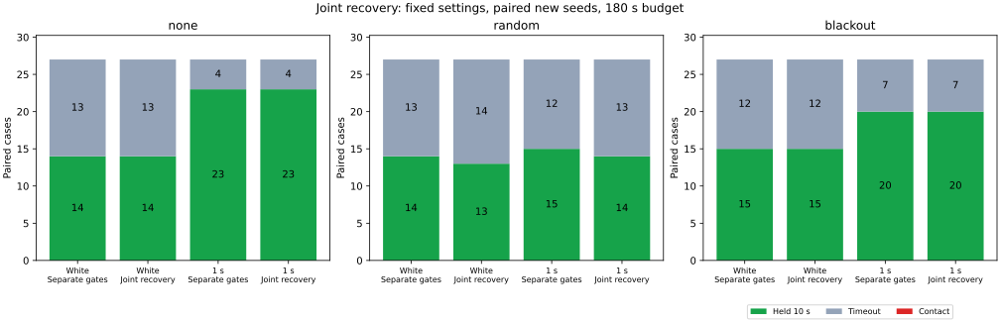

# 欠落待機と停止ガードの同時復帰比較

欠落待機と停止ガードを同時に解除する案では、新規シードの10秒保持成功が101/162から99/162に減りました。接触は両案とも0件でした。解除時に別の待機が残るイベントは防げましたが、既知の停止8件は回復しませんでした。今回の案は比較用のオプションとして残し、既定にはしません。

## 比較した変更

両群とも、前回と同じ広い経路と弧に基づく速度制限を使います。従来の `paced` では、欠落待機中のガードは目標速度0・操舵0の指令を予測します。欠落待機の1秒確認と、ガードの0.5秒確認は別々です。

`joint` は欠落待機中に、解除後の指令を仮に計算します。目標に応じた速度を0.4以下に制限し、推定姿勢によるPure Pursuitの操舵と既存の弧の速度上限を適用してから、停止予測を行います。実際の待機中の目標速度・操舵は0のままです。

既存の復帰条件である観測年齢1.5秒以内、速度0.02以下、同じ補正区間の静止観測10点以上、平均姿勢からの前方0.6の直線と境界の余裕を維持します。さらに、解除予定の目標速度が正で、その停止予測がガードの解除余裕を超えることを要求します。この全条件が同時に1秒続いた場合だけ、欠落待機と有効なガードを一緒に解除します。欠落待機中は独立したガード解除タイマーを0にし、ガードの開始判定にも解除予定の予測を使います。ガードだけが残った場合の0.5秒確認は従来どおりです。

この比較は、待機中の予測指令と解除確認の同期を合わせて変更しています。それぞれの寄与は分離していません。距離余裕、制動上限、車体半径、目標保持条件、180秒の制限は同じで、真の姿勢は制御判断に使いません。直線の復帰判定を曲線に置き換えた実験でもありません。

## 条件と到達結果

3地図×3計画器×欠落3条件で、各組を同じシード・同じ入力経路・同じノイズ革新・同じ補正機会に対応させました。新規シード247〜249は結果を見る前に固定し、その後の閾値調整や再選択は行っていません。

| 対象 | ノイズ | シード | 各群の件数 | 従来の保持 | 同時復帰の保持 |
|---|---|---|---:|---:|---:|
| 既知例 | 相関1秒 | 244, 245 | 54 | 36 | 36 |
| 既知例 | 独立 | 245 | 27 | 13 | 13 |
| 新規 | 独立 | 247〜249 | 81 | 43 | 42 |
| 新規 | 相関1秒 | 247〜249 | 81 | 58 | 57 |

比較の全486走行で接触・地図外への退出は0件です。保持以外はすべて180秒の時間切れでした。新規例では保持の獲得0件、喪失2件です。

| 新規ノイズ | 欠落 | 従来の保持 / 27 | 同時復帰の保持 / 27 |
|---|---|---:|---:|
| 独立 | なし | 14 | 14 |
| 独立 | ランダム | 14 | 13 |
| 独立 | 45〜75秒 | 15 | 15 |
| 相関1秒 | なし | 23 | 23 |
| 相関1秒 | ランダム | 15 | 14 |
| 相関1秒 | 45〜75秒 | 20 | 20 |

失われた2件はどちらもランダム欠落・seed248・mazeです。独立ノイズのA*は、終了目標距離が0.03340から16.45912になりました。相関1秒のTheta*は0.05133から0.62035になりました。同時復帰側はどちらも真の目標範囲へ入っておらず、目標内に到達してから保持だけを失った例ではありません。後者の終了速度は0.33051で、時間切れの直前にも進んでいました。

## 解除の整合性と実際の進行

| 対象 | 群 | 欠落待機中のガード解除 | 目標速度0でのガード解除 | ガードが残る欠落待機の解除 | 同時解除 |
|---|---|---:|---:|---:|---:|
| 既知例81件/群 | paced | 232 | 317 | 12 | 0 |
| 既知例81件/群 | joint | 0 | 86 | 0 | 17 |
| 新規162件/群 | paced | 414 | 540 | 28 | 0 |
| 新規162件/群 | joint | 0 | 107 | 0 | 55 |

この表は各走行の全時間でのイベント数です。「目標速度0でのガード解除」には、欠落待機以外の目標停止や速度上限0での解除も含まれます。同時復帰案が変えるのは欠落待機との関係であり、ガードだけの場合の解除すべてを正の速度に制限するものではありません。

[前回の診断](../recovery-stalls/report.md)で終盤30秒の移動距離が0.1未満だった8件は、今回も全件時間切れでした。対応する終盤30秒の移動距離も変わりませんでした。

| ノイズ・欠落 | seed・地図・計画器 | 従来の移動距離 | 同時復帰の移動距離 |
|---|---|---:|---:|
| 独立・ランダム | 245・maze・A* | 0 | 0 |
| 独立・ランダム | 245・maze・JPS | 0 | 0 |
| 相関1秒・なし | 245・dense・JPS | 0.04776 | 0.04776 |
| 相関1秒・なし | 245・maze・JPS | 0.00575 | 0.00575 |
| 相関1秒・ランダム | 244・maze・JPS | 0 | 0 |
| 相関1秒・45〜75秒 | 244・maze・JPS | 0 | 0 |
| 相関1秒・45〜75秒 | 245・dense・JPS | 0 | 0 |
| 相関1秒・45〜75秒 | 245・maze・JPS | 0 | 0 |

独立ノイズ・ランダム欠落・seed245・mazeのA*とJPSは、両案とも終盤30秒の全区間に欠落待機かガードが残ります。片方を残した解除を防いだことを、動けるようになったこととは扱えません。前回指摘した幾何条件を含め、解除イベントの同期だけでは停止の問題は解消しませんでした。

## 検証と再実行

- 全486走行で物理応答、ノイズと欠落の対、平均観測窓、保持条件、速度上限と制動を照合しました。
- `joint` の共通タイマーと解除予定の目標速度を毎ステップ再構成し、二つの待機の同時解除を確認しました。片側だけの解除・タイマーの不正変更・速度0での解除を注入した3記録は、検証がすべて拒否しました。
- 最初の補正欠落前の全軌跡列が両群で一致することと、欠落なしの軌跡全体の一致を確認しました。既知例の従来群81件の結果は前回の保存結果に一致しました。
- 停止予測・弧の速度制限・復帰直線の距離を1,898地点で独立に再計算しました。`joint` の欠落待機からの全復帰274回を含みます。
- 別途、元の既定条件のseed201・54件を再実行し、保存結果と一致しました。この回帰確認は今回の486件には含めません。
- Releaseビルド、Clippy（全ターゲット・警告をエラー扱い）、std有効のPure Pursuit単体テスト4件、std無効の同3件、Rust/Pythonの整形・構文チェックが通過しました。std無効で統合テストも含めた初回コマンドは、std専用の既存テストをコンパイルできず失敗したため、対象を単体テストに修正しました。

[READMEの再実行手順](../../README.md#compare-simultaneous-loss-and-stopping-guard-recovery)に全4走行と集計のコマンドがあります。Python標準ライブラリで走行・検証・CSV集計ができ、図の生成にはMatplotlibを使います。結果は [all-results.csv](all-results.csv)、[summary.csv](summary.csv)、[paired-holds.csv](paired-holds.csv)、解除イベントと最後の30秒の実移動は [control-events.csv](control-events.csv)、幾何確認は [preview-audit.csv](preview-audit.csv) にあります。最後の窓は各走行の終了前30秒で、180秒の時間切れでは `150 < t <= 180` です。移動距離は区間ごとの真の中心変位の合計です。

入力・シミュレータのハッシュ、シード、実行元のコミット等は [sources.json](sources.json) に保存しました。生軌跡はリポジトリへ含めず、同じ手順で再生成します。シミュレータSHA-256は `7e08b4dae74ce7b179f8f9a5adaf7b340ec6c43c842ba84893c7d2ea18797440` です。

同じ地図・計画器・シードからの条件の組合せなので、486件を独立な統計標本とは扱えません。接触0件も安全性の保証ではありません。固定操舵の予測と経験的なノイズ余裕を使ったシミュレーションであり、今回確認できたのは解除時の整合性と、この条件では到達性能を改善しなかったことです。
