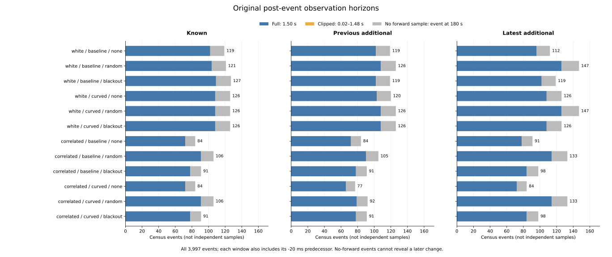
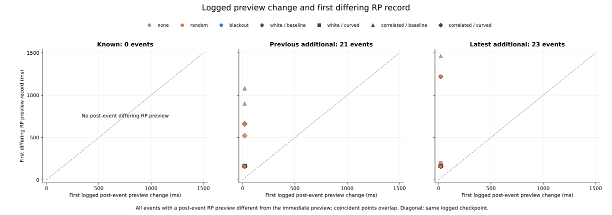
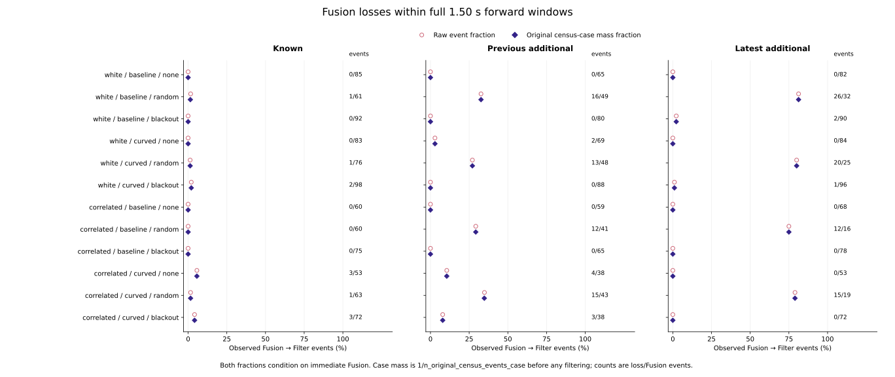

# Logged preview transitions in the original late-event windows

All 1,599 previously observed immediate-Fusion / RP-Filter disagreements match
their same-time raw logs. Across their 44 events in 40 full cases, the first
logged Fusion-to-Filter change is always at +20 ms; the first differing RP
record is at +160..+1,460 ms. The preceding identifier crosswalk can therefore
be connected to an observed logged sequence. The event-time preview remains
distinct from the later RP-state preview.

The [protocol](protocol.md) was committed as `96ee930` from main
`3887f64164454f34a6da3ff8dded2a8ec7cb54e6`, before reading new raw-window
outcomes. Implementation and rerun instructions are in `95af9aa` and the
[README](../../README.md#logged-preview-transitions-in-the-original-windows).
No controller or simulation was changed.

## Exhaustive windows and logged ordering

The audit keeps all 972 planned full cases and 324 families. It hashes and
streams all 108 original trajectory CSVs (6,043,185,194 bytes), validating
5,130,570 grid rows across all 570 timeout histories, including initial rows.
Every one of the 3,997 original census events receives the fixed inclusive
window [-20,+1,500] ms, clipped at logged time 180 s. Loss mode remains part of
case identity. Held cases retain their original outcomes and fall outside this
late-timeout census by design.

| Cohort | Census events | Full 1.50 s forward window | No forward sample |
|---|---:|---:|---:|
| Known | 1,307 | 1,121 | 186 |
| Previous additional | 1,276 | 1,094 | 182 |
| Latest additional | 1,414 | 1,212 | 202 |
| Total | 3,997 | 3,427 | 570 |

No actual event has a partially clipped 1..74-step forward window; that planned
category stays explicit and empty. All 570 no-forward events occur at 180 s.
They can validate the immediate/predecessor logs but cannot reveal a later
change. No observed change does not establish stability after a window ends.

There are 2,703 immediate-Fusion and 1,294 immediate-Filter events, of which
2,276 and 1,151 respectively have full forward windows. Within the full
windows, 152 events in 109 cases change from Fusion to Filter. No immediate-
Filter event changes preview mode in its observed window, and no window has
more than one post-event preview change. Changes from the -20 ms predecessor
to the immediate event are excluded from these post-event counts.

The 152 losses comprise 128 at +20 ms and 24 at +520..+1,220 ms. At the first
loss boundary, retained epoch group count is two for the former 128 and zero
for the latter 24; all had three retained groups and available Fusion at the
immediate event. This describes logged availability and retained history, not
complete group ancestry or a causal decomposition. Retained count alone must
not be used to select preview mode. Actual mode separately changes from
recovery mean to raw fallback in 87 windows.

## Selection and transition timing

All 10,995 original RP states in 157 cases agree with the raw actual and
preview identifiers at their own logged times and with their original RP
stratum. Of these states, 9,396 have the same preview as their associated
immediate event and 1,599 differ. Every difference is after the event;
there are zero differences before or at it.

| Cohort | Different RP records | Events | Full cases | First logged change | First differing RP | Lag from change |
|---|---:|---:|---:|---:|---:|---:|
| Known | 0 | 0 | 0 | NA | NA | NA |
| Previous additional | 769 | 21 | 20 | +20 ms | +160..+1,080 ms | 140..1,060 ms |
| Latest additional | 830 | 23 | 20 | +20 ms | +160..+1,460 ms | 140..1,440 ms |

All 44 events are received events in random mode. Their +20 ms boundary has
observation age 0.02 s, two retained groups and absolute measured speed at most
9.155e-30. These are boundary descriptors, not evidence of a mode's error,
safety benefit or controller effect. The change is observed at the next
20 ms logged checkpoint; the audit does not locate an unobserved continuous
transition instant.

Of all 152 events with logged Fusion loss, 103 have no original RP reference.
Five have RP references that all precede the later preview loss, and 44 have
the different-preview records above. Thus absence of this identifier mismatch
does not establish absence of a logged preview change. This audit checks
same-time correspondence; it does not rerun RP gate selection or explain which
gate prevented an absent selection.

For the previously discussed latest correlated/curved/random seed-279 dense
A* case `C0073`, event 3727 at 160 s changes preview at +20 ms. Its 52 Filter
RP records start at +160 ms, a 140 ms lag. For latest correlated/baseline/random
seed-278 maze JPS case `C0149`, event 3708 at 170 s also changes at +20 ms;
its three attached Filter RP records start at +1,460 ms, a 1,440 ms lag.
Both examples belong to the exhaustive windows above; neither selects a new
evaluation population.

## Full-horizon denominators and original measures

This table sums both noises and arms before taking shares. Each raw fraction
conditions on immediate Fusion in a full 1.50 s forward window. The second
fraction uses original all-census event mass 1/n_original_case_events before
any mode, horizon or immediate-preview filtering. It is not an average of
case rates. These are descriptive selected timeout histories.

| Cohort | Loss mode | Loss / immediate-Fusion events | Raw fraction | Original case-mass fraction |
|---|---|---:|---:|---:|
| Known | none | 3 / 281 | 1.07% | 1.07% |
| Known | random | 3 / 260 | 1.15% | 1.11% |
| Known | blackout | 5 / 337 | 1.48% | 1.48% |
| Known | all_modes | 11 / 878 | 1.25% | 1.24% |
| Previous additional | none | 6 / 231 | 2.60% | 2.60% |
| Previous additional | random | 56 / 181 | 30.94% | 30.91% |
| Previous additional | blackout | 3 / 271 | 1.11% | 1.11% |
| Previous additional | all_modes | 65 / 683 | 9.52% | 9.50% |
| Latest additional | none | 0 / 287 | 0.00% | 0.00% |
| Latest additional | random | 73 / 92 | 79.35% | 79.35% |
| Latest additional | blackout | 3 / 336 | 0.89% | 0.89% |
| Latest additional | all_modes | 76 / 715 | 10.63% | 10.63% |

All-census mass and received-census mass each close to 570 original case
units. RP mass closes separately to 157 original case units, retaining each
state's 1/n_original_RP_parent_case before filtering. These measures are not
equated, subtracted or renormalized after selection. Empty denominators remain
blank, while observed denominators with zero losses have defined zero shares.
The 570 final events are excluded from the figure's full-horizon denominator,
not treated as observed stable windows.

## Reproducibility and limits

Saved results comprise 3,997 event traces, 7,222 maximal paired-mode intervals,
10,995 RP audits and 1,344 fixed summary cells. The intervals reconstruct all
265,019 original checkpoint references without gaps or adjacent equal runs.
This compression is lossless for actual/preview identifiers, not numerical
trajectories. Overlapping event windows remain references to logged samples;
they are not new independent physical observations.

The collector checks 33,696 exact additive count/mass closures across loss
modes, exact event kinds and observation horizons. Independent verification
uses no analyzer imports or saved runs as reconstruction input: it rereads and
hashes every raw file with csv.reader, joins the original broad census and
historical membership/latest RP scores, and reconstructs transitions/runs with
SQLite LAG and cumulative windows over uncompressed checkpoints. Original
parent weights are exact Fractions. It checks every saved field, all 144
plotted summary rows, all 44 scatter rows, preceding RP counts/masses and
input/helper/script/protocol/output/plot hashes.

The [independent evidence](independent-verification.json) records **894,444
successful field comparisons**. All **806 Python tests** pass, including 23
new tests for grid/provenance failures, availability versus retained history,
pre-event boundaries, clipping, reversals, maximal runs, case/event isolation,
same-time RP checks, parent weights and empty denominators. All five collector
artifacts repeat byte for byte; all nine figure/export/provenance artifacts
(including scratch PNGs) also repeat byte for byte. All three final figures
were inspected. The source manifest SHA-256 is
`2c68a7619a074237496637f90580f96e5769301139a4326b3adbed62faa84f36`.

The study adds no error labels, AUC, threshold fit, intervention or rollout.
Historical held goals remain 140->140 and latest 62->60. Logged changes and
RP selection timing do not establish causal mode benefits, calibration,
independent trials, confidence intervals or held-out performance.
