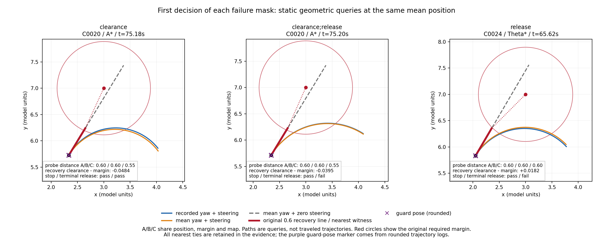

# Geometric witnesses for the mean speed-probe pilot

All 11,998 recorded eligible positive mean-arm probes replay exactly. A positive
speed probe does not establish clearance for the complete 0.6-unit recovery
line. The recovery line is straight along the mean heading; the recorded speed
probe follows the nominal steering arc along the raw heading. Release also
checks a terminal preview after the proposed stopping motion. In this fixed
packet, all 6,248 release failures include insufficient terminal-preview
clearance; only 74 also fail the stopping-path component.

This is a retrospective diagnostic of the same seed1001 pilot. It generates
no new simulator steps and evaluates no controller change. The previous
24 held / 30 timeout mean-arm outcomes are unchanged historical observations.

## Population and frozen method

The [protocol](protocol.md) and [62 input hashes](freeze-pins.json) were committed
at `bae1827`, from main `dd7ddfc28cf8c94bcde2d82687571f603bb66f61`.
Implementation `c44e8f86dd098704d2fac14ddcb9f669b6933041` was committed after
1,356 tests passed, before any new witnesses or alternative queries were
extracted. Both complete runs used that clean committed implementation.

All 54 mean-arm cases remain in [case-summary.csv](case-summary.csv): 36 have
selected decisions and 18 have none. Selection is exactly sidecar `used=true`
and `nominal_target>0`, in the frozen trial/case/step order. It retains 2,722
ready decisions as controls and all 9,276 blocked decisions. Per-case counts
and complete failure masks match the previous admission audit exactly.
Decisions within a case are dependent observations; these counts are not
independent trials or population recovery-rate estimates.

The [native source](probe-geometry.rs) reuses the original point/vehicle types,
segment-distance function, speed probe, aligned release function and prior
exact recovery/margin reader. Each recorded query must reproduce its
full-precision speed distance exactly and its formatted recovery clearance
and release margin exactly. Every selected initial point passes the original
obstacle and wall margins, and every recovery line passes bounds.

The separate recovery and guard margin expressions follow the previous
[margin amendment](../mean-speed-probe-admission-audit/protocol-amendment-1.md).
The fixed command has `recovery_guard_buffer=false`. With the original ordered
floating-point arithmetic, effective sigma is 0.03 in precision mode and 0.1
otherwise; recovery uses the 0.1 buffer while the base guard does not. The
release margin adds 0.05 to the base guard. No threshold is changed.

## Complete gate population

| Failed gates | Decisions | Cases containing this mask | Stop component fails | Terminal component fails |
| --- | ---: | ---: | ---: | ---: |
| None: ready control | 2,722 | 34 | 0 | 0 |
| Recovery clearance | 3,028 | 14 | 0 | 0 |
| Recovery clearance and release | 6,095 | 18 | 4 | 6,095 |
| Release | 153 | 6 | 70 | 153 |

Cases can occur in several rows. [mask-summary.csv](mask-summary.csv) includes
all 48 noise/mode/mask cells, including empty cells, with the full case
denominator and the number of cases contributing selected decisions.

The recorded stopping and terminal clearances have nine decimals. Each is
enclosed in its closed decimal rounding box, expanded outward to binary
endpoints. The original function `min(stop, terminal - 0.05)` maps the endpoints
monotonically. Each component is evaluated with the other argument set to
positive infinity. A strict pass requires its whole enclosure to exceed the
exact release margin; a fail requires its upper bound to be at most that
margin. Threshold overlaps remain unresolved.

All predicted combined intervals intersect the recorded combined-release
rounding intervals and agree with the previous definite gate classifications.
There are zero unresolved stop, terminal or combined classifications in this
packet. The adjusted terminal component is strictly below the stop component
in all 11,998 decisions, including the ready controls. Among the 6,248 release
failures, 6,174 fail only the terminal component and 74 fail both components;
none fail only the stop component. This localizes the recorded release failure,
but does not establish that removing or changing that check would succeed.

## Same-position heading and steering queries

Each selected position is queried three ways, holding its original margin
and obstacle map fixed:

| Query | Heading | Steering |
| --- | --- | --- |
| A: recorded | Raw heading | Recorded nominal steering |
| B | Mean heading | Same nominal steering |
| C | Mean heading | Zero steering |

These are ordered static comparisons. Their differences are not additive
causal contributions and do not predict a new vehicle trajectory. Distances
use the original 0.05-unit chords and 2-unit maximum horizon.

Across the 9,123 decisions failing recovery clearance:

- All C distances are at most 0.55. A positive distance alone therefore cannot
  certify the complete straight 0.6-unit recovery line. Sixteen C distances
  are zero despite every recorded A distance being positive.
- A and B return the same distance in 6,416 decisions; A is greater in 1,290
  and smaller in 1,417. Equality is at the native 0.05-unit resolution.
- B exceeds C in 7,844 decisions, equals C in 1,276 and is smaller in 3.
  Ten B distances are zero. Retaining nominal curvature often increases the
  returned distance relative to the straight mean-heading query, while heading
  replacement can move the result in either direction.
- Nearest recovery-line projections lie at an endpoint in 8,485 decisions and
  in the segment interior in 638. All nearest witnesses are retained.

Across the entire selected population, A/B distances differ in 3,021 decisions
and agree in 8,977. The largest absolute heading difference is approximately
7.353 degrees. There are 11,998 witness rows referencing 16 distinct original
fixture row IDs. No exactly tied nearest distances occur in this packet; the
reader and synthetic tests preserve all ties, including duplicate fixture
coordinates, rather than selecting one favorable obstacle.

## Fixed examples



[SVG](geometry.svg) is available for export. Each panel is the first global
decision of its failure mask, not a visually selected example. All three
nearest witnesses are the original obstacle fixture row 422 at (3, 7).

| Query ID / case | Time (s) | Failure mask | A / B / C distances | Recovery clearance minus margin |
| --- | ---: | --- | --- | ---: |
| 51 / C0020, A* | 75.18 | clearance | 0.60 / 0.60 / 0.55 | -0.048372 |
| 52 / C0020, A* | 75.20 | clearance;release | 0.60 / 0.60 / 0.55 | -0.039497 |
| 1597 / C0024, Theta* | 65.62 | release | 0.60 / 0.60 / 0.60 | +0.018240 |

The first panel passes release while failing the recovery line. The next two
fail the terminal component while their stop component passes. These three
examples show that neither a positive curved speed probe nor a passing current
recovery line alone establishes joint admission readiness.

Colored paths show all 40 diagnostic chords, continuing past the native first
failure for visualization. The distance labels give the native returned
distance; the full drawn path is not certified clear or actually traveled.
Red circles show the original required obstacle margin, the thick red segment
is the original recovery line, and the purple marker is the rounded logged
guard-pose center. No terminal arc is reconstructed from that rounded marker.

The [132 compact representatives](representatives.csv) select first and
minimum recovery-clearance-minus-margin per case/mask, with original-order
tie breaking and merged roles. They include ready controls. Full inputs,
native results and every tied witness are in the three `representative-*`
tables. This selection does not replace the full-population summaries.

## Reproduction and verification

Use Python 3.12 and the activated Rust compiler, a clean committed checkout,
the entire original pilot packet and fresh external output paths:

```bash
python3 -B experiments/pose_observation_loss/analyze_probe_geometry.py \
  --raw /path/to/mean-speed-probe-raw --output /tmp/probe-geometry-1
python3 -B experiments/pose_observation_loss/analyze_probe_geometry.py \
  --raw /path/to/mean-speed-probe-raw --output /tmp/probe-geometry-2
# Activate the pinned Python 3.12 / Matplotlib 3.10.8 replay profile to render.
MPLCONFIGDIR=/tmp/probe-mpl XDG_CACHE_HOME=/tmp/probe-cache \
python3 -B experiments/pose_observation_loss/plot_probe_geometry.py \
  --data /tmp/probe-geometry-1 --output /tmp/probe-figures-1
MPLCONFIGDIR=/tmp/probe-mpl XDG_CACHE_HOME=/tmp/probe-cache \
python3 -B experiments/pose_observation_loss/plot_probe_geometry.py \
  --data /tmp/probe-geometry-2 --output /tmp/probe-figures-2
```

Exact reference provenance records implementation commit `c44e8f8`. Replays
from later commits record their own HEAD; two runs at the same clean HEAD must
still match each other. The original implementation commit is retained in Git
for comparison with the tracked completion manifest.

[sources.json](sources.json) binds the implementation, raw manifest, scripts,
62 frozen inputs and all compact outputs. [native-sources.json](native-sources.json)
binds compiler/source/binary and all full queries, traces, witnesses, selected
metadata and classifications. It counts 35,994 static speed probes, plus nine
repeated plot probes, rather than treating them as independent trials.
The collector writes completion provenance only after all joins pass; failed
runs retain diagnostics and have no completion manifest.

[repeat-verification.json](repeat-verification.json) records byte equality of
all 25 collector files, including full evidence, provenance and native binary,
between two fresh runs. Both pinned renders produced identical SVG, PNG and
plot provenance bytes. The PNG was visually inspected. Full external packets
remain under `/workspace/scratch/mean-speed-probe-geometry-witnesses/aggregate-1`
and `aggregate-2`; the original raw packet remains under
`/workspace/scratch/mean-speed-probe-live-pilot/raw`. They are not checked in.

[validation.json](validation.json) records 1,356 tests, zero failures/errors
and zero skips, including 17 new native, interval, selection, input-join and
overwrite-protection tests. The full log is retained in the external study
scratch directory. A separate [archived-input verification](representative-verification.json)
recompiled the checked-in Rust source and replayed all 132 checked-in inputs;
the native trace and complete witness table matched their compact exports
byte for byte. Original simulator/controller sources, old evidence,
fixtures, manifests and lockfile retain their frozen bytes.
