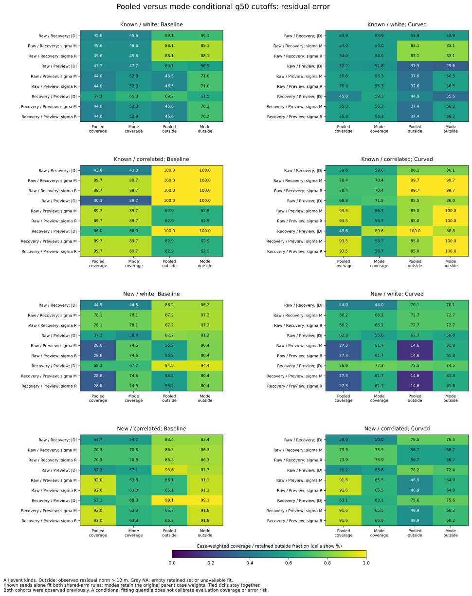
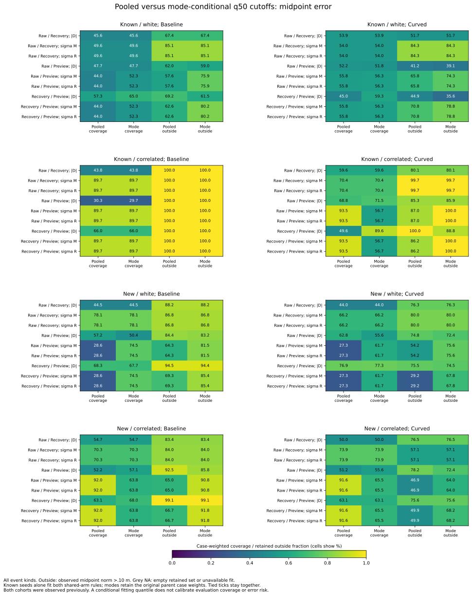

# Known-cohort cutoffs conditional on source estimator mode

Fitting separate mode quantiles changes which records remain, but does not
stabilize their error fractions in this retrospective transfer. For new
white-noise baseline Recovery/Preview, the residual-sigma median rule retains
**28.59% -> 74.53%** of case weight, pooled -> conditional, while retained
residual-outside fraction rises **55.23% -> 80.40%**. Curved coverage changes
**27.35% -> 61.69%**, with outside fraction **14.62% -> 61.81%**.

In correlated noise the same conditional comparison removes relatively
accurate Fusion references: coverage drops, and retained residual-outside
fraction rises in both arms. Conditioning the fitting quantile on estimator
mode does not calibrate evaluation coverage or error risk.

The [protocol](protocol.md) was frozen as f21fa86 and analyzer/tests as 96896fc
before these results. Plotting/reproduction instructions are aa54bb3. Known
seeds 269/270/271 alone fit the new cutoffs. Existing new seeds 274/275/276
were observed in previous studies, so this is **retrospective**, without an
untouched holdout or a new rollout. No outcome label enters fitting.

## Population, fitting and weights

Keep all 19,830 simultaneous pairs at 6,610 audited states, in 100 recorded
cases linked to 171 received-correction opportunities. The unchanged
accounting covers 648 cases, 368 timeout histories, 2,583 opportunities and
550/509 loss links. The 20,664 requested lagged pairs, including 2,208 missing,
remain inherited outside this simultaneous comparison.

The original pooled threshold table is copied unchanged. Fit additional
cutoffs by noise/view/score and the fixed Recovery/Filter/Fusion stratum,
pooling both known arms. The same fitted rule applies to both arms. First
give each represented known case total weight one in the full view/noise
fitting group; carry those row weights into its mode. Never rebalance cases
after mode conditioning. A case crossing modes retains its original split.

Take exact lower .25/.50/.75 weighted quantiles of the existing 1e-8 m score
ticks and retain ticks<=cutoff, including every tie. All_available selects
everything. This gives 216 conditional-threshold rows, including 72 empty
quantile fits in inapplicable structural modes. Those fits stay unavailable;
no evaluation data supplies a replacement. Every represented evaluation mode
has training support in these inputs.

Reporting again uses original parent 1/n_case weights, carried into strata
and through retention. Coverage divides retained mass by available case mass;
retained risk divides outside mass by retained mass. Raw counts, case counts,
row fractions and observed RMS are also saved. Fractions are not averages of
rebalanced retained cases. Both targets use the closed .10 m disk as inside.

## Conditional fitting quantiles and score ties

For Recovery/Preview residual sigma, the known training groups are:

| Noise / mode | References / cases | Parent-derived mass | Conditional q50 cutoff, per-axis cm | Fitting mass retained % |
|---|---:|---:|---:|---:|
| White / Filter | 364 / 7 | 7 | 10.198039 | 69.23 |
| White / Fusion | 1,526 / 22 | 22 | 5.899652 | 50.02 |
| Correlated / Filter | 397 / 11 | 11 | 13.610597 | 85.67 |
| Correlated / Fusion | 150 / 8 | 8 | 7.877054 | 54.02 |

The known cases in these fitting groups each occupy a single mode. Reporting
still preserves weights for the seven new cases that cross Filter/Fusion.
The preceding pooled cutoffs are 5.916838 cm for white and 13.610597 cm for
correlated noise. Conditional fitting raises the white Filter cutoff, tightens
the white Fusion cutoff, and tightens only Fusion in correlated noise.

Ties make a requested median quite different from achieved training coverage.
The white Filter .25 and .50 rules share a cutoff and retain 69.23% of fitting
mass. The correlated Filter .25/.50/.75 rules all share a cutoff and retain
85.67%. With both known arms/modes combined, the conditional median retains
54.66% in white and 72.35% in correlated noise. Ties are kept whole rather
than split to enforce a requested percentage.

## New-cohort median comparison

All event kinds and both modes are included below for Recovery/Preview,
**residual sigma q50**. Every slash is **pooled / conditional**, in percent.
The two sigma scores have identical displayed coverage/error values in these
rows; both remain in every saved table and figure.

| Noise / arm | Case-weighted coverage % | Residual-outside % | Midpoint-outside % |
|---|---|---|---|
| White / baseline | 28.59 / 74.53 | 55.23 / 80.40 | 69.34 / 85.38 |
| White / curved | 27.35 / 61.69 | 14.62 / 61.81 | 29.25 / 67.78 |
| Correlated / baseline | 91.96 / 63.76 | 66.74 / 91.84 | 66.74 / 91.84 |
| Correlated / curved | 91.61 / 65.53 | 49.95 / 68.25 | 49.95 / 68.25 |

White baseline retains 562 references/6 cases under the pooled rule and
1,059/14 under the conditional rule; curved retains 834/8 versus 1,380/16.
Correlated baseline retains 467/10 versus 324/9, and curved 327/11 versus
227/11. Raw reference fractions differ from case-weighted coverage.

The fixed contrast score has a different comparison at the same quantile:

| Noise / arm | Contrast coverage %, pooled / conditional | Residual-outside %, pooled / conditional |
|---|---|---|
| White / baseline | 68.27 / 67.67 | 94.52 / 94.38 |
| White / curved | 76.92 / 77.27 | 75.53 / 74.46 |
| Correlated / baseline | 63.14 / 67.97 | 99.07 / 99.13 |
| Correlated / curved | 63.11 / 63.11 | 75.62 / 75.62 |

There is no general method advantage inferred from these selected scores and
histories. All directions remain frozen; low-error performance does not
determine which score or method to report.

## Added and removed diagnostic records

For the residual-sigma median comparison, conditional-only records are newly
retained and pooled-only records are removed. Each entry below is
**raw references / inherited case mass / residual-outside %**:

| Noise / arm | Conditional only | Pooled only |
|---|---|---|
| White / baseline | 556 / 6.865 / 93.45 | 59 / .434 / 54.66 |
| White / curved | 641 / 6.502 / 90.06 | 95 / .665 / 8.12 |
| Correlated / baseline | 0 / 0 / undefined | 143 / 2.821 / 10.01 |
| Correlated / curved | 0 / 0 / undefined | 100 / 2.869 / 3.98 |

The white additions are Filter references, while removals are Fusion.
In correlated noise the Filter cutoff is unchanged and all removals are
Fusion. This set accounting explains how retained risk can rise even when
coverage decreases. These are changes to diagnostic subsets of recorded
states; no robot action is added, removed or replayed.

All four overlap cells, including both/neither, retain counts and exact-mass-
derived measures for both error targets. Their total mass equals the original
reporting mass. Conditional-only minus pooled-only mass, and outside mass,
exactly reproduce each method's differences before export.

All .25/.50/.75 rows remain in [comparison.csv](comparison.csv). For the
Recovery/Preview residual-sigma rule, conditional retained residual-outside
fractions exceed pooled ones at all three quantiles in these four new groups.
Conditional .25 coverage itself ranges from 50.81% to 67.73%, despite a nominal
25% fitting quantile. All_available agrees exactly between methods, and the
single-mode Raw/Recovery conditional cutoffs/selection equal the pooled rules.

The figures keep known/new, both noise types and arms, all three views and
scores at q50. Full tables keep every budget, event kind and structural
stratum. Dependence among times, anchors, modes, cases and arms remains;
the results are descriptive rather than confidence intervals, calibrated
risks, causal effects or a controller release recommendation.

## Validation and reproduction

Use the [README commands](../../README.md#known-only-cutoffs-conditional-on-estimator-mode)
with new output directories and tracked inputs. All **seven CSVs/provenance**
repeat byte for byte. Both SVG/PNG figures, their shared 144-row numeric
series and provenance also repeat exactly. Both layouts were visually
checked; PNGs remain in scratch. All three new scripts parse as Python 3.9.

The Python suite passes **465 tests**, including 18 new tests for fitting-only
data, label independence, shared-arm cutoffs, mode-crossing parent weights,
exact conditional quantiles, ties, source/weight fingerprints, unsupported
evaluation modes, empty populations, retained weights, overlap identities,
original pooled checks and the single-mode/all_available invariants.
All 13,824 pooled target comparisons match the preceding component study.

A separate saved-data calculation imports no analyzer functions. It uses
integer LCM case weights and cumulative integer quantiles to verify all 216
conditional thresholds, every field in 6,912 comparison rows, 13,824 prior
target comparisons and all 144 numeric figure rows. It also checks all
19,830 source score/membership identities, label/tick definitions and input/
script/protocol/helper/plot hashes: **745,416 field comparisons**. No actual
comparison lacks support; 1,536 populated and 5,376 empty rows remain explicit.

[Conditional thresholds](conditional-thresholds.csv) preserve training counts,
mass, seeds, fingerprints, cutoffs and achieved tied coverage. The original
[pooled thresholds](thresholds.csv), accounting/events/loss links and source
membership are unchanged copies. [Analysis provenance](sources.json),
[figure data](mode-conditional-cutoffs.csv) and
[figure provenance](mode-conditional-cutoffs-sources.json) are tracked.
Original observation/physics validation is inherited; recorded held goals
remain **140 -> 140**.
