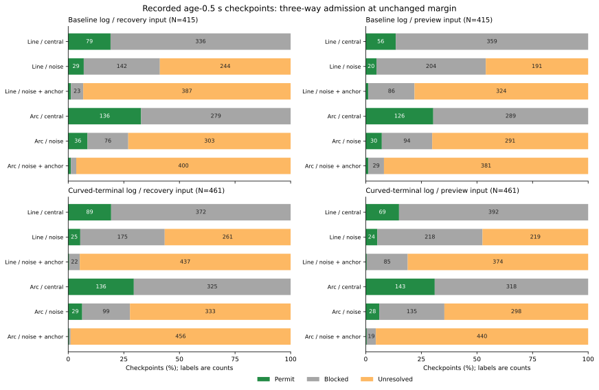

# 不確かさを含めた復帰経路の許可・遮断・未確定

観測後0.5秒の復帰入力876地点で、観測ノイズと共有する補正ずれを含めた範囲を使うと、誤った許可は112件から0件になりました。一方、正しい許可も160件から7件になり、856地点が未確定になりました。この比較条件では、誤判定を抑えても大部分の地点で判断を保留するため、そのまま復帰性能の改善とは扱えません。

予測入力でも誤った許可は90件から0件ですが、正しい許可は179件から7件、未確定は821地点です。今回の範囲は既存の余裕を保った上で追加した条件であり、余裕の削減、制御への組み込み、新しい走行は行っていません。

## 固定した対象と3通りの判定

[固定手順](protocol.md)を先に記録し、[前回の位置モデル](../epoch-position-components/report.md)と[予定操舵の幾何診断](../commanded-arc-components/report.md)の同じ648ケースの会計、時間切れ368ケース、2,120地点を使いました。位置誤差や移動の有無、融合の利用可否で対象を選び直していません。

復帰入力と予測入力、それぞれについて元の直線と記録済みの予定操舵の曲線を評価しました。経路長は0.6m、操舵は固定です。3規則を合わせて25,440判定になります。時点・入力・経路が重なる評価で、独立な試行数ではありません。

真の幾何を評価する基準も、推定側の基準も、元の`M=.6+2sqrt(2)*sigma+.02*age`のままです。位置範囲に使う標準偏差は、前回保存した観測重み・時刻・相関・補正IDからのモデル値です。実現した位置誤差や補正ずれの記録から半径を選んでいません。

| 規則 | 位置の円板半径r | 向きの範囲 |
|---|---|---|
| central | 0 | 推定値そのもの |
| noise_envelope | 2sqrt(2) × ノイズの1軸標準偏差 | 推定値±4度 |
| noise_anchor_envelope | 2sqrt(2) × ノイズと補正ずれの1軸標準偏差 | 推定値±4度 |

centralは元の推定判定を再現します。残る2規則は、同じ真の余裕Mを満たすための条件を広い姿勢範囲へ課します。既存のMの不確かさ項を置き換える設計ではなく、追加の保守性を測る比較です。centralからnoiseへの差には、位置と向きの両方の範囲が入ります。

## 範囲内なら成り立つ幾何の境界

向きを−4度から4度まで1度刻みで計算します。範囲内の向きと最寄りの格子点との差は最大0.5度で、経路上の点の移動は最大`E=2*.6*sin(radians(.5)/2)=0.00523597m`です。位置の平行移動も含め、経路上の点は対応する点から最大E+rだけ離れます。

障害物までの最小距離と壁までの最小距離は、それぞれこの移動量に対して1-Lipschitzです。各成分の下限は向き格子の最小値からE+rを引き、上限は格子の最大値にE+rを足します。真の位置・向きが範囲内なら、真の各成分の距離もこの上下限の中です。centralは正確な中心値を上下限に使います。

| 状態 | 条件 |
|---|---|
| 許可 | 障害物の下限 > M、かつ壁の下限 >= M |
| 遮断 | 障害物の上限 <= M、または壁の上限 < M |
| 未確定 | 上のどちらも成り立たない |

壁の境界での等号は元の許可条件を保ちます。範囲を広げると下限は下がり上限は上がるので、確定判定は同じままか未確定になります。許可から遮断、遮断から許可へは直接変わりません。したがって以下の誤判定減少は、元の誤判定を未確定へ移した結果です。

これは真の姿勢が範囲内という条件で成り立つ幾何の性質です。モデルはドリフト・移動補償の不確かさを除き、ガウス過程の裾も無限に続きます。選択された時間切れケースや繰り返し地点で、統計的な被覆率を保証するものではありません。

## 観測後0.5秒の予定操舵経路

基準記録epochは415地点・87ケース、曲線終端記録curvedは461地点・93ケースです。次の表では両記録を合わせ、各行の分母を876地点に固定しています。真の余裕が十分な地点は336、足りない地点は540です。復帰入力と予測入力は同じ地点を使うため合算しません。

「誤った遮断」は、真の経路が同じMを満たすのに遮断と確定したものです。未確定は遮断・移動再開・目標保持のいずれにも数えていません。

| 入力・規則 | 許可 | 正しい許可 | 誤った許可 | 遮断 | 正しい遮断 | 誤った遮断 | 未確定 |
|---|---:|---:|---:|---:|---:|---:|---:|
| 復帰・central | 272 | 160 | 112 | 604 | 428 | 176 | 0 |
| 復帰・noise | 65 | 31 | 34 | 175 | 135 | 40 | 636 |
| 復帰・noise+anchor | 7 | 7 | 0 | 13 | 13 | 0 | 856 |
| 予測・central | 269 | 179 | 90 | 607 | 450 | 157 | 0 |
| 予測・noise | 58 | 44 | 14 | 229 | 192 | 37 | 589 |
| 予測・noise+anchor | 7 | 7 | 0 | 48 | 48 | 0 | 821 |

noise+anchorでは、centralで正しく許可できた地点のうち復帰入力153・予測入力172地点も未確定へ移りました。未確定のうち真の余裕が十分なのは両入力とも329地点で、余裕不足は復帰入力527・予測入力492地点です。未確定を一律に遮断へ読み替えると、この329地点も遮断する別の規則になります。



図の数値は地点数、横軸は各記録の地点数に対する割合です。幅4%未満の区間のラベルは省き、0を含む全72区間を[図の数値](admission-states.csv)に保存しました。状態の色は判定結果で、正誤の区分は表と明細にあります。

直線でも同じ方向の変化を確認しました。復帰入力の正しい許可は85→27→7、誤った許可は83→27→0、未確定は0→505→824です。予測入力では正しい許可79→32→7、誤った許可46→12→0、未確定0→410→698でした。経路を曲げるだけで不確かさによる保留がなくなるわけではありません。

## 半径と実測した包含

観測後0.5秒では、復帰入力はすべて25観測、3期間融合を使う予測入力は75観測です。予測で融合を使えないフィルター代替は25観測で、次の復帰平均と同じ半径になります。半径の単位はmです。

| ノイズ・入力方式 | 地点 | noiseのr | noise+anchorのr |
|---|---:|---:|---:|
| 独立・復帰平均 | 474 | 0.056569 | 0.288444 |
| 相関1秒・復帰平均 | 402 | 0.261149 | 0.384966 |
| 独立・予測3期間融合 | 376 | 0.032660 | 0.166533 |
| 相関1秒・予測3期間融合 | 322 | 0.151586 | 0.222812 |

以下の包含は同じ876地点で実測したものです。位置は半径rの円板内、向きは±4度内、両方はその共通部分です。割合を校正済みの信頼水準とは扱いません。

| ノイズ・入力・規則 | 地点 | 位置を包含 | 向きを包含 | 両方を包含 |
|---|---:|---:|---:|---:|
| 独立・復帰・noise | 474 | 73 | 455 | 73 |
| 独立・復帰・noise+anchor | 474 | 474 | 455 | 455 |
| 独立・予測・noise | 474 | 56 | 455 | 56 |
| 独立・予測・noise+anchor | 474 | 474 | 455 | 455 |
| 相関1秒・復帰・noise | 402 | 341 | 370 | 309 |
| 相関1秒・復帰・noise+anchor | 402 | 391 | 370 | 359 |
| 相関1秒・予測・noise | 402 | 346 | 370 | 314 |
| 相関1秒・予測・noise+anchor | 402 | 393 | 370 | 361 |

noiseに残った予定操舵経路の誤った許可34地点・14地点は、すべて向きが範囲内でも位置が円板外でした。noise+anchorでも両方を包含するのは復帰814/876・予測816/876で、全地点を覆っていません。今回誤った確定判定が0だったことは、範囲外を含む将来の判定が正しいという保証にはなりません。

## 前回から固定した誤った追加許可

前回、直線では許可せず、曲線で追加許可したのに真の余裕が足りなかった復帰入力43地点・予測入力54地点を追跡しました。両入力は重なります。各セルは「許可 / 遮断 / 未確定」の地点数です。

| 記録・入力 | 元の地点数 | noise | noise+anchor |
|---|---:|---|---|
| 基準・復帰 | 24 | 0 / 0 / 24 | 0 / 0 / 24 |
| 曲線終端・復帰 | 19 | 1 / 0 / 18 | 0 / 0 / 19 |
| 基準・予測 | 27 | 0 / 0 / 27 | 0 / 0 / 27 |
| 曲線終端・予測 | 27 | 0 / 0 / 27 | 0 / 0 / 27 |

noise+anchorで全地点が未確定になりました。真の姿勢まで範囲内なのは復帰33/43・予測45/54地点で、ここでも全地点を覆うわけではありません。元の誤った許可を保留できたことと、正しく遮断できたことは区別しています。

全2,120地点の予定操舵経路でも、復帰入力の誤った許可は357→56→0、誤った遮断は383→61→0、未確定は0→1,688→2,068でした。予測入力ではそれぞれ226→24→0、329→61→0、0→1,527→2,001です。全地点・部分集合・判定群別の結果は[summary.csv](summary.csv)に残しています。

## 検証と再実行

解析コードは`eb94318`、図と手順は`6da5a66`です。元の8,480判定を再現し、すべての範囲の入れ子、状態の単調性、真の姿勢を包含したときの各成分の上下限と確定判定を検証しました。2e-8m以内の境界の曖昧さは0行、包含された姿勢での誤った確定判定も0行でした。noise+anchorは範囲外を含む全8,480評価でも誤った許可・遮断が0行です。

76,320回の幾何要求を52,218の固有幾何にまとめ、正確な障害物・壁の極値、既存の最小距離関数、独立な120弦近似を照合しました。弦近似との差の最大値は約5.11e-6mで、最大矢高の境界約5.47e-6m以内でした。真の距離は固定済みの前回の幾何表を使っています。

入力表・地図・解析コード・補助コード・シミュレーターと手順の指紋を記録しました。元の368軌跡・3,312,000区間の窓再構成と物理検証は以前の指紋から引き継ぎ、今回は生軌跡を読み直した新たな物理検証ではありません。Python 206テストが成功しました。追加9件で壁・障害物の等号、両方向の保留、格子間の姿勢の包含、角度補間量の必要性、真値を替えても変わらない判定、実現誤差を使わない半径、共有ずれによる誤った遮断の保留、空の判定群を確認しています。

```bash
python3 experiments/pose_observation_loss/analyze_model_admission_envelopes.py \
  --output /tmp/model-admission-envelopes
python3 experiments/pose_observation_loss/plot_model_admission_envelopes.py \
  --results /tmp/model-admission-envelopes --output /tmp/model-admission-figure
python3 -m unittest discover -s experiments/pose_observation_loss -p 'test_*.py'
```

新しい出力先を使います。解析は標準ライブラリー、図はMatplotlibを使い、追跡済みの入力表と地図だけで再実行できます。4つのCSVと`sources.json`は別の出力先への再集計でバイト単位で一致しました。図の数値・SVG・PNG・指紋も再生成で一致し、表示を確認しました。

[accounting.csv](accounting.csv)は648ケースの会計、[decisions.csv](decisions.csv)は各規則の上下限・状態・正誤・包含、[geometry-audit.csv](geometry-audit.csv)は推定側の向き格子の固有幾何、[summary.csv](summary.csv)は1,920行の集計です。明細の`centre_audit_id`と`heading_audit_ids`は今回の幾何表、`truth_source_audit_id`は[前回の幾何表](../commanded-arc-components/geometry-audit.csv)を参照します。[sources.json](sources.json)と[図の指紋](admission-states-sources.json)に入力とコードの指紋があります。

この比較は、既存の真の余裕を守る追加条件がどれだけの判断を未確定にするかを示します。制御、タイマー、標準の余裕、保持結果は更新していません。以前の走行結果140→140もそのままです。
