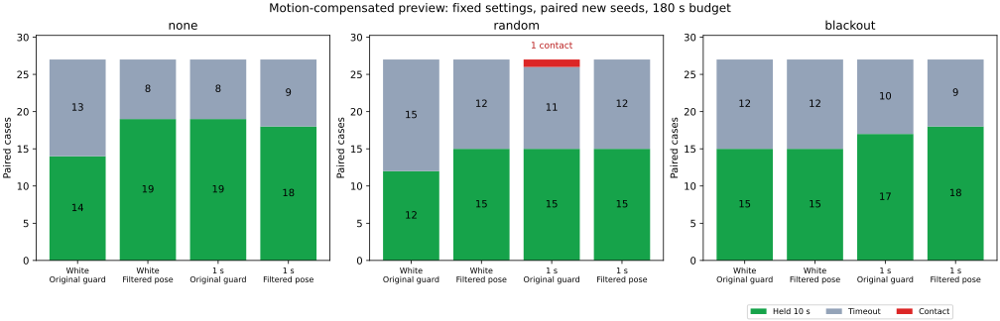

# 移動を補償した観測平滑化と停止予測ガードの比較

停止予測ガードへ渡す姿勢を、移動補償した直近25観測の平均へ変えると、新規シードの10秒保持成功は92/162から100/162へ増えました。独立ノイズでは41→49件、相関1秒では51→51件です。新規例の接触は従来の `joint` が1件、平滑化の `filtered` が0件でした。この固定条件での改善は主に独立ノイズに見られます。比較用オプションとして追加し、既定は変更しません。

## 変更した条件

[解除後の再発動の診断](../reentry-inputs/report.md)では、短い再発動27区間のうち24区間で観測誤差の変化が判定余裕を最も縮めていました。今回は、姿勢の時刻を合わせて平均する候補を、元の `joint` と比較します。前の `entry` との対比較ではなく、速度に応じた開始側の追加余裕は両群とも無効です。

古い観測を平均する前に、前回の測定速度と実際に適用した操舵指令を使い、各観測の姿勢を今回の観測時刻まで進めます。位置は算術平均、向きは円周平均を取り、最新の測定速度はそのまま使います。最大25観測、約0.5秒の窓です。受信の有無によらず予定補正の境界と、終端精密観測への切替で履歴を捨てます。外部補正が欠落しても局所姿勢観測は続く、という従来モデルの条件を保ちます。

| 項目 | `joint` | `filtered` |
|---|---|---|
| 停止予測の姿勢 | 今回の局所観測 | 移動補償した最大25観測の平均 |
| ガード開始・解除・同時復帰の停止予測 | 上の姿勢 | 上の姿勢 |
| ガード開始余裕 | `0.5 + 2√2×sigma + 0.02×観測年齢` | 同じ |
| ガード解除余裕 | 開始余裕 + 0.05 | 同じ |
| 目標・操舵指令、弧による速度上限、復帰直線 | 従来の観測と判定 | 同じ規則 |

平均化を理由に距離余裕の `sigma` を小さくしていません。ガードの0.5秒解除確認、欠落待機との1秒の同時復帰、速度上限、制動則、車体半径0.5、10秒保持、180秒の制限、対にしたノイズ革新・欠落は共通です。姿勢推定に真位置・真のヨーは使いません。

`MOTION_FILTER` は既定で無効です。有効化には同時復帰を要し、以前の2種類の追加余裕フラグとは併用できません。実装は実験用example内にあり、ライブラリのコントローラは変更していません。

## 保持と接触

3地図×3計画器×欠落3条件を、独立ノイズと相関1秒のノイズで比較しました。窓幅、補償・リセット方法、既知シード253〜255、新規シード256〜258は結果を見る前に固定し、調整していません。各行は81組、各群81走行です。

| 対象・ノイズ | シード | 従来の保持 | 平滑化の保持 | 従来の接触 | 平滑化の接触 |
|---|---|---:|---:|---:|---:|
| 既知・独立 | 253〜255 | 39 | 52 | 0 | 0 |
| 既知・相関1秒 | 253〜255 | 50 | 52 | 0 | 0 |
| 新規・独立 | 256〜258 | 41 | 49 | 0 | 0 |
| 新規・相関1秒 | 256〜258 | 51 | 51 | 1 | 0 |

| 新規ノイズ | 欠落 | 従来の保持 / 27 | 平滑化の保持 / 27 |
|---|---|---:|---:|
| 独立 | なし | 14 | 19 |
| 独立 | ランダム | 12 | 15 |
| 独立 | 45〜75秒 | 15 | 15 |
| 相関1秒 | なし | 19 | 18 |
| 相関1秒 | ランダム | 15 | 15 |
| 相関1秒 | 45〜75秒 | 17 | 18 |

新規162組では保持の獲得10件・喪失2件、既知162組では獲得17件・喪失2件でした。新規で失ったのは独立・blackout・seed257・maze・A*と、相関1秒・none・seed258・maze・JPSです。全648走行で地図外への退出はなく、保持と下記1件の接触以外はすべて180秒の時間切れでした。

接触したのは相関1秒・random・seed258・maze・JPSの従来群で、109.28秒の区間に中心と障害物の最短距離が0.49903となりました。同じ組の平滑化群は接触せず、最短距離0.75634でしたが、目標距離30.87のまま時間切れです。この1組の接触回避を保持成功とは扱いません。区間の再計算は [contacts.csv](contacts.csv) にあります。

## 待機と短い再発動

待機は欠落待機またはガードが有効な指令区間の和集合です。重なりは1回だけ数え、目標停止だけの時間は加えません。制動中も含みます。「静止中の待機」は同じ和集合を判断前の測定速度の絶対値0.02以下に限定したものです。

| 対象・ノイズ | 従来の平均待機 | 平滑化の平均待機 | 従来の静止中の待機 | 平滑化の静止中の待機 |
|---|---:|---:|---:|---:|
| 既知・独立 | 98.14秒 | 67.89秒 | 94.12秒 | 66.05秒 |
| 既知・相関1秒 | 65.29秒 | 60.63秒 | 61.71秒 | 58.41秒 |
| 新規・独立 | 94.64秒 | 73.36秒 | 90.69秒 | 72.00秒 |
| 新規・相関1秒 | 65.11秒 | 63.31秒 | 62.32秒 | 61.60秒 |

新規例全体では平均待機79.87→68.33秒、静止中の待機76.51→66.80秒でした。ガード開始は1走行平均4.58→2.87回、時間切れかつ末尾30秒の移動0.1未満は49→44件です。後者は独立した失敗原因の判定ではありません。

短い再発動は、解除時の実指令速度が正、途中に欠落待機がなく、1秒以内・再発動直前までの移動0.1未満で再びガードが始まる区間です。前の診断と同じ定義を使います。

| 対象・ノイズ | 従来の短い再発動 | 平滑化の短い再発動 |
|---|---:|---:|
| 既知・独立 | 92 | 0 |
| 既知・相関1秒 | 71 | 26 |
| 新規・独立 | 87 | 1 |
| 新規・相関1秒 | 89 | 20 |

新規例全体で176→21回、既知例全体で163→26回でした。相関1秒でも再発動は減りましたが、新規例の保持は増えていません。再発動の低減だけを到達改善とは扱いません。

時間と回数は各走行の終了までの観測値です。成功・接触・時間切れで観測期間が異なり、成功例には10秒保持も含まれます。固定した同じ時間窓での因果効果や、単位時間あたりの再発動率ではありません。

## 以前の診断例との関係

[前の開始側余裕によって保持を失った10組](../entry-cycles/report.md)については、今回の平滑化群が8/10組で保持し、相関1秒・seed254・none・dense・JPSと、相関1秒・seed253・blackout・maze・JPSは時間切れでした。元の `joint` はこの10組すべてで保持するため、この部分集合で従来案を改善したわけではありません。以前の `entry` からは開始側余裕の有無も変わり、8件を平滑化だけによる回復とは解釈できません。

## 検証と再実行

4比較走行の全648ケースと元の既定条件seed201・54ケースを検証しました。5走行の実行情報のシミュレータハッシュは、今回のソースと一致しています。

- Rustは観測を毎ステップ進めますが、Pythonは各観測を独立したデッドレコニング座標系のアンカーに変換して平均を再構成します。全ステップのサンプル数、リセット、予測用の姿勢を照合しました。
- 毎ステップの余裕、速度上限、物理応答、対にしたノイズ・欠落、平均観測窓、目標保持、ガードの全状態遷移と両解除タイマーが整合しています。
- 既知シードの従来群162件は前の開始側余裕比較に保存した結果と全項目が一致しました。既定条件54件も保存結果と一致し、従来のbaseline・blackoutに元からある接触1件も同じでした。
- 平滑化群の全ガード開始・解除・欠落復帰と固定地点を合わせた3,903地点で、停止予測、速度用の弧、復帰直線の幾何を独立に再計算しました。欠落待機からの全復帰397回と、従来群の接触1区間を確認しています。
- サンプル数、フィルタ位置、初期サンプル数、補正をまたぐ履歴を破損させた4記録は、独立検証がすべて拒否しました。
- 直進時のノイズ相殺、旋回時の補償、角度の円周平均、窓幅と補正リセットのRustテスト4件、既存のPure Pursuitテスト4件、再発動の区間集計テスト7件が通過しました。Headless Releaseビルド、全ターゲットのClippy（警告をエラー扱い）、Rust/Python整形・構文チェックも通過しています。
- 集計を再実行し、全CSV、接触記録、実行情報のバイト単位の一致を確認しました。

入力と実行情報は [sources.json](sources.json)、全結果は [all-results.csv](all-results.csv)、条件別集計は [summary.csv](summary.csv)、保持の獲得・喪失は [paired-holds.csv](paired-holds.csv)、待機と再発動は [control-events.csv](control-events.csv)、幾何確認は [preview-audit.csv](preview-audit.csv) にあります。[READMEの手順](../../README.md#compare-motion-compensated-stopping-preview-observations)で4比較走行と集計を再実行できます。図の生成にはMatplotlibを使います。

シミュレータSHA-256は `77250ddb3cde486fba952508de3b6f67258f0ac554332ce01369fa6fc1071e53` です。生軌跡はリポジトリに含めず、再実行で生成します。

この補償は測定速度と適用済み操舵が正確で、車体が離散モデルに従う条件に依存します。車輪の滑り、操舵応答の遅れ、速度の測定誤差は加えていません。相関ノイズや共通の偏りも平均だけで取り除けません。同じ3地図・少数シードの条件を組み合わせた648走行を、独立な統計標本とは扱いません。確認できた改善は今回の固定モデル内のもので、既定変更や実機への適用を判断するには評価が足りません。
