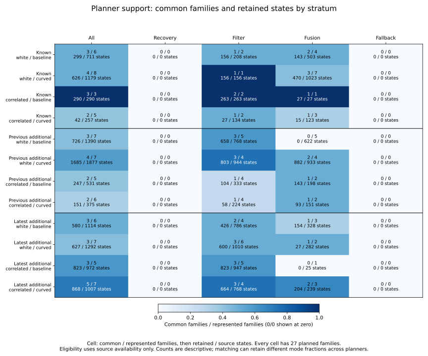
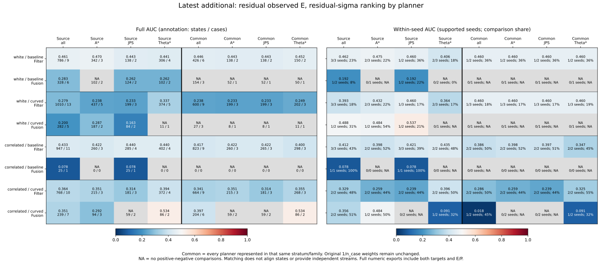
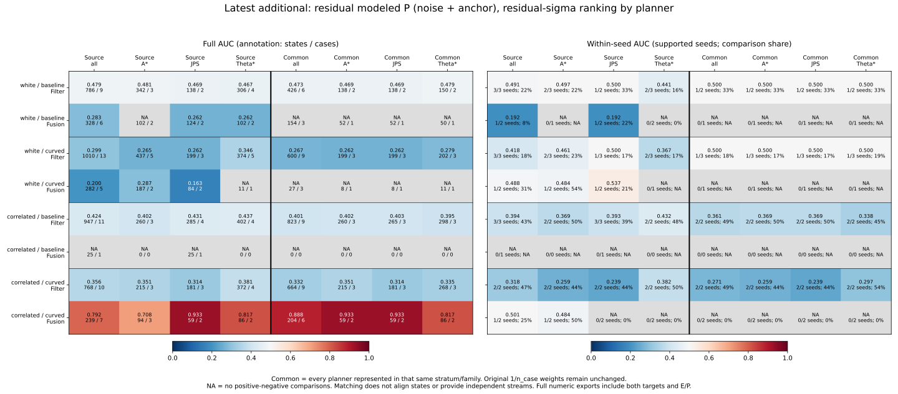
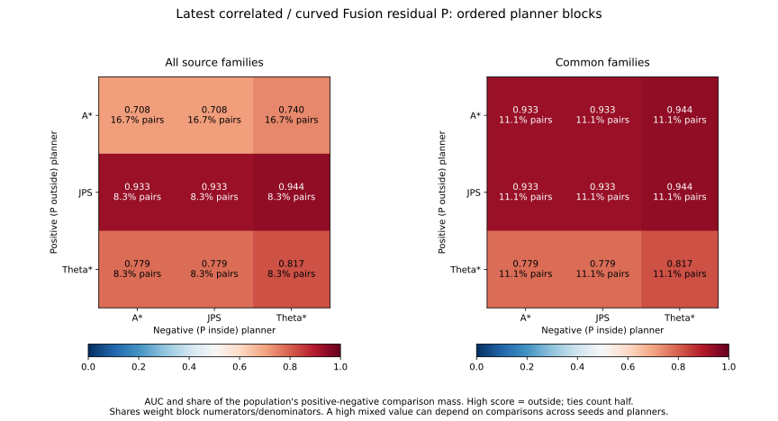
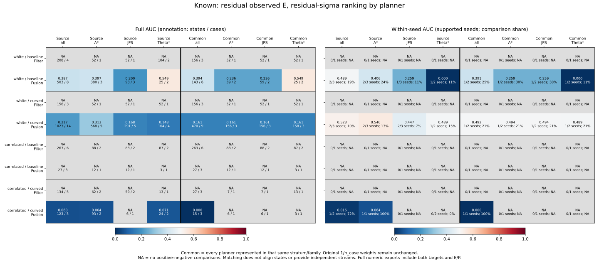
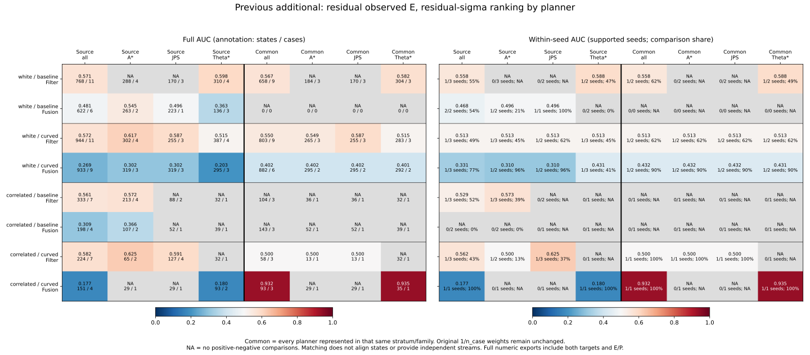

# Planner-conditioned ranking results

The latest cohort's Filter residual observed-error ranking remains below .5
for every planner in all four noise/arm conditions, both in full comparisons and
within each seed. Matching common families does not reverse that result.
Fusion is more support-sensitive: planner-specific AUCs can be undefined or
depend heavily on comparisons between seeds. No planner, score direction or
selection is chosen as a remedy.

## Fixed scope and interpretation

The [protocol](protocol.md) was committed as 303bd59 before calculating these
outcomes, starting from main 51b8e7d. Reuse 32,985 reconstructed pair references,
10,995 Recovery/Preview states, 157 represented cases, 275 source opportunities,
972 planned cases and 324 planner families. The three cohorts remain separate:
known 269/270/271, previous additional 274/275/276, latest additional 277/278/279.

All existing targets, scores, E/P/U labels and five strata remain in the tables.
Only the original case reference weight 1/n_case is used. Compute n_case before
mode/planner/family selection, retain every selected row's original weight, and
never reweight remaining mode states to sum to one. The earlier window/family
weighting study remains unchanged.

`source` uses every available state in the stratum. `common_family` requires
available states for A*, JPS and Theta* in that same family and stratum, without
examining labels or scores. A family removes only planner from the full case
key. This aligns family membership, not times, trajectories, state counts or
mode mass. The audit retains original `accounting_partition=existing_new` while
using `partition=new` for analysis.

High score predicts outside; ties count half. Outside is norm > .10 m; the
inside disk is closed. AUC is blank without positive-negative comparisons.
Within-seed and within-planner AUCs sum eligible pair numerators/denominators
before division; they do not average individual AUCs. The joint statistic
requires both the same seed and same planner. Counts and case mass are not
independent sample sizes.

## Source support and matching

Each noise/arm cell contains 27 planned families. The table counts complete
Recovery/Preview windows before stratum selection; mode-specific eligibility is
recomputed from availability and is saved for all 1,620 family/stratum rows.

| Cohort | Noise / arm | Represented families | Common families | Source states | Retained states |
|---|---|---:|---:|---:|---:|
| Known | white / baseline | 6 | 3 | 711 | 299 |
| Known | white / curved | 8 | 4 | 1,179 | 626 |
| Known | correlated / baseline | 3 | 3 | 290 | 290 |
| Known | correlated / curved | 5 | 2 | 257 | 42 |
| Previous additional | white / baseline | 7 | 3 | 1,390 | 726 |
| Previous additional | white / curved | 7 | 4 | 1,877 | 1,685 |
| Previous additional | correlated / baseline | 5 | 2 | 531 | 247 |
| Previous additional | correlated / curved | 6 | 2 | 375 | 151 |
| Latest additional | white / baseline | 6 | 3 | 1,114 | 580 |
| Latest additional | white / curved | 7 | 3 | 1,292 | 627 |
| Latest additional | correlated / baseline | 5 | 3 | 972 | 823 |
| Latest additional | correlated / curved | 7 | 5 | 1,007 | 868 |

Across cohorts, 37 of 72 represented families have all three planners somewhere
in their saved windows, retaining 111 cases and 6,964 states. The remaining
252 planned families have no source states. These are availability counts.

Latest white/baseline Fusion retains 154 of 328 states, one of three represented
families; white/curved Fusion retains 27 of 282, one of two families. Both common
subsets have only inside E/P labels and undefined AUC. Latest correlated/baseline
Fusion originally has 25 states from JPS alone, so matching retains no family.
Previous-additional white/baseline Fusion has five represented families but none
with all three planners in Fusion, leaving zero matched states out of 622.

## Latest Filter: the below-.5 pattern persists within every planner

The following residual observed-E AUCs use residual_sigma and source support.
Each cell is full / within-seed AUC. All 12 planner cells have both classes;
all 24 values are below .5.

| Noise / arm | Mixed | A* | JPS | Theta* |
|---|---:|---:|---:|---:|
| white / baseline | .461424 / .461846 | .470475 / .475032 | .442732 / .460452 | .441021 / .406281 |
| white / curved | .279402 / .393138 | .237994 / .431906 | .232979 / .460452 | .337478 / .363980 |
| correlated / baseline | .432830 / .411836 | .422245 / .397870 | .439766 / .420897 | .439628 / .434663 |
| correlated / curved | .363656 / .329082 | .350968 / .259278 | .314006 / .239084 | .394275 / .395988 |

For common families, all 12 individual-planner full AUCs remain .232979–.452088
and within-seed AUCs .239084–.460452. The mixed values are .445851/.460452,
.238067/.460452, .416636/.386161 and .340970/.285750 in the same row order.
Matching removes states and changes family composition; it does not repair the
fixed score's ordering or justify reversing it after observing these results.

## Latest Fusion: planner and seed support matter separately

For correlated/curved Fusion residual E, source support is 239 states, seven
cases and three families. A* has 94 states/three cases, JPS 59/two and Theta*
86/two. Full / within-seed AUCs are respectively .292033/.484066, NA/NA and
.534080/.090909. Theta*'s full AUC above .5 therefore does not persist within
the single seed with both classes. Its within-seed comparisons supply 32.35%
of its full comparison mass (see the unrounded CSV share).

Common support retains 204 states, six cases and two families. A* and JPS
each have 59 states but only inside E, so their AUCs remain undefined. Theta*
is unchanged. The mixed E AUC becomes .396864 full and .017544 within-seed;
jointly within seed and planner it is .090909. Restricting comparisons changes
which class pairs are available.

For modeled P in that same cell, the apparent high ranking is primarily a
seed-composition issue. All P class mass is entire case mass here:

| Population / planner | States / cases | P outside / inside mass | Full AUC | Within-seed AUC | Within-seed pair share |
|---|---:|---:|---:|---:|---:|
| Source / mixed | 239 / 7 | 4 / 3 | .791564 | .501320 | 25% |
| Source / A* | 94 / 3 | 2 / 1 | .708379 | .484066 | 50% |
| Source / JPS | 59 / 2 | 1 / 1 | .932692 | NA | 0% |
| Source / Theta* | 86 / 2 | 1 / 1 | .817460 | NA | 0% |
| Common / mixed | 204 / 6 | 3 / 3 | .888312 | NA | 0% |
| Common / A* | 59 / 2 | 1 / 1 | .932692 | NA | 0% |
| Common / JPS | 59 / 2 | 1 / 1 | .932692 | NA | 0% |
| Common / Theta* | 86 / 2 | 1 / 1 | .817460 | NA | 0% |

The source mixed within-planner AUC is .791728 on one third of pair mass;
restricting both seed and planner gives .484066 on only one twelfth of pair
mass. Removing cross-planner comparisons alone does not remove seed mixing.
For common families, every P-positive state belongs to seed 278 and every
P-negative state to seed 279. The .888312 full AUC has no within-seed comparison
support, even though all three individual full AUCs are high.

The omitted unmatched A* family contains the additional 35-state P-positive
case at seed 279. Matching removes the source of same-seed P comparisons and
raises the full descriptive AUC; that is a population change, not evidence of
better estimation. The nine ordered planner blocks reproduce every numerator,
denominator and within-seed total exactly.

## Other cohorts prevent a general improvement claim

Known Filter has one class under all planner selections and both populations;
all AUCs remain undefined. Known correlated/curved common Fusion has 15 states
in one family at seed 269: A* and JPS each supply six E-outside states, Theta*
three E-inside states. Mixed full/within-seed AUC is zero, while every individual
planner and the joint seed/planner AUC are undefined. A within-seed statistic
can therefore consist entirely of comparisons across planners.

Previous-additional correlated/curved Fusion changes from 151 states/four cases
in two families to 93 states/three cases in one family, all seed 275. Mixed E
full/within-seed AUC rises from .177094 to .932400. Theta* changes from 93 states
across two cases to 35 states in one case, with AUC .935484; A*/JPS remain
one-class. This large support sensitivity is retained alongside the latest
cohort's below-.5 results. It is not an untouched validation result.

## Reproduction and verification

See [README commands](../../README.md#planner-specific-rankings-on-common-family-support).
Aggregation uses tracked CSV/JSON inputs and Python's standard library. Plotting
and the separate independent verifier need NumPy; plotting also needs Matplotlib.
Use new output directories and a new evidence filename, without Python -O.

All 51,120 preceding case-reference component/ranking field comparisons pass.
The output contains 1,620 family/stratum audit rows, 960 component summaries,
8,640 ranking summaries, 19,440 ordered planner blocks and 2,880 seed support
rows, including every zero-support stratum and seed. Original accounting,
case support, events, both cutoff tables, historical 550/509 and latest 101/94
loss references, and all prior case/family audit bytes are unchanged.
All 32,985 reconstruction audits pass; maximum vector closure is
2.434e-14 m and maximum residual component difference is zero.

Both aggregation runs match byte for byte across all 15 artifacts. Both plotting
runs match across all 16 artifacts: six SVGs, six PNGs, three numeric CSVs and
plot provenance. All six figures were visually inspected. Track SVGs, all
numeric exports and provenance; PNGs are reproducible scratch outputs.

The independent verifier imports no analyzers. It reconstructs both targets
from saved pose components with NumPy, checks joins/labels/ticks/events, repeats
the exact whole-window and original case/family audit, reconstructs stratum
eligibility, directly evaluates weighted state pairs and verifies every field
and plotted numeric row. `independent-verification.json` records its counts and
source/script hashes. It also verifies all aggregation/plot hashes and copied
source artifacts: 1,706,996 field comparisons pass, including 846 plotted rows,
6,981 defined full/block AUC checks and 1,929 defined within-seed ranking checks.
All 562 Python tests pass, including ten new mathematical and support regressions.

No new Rust build, raw-history replay, fitting or rollout was performed. The
live results remain historical 140->140 and latest 62->60. Repeated selected
windows/planners do not provide independent seed streams, confidence intervals,
causal effects or real-world calibration.
