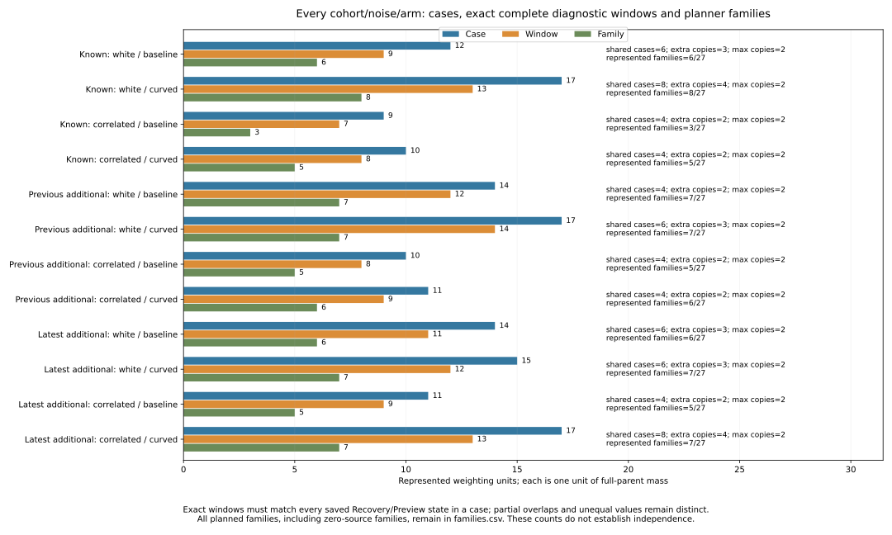
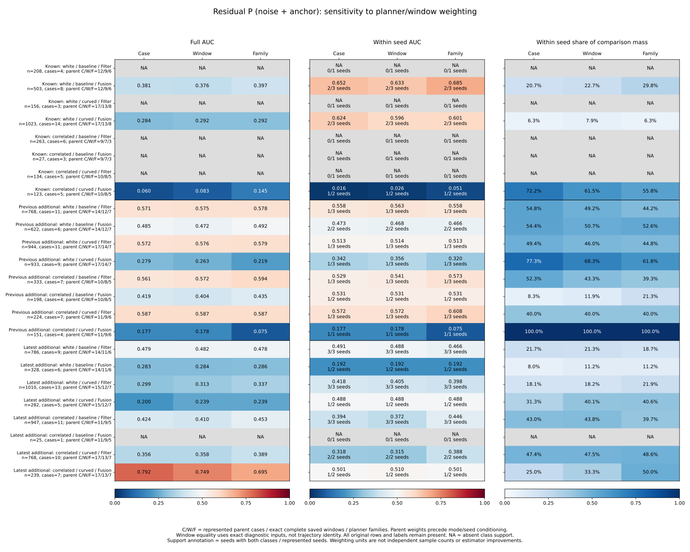
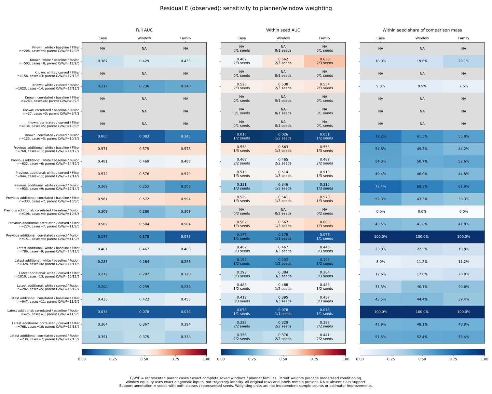
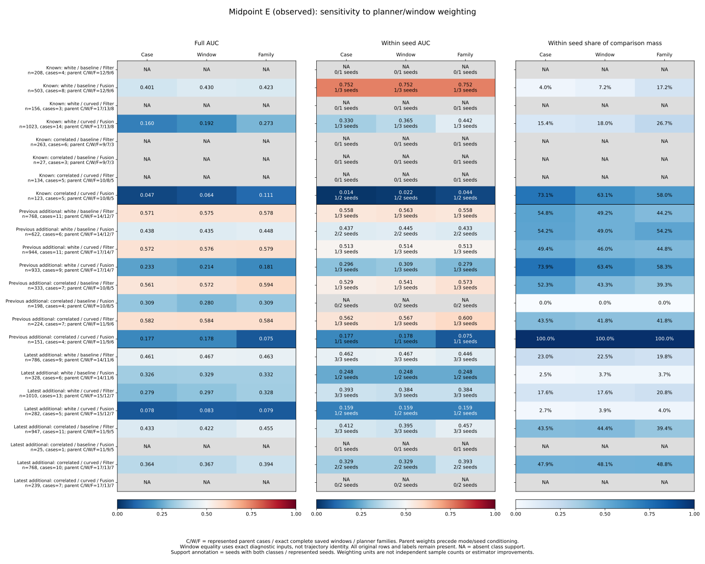
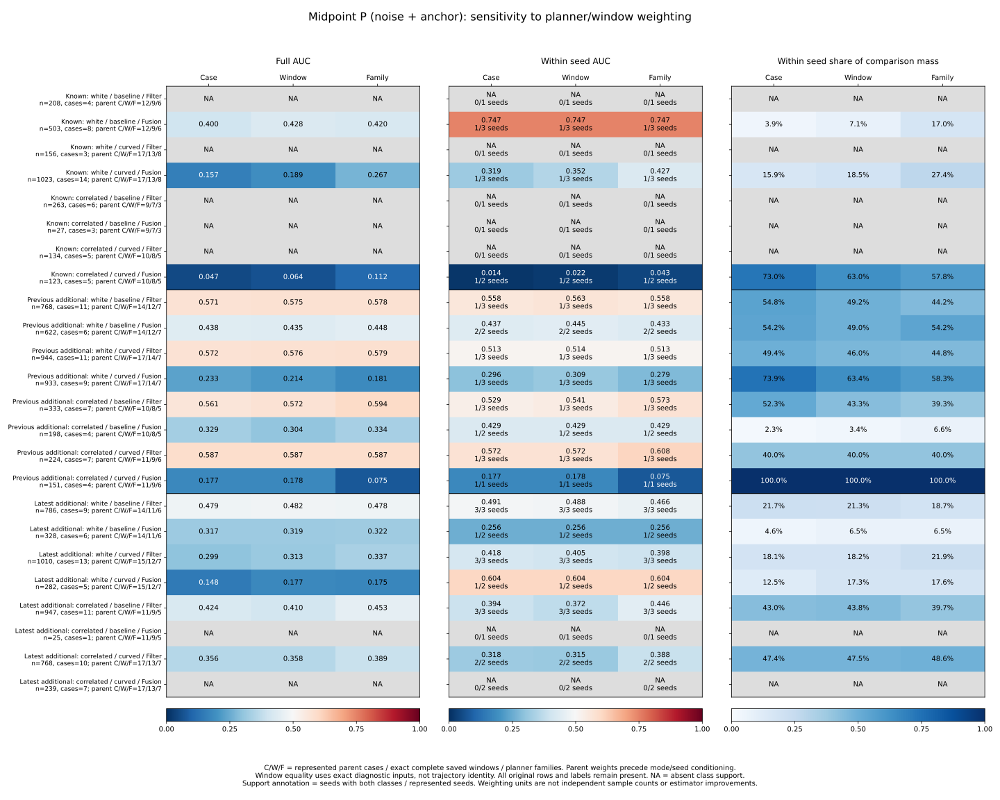

# Planner families and exact saved diagnostic windows

Of the **157 represented cases**, **64 cases form 32 pairs of identical complete
saved Recovery/Preview diagnostic windows**. Every pair is A*/JPS within the
same cohort/arm/loss/seed/map family. There are **125 distinct complete windows**
within families and **72 represented planner families**. These counts describe
the saved diagnostic inputs, not independent samples or identical trajectories.

The choice of weighting unit changes reported AUCs. Latest curved-correlated
Fusion residual P AUC is **.792 with case weights, .749 with exact-window weights
and .695 with family weights**. Its within-seed P AUC stays about .5. Latest
observed E residual-sigma AUCs, full and within seed, stay **below .5 in all eight
Filter/Fusion conditions under all three weightings**. This is a sensitivity
analysis of existing observations; it neither changes nor improves the estimator.

## Prespecified units and window identity

The [protocol](protocol.md) was committed as **6450034** after main e9f7dba,
before computing these results. Collector/tests are **ef50642**, the accounting
group alias regression is **b0fcbd1**, and plots/README are **3342253**. All source
outcomes were previously observed. No new simulation, raw replay, fitting,
threshold choice, score reversal or controller change occurs here.

Keep cohorts separate: known 269/270/271, previous additional 274/275/276 and
latest additional 277/278/279. The adapters reconstruct all **32,985 simultaneous
references at 10,995 states**, from 157 cases / 275 received opportunities. This
study fixes Recovery/Preview, all event kinds together, all_available, both
midpoint/residual targets, all three scores, E/P/U labels and all strata plus
pooled all. Other saved selections remain unchanged.

A family removes only planner from the full case key: cohort, arm, loss mode,
seed and map remain. Audit all **972 planned cases / 324 planned families**,
including **252 families with no source window**. Do not merge across those
family keys or impute absent planner records.

For every state in an entire represented case window, the exact signature keeps
time/truth time, estimator/anchor/stratum, all three integer score ticks, saved
residual coefficients, both target error x/y vectors and partial variances,
all four weighted signed component vectors, E/P/U labels, and sorted source
event kinds/times/scheduled/received/precision flags. Arbitrary artifact IDs and
planner names are excluded. Parse finite floats, normalize signed zero and use
typed float.hex JSON plus SHA-256, verifying canonical bytes on hash matches.
No tolerance or approximation is used. Different lengths, partial overlaps or
any unequal saved diagnostic value give different complete windows.

Absolute physical positions and full trajectories are outside this equality
definition. Unequal windows can still share noise streams, individual states or
other information; distinct hashes do not establish independence.

Let n_c be the case's full parent state count, k_f its family's represented case
count and m_w the multiplicity of its exact window in that family:

| Weighting | Per-state weight | Full parent mass per represented unit |
|---|---|---|
| Case | 1/n_c | One per original case |
| Window | 1/(n_c m_w) | One per exact complete saved window |
| Family | 1/(n_c k_f) | One per represented planner family |

Weights precede both mode and seed conditioning and remain unchanged afterward.
Keep every original observation and label. A unit split across modes can carry
fractional mode mass. Family weighting treats unequal windows as members of
the same family; it is broader than exact-window weighting. Tables distinguish
original records/cases, analysis units and analysis mass. These are not effective
independent sample sizes, and no weighting is selected as the preferred estimate.

## How much repetition is present

Every planned family has three planner cases. Counts by cohort are:

| Cohort | Represented cases | Exact complete windows | Represented families | Shared-window cases / pairs |
|---|---:|---:|---:|---:|
| Known | 48 | 37 | 22 | 22 / 11 |
| Previous additional | 52 | 43 | 25 | 18 / 9 |
| Latest additional | 57 | 45 | 25 | 24 / 12 |
| Total | 157 | 125 | 72 | 64 / 32 |

All 32 matches have multiplicity two and planner set A*/JPS. The 32 extra
complete-window copies contain **2,073 Recovery/Preview state records** in total;
all 10,995 original states remain in every weighting. No Theta* complete window
joins these exact pairs under the fixed signature. That does not imply Theta*
histories are independent or that partial overlaps are absent.

For latest curved-correlated Fusion, A*/JPS share a **52-state** window in
seed 279/blackout/dense_50x50 and a **7-state** window in
seed 278/random/dense_50x50. The latter does not merge with the longer Theta*
window even though some nearby states overlap. `cases.csv` maps all source IDs,
full keys, fingerprints, unit IDs, multiplicities and all three row weights;
`families.csv` also retains every zero-source family and missing planner.

## Latest curved-correlated Fusion residuals

These 239 source states are unchanged. The parent noise/arm group has
**17 cases / 13 windows / 7 families**; its Fusion subset has **7 cases /
5 windows / 3 families**. E is observed error, P=noise+anchor and U=drift+transport.
Norm >.10 m is outside, with the closed disk inside. P is an arithmetic label
using true saved components, not an online estimator output.

| Weighting | Full E AUC | Within seed E AUC | Full P AUC | Within seed P AUC | P comparison mass within seed |
|---|---:|---:|---:|---:|---:|
| Case | .351269 | .355612 | .791564 | .501320 | 25% |
| Window | .374660 | .376210 | .748889 | .509947 | 33.33% |
| Family | .337759 | .440548 | .694816 | .501320 | 50% |

P outside/inside mass changes from **4/3** case units to **3/2** window units
and **2/1** family units. Its comparison denominator therefore changes from
12 to 6 to 2. Only these two ordered seed blocks have positive comparison mass:

| Weighting | Positive 278 / negative 279: AUC, denominator share | Positive 279 / negative 279: AUC, denominator share |
|---|---|---|
| Case | .888312, 75% | .501320, 25% |
| Window | .868361, 66.67% | .509947, 33.33% |
| Family | .888312, 50% | .501320, 50% |

Thus duplication and family composition affect the full P AUC, while the
within-seed comparison remains near .5. Seed 278 still has no P-inside class,
and seed 277 still has no Fusion records. Changing weights does not create
missing comparison support. Window weighting also changes the relative mixture
of unequal complete windows inside a family; family weighting keeps original
cases equal within that family, explaining their slightly different diagonal AUCs.

## Observed residual ranking across the latest cohort

The following full E AUCs keep the fixed high-residual-sigma direction. All
source rows remain; changes are in the reporting weights alone.

| Noise / arm / mode | Case | Window | Family |
|---|---:|---:|---:|
| White / baseline / Filter | .461 | .467 | .463 |
| White / curved / Filter | .279 | .297 | .328 |
| Correlated / baseline / Filter | .433 | .422 | .455 |
| Correlated / curved / Filter | .364 | .367 | .394 |
| White / baseline / Fusion | .283 | .284 | .286 |
| White / curved / Fusion | .200 | .239 | .239 |
| Correlated / baseline / Fusion | .078 | .078 | .078 |
| Correlated / curved / Fusion | .351 | .375 | .338 |

Full and within-seed E AUCs are below .5 in every one of these eight cells for
all three weightings. Exact-window or family balancing therefore leaves the
latest cohort's low observed residual ranking present on this saved selection.
This finite descriptive result supplies no confidence interval or general
calibration verdict.

Other observed cohorts can move differently. Known white-baseline Fusion E has
full AUC **.387/.429/.433** and within-seed AUC **.489/.562/.638** under case/
window/family weights. It still uses only two of three represented seeds for
within-seed comparisons. Previous correlated-baseline Fusion E has full AUC
**.309/.280/.309**, but within-seed AUC remains undefined under all three schemes.
Its classes are separated by seed, which positive reweighting cannot repair.
All label/support absences remain explicit.

Midpoint targets, P labels and all other scores/strata remain separate in the
complete tables. The following two midpoint figures keep their one-class
correlated Fusion cells visible; U alone also retains undefined AUC where it
has no outside class. No score is reversed or selected after observing results.

## Validation and reproduction

The case-reference branch reproduces **every field of all 120 previous component,
1,080 ranking and 9,720 seed-block rows**: **278,640 field comparisons**. Parent
mass equals represented case/window/family unit count exactly; all production
pair numerators/denominators close with rational weights. Saved target closure
is at most **2.434e-14 m**, with zero saved residual-component discrepancy.

Python **552 tests pass**, including 13 new tests for exact signatures, one-ULP
differences, signed zero, IDs versus event semantics, whole-window length,
family scope, missing planners, inherited mode weights, replication invariance,
empty/undefined support, ordering and accounting aliases. The accounting
partition `existing_new` is preserved as `accounting_partition`, while audit
reporting uses `new`; original accounting bytes remain unchanged.

Both aggregation runs match byte for byte across all **14 artifacts**. Both
plot runs match across **five SVGs, five PNGs, two numeric CSVs and provenance**.
All five figures were inspected. Plot numeric exports retain **288 ranking**
and **36 unit records**, including undefined values. Complete outputs contain
**972 case rows, 324 family rows, 360 component rows, 3,240 ranking rows,
29,160 seed blocks and 36 parent-unit rows**.

A separate script imports no experiment/analyzer modules. It reconstructs
10,995 states / 21,990 targets, independently verifies all **157 complete-window
signatures** using exact sums of rounded products for canonical vector values,
checks family membership and every unit weight, and uses NumPy/direct weighted
positive-negative comparisons for metrics and AUCs. **1,425,817 comparisons pass**,
covering every output, **6,219 defined full/block AUCs**, **1,035 defined within-seed
AUCs**, all undefined entries and all plotted values/hashes. Its fingerprint and
evidence are saved in `independent-verification.json`.

Use the [README commands](../../README.md#planner-families-and-exact-diagnostic-windows)
to reproduce solely from tracked inputs. Protocol/input/helper bytes are pinned
in `sources.json`; the full **972-case / 570-timeout accounting**, support,
all **3,997 opportunities**, cutoff tables and separate historical **550/509**
and latest **101/94** loss references are copied intact. Raw trajectories and
Rust compilation are unnecessary. Analysis/replay/PNGs/logs/independent script
remain under `/workspace/scratch/planner-window-sensitivity`; portable
CSV/JSON/SVG and this report are saved here. Historical live outcomes remain
**140 -> 140**, latest **62 -> 60**. Reweighting selected repeated histories adds
no new seed streams, independent validation, causal evidence or real-world
calibration claim.
