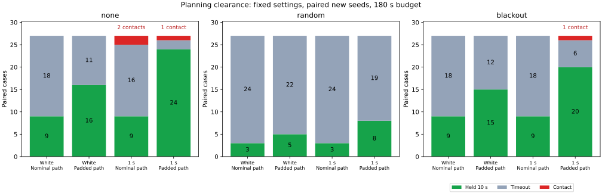

# 計画経路の障害物余裕を広げる比較

同じ刻み幅0.125・同じ停止ガードで計画半径を0.5から0.99に増やすと、新しいシード241〜243の10秒保持は42/162件から88/162件に増えました。接触は両群とも2件です。経路の余裕には保持率を改善する効果が見られましたが、接触を防ぐ条件としては十分ではありませんでした。比較オプションと再実行手順を保存し、既定の入力・制御は変更しません。

## 経路の生成と幾何監査

元の障害物CSV・開始点・目標点を使い、既存のA*・JPS・Theta*で4設定×9経路を生成しました。全36件で経路を取得でき、JPSのフォールバックはありませんでした。計画失敗を別の経路で補う処理はありません。

刻み幅1の地図では、計画半径0.5と0.9で障害物の格子点集合が変わらず、生成経路も同じでした。Theta*の連続した経路線分は、設定した0.9より障害物に近い場所を通っています。格子点への障害物膨張と、経路線分の距離を区別する必要があります。

| 地図 | 計画器 | 刻み1・半径0.5 | 刻み1・半径0.9 | 刻み0.125・半径0.5 | 刻み0.125・半径0.99 |
|---|---|---:|---:|---:|---:|
| dense | A* | 1.00000 | 1.00000 | 0.55902 | 1.00000 |
| dense | JPS | 1.00000 | 1.00000 | 0.55902 | 1.00000 |
| dense | Theta* | 0.78784 | 0.78784 | 0.53528 | 1.00000 |
| maze | A* | 1.00000 | 1.00000 | 0.55902 | 1.00000 |
| maze | JPS | 1.00000 | 1.00000 | 0.55902 | 1.00000 |
| maze | Theta* | 0.78087 | 0.78087 | 0.53184 | 1.00000 |

値は全経路線分から元の点障害物・地図境界までの最小距離です。open地図は全設定・全計画器で2.0でした。刻み0.125では、0.9に格子の半対角長約0.08839を加えた値を超える0.99を計画半径とし、さらに全線分の独立な距離計算で0.9以上を確認しました。この監査は今回の経路に対する実測であり、今後の任意の地図・経路への保証ではありません。

全経路と計画パラメータは [fixtures](fixtures)、監査値は [path-audit.csv](fixtures/path-audit.csv) に保存しました。半径を広げた分、denseの経路長はA*/JPSで67.543→72.230、Theta*で65.580→69.088に増えています。経路長だけでなく障害物との距離も比較しています。

## 同じ制御での走行比較

`guarded` は刻み0.125・計画半径0.5の経路、`clearance` は同じ刻み・半径0.99の経路を使います。両群とも既存の停止軌道予測ガードと観測欠落時の平均姿勢による復帰を使い、前回の補正整合性チェックは無効です。車体の物理半径0.5、速度、制動、操舵上限、180秒の上限、観測・乱数条件は同じです。真の姿勢は物理計算と評価にだけ使います。

成功は目標停止指令中の真の目標距離0.25未満・速度0.02以下を10秒連続で満たすことです。車体中心の移動線分と障害物の距離0.5以下は接触として即終了します。下表は新しいシード241〜243で、各行27件、値は `guarded → clearance` です。

| 局所ノイズ | 外部観測欠落 | 10秒保持 | 接触 | 時間切れ |
|---|---|---:|---:|---:|
| 独立 | なし | 9 → 16 | 0 → 0 | 18 → 11 |
| 独立 | ランダム | 3 → 5 | 0 → 0 | 24 → 22 |
| 独立 | 45〜75秒 | 9 → 15 | 0 → 0 | 18 → 12 |
| 相関1秒 | なし | 9 → 24 | 2 → 1 | 16 → 2 |
| 相関1秒 | ランダム | 3 → 8 | 0 → 0 | 24 → 19 |
| 相関1秒 | 45〜75秒 | 9 → 20 | 0 → 1 | 18 → 6 |

新規324件の対比較では、保持を46件獲得し、保持を喪失したケースはありませんでした。独立ノイズの保持は21/81→36/81、相関1秒は21/81→52/81です。相関1秒・欠落なしの平均ガード待機時間は111.55→21.48秒でした。待機時間は各試行の終了までの累計で、未達・接触も含めます。全件で地図外への逸脱はありません。

以前の刻み幅1の経路とは基準経路も変わるため、この結果を以前の制御案との直接比較には使えません。今回示せるのは、固定した微細格子と制御で計画半径を変えた効果です。新しい乱数シードは3個で、地図は既存のままです。同じ乱数を複数の経路・欠落条件で使うため、各ケースは独立した統計標本ではありません。

## 残った接触

新規シード243・相関1秒・maze・JPSでは7.90秒に接触しました。欠落なしと45〜75秒欠落の両条件に記録されていますが、欠落開始前であり、接触までの全軌跡・観測・制御は一致しています。独立した2事象ではありません。

停止ガードは7.38秒に作動し、その時点の真の移動線分の距離は0.73797、制動前速度は0.99941でした。7.90秒まで減速度1で制動し、速度は0.45941まで下がりましたが、距離0.49765で接触しています。操舵は発動時の値に固定されていました。接触時の計画経路からの偏差は0.50774です。経路自体の最小距離1.0は、追従中の車体の距離を保証しません。

この接触時の位置推定誤差0.31320は、位置に対する余裕0.34084より小さく、位置誤差の大小だけでは制動中の接触を説明できません。向きの推定誤差、将来の曲線軌道と制動余裕まで含めた安全条件は今回のガードでは確立していません。

参考シード234・相関1秒・欠落なし・dense・Theta*にも広い経路側の接触がありました。92.30秒時点の真の距離は0.49937、経路偏差0.57652、推定位置誤差0.44155でした。推定停止軌道の距離下限0.87920は設定余裕0.82884を上回り、そのステップではガードが作動していません。

接触の幾何再計算は [contacts.csv](contacts.csv)、広い経路側の接触付近は [contact-windows.csv](contact-windows.csv) に保存しました。

## 参考シードと検証

既知シード227・234は相関1秒で108件を別に実行しました。保持は欠落なし6/18→16/18、ランダム6/18→11/18、45〜75秒欠落6/18→14/18。接触は欠落なし2→1、他は両群0です。経路を再生成しているので、前回の接触軌跡の厳密な再実行ではありません。

- 全36計画経路について、開始・目標・格子整合性・長さ・全線分と全障害物の距離を独立に監査しました。再実行用の準備スクリプトでも同じ経路CSVを再生成できました。
- 全432走行ケースについて、時間・物理応答・乱数の対比較・停止と解除・保持/接触・サマリー整合性を検証しました。停止予測は計1,506地点で幾何再計算し、全7件の接触記録も真の移動線分から再計算しました。
- 格子に関する5テスト、経路出力exampleのClippy（警告をエラー扱い）、Rust整形とPython構文・整形チェックを通過しました。既存の再発進比較54件も新しい検証コードで再検証し、該当する保存済み結果と照合しました。集計ツールの旧モードは保存済みのCSV 3種類を完全に再現しました。

全走行結果は [all-results.csv](all-results.csv)、条件別集計は [summary.csv](summary.csv)、対比較は [paired-holds.csv](paired-holds.csv)、停止予測監査は [preview-audit.csv](preview-audit.csv) です。[sources.json](sources.json) は走行入力を制御案ごとにハッシュで記録し、[経路生成情報](fixtures/provenance.json) は計画器ソースと元入力を記録しています。走行シミュレータは前回と同じSHA-256 `25ed8c503317e78c9fa75185449e4f05ca8bfb77689fe7afed6b759c825a1870` です。

[実験README](../../README.md#planning-clearance-comparison) の準備・3走行・集計コマンドで再実行できます。生軌跡は実行先に生成し、このディレクトリには経路・集計・監査・着目した時間窓を保存しています。図の再生成だけMatplotlibが必要です。
