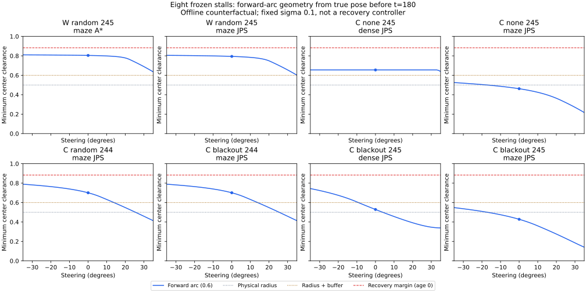

# 停止8例の前進弧と復帰余裕の診断

既知の停止8例では、真姿勢から前方0.6を進む固定操舵の弧に変えても、現在の復帰余裕を満たしませんでした。7例は始点だけで余裕不足です。残る1例も、−35〜35度の連続した固定操舵全体で通過できない上界を確認しました。一方、物理半径0.5だけなら全8例に通れる弧があります。「物理的に接触しない経路があること」と「既存の復帰条件を満たすこと」は異なります。

今回は保存済み記録の幾何解析です。制御、距離余裕、ノイズ設定は変更せず、新しい走行や保持成功率の比較も行っていません。

## 対象と評価方法

[停止診断](../recovery-stalls/report.md)で終盤30秒の移動距離が0.1未満だった8例を固定し、[同時復帰比較](../joint-recovery/report.md)の `joint` 群の軌跡を使いました。独立ノイズのseed245・2例と、相関1秒のseed244/245・6例です。全例が180秒で時間切れでした。

車体中心から前進距離0.6、ホイールベース0.4、操舵−35〜35度の1度刻み71本を調べました。円弧と点障害物・地図境界の最小距離を、始点、終点、円への射影、境界方向の極値から解析的に求めています。固定操舵の空間的な円弧であり、実際の0.02秒の数値積分、加減速、操舵の変化、ガード解除の時間条件を再実行したものではありません。

必要な距離は、物理半径0.5、追加余裕を含む0.6、既存の復帰余裕 `0.6 + 2√2×sigma + 0.02×観測年齢` を区別します。通常のsigma=0.1で観測年齢を0としても、復帰には0.88284を**超える**距離が必要です。真姿勢での評価もsigmaは0.1に固定し、誤差を取り除いた位置に同じ余裕を適用しています。

## 最終判断の真姿勢からの幾何

時刻180の判断直前、つまり179.98秒の物理状態を始点にしています。

| ノイズ・欠落 | seed・地図・計画器 | 始点 | 直進 | 弧の最大 | 全固定操舵の上界 |
|---|---|---:|---:|---:|---:|
| 独立・ランダム | 245・maze・A* | 0.81412 | 0.80422 | 0.81003 | 0.81412 |
| 独立・ランダム | 245・maze・JPS | 0.81270 | 0.79422 | 0.80505 | 0.81090 |
| 相関1秒・なし | 245・dense・JPS | 0.65493 | 0.65493 | 0.65493 | 0.65493 |
| 相関1秒・なし | 245・maze・JPS | 0.58995 | 0.46181 | 0.52510 | 0.53095 |
| 相関1秒・ランダム | 244・maze・JPS | 0.85018 | 0.70059 | 0.78873 | 0.79458 |
| 相関1秒・45〜75秒 | 244・maze・JPS | 0.85018 | 0.70059 | 0.78873 | 0.79458 |
| 相関1秒・45〜75秒 | 245・dense・JPS | 0.90889 | 0.52874 | 0.74397 | 0.74982 |
| 相関1秒・45〜75秒 | 245・maze・JPS | 0.66156 | 0.42780 | 0.54801 | 0.55387 |

「弧の最大」は71本で得られた最小距離の最大値、「全固定操舵の上界」はその間の操舵も含む最大値の上限です。すべて0.88284を下回ります。独立ノイズ・maze・A*の終了姿勢は今回の `joint` 群の値で、以前の `paced` 群の姿勢とはわずかに異なります。

青線が前進弧、青点が直進です。赤破線がsigma=0.1・観測年齢0の復帰余裕、灰色と茶色の点線が0.5と0.6です。Wは独立ノイズ、Cは相関1秒を示します。

全8例で、0.5を超える弧は見つかりました。0.6を超える弧は6例です。相関1秒・seed245・maze・JPSの欠落なしと45〜75秒欠落の2例は、全固定操舵の上界がそれぞれ0.53095と0.55387で、sigmaを0に置き換えても追加余裕0.1を残す同じ長さの固定操舵の弧では通りません。

始点が0.88284以内の7例は、始点を含むどの曲線でも同じ余裕を満たせません。始点だけは余裕を満たす相関1秒・45〜75秒欠落・seed245・dense・JPSも、最良の弧が0.74397、全固定操舵の上界が0.74982でした。直線を単に円弧に置き換える案では、この8例の復帰判定は解けません。

## 操舵格子の間を見落とさないための上界

曲率 `k = tan(delta)/0.4`、前進距離 `s` の円弧では、曲率に対する位置の変化率の大きさは `s²/2` 以下です。操舵に対する曲率の変化率は、この区間で `sec²(35°)/0.4` 以下です。任意の操舵から最寄りの格子までの差は0.5度以下なので、位置と最小距離の差は次で抑えられます。

`0.6²/2 × sec²(35°)/0.4 × radians(0.5) = 0.00585236`

最小距離は始点の距離も超えられません。この二つを合わせ、`min(始点距離, 格子の最大距離 + 0.00585236) + 1e-9` を連続した固定操舵全体の上界にしています。上界が必要余裕以下の場合だけ `all_fixed_steering_blocked` とします。格子の成功には余裕を1e-9より大きく超えることを要求し、そのどちらでもない場合は `unresolved` として断定を避けます。今回の評価では未確定は0件でした。

この上界は固定操舵・前進距離0.6という範囲のものです。途中で操舵を変える経路、短い移動、後退、再計画を排除する証明ではありません。

## 観測からは通れるように見える地点

終盤30秒の `150.5, 155.5, …, 175.5` 秒で、観測年齢が0.5秒、判断前の速度が0.02以下の地点を選びました。欠落や移動で条件を満たさない地点は除き、45地点になりました。真姿勢と再構成した観測姿勢を同じ地点で比較します。復帰用平均は同じ補正区間の静止観測が10点以上ある33地点だけに含め、観測1点を平均とは扱いません。

| 姿勢の種類 | 利用地点数 | 直進が余裕を満たす地点 | 弧のどれかが余裕を満たす地点 |
|---|---:|---:|---:|
| 真姿勢 | 45 | 0 | 0 |
| 観測姿勢 | 45 | 5 | 12 |
| 復帰用の平均姿勢 | 33 | 4 | 5 |

この表の余裕は観測年齢0・sigma=0.1の0.88284です。実際の年齢0.5秒を入れた0.89284でも、弧の通過地点数は観測姿勢12、平均姿勢5のままでした。平均姿勢の33地点は45地点の部分集合で、割合をそのまま比較する表ではありません。対応する真姿勢ではすべての固定操舵の弧が余裕を満たさないことを確認しました。

例えば相関1秒・45〜75秒欠落・seed245・dense・JPSの175.5秒では、平均姿勢からの最良角−27度の弧の距離は0.94575でした。同じ角度を真姿勢から調べると0.71024です。平均後にも位置誤差0.31870が残っていました。これは物理半径0.5での接触判定とは別の比較です。平均化や観測姿勢での操舵探索だけで、真の距離余裕を保証することはできません。

最終判断の観測姿勢8点では、いずれも通れる固定操舵の弧はありませんでした。180秒の補正で観測窓がリセットされるため、最終判断を10点以上の平均として扱った記録はありません。

## 検証と再計算

139姿勢で9,869本の格子の弧を求めました。最終判断の全格子と、新しい観測の地点での直進・最良角・記録された操舵の計1,519本を、独立した120分割の折れ線距離で照合しました。円弧と弦の差による最大誤差と1e-9の数値許容を検証条件とし、観測した最大差は約5.47×10⁻⁶でした。

幾何テスト8件は、既知の射影・端点距離、円の中心、地図境界での内部極値、左右旋回と角度の折り返し、ほぼ直線の数値計算、固定シードのランダムな弧、連続操舵の格子上界を確認しています。Pythonの整形・構文チェックも通過しました。各例の最後の30秒、全12,000物理区間の時刻と応答、終了目標距離・速度を保存結果と照合し、復帰用の平均観測窓も再構成しました。再実行で全CSVと実行情報が一致することを確認しています。

[READMEのコマンド](../../README.md#audit-forward-recovery-arcs-at-the-frozen-stalls)で再計算できます。生軌跡がなければ、前回の同時復帰比較の既知例2走行を再生成します。集計は [summary.csv](summary.csv)、各姿勢と余裕は [checkpoints.csv](checkpoints.csv)、全格子は [steering-grid.csv](steering-grid.csv)、独立検証は [geometry-audit.csv](geometry-audit.csv) にあります。[sources.json](sources.json) には入力、軌跡、解析コードと補助コード、対象選択のハッシュを保存しました。

CSVのsigma上限は、現在の真姿勢を固定したまま余裕式を逆算した値です。実際にその精度の観測が得られること、sigmaの設定値だけを下げてよいこと、到達できることを示すものではありません。この8例は失敗を見て選んだ既知例です。終了時と選んだ終盤の地点の結果を全走行の原因へ広げることはできません。
