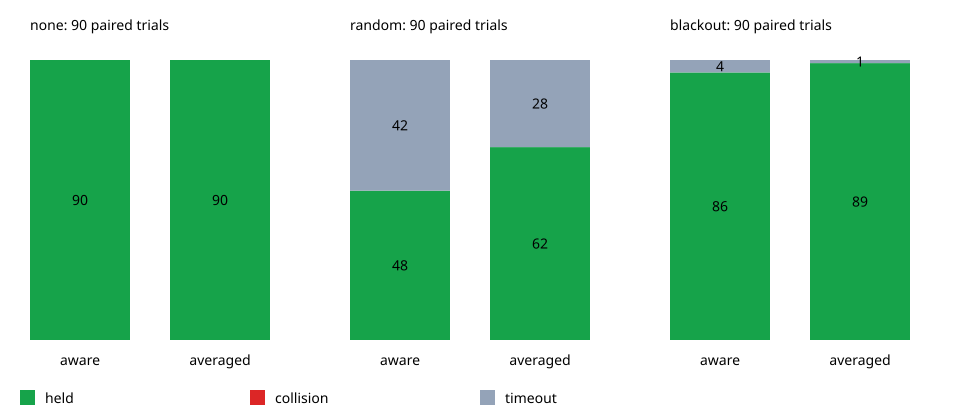
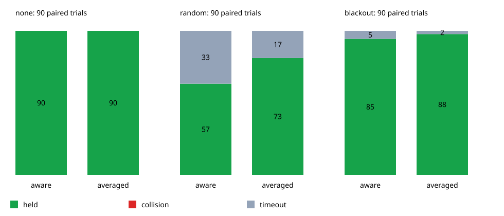

# Averaging stationary pose estimates before resuming

Averaging the recovery pose increased successful holds in both the reference
seeds and the new-seed evaluation, with no observed contacts in either arm.
The setting was fixed before evaluating seeds 211–220. The maps are unchanged.

| Cohort | Availability | Recovery check | Held 10 s | Contact | Timeout | Mean paused time (s) |
|---|---|---|---:|---:|---:|---:|
| reference | none | aware | 90/90 | 0 | 0 | 0.00 |
| reference | none | averaged | 90/90 | 0 | 0 | 0.00 |
| reference | random | aware | 48/90 | 0 | 42 | 79.91 |
| reference | random | averaged | 62/90 | 0 | 28 | 65.33 |
| reference | blackout | aware | 86/90 | 0 | 4 | 37.44 |
| reference | blackout | averaged | 89/90 | 0 | 1 | 32.43 |
| validation | none | aware | 90/90 | 0 | 0 | 0.00 |
| validation | none | averaged | 90/90 | 0 | 0 | 0.00 |
| validation | random | aware | 57/90 | 0 | 33 | 78.35 |
| validation | random | averaged | 73/90 | 0 | 17 | 58.99 |
| validation | blackout | aware | 85/90 | 0 | 5 | 39.11 |
| validation | blackout | averaged | 88/90 | 0 | 2 | 34.58 |

`reference` uses seeds 201–210; `validation` uses new seeds 211–220. Each cohort
has 540 cases (three maps × three planners × ten seeds × three availability
conditions × two recovery policies). Mean paused time includes successful and
unsuccessful cases, within the same 180 s budget.

For random loss, the paired comparison gained 14 successful cases in the
reference cohort and 16 in validation. For the blackout it gained three in
each cohort. No previously successful case became unsuccessful. All 1,080
cases had no contacts or out-of-bounds outcomes. Without observation loss,
the two policies produce identical case summaries.





## What changed and why

The original random-loss policy timed out in 42 of 90 cases. Of those, 39 were
on maps with interior obstacles, and 20 never resumed. Noisy instantaneous
pose estimates repeatedly interrupted the one-second clearance confirmation.
Some other cases resumed repeatedly but exhausted the time budget; averaging
does not remove the cost of actual observation loss or the restart speed cap.

The optional `averaged` arm replaces only the pose used for recovery clearance
and boundary checks. It averages at most 25 stationary measurements (0.5 s),
using a circular mean for yaw, and requires ten samples before confirmation.
A correction, missed scheduled observation, motion above 0.02, or observation
age above 1.5 s clears the window. Samples never span a correction/bias reset.
The original distance margin, 1.5 s age limit, one-second confirmation, bounded
braking, restart speed cap, and true ten-second hold criterion remain fixed.
The original `baseline`/`aware` comparison remains the default runner mode.

Independent measurement noise every 0.02 s is an assumption of this model.
Averaging cannot remove shared correction residuals or bias; the uncertainty
margin is not reduced. Correlated noise, new maps, hardware, and actual sensor
processing have not been evaluated. The 17 random-loss timeouts in validation
also show that mission completion remains imperfect. These observations do
not establish a safety guarantee.

## Reproduce and verify

From the repository root:

```bash
python3 experiments/pose_observation_loss/run.py --recovery-comparison
python3 experiments/pose_observation_loss/run.py --recovery-comparison \
  --seeds 211 212 213 214 215 216 217 218 219 220
```

The verifier passed all 1,080 cases, checking observation availability/age,
paired latent white noise and correction residuals, window resets and measured
sample provenance, circular averaging, warmup, resume evidence, motion/braking,
RMS, clearance summaries, and true hold conditions. All 270 reference `aware`
rows match the previous recorded experiment exactly. The original runner mode
also passed its 54-case seed-201 regression check.

Formatting, control-crate Clippy for all targets with warnings denied, and the
three headless Pure Pursuit library tests passed. The broader workspace suite
was run for the preceding merge; it was not rerun for this example-only change.

Case summaries, event counts, SVG plots, and source/input hashes are preserved
in the `reference-*` and `validation-*` files beside this report. Raw trajectories
are generated by the runner and are not committed. The tested checkout was
based on commit `2078bd8b073094a46ae2bfb062f4a52a3da9c963` with the example changes
present; the provenance files record that dirty state and the simulator hash.
