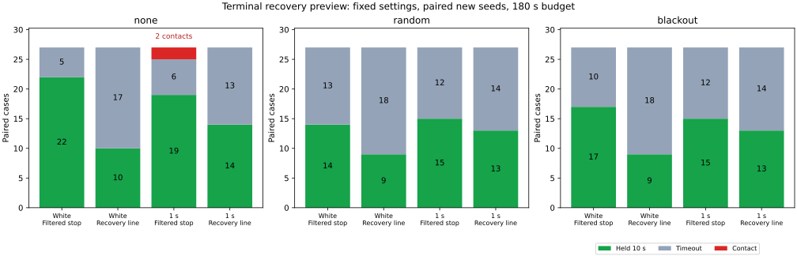

# 予測停止点からの復帰直線を加える比較

平滑化した停止予測に、予測停止点から前方0.6の復帰直線の確認を追加すると、新規シードの10秒保持成功は102/162から68/162に減りました。平均待機は65.48→109.40秒、短い再発動は17→237回に増えています。接触は2→0件でしたが、その2組も目標から遠いまま時間切れでした。この固定条件では改善を確認できず、追加条件は比較用オプションとして残し、既定にはしません。

## 比較する変更

[平滑化後の未完了例の診断](../filter-stalls/report.md)では、静止待機の19例中17例が、終了時の真の位置でガード解除や復帰の最小余裕を下回っていました。今回は停止位置が復帰条件を満たせるかを先に確認する候補を、前の `filtered` と比較します。両群とも同じ移動補償した最大25観測の平均姿勢を使います。元の `joint` との比較ではありません。

停止予測は、平滑化姿勢から0.2秒の予定指令を適用し、操舵を保った制動で速度0.001以下になるまで進めます。候補 `recoverable` は、その終点と向きからさらに前方0.6の直線を調べます。直線は全障害物と地図境界に対して確認します。

`m = 0.5 + 2√2×sigma + 0.02×観測年齢`、停止軌道の距離を `Dstop`、終端の復帰直線の距離を `Drecovery` とすると、条件は次のとおりです。

| 項目 | 従来の `filtered` | 復帰直線を加える `recoverable` |
|---|---|---|
| ガード開始を通過 | `Dstop > m` | `Dstop > m` かつ `Drecovery > m + 0.1` |
| ガード解除を通過 | `Dstop > m + 0.05` | `Dstop > m + 0.05` かつ `Drecovery > m + 0.15` |
| 単独解除・同時復帰の連続確認 | 0.5秒・1秒 | 同じ |

実装では `min(Dstop, Drecovery − 0.1)` をガードの判断値とし、従来の余裕とタイマーに渡しています。これは2つの領域を組み合わせた判断値で、1本の軌道の物理的な距離ではありません。開始・解除の両方に直線条件を加えており、早く制動する効果だけを分離した比較ではありません。

実際の欠落復帰は、従来の平均観測による前方直線と同時復帰条件も満たす必要があります。速度上限、姿勢平均の窓とリセット、ノイズの余裕、制動、車体半径0.5、10秒保持、180秒の制限は両群で共通です。予測姿勢や制御に真姿勢は使いません。ガードが実際に発動すると直ちに制動する一方、予測は元の0.2秒指令の区間を含むため、予測の終点が実際の停止位置と一致する保証もありません。

`RECOVERY_PREVIEW` は既定で無効で、`MOTION_FILTER=true` を要します。実装は実験用example内だけで、ライブラリの既定コントローラは変更していません。

## 保持と接触

3地図×3計画器×欠落3条件を、独立ノイズと相関1秒のノイズで比較しました。直線長、距離余裕、既知シード256〜258、新規259〜261は、今回の結果を見る前に固定しています。途中で閾値やシードを変えていません。各行は81組、各群81走行です。

| 対象・ノイズ | シード | 従来の保持 | 復帰直線群の保持 | 従来の接触 | 復帰直線群の接触 |
|---|---|---:|---:|---:|---:|
| 既知・独立 | 256〜258 | 49 | 27 | 0 | 0 |
| 既知・相関1秒 | 256〜258 | 51 | 43 | 0 | 0 |
| 新規・独立 | 259〜261 | 53 | 28 | 0 | 0 |
| 新規・相関1秒 | 259〜261 | 49 | 40 | 2 | 0 |

新規162組では保持の獲得0件・喪失34件、既知162組では獲得0件・喪失30件でした。全648走行で地図外への退出はなく、保持と下記2件の接触以外はすべて180秒の時間切れでした。

| 新規ノイズ | 欠落 | 従来の保持 / 27 | 復帰直線群の保持 / 27 |
|---|---|---:|---:|
| 独立 | なし | 22 | 10 |
| 独立 | ランダム | 14 | 9 |
| 独立 | 45〜75秒 | 17 | 9 |
| 相関1秒 | なし | 19 | 14 |
| 相関1秒 | ランダム | 15 | 13 |
| 相関1秒 | 45〜75秒 | 15 | 13 |

接触2件は、相関1秒・none・seed260のJPSでした。[contacts.csv](contacts.csv) に接触区間を独立に再計算した値を記録しています。

| 地図 | 従来の接触時刻 | 従来の最短距離 | 復帰直線群の最短距離 | 復帰直線群の移動 | 復帰直線群の終了目標距離 |
|---|---:|---:|---:|---:|---:|
| dense | 129.28秒 | 0.49994 | 0.97804 | 4.00312 | 62.06150 |
| maze | 128.94秒 | 0.49840 | 0.98790 | 6.10169 | 43.98842 |

復帰直線群は両組で接触せず時間切れでしたが、進行は限られています。接触0件だけを、到達や保持を改善した証拠とは扱いません。

## 待機と再発動

待機は欠落待機またはガードの指令区間の和集合です。重なりは1回だけ数え、目標停止だけの時間は加えません。制動中も含みます。「静止中の待機」は同じ和集合を判断前の測定速度の絶対値0.02以下に限定したものです。

| 対象・ノイズ | 従来の平均待機 | 復帰直線群の平均待機 | 従来の静止中の待機 | 復帰直線群の静止中の待機 |
|---|---:|---:|---:|---:|
| 既知・独立 | 73.36秒 | 115.74秒 | 72.00秒 | 111.91秒 |
| 既知・相関1秒 | 63.31秒 | 94.24秒 | 61.60秒 | 90.63秒 |
| 新規・独立 | 66.11秒 | 118.33秒 | 63.87秒 | 114.02秒 |
| 新規・相関1秒 | 64.85秒 | 100.46秒 | 62.46秒 | 95.99秒 |

新規例全体で平均待機65.48→109.40秒、静止中の待機63.16→105.01秒でした。時間切れかつ末尾30秒の移動0.1未満は31→75件に増えています。これは独立した失敗原因の分類ではありません。

短い再発動は、解除時の実指令速度が正、途中に欠落待機がなく、1秒以内かつ移動0.1未満で次のガードが始まる区間です。新規例全体で17→237回、既知例全体で21→184回に増えました。新規のガード開始636回中633回、既知601回中597回は、従来の停止距離条件を通過していて、追加直線だけが発動させたものでした。これらの分類は全開始地点で独立した正確な幾何と一致しています。

観測期間は各走行の終了までで、成功・接触・時間切れでは長さが異なります。成功には10秒保持も含まれます。待機時間や再発動数を、同じ時間窓での因果効果や単位時間あたりの率としては扱いません。

## 検証と再実行

4比較走行の全648ケースと、元の既定条件seed201・54ケースを検証しました。5走行のシミュレータハッシュは今回のソースと一致しています。

- 毎ステップの距離の組合せ、追加条件の有効フラグ、元の余裕、平滑化姿勢、速度上限、物理応答、対にしたノイズ・欠落、目標保持、ガード状態と両解除タイマーを照合しました。
- 既知シードの従来群162件は、前回の平滑化比較に保存した結果と全項目が一致しました。既定条件54件も保存結果に一致し、元からあるbaseline・blackoutの接触1件も同じでした。
- 復帰直線群の全ガード開始・解除・欠落復帰と固定地点を合わせた4,322地点で、停止軌道と終端直線、速度用の弧、実際の復帰直線の幾何を独立に再計算しました。欠落待機からの全復帰390回と、従来群の接触2区間も確認しています。
- exampleのRustテスト7件、既存のPure Pursuit関連4件、追加直線のPython幾何テスト5件、既存の区間・幾何・入力分解テスト19件が通過しました。Headless Releaseビルド、全ターゲットのClippy（警告をエラー扱い）、Rust/Python整形・構文チェックも通過しています。
- 集計を再実行し、全CSV、接触記録、実行情報のバイト単位の一致を確認しました。

[READMEの手順](../../README.md#compare-a-terminal-recovery-preview)で再実行できます。[all-results.csv](all-results.csv)、[summary.csv](summary.csv)、[paired-holds.csv](paired-holds.csv)、[control-events.csv](control-events.csv)、[preview-audit.csv](preview-audit.csv) に結果・集計・イベント・幾何を、[sources.json](sources.json) に入力・シード・実行情報を保存しました。生軌跡は再実行で生成します。図にはMatplotlibを使います。

シミュレータSHA-256は `c108d0e20cdac94d8cd2fe54125db1b426598e785af7700bbcc0819bd5abf7f1` です。移動補償の正確な測定速度・適用操舵・車体モデルへの依存、相関ノイズや共通バイアスの限界は前回と同じです。同じ3地図と少数シードの組合せを独立な統計標本とは扱えません。今回確認できたのは、予測停止点からの前方直線を開始・解除の両判定に追加するだけでは、保持を減らし、待機と再発動を増やしたことです。
