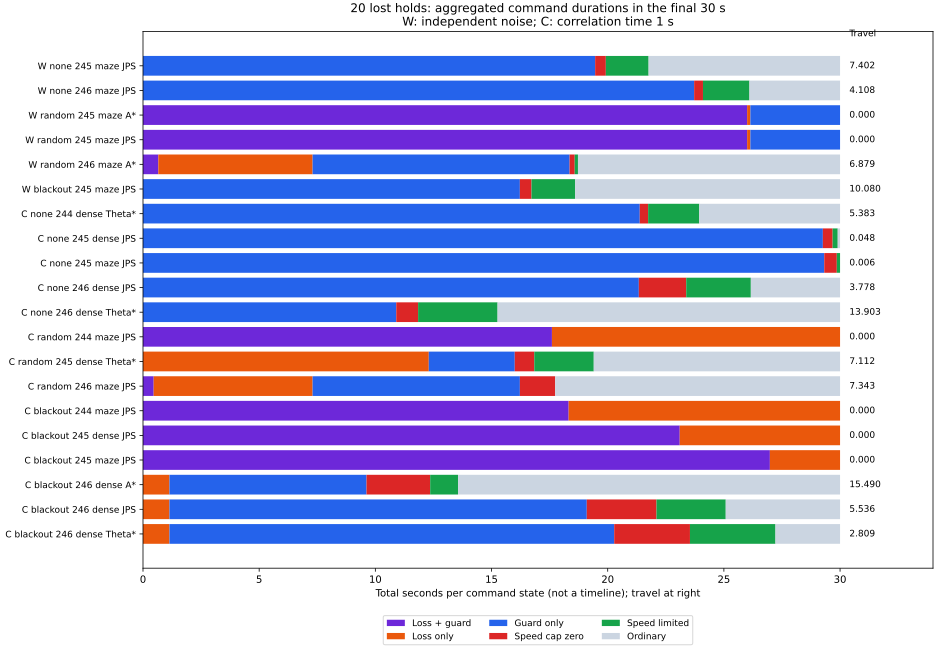

# 速度制限案で保持を失った20件の停止・復帰診断

前回の保持喪失20件は、同じ原因だけでは説明できません。終盤30秒の移動距離が0.1未満のケースは8件で、そのうち6件は欠落待機か停止ガードが30秒間ずっと残っていました。残る12件は終盤にも進んでいます。解除イベントを数えるだけでは、動けるようになったかどうかは判断できませんでした。

今回は既存の記録の解析です。制御や閾値は変更せず、新しいシードでの性能比較も行っていません。

## 対象と窓の定義

[前回の速度制限比較](../anticipatory-speed/report.md)の新規シード244〜246から、`clearance` が10秒保持に成功し、`paced` が失敗した20件を選びました。独立ノイズ6件、相関1秒14件です。すべて180秒で時間切れ、真の目標範囲への初回進入は記録されておらず、終了時の目標距離は4.40015〜58.67900でした。目標直前の10秒保持の失敗には分類されません。

`150 < t <= 180` の各ケース1,500区間を調べました。移動距離は各区間の真の車体中心の変位を合計し、始点と終点の直線距離には置き換えていません。「ほぼ移動なし」はこの合計が0.1未満という診断上の分類です。

| ノイズ | 保持喪失 | ほぼ移動なし | 待機・ガードが全30秒を覆う | 終了位置が最小ガード解除余裕以内 |
|---|---:|---:|---:|---:|
| 独立 | 6 | 2 | 2 | 2 |
| 相関1秒 | 14 | 6 | 4 | 5 |
| 合計 | 20 | 8 | 6 | 7 |

これらは同じケースを異なる条件で数えた列で、排他的な原因分類ではありません。ほぼ移動のなかった8件以外にも、終了時だけガード余裕以内になったケースがあります。

棒は指令状態の合計時間で、左から時系列を示す図ではありません。欠落待機・ガードの状態には制動中も含み、静止時間とは異なります。右の数値は実移動距離です。全ケースの値は [lost-holds.csv](lost-holds.csv)、条件別集計は [summary.csv](summary.csv) に保存しました。

## 解除しても動けない例

独立ノイズ・ランダム欠落・seed245・maze・JPSでは、終盤30秒の記録上の移動距離は0でした。

| 時刻 | 起きたイベント | ガード | 欠落待機 | 名目目標速度 |
|---|---|---|---|---:|
| 175.68 | ガード解除 | 無効 | 有効 | 0 |
| 176.16 | 欠落待機から復帰 | 有効 | 無効 | 0.4 |

ガード解除時には欠落待機が残り、欠落待機から復帰した時点ではガードが再び有効でした。30秒間の全1,500判断で、少なくとも片方が有効です。同じシード・欠落条件のmaze・A*にも同じ解除・復帰の組合せがありました。

20件全体の窓内ではガード解除71回のうち23回が欠落待機中、32回が名目目標速度0での解除でした。欠落待機からの復帰11回のうち3回ではガードが有効でした。これらの数え方は重なりを含み、解除数を移動再開数とは扱っていません。

全ケースで、受信から1.5秒以内の観測を使える区間は窓内に7.60秒以上ありました。継続確認を要する二つの停止条件と、その時点の幾何条件を合わせて評価する必要があります。`guard_ready` と `recovery_ready` は瞬間の条件であり、0.5秒・1秒の連続確認やラッチ解除を意味しません。

## 終了姿勢で余裕を固定した幾何評価

停止予測には現在の位置も含まれます。したがって予測経路の最小距離は、現在位置の距離を上回れません。通常のsigma=0.1、観測経過時間0でも、ガード解除には `0.5 + 2√2×0.1 + 0.05 = 0.83284` を超える距離が必要です。20件中7件の終了位置はこの値以内でした。位置を真値に置き換えても、余裕を固定した同じ解除条件では、その位置からの予測は通りません。

欠落待機からの復帰では前方0.6の直線に、最小でも `0.6 + 2√2×0.1 = 0.88284` の余裕を要求します。ほぼ移動しなかった8件はすべて、終了時の真位置・真の向きでこの直線を調べても条件を満たしませんでした。

| ノイズ・欠落 | seed・地図・計画器 | 終了位置の距離 | 真姿勢からの前方0.6の距離 |
|---|---|---:|---:|
| 独立・ランダム | 245・maze・A* | 0.81381 | 0.81381 |
| 独立・ランダム | 245・maze・JPS | 0.81270 | 0.79422 |
| 相関1秒・なし | 245・dense・JPS | 0.65493 | 0.65493 |
| 相関1秒・なし | 245・maze・JPS | 0.58995 | 0.46181 |
| 相関1秒・ランダム | 244・maze・JPS | 0.85018 | 0.70059 |
| 相関1秒・45〜75秒欠落 | 244・maze・JPS | 0.85018 | 0.70059 |
| 相関1秒・45〜75秒欠落 | 245・dense・JPS | 0.90889 | 0.52874 |
| 相関1秒・45〜75秒欠落 | 245・maze・JPS | 0.66156 | 0.42780 |

この評価では観測の誤差だけを除き、sigmaと距離余裕は固定しています。精度改善に合わせて余裕を変える制御の評価ではありません。また現在の向きの直線を検査した結果であり、別の操舵でも動けないという結論ではありません。直線の距離が物理半径0.5以下になる例も2件あり、一律の待機解除や余裕の緩和が安全かどうかは、この解析からは判断できません。

## 再計算と限界

全30,000区間の時間間隔と物理応答、指令状態の合計30秒を照合しました。全解除イベント、観測年齢0.5秒で静止中の判断、最終判断の計196地点で、復帰用の線分距離と必要な余裕を再計算しています。記録された復帰距離との一致、停止予測の距離下限が始点の距離以下であることも確認しました。

判断地点は [checkpoints.csv](checkpoints.csv)、入力結果・軌跡のハッシュと元の実行情報は [sources.json](sources.json) にあります。元の結果サマリー、シミュレータ、両群の経路ハッシュが記録済みの研究と一致することを解析時に要求します。Pythonの構文・整形チェックと再実行でのCSV一致も確認しました。

[実験README](../../README.md#diagnose-lost-holds-and-interacting-recovery-gates) のコマンドで再計算できます。生軌跡がなければ前回の独立・相関ノイズの2走行を同じ入力とシードで生成します。図の生成だけMatplotlibが必要です。

この20件は失敗を見て選んだ同じ地図・同じ3シードの事後解析で、独立した統計標本でも新しい制御の検証でもありません。終了時点の幾何条件を全180秒の原因に広げることはできません。次の制御比較では、解除イベントに加えて、複数の待機条件が同時に解けて実際に進めることと、その再開軌道を検証する必要があります。
