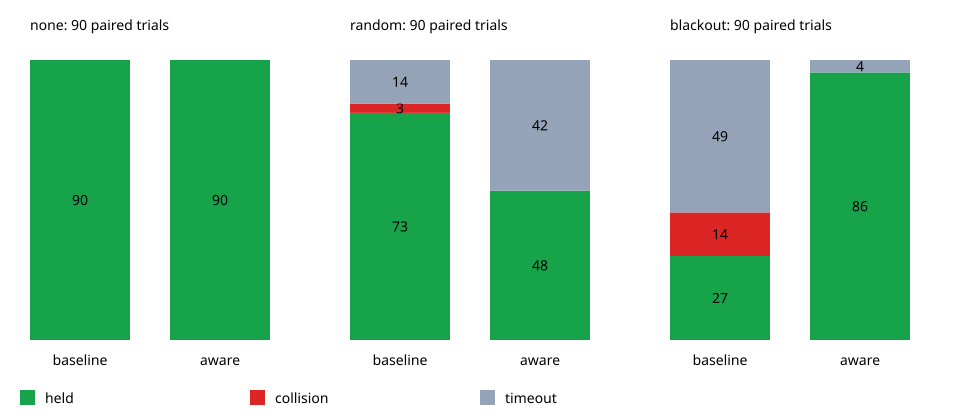

# Recorded pose-observation loss experiment

The candidate pause/recovery policy eliminated contacts in these paired
simulation fixtures. It improved completion during a single 30 s blackout,
while repeated random losses caused substantially more waiting and timeouts.
Each row is the same three maps × three planners × seeds 201–210 (90 cases).

| External observations | Controller | Held for 10 s | Contacts | Timeout | Out of bounds |
|---|---|---:|---:|---:|---:|
| Available | Baseline | 90/90 | 0 | 0 | 0 |
| Available | Pause/recovery | 90/90 | 0 | 0 | 0 |
| 30% random block loss | Baseline | 73/90 | 3 | 14 | 0 |
| 30% random block loss | Pause/recovery | 48/90 | 0 | 42 | 0 |
| Blackout at 45–75 s | Baseline | 27/90 | 14 | 49 | 0 |
| Blackout at 45–75 s | Pause/recovery | 86/90 | 0 | 4 | 0 |

Successful holding requires the goal stop latch, true distance <0.25, and true
speed ≤0.02 for ten consecutive seconds. Contact takes priority over arrival.
Both controllers use the same 180 s budget and collision radius 0.5.
Waiting and safely passing through the goal do not count as successful holding.

The baseline keeps tracking during lost external corrections. The candidate
brakes on a missed scheduled correction and waits for a fresh observation,
low measured speed, and a clear estimated forward segment for one second.
It resets the path cursor on a received correction while paused and limits
speed to 0.4 for five seconds after resuming. See the
[model and reproducible commands](../README.md) for the exact policy.

These seeds were also used in earlier experiments. The policy has not been
validated on unseen maps/seeds or hardware. Local pose estimates remain
available during loss; speed is measured exactly; terminal precision is an
idealized assumption. The straight preview and heuristic uncertainty margin
are not a stopping-trajectory planner or safety guarantee. The random-loss
result demonstrates why reduced contact alone does not establish mission
reliability.

## Validation and provenance

Workspace validation passed: `cargo fmt --all -- --check`, workspace Clippy
with warnings denied, and the workspace build. Workspace tests passed 1,481
cases with 73 existing ignored cases; the headless Pure Pursuit tests passed
all three cases.

The complete native Cargo run covers 540 cases. The verifier checks all 270
pause/recovery trajectories against their corresponding baseline noise and
availability streams, and checks timing, finite values, braking/motion,
pause/resume evidence, observation age, RMS, minimum-clearance summaries,
and true hold conditions. No-loss outputs are identical for both controllers.
All 270 baseline result rows match the previous observation-loss and terminal
precision experiments exactly. The final run also checks all 540 result rows
against the initial portable run's recorded snapshot.

- [all-results.csv](all-results.csv): all 540 case summaries.
- [summary.csv](summary.csv): the table above.
- [control-events.csv](control-events.csv): pause/resume counts and wait time.
- [provenance.json](provenance.json): UTC time, toolchain, base commit, dirty
  state, and SHA-256 hashes of the simulator and input fixtures.

Raw trajectories are regenerated by the runner and are not committed.
The simulator and fixture hashes identify this experiment even when it is
run from a checkout with uncommitted documentation/results. The input paths
were generated at commit `594185e52c9c570090fe5a55f2b69551825fe03d`.
