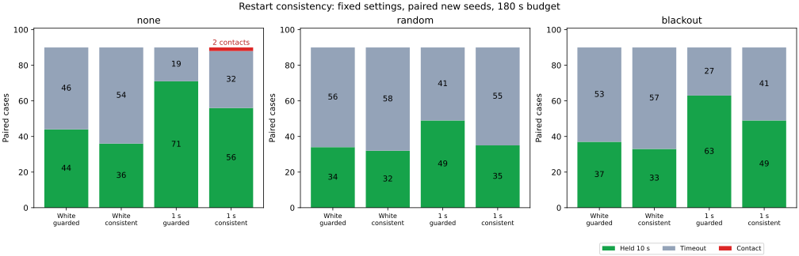

# 再発進前の停止観測・補正整合性チェック

補正前後の停止観測を確認する新案 `consistent` は、前回の接触例を回避した一方、新しいシードでは接触を増やし、目標保持も減らしました。既定の制御には採用せず、再実行できる比較オプションと反例として保存します。

## 固定した比較条件

比較対象は前回の停止軌道予測ガード `guarded`。新案は、ガード中の予定補正前25点と補正後10〜25点の位置平均・向きの円周平均を比較します。位置差0.2以下、向きの差5度以下、補正後1.5秒以内を要求し、条件を満たす間だけ補正後の平均姿勢で停止軌道を予測します。既存の速度0.02以下・距離余裕に追加0.05・0.5秒連続確認も必要です。

走行中とガード開始時には従来どおり瞬間の推定姿勢を使います。移動、欠落補正、終端精密化、ガード解除後には比較を無効にし、新しい停止観測を必要とします。停止ガードと観測欠落による待機は別の条件であり、片方の解除が発進を意味するとは限りません。この比較は「補正の整合性確認」と「解除判断に使う姿勢の平均化」を合わせた変更で、各効果は分離していません。

3地図×3経路、上限180秒、半径0.5、速度・減速度、観測モデル、ノイズと欠落の乱数系列は同じです。成功は真の目標距離0.25未満・速度0.02以下・目標停止指令中の10秒連続保持です。接触は車体中心の移動線分と障害物の距離0.5以下で即終了します。真の姿勢・推定誤差は評価にだけ使用します。

## 新しいシード231〜240

設定を固定してから、独立ノイズと相関時間1秒のそれぞれで540件、計1,080件を比較しました。各表のセルは `guarded → consistent`、各行は同じ90件です。

| 局所ノイズ | 外部観測欠落 | 10秒保持 | 接触 | 時間切れ |
|---|---|---:|---:|---:|
| 独立 | なし | 44 → 36 | 0 → 0 | 46 → 54 |
| 独立 | ランダム | 34 → 32 | 0 → 0 | 56 → 58 |
| 独立 | 45〜75秒 | 37 → 33 | 0 → 0 | 53 → 57 |
| 相関1秒 | なし | 71 → 56 | 0 → 2 | 19 → 32 |
| 相関1秒 | ランダム | 49 → 35 | 0 → 0 | 41 → 55 |
| 相関1秒 | 45〜75秒 | 63 → 49 | 0 → 0 | 27 → 41 |

合計では10秒保持が298/540から241/540へ減り、接触は0/540から2/540へ増えました。全件で地図外への逸脱はありません。独立ノイズでは保持が115から101、相関1秒では183から140に減っています。停止待機による時間切れを到達として数えていません。

対比較では保持を新たに獲得したケースが9件、喪失したケースが66件でした。相関1秒・欠落なしの平均ガード待機時間は42.00秒から69.96秒に増えています。待機時間は各試行の終了までの累計で、未達・接触例も含みます。

全ケースの結果は [all-results.csv](all-results.csv)、条件別件数と平均待機時間は [summary.csv](summary.csv)、保持を獲得・喪失した対比較は [paired-holds.csv](paired-holds.csv)、停止イベント集計は [control-events.csv](control-events.csv) に記録しています。同じシード・ノイズを複数経路で使うため、各ケースは独立した統計標本ではありません。

## 新たな接触の反例

相関1秒・外部観測欠落なし・シード234の dense_50x50、A*とJPSで、91.78秒に接触しました。接触までの両ケースの物理状態・制御・観測記録は一致しており、独立した2事象ではありません。

最後のガード解除は85.66秒。補正後0.66秒、補正前後の平均位置差0.06921、向きの差約1.764度で、予測に使った姿勢の真の誤差は0.12534でした。解除条件を満たした時点で大きな位置誤差があった例ではありません。

その後90秒に新しい補正を受け、91.78秒の接触時には瞬間の推定位置誤差が0.55699に増えていました。推定停止軌道の距離下限1.05682は設定余裕0.81844を上回る一方、真の移動線分と障害物の距離は0.49807でした。ガードはこのステップで発動していません。再発進前の観測確認だけでは、走行中に生じる誤差を抑えられませんでした。

比較対象の `guarded` は両ケースとも接触せず時間切れで、最小距離は0.66587でした。新案の軌跡が前進した結果、後の推定誤差による接触を新たに経験しています。平均化や補正間の一致を、走行中の誤差上限と解釈できません。

接触の幾何再計算は [contacts.csv](contacts.csv)、解除・途中の補正・接触付近の記録は [new-contact-windows.csv](new-contact-windows.csv) を参照してください。

## 前回のシード227

既知の相関1秒・欠落なし・maze_50x50・Theta*の接触は、新案では起きませんでした。ただし180秒で時間切れです。終了時の目標距離0.00336だけでは、10秒保持の成功条件を満たしたことにはなりません。最小距離は従来の0.49906から0.61959になりました。

同じシードの各欠落条件9件では、保持が欠落なし6→4、ランダム4→4、45〜75秒欠落7→5。接触は欠落なし1→0、他は両方0でした。この既知例54件は新しいシードの表には含めていません。ガード発動・解除の推移は [reference-events.csv](reference-events.csv) に保存しました。

## 検証

- 既知例54件と新規1,080件について、全軌跡の時間・物理応答・観測乱数の対比較・停止と解除・目標保持・集計値の整合性を検証しました。補正前後の窓、平均姿勢、期限、解除の連続確認も観測ログから再構成しています。
- 新案567件の停止予測を計4,059地点で幾何再計算しました。距離下限と閾値判定を照合し、既知例の1件と新規2件の全接触を真の移動線分から独立に再計算しました。[preview-audit.csv](preview-audit.csv) に全監査地点を記録しています。
- シード227の比較対象27件は、前回の保存済みサマリーと全項目が一致しました。旧設定の独立ノイズ・シード201も54件を実行し、保存済み結果との回帰検証を通過しました。集計ツールの旧モードも既存CSV 3種類を完全再現しました。
- `cargo fmt --all -- --check`、制御crateの全ターゲットClippy（警告をエラー扱い）、関連4テスト、ヘッドレスのrelease exampleビルド、Python構文・整形チェックを通過しました。

実行情報は [sources.json](sources.json) に保存しました。実行時の基点は `99b4d7b`、開発中の差分を含むため `dirty: true` です。全実行のシミュレータSHA-256は最終ソースと一致する `25ed8c503317e78c9fa75185449e4f05ca8bfb77689fe7afed6b759c825a1870` です。接触・時間切れを含む実験結果のデータ検証が通ったという意味であり、全試行が目標保持に成功したという意味ではありません。

## 再実行と解釈

[実験README](../../README.md#stationary-correction-consistency-before-restart) の3コマンドと集計コマンドで、既知例54件と新規1,080件を再実行できます。軌跡は実行先に生成し、ここには集計、監査結果、着目した時間窓を保存しています。図の生成だけMatplotlibが必要です。

補正前後で共通する偏りは検出できず、誤った古い推定を正す有用な補正を拒む可能性もあります。相関ノイズの平均化から独立標本と同じ誤差縮小は仮定していません。この条件では、保持率も接触件数も改善したとは判断できません。実機・EKF・全センサー欠落や確率的な安全保証を検証した結果ではありません。
