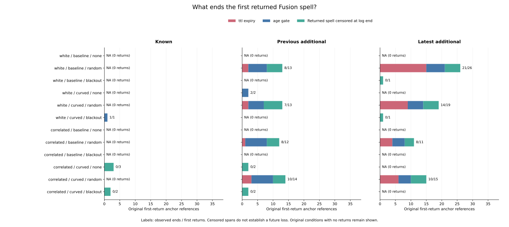
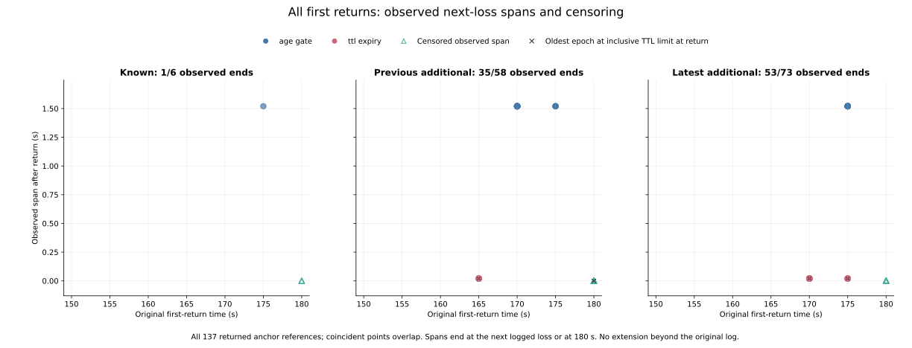

# Why the first returned Fusion spell ends

All 89 observed ends of the previously fixed first returned spells have native
operation evidence: **42 end after 20 ms by TTL expiry, and 47 end after 1.52 s
by the observation-age gate**. The other 48 first returns occur at the original
180 s endpoint and have no subsequent observed span. Their future end is unknown.
The [protocol](protocol.md) was committed as `9c4d9b2` from main `96418e8` before
examining new endpoint operation, age and next-receipt comparisons.

This audit follows all 137 preceding first returns, preserving the 152 original
observed-loss anchors and all 3,997 original census anchors. It retains 972
planned cases, 324 families, all 570 timeout histories and the original 10,995
RP records in 157 parent cases. Full identities include loss mode. No new
rollout, RP selection, retention setting, controller behavior or error label
is introduced.

## Complete follow-up accounting

| Partition | Original observed losses | First returns | Observed next losses | Returned spell censored | No return by log end |
|---|---:|---:|---:|---:|---:|
| Known | 11 | 6 | 1 | 5 | 5 |
| Previous additional | 65 | 58 | 35 | 23 | 7 |
| Latest additional | 76 | 73 | 53 | 20 | 3 |
| Total | 152 | 137 | 89 | 48 | 15 |

The 137 returned-anchor references belong to 95 distinct full cases. Their
89 observed next losses belong to 55 cases; the 48 censored returned spells
belong to 48 cases. Cases can have multiple anchors and can appear in both
ended and censored groups. These references are not independent replications.
The 15 episodes without a return preserve their original censoring lower
bounds, separate from observed return waits. The 18 original TTL-limit anchors
without a next logged checkpoint remain outside the observed-loss denominator.

All 36 original cohort/noise/arm/mode conditions remain shown, including empty
conditions. Every summary retains all nine possible end operations, even when
unobserved. Across these fixed anchors, known has one age-gate end; previous
additional has eight TTL and 27 age-gate ends; latest additional has 34 TTL and
19 age-gate ends. These are retrospective counts with unequal available
follow-up, not mode effects or eventual-loss probabilities.

## Two observed mechanisms

| Observed next-loss operation | Anchor references | Distinct cases | Observed span | Oldest TTL remaining at return | Age before -> after loss |
|---|---:|---:|---:|---:|---|
| TTL expiry | 42 | 34 | 0.02 s | 0 ms | 0 -> 0.02 s |
| Age gate | 47 | 47 | 1.52 s | 5,000 ms | 1.50 -> 1.52 s |

All 137 returns have logged observation age zero. The 42 TTL-ended spells
return with three retained groups and sample counts [25,25,1]. The oldest group
is exactly 15 s old and remains valid at that inclusive limit. At the next
20 ms checkpoint the native implementation expires that group, leaving two
groups with counts [25,2]. All 42 ends have expiry evidence, fail the three-group
predicate, and have no motion/precision clear, capacity eviction or age failure.
All were previously first lost through TTL expiry as well.

The 47 age-gate ends retain three groups with counts [25,25,25] on both sides
of the end. Logged age 1.50 s still permits Fusion; 1.52 s blocks it. There is
no clear, TTL expiry, capacity eviction, latest-epoch mismatch or insufficient
older-group sample count at those ends. Their preceding first-loss operations
were 44 TTL expiries and three motion clears: an initial loss and the end of a
later returned spell need not share an operation.

Both the TTL and age deadlines are explicitly conditional on unchanged history
and no new receipt. Every observed end matches its corresponding conditional
deadline and the saved operation evidence; a matching duration alone is not
used for classification. Among observed ends, raw and original all-census-mass
shares are 42/89 (47.1910%) TTL and 47/89 (52.8090%) age gate. Their equality
here does not change the original parent weighting rule. Other end operations
have observed zero shares; cells without observed ends have blank shares.

## Next received opportunities and endpoint censoring

For 70 of the 89 observed ends, a strictly later received census opportunity is
logged. In every one it is 5 s after the return, and the returned spell ends
before that receipt: 42 TTL ends after 20 ms and 28 age-gate ends after 1.52 s.
The remaining 19 age-gate ends have no later received opportunity in the log.
That absence describes the observed log, not the absence of all future receipts.
No observed end is at or after its next logged received opportunity.

All 48 censored returned spells start at 180 s and have zero subsequent
observed span. Eighteen have oldest remaining TTL zero and 30 have 5 s remaining.
Neither group has a subsequent logged end, operation, one-checkpoint label or
end-versus-next-received comparison. Conditional deadline values in their rows
do not turn into observations beyond 180 s. A zero-span censored spell is not
an observed zero-duration or one-checkpoint returned spell.

The preceding illustrative case `C0149` (latest correlated/baseline/random,
seed 278, maze JPS) shows both mechanisms with separate anchor references:

| Original anchor | Return | Retained epoch times | Next loss | Operation | Next logged receipt |
|---|---|---|---|---|---|
| 3705 | 170 s | 155;165;170 s | 170.02 s | TTL expiry | 175 s |
| 3708 | 175 s | 165;170;175 s | 176.52 s | Age gate | None logged |

Both returns have sample counts [25,25,1]. The same physical 170 s event is the
return for anchor 3705 and the immediate event of the later original loss
anchor 3708. The ledgers keep these roles and original weights separate.

## Saved artifacts and independent verification

[return-endpoints.csv](return-endpoints.csv) retains all 3,997 anchors and their
original parent measures. [snapshots.csv](snapshots.csv) saves 363 anchor/role
references at returns, consecutive before/after observed ends and censored log
endpoints. [group-history.csv](group-history.csv) saves all 1,047 retained group
references, including identities/counts, age and remaining TTL. Independent
predicate flags remain alongside ordered end-operation attribution.

[spell-summary.csv](spell-summary.csv) keeps 528 fixed cells over all original
cohort/noise/arm/mode and first-loss operation selectors, including empty cells
and planned/timeout/held counts. All-census and received-census weights each
close to 570 original case units; RP mass closes to 157. Exact Fraction masses
precede division and selection. Distinct case counts are excluded from additive
closure. Both implementations pass 9,540 additive mode/operation comparisons.

Collection reuses 108 exact native traces from the preceding committed evidence,
152,046,782 bytes of metadata cache. It does not reread raw logs. The standalone
verifier imports no analyzers, freshly hashes/reads all 108 original files
(6,043,185,194 bytes), and compiles unchanged original Rust observe/type/mean_pose/
VehicleState/test source slices. All six original Rust tests pass. Every one
of 5,130,000 timeout decisions matches raw availability/group count; every one
of 855,570 late points is requested. Every freshly generated native trace is
byte-identical to its frozen cache hash.

Independent maximal runs recover first returned spells without collector-selected
endpoints. Separate logic reconstructs gates, deadlines, opportunity joins,
groups, exact masses, summaries and all numeric plot values. The
[independent evidence](independent-verification.json) records **410,271 new field
comparisons**, 347,739 preceding anchor/join comparisons and 71,946 original
census-join comparisons, plus input/helper/source/protocol/plot/native hashes.
Rust 1.99.0 uses `--edition=2021 -O` with active assertions. Dummy zero pose and
steering restrict replay to metadata; fused positions are ignored. This does
not validate pose errors or replay controller trajectories.

All **866 Python tests** pass, including 19 new tests for inclusive TTL/age,
simultaneous gate evidence and attribution order, endpoint censoring, no-return
bounds, strict opportunity joins, missing receipts, repeated anchors, case/grid
isolation, cache tampering, fixed unequal parent measures, blank/zero shares,
closure and nonmutation. All five collector CSV/provenance artifacts and all
seven figure/export/provenance artifacts repeat byte for byte. Both figures
were inspected. Source manifest SHA-256:
`e251852bc1bc8c1f2f1f974acaeaaf5660fb0be8b15f16eabd95b3fd3bdf914b`.

See the [README](../../README.md#why-the-first-returned-fusion-spell-ends) for
commands and cache reconstruction. Historical held goals remain 140->140 and
latest 62->60. These selected sequences add no AUC, cutoff, retention tuning,
new live outcome, independent-trial estimate or causal controller benefit.
