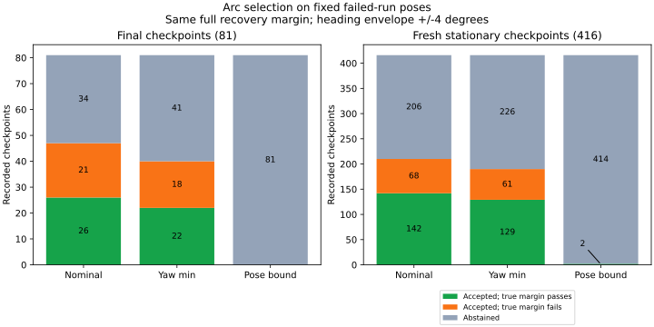

# 観測誤差を見込んだ前進弧の選択

向きの誤差±4度を見込む選択では、真姿勢で復帰余裕を満たさない選択が計89→79地点に減りました。一方、真姿勢でも余裕を満たす選択は168→151地点に減りました。位置誤差の分まで距離から差し引く方式は497地点中2地点だけを通過と判定しました。今回の固定条件では、食い違いの減少と引き換えに多くの候補を見送っており、制御への採用を支持する改善は確認できません。

[前回の弧の診断](../aligned-arcs/report.md)で保存した497組の姿勢を使う、固定した失敗走行上の比較です。新規の検証走行ではありません。終了判断81組と、観測年齢0.5秒・判断前速度の絶対値0.02以下の416組を別々に集計しました。元の走行はseed265〜267の独立ノイズ44例・相関1秒37例です。同じ走行の複数地点や、異なる欠測条件で同じ姿勢になる地点も含み、地点数を独立な試行数とは扱いません。

## 先に固定した規則

[比較条件](protocol.md)を解析前に固定しました。弧の長さ0.6、ホイールベース0.4、操舵−35〜35度の1度刻み、地図は前回と同じです。真姿勢側の判定にも、観測のsigmaと年齢を含む従来の余裕を維持します。

`E = 2√2 × sigma + 0.02 × age`、`M = 0.6 + E`

全地点でsigmaは0.1です。観測年齢0.5秒ならEは0.29284、通過目標Mは0.89284です。各方式のスコアがMを1e-9より大きく超える場合に通過と判定します。

| 方式 | 角度の選び方 | 通過判定のスコア |
|---|---|---|
| nominal | 平滑化姿勢の中心の向きで距離最大 | その距離 |
| yaw_min | 向きを±4度の範囲で変えた距離の下界を最大化 | 向きの範囲全体の距離下界 |
| pose_bound | yaw_minと同じ角度 | 向きの距離下界からさらにEを引く |

向きは−4〜4度を1度刻みで評価します。格子間の向きも覆うため、最小距離から `2×0.6×sin(radians(0.5)/2) = 0.00523597` を引きます。長さ0.6の弧の各点は始点から0.6以内なので、最寄りの向き格子までの回転による点の移動量がこの値以下になります。障害物と壁への距離も同じ量以内しか変わりません。

さらに、位置の誤差がE以下なら距離の減少はE以下です。このため、位置誤差がE以内かつ向き誤差が±4度以内という条件付きで、pose_boundのスコアは同じ操舵の真姿勢での距離を下から抑えます。±4度は仮定した範囲で、ガウス分布や相関・平滑化された姿勢の確率保証ではありません。

pose_boundは、真姿勢で要求するMにも位置誤差分Eを残したうえで、予測する距離からもEを差し引きます。この追加の慎重さを含む条件を固定して比較し、結果を見て余裕を緩めていません。真姿勢は選択・通過判定に使わず、事後の評価と誤差範囲の確認にだけ使います。

## 通過判定と見送り

「真姿勢で通過」は、その方式が通過と判定した同じ操舵が、真姿勢でもMを超える地点です。「食い違い」は通過と判定したものの真姿勢ではMを超えない地点です。物理半径との接触判定や、実行した結果の成否ではありません。

| 地点群 | 方式 | 通過判定 | 真姿勢でも通過 | 食い違い | 見送り | 見送りのうち真姿勢に通る格子弧あり |
|---|---|---:|---:|---:|---:|---:|
| 終了判断81組 | nominal | 47 | 26 | 21 | 34 | 21 |
| 終了判断81組 | yaw_min | 40 | 22 | 18 | 41 | 25 |
| 終了判断81組 | pose_bound | 0 | 0 | 0 | 81 | 53 |
| 鮮度確認416組 | nominal | 210 | 142 | 68 | 206 | 118 |
| 鮮度確認416組 | yaw_min | 190 | 129 | 61 | 226 | 133 |
| 鮮度確認416組 | pose_bound | 2 | 2 | 0 | 414 | 273 |

yaw_minによる操舵の変更は終了判断5例、鮮度確認78地点でした。従来は真姿勢で通らなかった選択を通る選択に変えた地点は終了判断0・鮮度確認2でした。一方、従来通っていた選択を失ったのは4・15地点です。食い違いを減らした件数だけでは、選択の改善とは評価できません。

pose_boundが通過と判定した2地点は、どちらも独立ノイズ・seed266・maze・Theta*の155.5秒で、欠測条件がblackoutとrandomの記録です。保存された姿勢は同じであり、独立な2件の成功ではありません。操舵−35度、スコア0.93122、真姿勢での距離1.08047で、両方ともM=0.89284を超えました。終了判断では通過判定がありませんでした。

## 誤差範囲の被覆と幾何検証

| 地点群 | 位置・向きとも仮定内 | 位置だけ範囲外 | 向きだけ範囲外 | 両方範囲外 |
|---|---:|---:|---:|---:|
| 終了判断81組 | 55 | 8 | 18 | 0 |
| 鮮度確認416組 | 369 | 8 | 39 | 0 |

範囲内は計424/497地点でした。この経験的な被覆を、新たな走行に対する信頼水準とは解釈しません。yaw_minには位置誤差の距離補正がないため、範囲内でも食い違いが残り、終了判断3例・鮮度確認44地点でした。pose_boundは範囲内の通過判定2地点とも真姿勢で通過しましたが、ほぼすべてを見送る結果でもあります。

497地点×71本の35,287候補について、各9方向の距離を評価しました。障害物の絞り込みは近似ではありません。始点の最小距離をCとすると、弧の距離は始点を含むためC以下です。始点からC+0.6より遠い点障害物は、弧のどこからもCより遠いため除外できます。壁は常に評価します。

各地点の従来角と変更後の角、計580本について、9方向すべてを全障害物走査でも検査し、中心と最悪方向の距離を照合しました。最悪方向と真姿勢の計1,160件を独立した120分割の折れ線距離と照合し、最大差は約5.47×10⁻⁶で弧と弦の誤差上限内でした。範囲内424地点の選択角すべてで、真姿勢の距離がpose_boundの下界以上であることを確認しました。nominalの角度・距離・通過判定は前回の保存結果と一致しました。

追加6件を含むPythonの70テスト、整形・構文チェックが通過しました。障害物の絞り込み、格子にない向き、位置と向きが同時に変わる場合、角度の折り返しと範囲端、通過閾値と同点選択、集計での獲得・喪失の区別を検査します。再実行で4つのCSVと実行情報のバイト単位の一致を確認しました。

[READMEの再実行手順](../../README.md#compare-uncertainty-aware-arc-selection-on-saved-poses)は追跡済みの姿勢CSVと地図だけを使います。[decisions.csv](decisions.csv)、[candidate-scores.csv](candidate-scores.csv)、[geometry-audit.csv](geometry-audit.csv)、[summary.csv](summary.csv)、[sources.json](sources.json)に結果と入力・スクリプト・固定条件のハッシュを保存しました。

シミュレータと制御の既定値は変更していません。走行、加減速、操舵変更、解除タイマーを再実行しておらず、到達や10秒保持の改善も測定していません。この比較から確認できたのは、固定した姿勢で誤差を見込む方式の条件付き下界と、候補を失う代償です。
