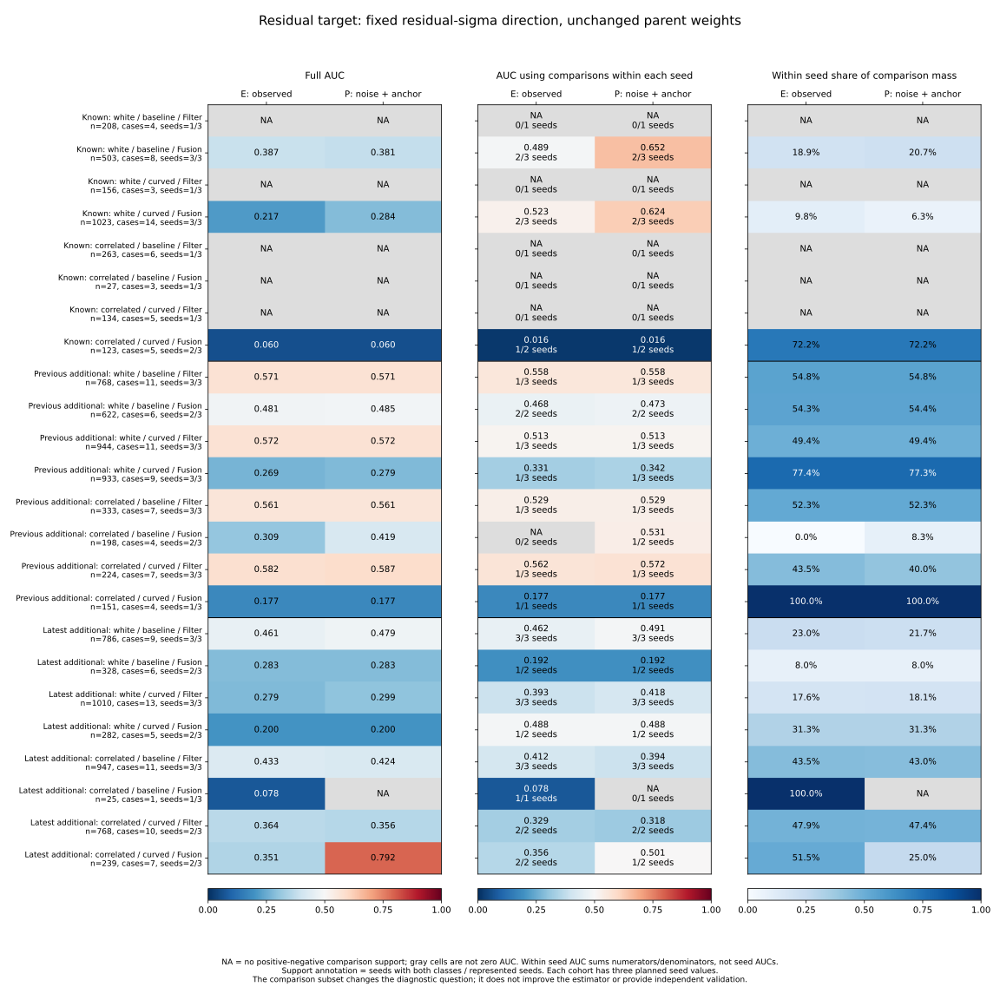
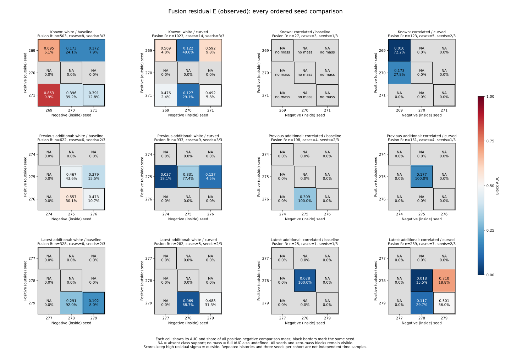
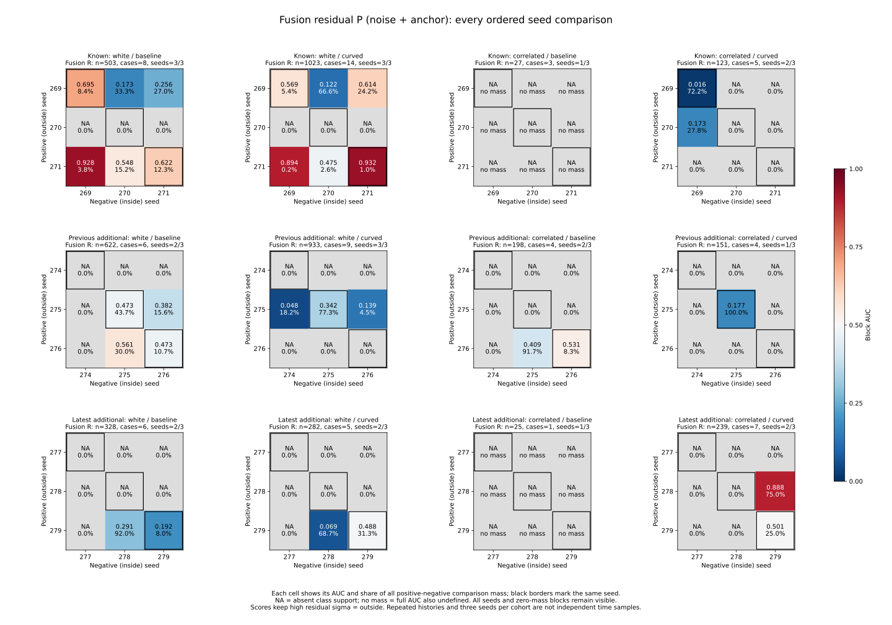
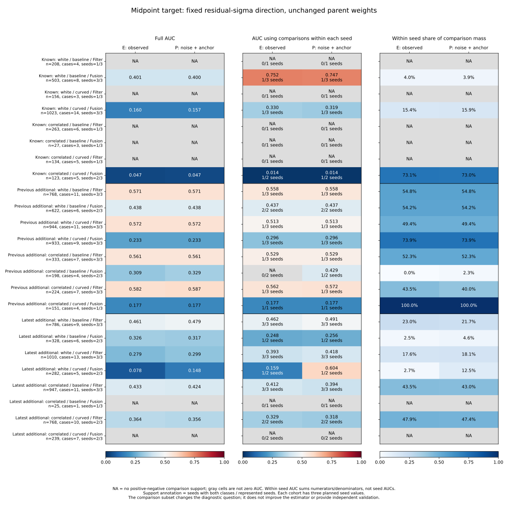

# Ranking comparison support within each seed

Seed mixtures change what the aggregate AUC measures in all three observed
cohorts. The clearest unsupported comparison is **previous additional,
correlated baseline Fusion**: observed-error residual AUC is **.309**, but
**none of its comparison mass is within a seed**. Seed 275 is entirely inside
the .10 m disk and seed 276 entirely outside; a within-seed AUC is undefined.

The effect can run in either direction. Known white-curved Fusion observed
residual AUC is **.217 overall versus .523 within seeds**, with only **9.78%**
of comparison mass retained. Latest curved-correlated Fusion P AUC is **.792
overall versus .501 within seeds**, with **25%** retained. These values answer
different diagnostic questions; conditioning comparisons does not repair the
estimator or supply new validation.

## Frozen cohorts, selection and arithmetic

The [protocol](protocol.md) was committed as **0898dd7** after main f427fc9 and
before the new decompositions. Collector/tests are **dee8907**, plots/README
**42a07a2**. All underlying outcomes had already been observed. Keep these
cohorts separate throughout:

| Partition | Display name | Seed values |
|---|---|---|
| known | Known | 269, 270, 271 |
| new | Previous additional | 274, 275, 276 |
| fresh | Latest additional | 277, 278, 279 |

The existing adapters reconstruct **32,985 simultaneous references at 10,995
states**, in 157 cases linked to 275 received opportunities: 19,830 historical
and 13,155 latest references. This study uses Recovery/Preview, all event kinds
together, all_available, both targets, all three original scores and E/P/U
labels. Keep all estimator strata and pooled all; historical fallback rows are
explicitly empty. Other source selections/budgets retain their previous results.

E is observed error, P=noise+anchor, U=drift+transport. Norm >.10 m is outside;
the closed disk is inside. Signed component identities and saved E labels are
unchanged. P/U labels are arithmetic diagnostics using true saved components,
which are unavailable to an online predictor. No simulation, raw replay,
fitting, score reversal, cutoff choice or controller change occurs here.

Weights remain **1/n_case on the full parent cohort/noise/arm/view group before
mode/seed conditioning**. No seed or mode receives new unit weights. For every
score/label group, let N_st be weighted concordant positive/negative mass plus
half of tied mass, and D_st be all such pair mass, for positive seed s and
negative seed t. Then:

`full AUC = sum(N_st) / sum(D_st)`

`within seed AUC = sum(N_ss) / sum(D_ss)`

`within seed comparison share = sum(D_ss) / sum(D_st)`.

All nine ordered blocks remain explicit, including empty seeds and one-class
populations. A zero denominator gives undefined AUC, not zero or .5. The
within-seed value sums numerators/denominators rather than averaging seed AUCs.
Seeds without both labels contribute no diagonal mass; supported seed counts
must accompany the value. Scores retain high=outside at their original 1e-8 m
ticks. The three cohorts are never pooled into a nine-seed AUC.

## Fusion residual observed-error comparisons

All values below use residual_sigma, all_available. Support is seeds with both
E classes / represented seeds; each cohort has three planned seed values.

| Cohort / noise / arm | Full E AUC | Within seed E AUC | Within seed comparison share | Support |
|---|---:|---:|---:|---:|
| Known / white / baseline | .387 | .489 | 18.93% | 2/3 |
| Known / white / curved | .217 | .523 | 9.78% | 2/3 |
| Known / correlated / baseline | NA | NA | NA | 0/1 |
| Known / correlated / curved | .060 | .016 | 72.20% | 1/2 |
| Previous / white / baseline | .481 | .468 | 54.35% | 2/2 |
| Previous / white / curved | .269 | .331 | 77.39% | 1/3 |
| Previous / correlated / baseline | .309 | NA | 0% | 0/2 |
| Previous / correlated / curved | .177 | .177 | 100% | 1/1 |
| Latest / white / baseline | .283 | .192 | 7.99% | 1/2 |
| Latest / white / curved | .200 | .488 | 31.31% | 1/2 |
| Latest / correlated / baseline | .078 | .078 | 100% | 1/1 |
| Latest / correlated / curved | .351 | .356 | 51.50% | 2/2 |

In previous correlated-baseline Fusion, seed 274 has no records, seed 275 has
**143 states / 3 cases, all E inside**, and seed 276 has **55 states / 1 case,
all E outside**. Seed 276 inherits only **11/17 case mass**, because its parent
case also includes Filter states. All E comparisons therefore run from positive
seed 276 to negative seed 275; this single block has AUC .308547 and 100% of
comparison mass. Both midpoint and residual E labels have this support pattern.
Across all three scores these are the **six** defined full AUC rows with no
defined within-seed AUC.

Known white-curved Fusion shows the opposite aggregate shift. Positive seed
269 versus negative seed 270 supplies **48.96%** of comparison mass with AUC
.122394; positive 271 versus negative 270 supplies **29.11%** with AUC .126735.
These two between-seed blocks dominate the full .217 value. The within-seed
.523 describes the remaining diagonal comparisons, not all three seed streams.

## P labels and the limits of component removal

The same complete residual-sigma comparison for P is:

| Cohort / noise / arm | Full P AUC | Within seed P AUC | Within seed comparison share | Support |
|---|---:|---:|---:|---:|
| Known / white / baseline | .381 | .652 | 20.74% | 2/3 |
| Known / white / curved | .284 | .624 | 6.34% | 2/3 |
| Known / correlated / baseline | NA | NA | NA | 0/1 |
| Known / correlated / curved | .060 | .016 | 72.20% | 1/2 |
| Previous / white / baseline | .485 | .473 | 54.40% | 2/2 |
| Previous / white / curved | .279 | .342 | 77.35% | 1/3 |
| Previous / correlated / baseline | .419 | .531 | 8.27% | 1/2 |
| Previous / correlated / curved | .177 | .177 | 100% | 1/1 |
| Latest / white / baseline | .283 | .192 | 7.99% | 1/2 |
| Latest / white / curved | .200 | .488 | 31.31% | 1/2 |
| Latest / correlated / baseline | NA | NA | NA | 0/1 |
| Latest / correlated / curved | .792 | .501 | 25% | 1/2 |

Previous correlated-baseline seed 276 has 32 P-outside and 23 P-inside states,
so P introduces diagonal support that E lacks. Its within-seed .531 uses just
**8.27%** of full P comparison mass and only that seed. Changing the label from
E to P changes support as well as the target, so the difference is not a score
repair or an online estimator improvement.

Latest curved-correlated P exactly reproduces the preceding case-level result:
positive 278 versus negative 279 has AUC .888312 and **75%** of comparison mass;
279 versus 279 has .501320 and **25%**. Seed 278 has no P-inside records, while
seed 277 has no Fusion records. The diagonal summary exposes the limited scope
of the aggregate .791564 value without discarding either block.

## Filter and midpoint checks

For observed Filter residuals, constraining comparisons to the same seed does
not remove the latest cohort's low ranking:

| Noise / arm | Previous full -> within E AUC | Previous support | Latest full -> within E AUC | Latest support |
|---|---:|---:|---:|---:|
| White / baseline | .571 -> .558 | 1/3 | .461 -> .462 | 3/3 |
| White / curved | .572 -> .513 | 1/3 | .279 -> .393 | 3/3 |
| Correlated / baseline | .561 -> .529 | 1/3 | .433 -> .412 | 3/3 |
| Correlated / curved | .582 -> .562 | 1/3 | .364 -> .329 | 2/2 |

The latest within-seed E values remain below .5 in all four cells. The previous
values use only one mixed-label seed in each cell, despite three represented
seeds; they are not evidence of replicated ranking across all seeds. Known
Filter groups contain only seed 271 under the original audit selection and
have one E class, so their full and within-seed AUCs stay undefined.

Midpoint results are preserved separately. For example, known white-baseline
Fusion midpoint E changes from .401 overall to .752 within seeds, using only
**3.99%** of comparison mass and one supported seed. Latest correlated Fusion
midpoint E/P groups have one class, leaving both AUCs undefined. These missing
comparisons remain visible in the figure rather than being imputed. Complete
tables retain the other scores, U labels, pooled strata and all empty support.

## Validation and reproduction

All **104** supported complete-group component rows and **936** complete-group
ranking rows match the preceding component bundles. Historical fallback rows
are explicitly empty, without inventing source comparisons. All **3,240 latest
seed blocks** match aggregation of the saved case-pair blocks, and all **1,080
latest diagonal blocks** match saved single-seed AUCs/counts/masses. This totals
**33,040 field comparisons**. Exact rational numerators/denominators close for
every production decomposition; saved target closure is at most **2.434e-14 m**,
with zero saved residual-component discrepancy.

Python **539 tests pass**, including 12 new tests for mixtures with high full
but zero within-seed AUC, comparison weighting versus seed averaging, ties,
unequal weights, full grid support, mode mass, cohort isolation, undefined
classes, the closed disk and exact block contributions. Aggregation repeats
byte for byte across all **12 artifacts**; plotting repeats across **four SVGs,
four PNGs, two numeric CSVs and provenance**. All four figures were inspected;
numeric exports retain **96 ranking and 216 block records** including NA.

A separate checker imports no experiment/analyzer modules. It reconstructs all
**10,995 focus states / 21,990 targets** with NumPy vectors and uses direct
weighted positive-negative comparisons. It checks every component/support/
ranking row, all **9,720 seed blocks**, undefined classes, copied tables, source
hashes and plotted records: **793,385 comparisons pass**, including **2,073
defined full/block AUCs** and **345 defined within-seed AUCs**. Evidence and its
script fingerprint are in `independent-verification.json`.

Use the [README commands](../../README.md#ranking-comparisons-within-each-seed)
to reproduce solely from tracked files. Sources/protocol/helpers are pinned in
`sources.json`. All **972 cases / 570 timeouts**, all **3,997 opportunities**,
accounting/support/cutoff bytes and separate unchanged historical **550/509**
and latest **101/94** loss-link references remain available. Analysis/replay,
PNGs, logs and the independent script stay under
`/workspace/scratch/seed-conditioned-rankings`; portable CSV/JSON/SVG and this
report are saved here. Historical live outcomes remain **140 -> 140**, latest
**62 -> 60**. Nine previously observed seed values, repeated planner histories
and three seeds per cohort do not supply confidence intervals, new independent
validation, causal attribution or real-world calibration claims.
