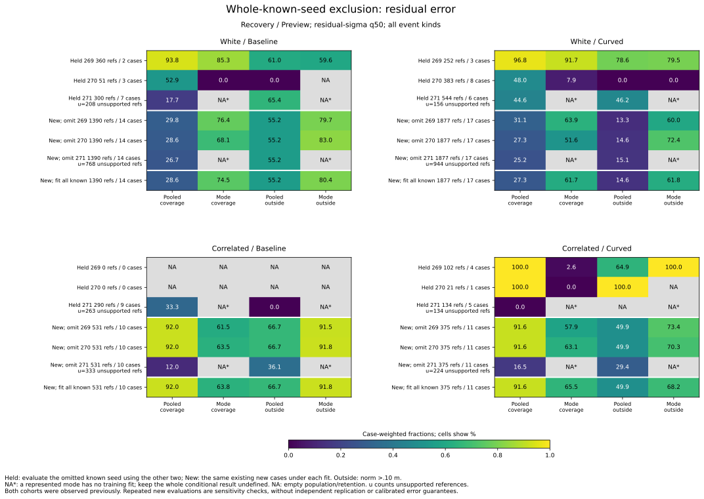
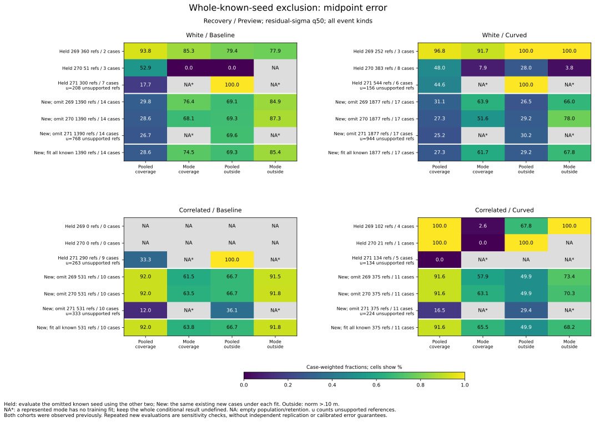

# Seed-exclusion checks for pooled and mode-conditional cutoffs

The known Filter training population is concentrated in **seed 271**: all
7 white-noise and 11 correlated-noise recorded Filter cases come from that
seed. Omitting it leaves the mode-conditional quantile rules undefined for
represented Filter evaluations. This is missing training support, rather
than a measured conditional error fraction of zero.

The pooled rule also depends strongly on that seed in correlated noise.
For existing-new Recovery/Preview residual-sigma q50, pooled coverage spans
**12.05--91.96%** in baseline and **16.54--91.61%** in curved across the three
refits. White-noise spans are narrower: **26.74--29.85%** and **25.24--31.11%**.
These are finite sensitivity ranges, not confidence intervals.

The [protocol](protocol.md) was frozen as 11c8040 and analyzer/tests as 6f5f820
before the refitted outcomes; plotting/reproduction instructions are d38777e.
All three omitted seeds and every score/budget remain reported. Both cohorts
have appeared in prior work: this is **retrospective seed exclusion**, without
untouched validation, extra independent new cases or a new rollout.

## Whole-case roles and data coverage

For each omitted known seed 269/270/271, train on the other two known seeds
across both noises/arms and every map, planner, availability mode, time and
pairing. Evaluate the omitted seed separately from the existing new seeds
274/275/276. Every original known accounting case is held out once. No held
case or new case enters a fold's fitting rows.

All 648 accounting cases have an explicit role in each fold, including cases
without audited simultaneous references. Each fold has 216 train-known,
108 held-known and 324 existing-new accounting cases. Source populations are:

| Omitted seed | Train source references / cases | Held-known references / cases | Existing-new references / cases |
|---|---:|---:|---:|
| 269 | 5,169 / 39 | 2,142 / 9 | 12,519 / 52 |
| 270 | 5,946 / 36 | 1,365 / 12 | 12,519 / 52 |
| 271 | 3,507 / 21 | 3,804 / 27 | 12,519 / 52 |

Counts include all three pairings of the same audited states. Existing-new
cases recur under each refit; they are not added as 156 independent cases.
The original 19,830 pairs, 6,610 states, 100 source cases and 171 received
opportunities remain. Accounting still covers 368 timeout histories and
2,583 opportunities, with all 550/509 loss links. The 20,664 requested lagged
pairs, including 2,208 missing, remain inherited outside this analysis.

Reuse the preceding pooled/conditional quantile algorithms, score directions,
1e-8 m ticks and all .25/.50/.75/all_available rules. Both training arms share
each cutoff. Parent fitting case weights are carried into modes. Reporting
weights are computed within each evaluation group before stratification or
retention and then preserved. Missing conditional support leaves whole-group
conditional and overlap metrics blank; supported Fusion-only rows remain.

## Why omitting 271 removes mode support

Known Recovery/Preview source-case counts by seed, before fitting, are:

| Known seed | White Filter / Fusion | Correlated Filter / Fusion |
|---|---:|---:|
| 269 | 0 / 5 | 0 / 4 |
| 270 | 0 / 11 | 0 / 1 |
| 271 | 7 / 6 | 11 / 3 |

These are recorded cases in selected audit windows, not a statement that
other trajectories or simulator seeds cannot use Filter. Conditional fitting
has 72 structurally empty quantile rows when 269 or 270 is omitted, and 108
when 271 is omitted. The additional 36 are Filter/noise/Preview-view/score/
quantile combinations that lose every fitting reference.

There are **576 unsupported reporting rows**, all in omit_271: 288 held-known
and 288 existing-new, across overlapping event kinds/views/scores/budgets and
pooled/Filter strata. Do not fill those rows with the all-known cutoff or
renormalize onto Fusion. All_available still retains every available row.

For existing-new Recovery/Preview, omitting 271 leaves 768/944 unsupported
Filter references in white baseline/curved and 333/224 in correlated
baseline/curved. The whole conditional quantile result stays undefined even
though Fusion alone has a trained cutoff.

## Pooled cutoff and existing-new sensitivity

The pooled Recovery/Preview residual-sigma q50 cutoff is per-axis cm:

| Omitted seed | White train references / cases | White cutoff | Correlated train references / cases | Correlated cutoff |
|---|---:|---:|---:|---:|
| 269 | 1,278 / 24 | 5.927490 | 445 / 15 | 13.610597 |
| 270 | 1,456 / 18 | 5.916838 | 526 / 18 | 13.610597 |
| 271 | 1,046 / 16 | 5.905364 | 123 / 5 | 7.877572 |

The all-known reference cutoffs are 5.916838 cm and 13.610597 cm. After
omitting 271, correlated training contains only five Fusion source cases,
all in the curved arm; the frozen shared-arm rule still applies to both
evaluation arms. The loss of Filter support changes the pooled score mixture
as well as making conditional Filter fitting unavailable.

The same existing-new population is evaluated under all three pooled refits.
For residual-sigma q50, all modes/event kinds, percentages are:

| Noise / arm | All-known coverage | Three-refit coverage range | Coverage span, points | Retained residual-outside range |
|---|---:|---|---:|---|
| White / baseline | 28.59 | 26.74--29.85 | 3.10 | 55.18--55.24 |
| White / curved | 27.35 | 25.24--31.11 | 5.87 | 13.26--15.09 |
| Correlated / baseline | 91.96 | 12.05--91.96 | 79.92 | 36.14--66.74 |
| Correlated / curved | 91.61 | 16.54--91.61 | 75.07 | 29.37--49.95 |

Conditional existing-new results are available for only two of these refits.
Each cell below is **case-weighted coverage % / retained residual-outside %**:

| Noise / arm | Omit 269 | Omit 270 | Omit 271 |
|---|---|---|---|
| White / baseline | 76.41 / 79.75 | 68.14 / 83.01 | Unsupported |
| White / curved | 63.89 / 59.97 | 51.62 / 72.39 | Unsupported |
| Correlated / baseline | 61.52 / 91.54 | 63.52 / 91.81 | Unsupported |
| Correlated / curved | 57.91 / 73.43 | 63.13 / 70.34 | Unsupported |

In these focused groups the conditional residual-outside fraction exceeds
pooled in both defined folds, with one undefined comparison. The midpoint
target has the same comparison direction. This is not a three-defined-fold
result and does not establish a general advantage for either method.
The [stability table](stability.csv) shows defined counts of two and blank
conditional min/max/span, rather than treating the two available values as
a complete three-fold range.

## Omitted-known outcomes and empty sets

The omitted-known populations are small and differ substantially. These
Recovery/Preview residual-sigma q50 entries are **coverage % / retained
residual-outside %**; undefined fractions are preserved after empty retention.

| Held seed | Noise / arm | Source references / cases | Pooled | Conditional |
|---|---|---:|---|---|
| 269 | White / baseline | 360 / 2 | 93.82 / 60.98 | 85.26 / 59.63 |
| 269 | White / curved | 252 / 3 | 96.78 / 78.62 | 91.72 / 79.51 |
| 269 | Correlated / baseline | 0 / 0 | Empty population | Empty population |
| 269 | Correlated / curved | 102 / 4 | 100 / 64.94 | 2.59 / 100 |
| 270 | White / baseline | 51 / 3 | 52.94 / 0 | 0 / undefined |
| 270 | White / curved | 383 / 8 | 48.04 / 0 | 7.88 / 0 |
| 270 | Correlated / baseline | 0 / 0 | Empty population | Empty population |
| 270 | Correlated / curved | 21 / 1 | 100 / 100 | 0 / undefined |
| 271 | White / baseline | 300 / 7 | 17.69 / 65.38 | Unsupported |
| 271 | White / curved | 544 / 6 | 44.59 / 46.24 | Unsupported |
| 271 | Correlated / baseline | 290 / 9 | 33.33 / 0 | Unsupported |
| 271 | Correlated / curved | 134 / 5 | 0 / undefined | Unsupported |

Empty audit groups do not remove their trajectories from accounting. A
supported fitted cutoff can retain nothing, making coverage zero but risk
undefined. That differs from a missing conditional fit. Do not average these
fold fractions into a pooled held-seed risk.

Both observed abstract targets remain: for held 271 correlated baseline,
the pooled rule retains 27 Fusion references with residual-outside fraction
0% but midpoint-outside fraction 100%. Neither target relabels the original
point accuracy or defines a controller action. Full tables keep all views,
scores, budgets, event kinds and structural strata, including empty groups.

## Validation and reproduction

Use the [README commands](../../README.md#whole-known-seed-exclusion-checks)
with new directories. All **twelve CSVs and provenance** repeat byte for byte.
Both SVG/PNG figures, the shared 56-row numeric series and plot provenance
also repeat exactly; both layouts were visually checked. PNGs remain in
scratch. All three new scripts parse as Python 3.9 syntax.

The Python suite passes **482 tests**, including 17 new tests for whole-seed/
case isolation, evaluation exclusion, missing Filter support, unchanged
existing-new populations, case-role coverage, reference restrictions, empty
retention, undefined ranges, complete fold identities and sign counts.
Recomputing all-known fitting exactly reproduces 72 simultaneous pooled
thresholds, all 216 conditional thresholds and all 6,912 preceding comparison
rows. That reference is used only for existing-new evaluation.

A separate calculation imports no analyzer functions. It verifies all 1,944
case-role rows and three fold censuses, refits all 216 pooled and 648 conditional
fold thresholds using integer LCM case weights/cumulative quantiles, and
checks every field of all 20,736 fold comparisons. It also checks the 3,456
existing-new references, 3,456 complete/undefined-range summaries and 56
numeric figure rows: **2,472,813 field comparisons**. All 19,830 scored-source
identities, score ticks, labels and input/script/protocol/helper/plot hashes
match. Original accounting/events/loss links/membership/thresholds are
byte-identical copies.

[Fold census](folds.csv), [case roles](case-roles.csv),
[pooled fits](pooled-fold-thresholds.csv),
[conditional fits](conditional-fold-thresholds.csv),
[fold comparisons](fold-comparison.csv), [existing-new reference](reference.csv)
and [analysis provenance](sources.json) are tracked, alongside
[figure data](seed-exclusion-cutoffs.csv) and
[figure provenance](seed-exclusion-cutoffs-sources.json).
Original observation/physics validation is inherited. No confidence interval,
calibrated risk, causal effect or new release policy follows from these
dependent, previously examined histories. Recorded held goals remain **140 -> 140**.
