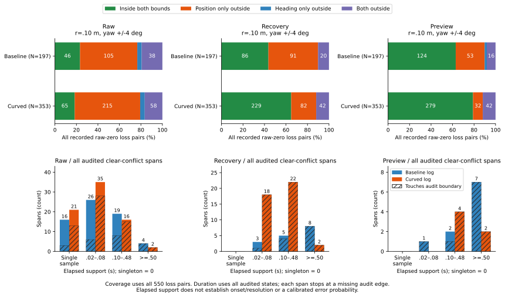

# Coverage components and persistence on audited chains

At the previously reported .10 m / +/-4 degree setting, every residual clear
certificate conflicting with truth in the fixed 550-loss population has
position outside its disk and heading inside its interval: 9 recovery rows
and 1 preview row. Recovery's 9 rows belong to 5 audited conflict spans,
with elapsed support .08 to 1.34 s. All five end at audit boundaries, so their
resolution times are not observed. The chosen bounds remain sensitivity
settings with no calibrated error probability.

The [protocol](protocol.md) was frozen as 772d03e before the new analysis.
Inputs are the tracked [envelope results](../speed-probe-envelopes/report.md)
and the earlier explicit adjacent-pair table. No raw replay or new geometry
is required. The 648-case accounting, 368 timeouts and 2,583 opportunities
remain intact, including categories without geometric audits and source
right-censoring. All 237,960 pose/setting combinations reproduce the prior
certificate counts, coverage marginals and summary denominators.

## Which part of the envelope misses truth?

Coverage has four exclusive categories. Here inside means the closed position
disk or closed absolute wrapped heading interval, with no relaxed tolerance.
At .10 m / +/-4 degrees the full 550-loss partition is:

| Recorded arm | Input | Both inside | Position only outside | Heading only outside | Both outside |
|---|---|---:|---:|---:|---:|
| Baseline, N=197 | Raw | 46 | 105 | 8 | 38 |
| Baseline, N=197 | Recovery | 86 | 91 | 0 | 20 |
| Baseline, N=197 | Preview | 124 | 53 | 4 | 16 |
| Curved, N=353 | Raw | 65 | 215 | 15 | 58 |
| Curved, N=353 | Recovery | 229 | 82 | 0 | 42 |
| Curved, N=353 | Preview | 279 | 32 | 0 | 42 |

In the unchanged command-only subset of 509, combined across arms, recovery
has 280 inside both, 171 position-only outside, 0 heading-only outside and
58 outside both. Preview has 368, 83, 4 and 54 respectively. Its residual
clear/truth conflicts are the same 9 recovery and 1 preview rows, all
position-only outside. Input views share recorded actions and are not
independent attempts.

Retain the full 6,610-state population separately. Its recovery clear/truth
conflicts are 787 position-only outside and 21 outside both (808 total).
Preview's 480 are all position-only outside. Raw's 767 split 723 and 44.
Neither covered truth nor heading-only outside produces a clear conflict at
this fixed setting in these records. This geometric association does not
establish that heading uncertainty is irrelevant at other settings, steering
inputs or populations. Both clear-conflict and blocked-conflict cross-tabs
for every frozen setting remain available, including zero categories.

## What elapsed support is actually observed?

The 6,187 source pairs yield 6,187 unique physical edges, with zero repeated
edge references in this particular subset. The implementation still checks
and deduplicates repeated opportunity references. Explicit edges create 423
chains over all 6,610 states: baseline 157 chains / 2,922 states, curved 266 /
3,688. There are no isolated nodes here. Median chain support is .18 s and
.11 s; maximum is 1.34 s in both arms. Adjacent timestamps alone cannot add
an unaudited edge.

Every chain is partitioned independently into coverage-category spans and
conflict/no_conflict spans. At .10 m / +/-4 degrees all clear-conflict spans
over the broader audited population are:

| Arm | Input | Conflict spans | States | Singletons | Median support (s) | Max support (s) | Touch audit boundary |
|---|---|---:|---:|---:|---:|---:|---:|
| Baseline | Raw | 65 | 424 | 16 | .04 | .84 | 21 |
| Baseline | Recovery | 16 | 455 | 0 | .55 | 1.34 | 13 |
| Baseline | Preview | 10 | 339 | 0 | .70 | 1.02 | 9 |
| Curved | Raw | 74 | 343 | 21 | .04 | 1.02 | 58 |
| Curved | Recovery | 42 | 353 | 0 | .10 | 1.02 | 42 |
| Curved | Preview | 6 | 141 | 0 | .21 | 1.02 | 6 |

The 808 recovery conflicts thus occupy 58 spans, and 480 preview conflicts
occupy 16 spans. They are correlated samples within selected trajectories,
not 808/480 independent failure trials. Longer or shorter spans do not
establish estimator superiority: this population and its chain boundaries
were selected by the earlier joint-gate audit.

Support is `(states-1)*.02`, equal to the last minus first decision time. A
singleton has zero support. Left/right audit boundaries indicate unknown
behavior outside the chain, not observed onset/resolution. Each decision
keeps its own recorded steering and margin, which can change along a span.
This describes consecutive sampled decisions, not a new continuous-time
geometric guarantee or a held-input controller rollout.

## The residual loss rows in context

The 9 recovery loss rows join these five conflict spans:

| Span ID | Recorded case / opportunity | Decision times (s) | States | Support (s) | Loss rows in span | Boundaries |
|---:|---|---|---:|---:|---:|---|
| 6414 | Known-white curved blackout 271, dense A*, event 87 | 161.30–161.38 | 5 | .08 | 1 | audit / audit |
| 8095 | Same cohort/arm/mode/seed/map, JPS, event 94 | 161.30–161.38 | 5 | .08 | 1 | audit / audit |
| 9661 | Same cohort/arm/mode/seed/map, Theta*, event 101 | 161.30–161.50 | 11 | .20 | 1 | audit / audit |
| 33989 | New-white curved random 275, maze JPS, event 1626 | 160.44–160.62 | 10 | .18 | 1 | label change / audit |
| 46523 | New-white baseline random 275, dense Theta*, event 1974 | 150.16–151.50 | 68 | 1.34 | 5 | audit / audit |

The single preview loss conflict is the same recorded transition 106204 in
event 1626, joined to preview span 34037 over the same 10 decisions / .18 s.
Transition 5706 from the earlier concrete example joins recovery span 6414.
The table is the complete residual population at this setting. No loss-only
timestamps were stitched into artificial runs; every span uses all available
audited decisions in its chain.

## Reproducibility and limits

The [README commands](../../README.md#envelope-coverage-components-and-audited-persistence)
write new output directories. All eight CSVs and [sources.json](sources.json)
repeat byte for byte. Figure CSV/SVG/PNG and provenance also repeat exactly;
the figure was visually checked and PNG remains in scratch. The Python suite
passes **327 tests**, including 14 new tests for coverage equality, explicit
edges, gaps, duplicate references, case boundaries, maximal runs, elapsed
support, span membership and truncation.

[chains.csv](chains.csv) and [members.csv](members.csv) retain chain order,
pose/state IDs and original edge transition/event references. [spans.csv](spans.csv)
contains 52,031 rows: 34,315 coverage spans and 17,716 conflict-family spans.
Each family separately covers all 237,960 pose/settings, including no_conflict.
[loss-memberships.csv](loss-memberships.csv) joins all 19,800 prior decisions
to both span families. [coverage-summary.csv](coverage-summary.csv) has 6,480
rows and [span-summary.csv](span-summary.csv) 12,960, retaining empty groups.

An event-kind span summary includes a whole span when any source node belongs
to that event kind. These union groups can overlap and must not be summed.
The figure's [432 numeric rows](coverage-span-comparisons.csv) retain both
arms, all inputs and event kinds, singleton bins and audit-truncated spans;
[plot provenance](coverage-span-comparisons-sources.json) pins all inputs.
[Accounting](accounting.csv) and [opportunities](events.csv) exactly preserve
the prior files. Original observation/physics validation is inherited and
recorded held goals remain **140 -> 140**. No new release, trajectory or
physical safety improvement is claimed.
