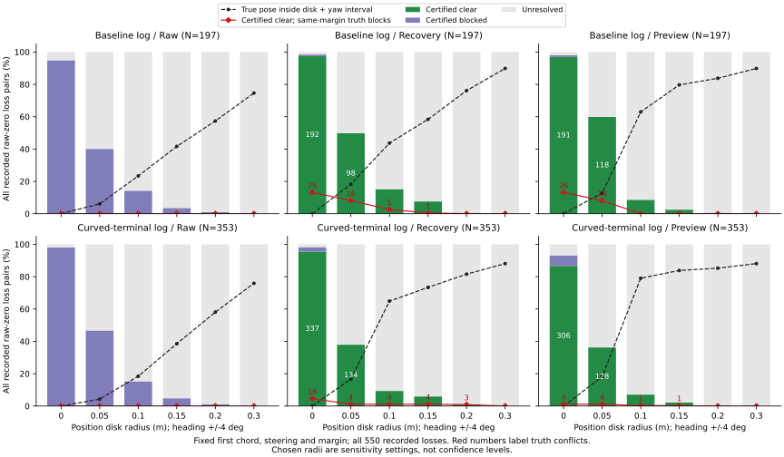

# First-chord position and heading envelopes

Adding a pose envelope reduces definite first-chord permissions, but its
geometric guarantee depends on the true pose being inside that envelope.
At a frozen .10 m position radius and +/-4 degree heading bound, recovery
certifies 63 of the 550 recorded raw-zero losses clear; 9 still disagree with
same-margin truth. Preview certifies 42 clear, with 1 disagreement. Every
disagreement has truth outside its chosen set. These settings are sensitivity
queries, with no calibrated confidence level or new controller result.

The [protocol](protocol.md) was committed as cdc94ce before running the new
analysis. Inputs come from [speed-probe-starts](../speed-probe-starts/report.md).
Keep all 648 case records, 368 timeouts, 2,583 opportunities, 6,187 detailed
source pairs and 6,610 distinct audited states. The audited subset spans
100 recorded cases / 171 opportunities (baseline 45/75, curved 55/96).
Other opportunities retain zero audited states; they have no geometric label.

## Conditional geometric bounds

The original nominal steering and speed margin remain fixed. Translation by
at most r shifts the first chord by at most r. A heading change bounded by d
shifts each chord point by at most `e=2*|end-start|*sin(d/2)`. The nearest
obstacle distance and signed wall distance change by at most that displacement.
Start gaps need only the translation bound. Subtract these bounds for a clear
certificate; add them for a blocked certificate. Bounds within the fixed
2e-8 m rounding guard remain unresolved. Source blocking equality stays <=0.

The product sets use radii 0, .05, .10, .15, .20, .30 m and heading bounds
0 or 4 degrees. At +/-4 degrees the rotation displacement is at most about
.00349 m. Neither the margin nor sensor uncertainty is refitted. Clear and
blocked certificates quantify every pose in the chosen set; unresolved does
not mean blocked. A positive first chord does not establish a clear full
path, another passed gate or a successful release.

All 237,960 pose/setting combinations satisfy the conditional check: covered
truth agrees with every definite certificate. Separately, 19,830 oracle
intervals computed from the observed position and heading errors contain the
actual true gap. These oracle inputs are unavailable online. No covariance
model, calibrated error probability or out-of-sample guarantee is introduced.

## Fixed 550-loss population

Each input has all 197 baseline and 353 curved losses (38/56 opportunities,
19/27 recorded cases). Every source member stays in the denominator. At
.10 m and +/-4 degrees:

| Recorded arm | Input | Clear | Blocked | Unresolved | Clear / truth blocks | Truth inside set |
|---|---|---:|---:|---:|---:|---:|
| Baseline | Raw | 0 | 28 | 169 | 0 | 46 |
| Baseline | Recovery | 30 | 0 | 167 | 5 | 86 |
| Baseline | Preview | 17 | 0 | 180 | 0 | 124 |
| Curved | Raw | 0 | 54 | 299 | 0 | 65 |
| Curved | Recovery | 33 | 0 | 320 | 4 | 229 |
| Curved | Preview | 25 | 0 | 328 | 1 | 279 |

Across both arms, at the same +/-4 degree heading bound:

| Radius (m) | Recovery clear / conflicts / unresolved | Preview clear / conflicts / unresolved | Recovery / preview truth inside set |
|---:|---|---|---|
| 0 | 529 / 42 / 9 | 497 / 30 / 28 | 0 / 0 |
| .05 | 232 / 20 / 318 | 246 / 20 / 304 | 95 / 89 |
| .10 | 63 / 9 / 487 | 42 / 1 / 508 | 315 / 403 |
| .15 | 36 / 5 / 514 | 13 / 1 / 537 | 374 / 453 |
| .20 | 5 / 3 / 545 | 2 / 0 / 548 | 438 / 466 |
| .30 | 0 / 0 / 550 | 0 / 0 / 550 | 488 / 488 |

Conflicts are a subset of clear certificates. At radius zero, recovery also
has 12 blocked certificates and preview 25; at every positive radius both
have zero blocked certificates. The zero-radius rows still include heading
uncertainty, so they differ from the prior point-pose counts (537/525 clear,
42/32 conflicts). At .30 m all 550 positions are covered in both inputs, but
62 headings fall outside +/-4 degrees and every query is unresolved. Zero
remaining conflicts there cannot be interpreted as successful permission.

The fixed command-only population has 509 members: baseline 183 in 35
opportunities / 18 cases, curved 326 in 54 opportunities / 25 cases. Point
queries clear all 509 in both recovery and preview, including the same 32
truth-blocked states. At .10 m / +/-4 degrees recovery certifies 62 clear,
9 conflicting and 447 unresolved; preview 41 clear, 1 conflicting and 468
unresolved. Their joint truth coverage is 280/509 and 368/509. These are
separate input views of shared recorded actions, not independent attempts.

## Error sizes and the previous concrete example

For the 32 command-only central conflicts, truth margin shortfall averages
1.764 cm in the baseline's 26 states (maximum 4.842 cm), and 1.771 cm in the
curved arm's 6 states (maximum 3.351 cm). Mean position errors are 15.00/11.63
cm for baseline recovery/preview and 17.57/10.02 cm for curved recovery/preview.
Mean absolute heading errors are 2.126 and 1.124 degrees respectively. Error
norm alone does not specify the direction toward an obstacle. These shortfalls
use the original uncertainty-containing margin; they are not physical contacts.

Revisit the prior report's transition 5706, event 87, known-white curved
blackout seed 271, dense A*, t=161.38 s. Steering .215825668 and margin
.910442712 m stay fixed; truth's gap is -.011108350 m.

| Input | Central gap (m) | Position error (m) | Heading error (deg) | Clear radius budget at +/-4 deg (m) |
|---|---:|---:|---:|---:|
| Recovery, pose 1742 | .219022646 | .251268219 | .314309291 | .215532805 |
| Preview, pose 1743 | .078101542 | .089506837 | .314309291 | .074611701 |

Recovery remains certified clear even at .20 m, because its .2513 m position
error lies outside that disk. Preview is unresolved at .10 m, which contains
truth. Both oracle intervals are unresolved. This previously selected example
illustrates a conditional guarantee and an uncovered error, without changing
the recorded controller. The three recovery conflicts left at .20 m are
transitions 5706, 6163 and 6620, all known-white curved records at 161.38 s;
their near-identical .2513 m errors are repeated records, not three independent
draws establishing a tail probability.

## Broader audited states and reproducibility

Keep the complete 6,610-state summaries as well. At .10 m / +/-4 degrees,
recovery certifies 4,054 clear with 808 truth conflicts and preview 3,216 with
480 conflicts. The loss-only counts cannot stand in for this broader selected
population or an unselected deployment population. No radius here is proposed
as a control setting. Recorded held goals remain **140 -> 140**, and original
physics/observation validation is inherited.

Run the commands in the [README](../../README.md#first-chord-position-and-heading-envelopes)
with new output directories. No raw trajectory replay is needed. All five CSVs
and [sources.json](sources.json) repeated byte for byte. Plot CSV/SVG/PNG and
provenance also repeated exactly; the SVG was visually checked. PNG remains
in scratch. The Python suite passes **313 tests**, including 16 new analytic,
curved-chord transformation, rounding, coverage and accounting tests.

[poses.csv](poses.csv) contains 19,830 estimate/truth diagnostics and radius
budgets. [loss-decisions.csv](loss-decisions.csv) contains 19,800 decisions
joined to the original transition/event/pose IDs. [summary.csv](summary.csv)
has 6,480 rows, including empty event kinds and all three populations.
[accounting.csv](accounting.csv) and [events.csv](events.csv) exactly preserve
the prior tables and censoring. Figure [numeric data](probe-envelope-comparisons.csv)
has 432 rows for all event kinds, both arms, inputs and settings; its
[provenance](probe-envelope-comparisons-sources.json) pins every input and script.
