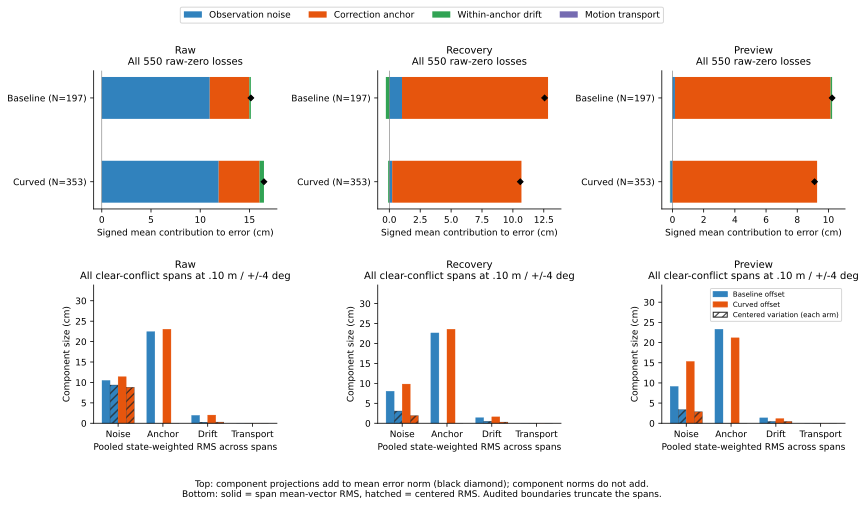

# Position-error components within audited first-chord spans

The correction-anchor offset is the largest signed contribution to position
error in all 9 recovery and 1 preview residual loss conflicts at .10 m /
+/-4 degrees. In the longest linked conflict span, the anchor vector stays
constant at 21.15 cm over 68 audited decisions / 1.34 s, while observation
noise varies around it. These are error-vector decompositions of existing
records, not causal obstacle-clearance attributions or a new control result.

The [protocol](protocol.md) was committed as 2c99901 before new results.
All 368 timeout histories were replayed from time zero through 180 s:
3,312,000 intervals in 72 hash-pinned raw files. Estimator-window counts match
at every interval. All 19,830 input positions/headings match the earlier
recorded poses within 1e-8 (coordinates in m, headings in rad). The largest
absolute coordinate/heading difference is 1.2223e-9 in the respective units;
maximum position-error-norm difference is 1.3236e-9 m.

## Population and arithmetic

The 648 case records, 368 timeouts and 2,583 opportunities remain unchanged.
Every one of the 6,610 previously audited states is reconstructed, including
nonconflicting poses: 6,610 raw observations, 6,610 recovery means, 3,580
three-epoch previews and 3,030 motion-filter previews. The audited states span
100 recorded cases; the other 268 timeout histories retain zero-target replay
rows. Full physics/observation validation is inherited.

Truth uses the preceding physical CSV row. Position error is decomposed into
weighted observation noise, correction-anchor offset, within-anchor bias
drift and motion transport error. Recorded estimator weights do not use truth.
The four vectors sum to the error. Their signed projections onto its direction
sum to its norm; their norms do not sum. Negative projections remain negative.
The maximum transport norm across this selected population is 9.34e-10 m.
Model covariance diagnostics retain shared anchor IDs and AR sample spacing;
they are not calibrated uncertainty bounds.

## Complete 550-loss comparison

Each input retains all 197 baseline and 353 curved raw-zero-loss transitions.
RMS values below are in cm. A component's RMS can exceed the full error's RMS
because other components can point in the opposite direction.

| Arm | Input | Full error RMS | Noise RMS | Anchor RMS | Drift RMS | Anchor largest projection |
|---|---|---:|---:|---:|---:|---:|
| Baseline | Raw | 16.953 | 17.190 | 15.279 | 1.769 | 64 / 197 |
| Baseline | Recovery | 14.404 | 6.384 | 15.279 | 1.364 | 183 / 197 |
| Baseline | Preview | 11.817 | 5.451 | 12.867 | .875 | 189 / 197 |
| Curved | Raw | 18.417 | 16.469 | 13.243 | 1.579 | 80 / 353 |
| Curved | Recovery | 12.589 | 4.060 | 13.243 | 1.187 | 337 / 353 |
| Curved | Preview | 11.030 | 2.788 | 11.564 | .799 | 346 / 353 |

Transport is zero at all these loss poses. Across both arms, anchor is largest
in 520/550 recovery and 535/550 preview inputs; noise is largest in 406/550 raw
inputs. This arithmetic label does not identify which component caused a
particular geometric gate failure. Input views share the same recorded actions.

Keep the fixed command-only subset of 509 separately. Its recovery anchor
count is 481/509 and preview 495/509. No source member, heading, steering,
speed margin or first-chord decision changes. All 19,800 inherited loss
memberships, including six radii and two heading bounds, are preserved exactly.

At .10 m / +/-4 degrees, the same 9 recovery loss conflicts and 1 preview loss
conflict remain. Their error/anchor/noise RMS values in cm are:

| Arm/input | Rows | Full error | Anchor | Noise | Anchor largest |
|---|---:|---:|---:|---:|---:|
| Baseline recovery | 5 | 21.991 | 21.150 | 2.185 | 5 |
| Curved recovery | 4 | 23.457 | 22.464 | 2.069 | 4 |
| Curved preview | 1 | 17.515 | 18.199 | 2.875 | 1 |

These rows also belong to the 509 subset and must not be counted twice.
The preview loss conflict uses the motion filter. Across the broader audited
population, all 480 preview envelope conflicts at this setting use that
fallback, while the 3,580 three-epoch poses have no definite envelope conflict.
However, 454 three-epoch poses have a central point-pose conflict before the
envelope test. This does not establish that fusion is always correct, or that
a fallback restriction would improve closed-loop outcomes.

## Persistent offsets within the previously audited spans

Every default-setting span in both source families is retained: 4,737 rows
cover coverage categories and conflict/no_conflict comparisons. Within each
span, `RMS^2 = |mean vector|^2 + centered RMS^2` holds for the full error and
each component. A singleton has zero centered RMS. The figure pools these
energies with state-count weights, rather than averaging span durations or
treating spans as independent samples.

All .10 m / +/-4 degree clear-conflict spans have these pooled moments (cm):

| Arm | Input | Spans / states | Anchor mean-offset RMS | Anchor centered RMS | Noise centered RMS | Drift centered RMS |
|---|---|---|---:|---:|---:|---:|
| Baseline | Raw | 65 / 424 | 22.436 | <1e-12 | 9.363 | .267 |
| Baseline | Recovery | 16 / 455 | 22.646 | <1e-12 | 3.067 | .493 |
| Baseline | Preview | 10 / 339 | 23.307 | <1e-12 | 3.382 | .465 |
| Curved | Raw | 74 / 343 | 23.034 | <1e-12 | 8.822 | .282 |
| Curved | Recovery | 42 / 353 | 23.580 | <1e-12 | 1.922 | .301 |
| Curved | Preview | 6 / 141 | 21.180 | <1e-12 | 2.846 | .461 |

In these spans, the anchor contribution is effectively constant. Transport is
zero. Recovery conflicts use recovery means; preview conflicts use motion
filters. Other default-setting spans, including fusion and no_conflict, remain
available rather than being dropped to create this table. Chain edges and
audit truncation are inherited exactly from the previous study; the .08–1.34 s
supports linked to residual loss rows do not establish their full episode
duration or resolution time.

For the previous example's recovery pose 1742, noise/anchor/drift norms are
1.719/23.716/2.280 cm; full error is 25.127 cm. Its 25-sample window covers
steps 8045–8069 and all samples share anchor 8000 (the 160 s correction).
The corresponding three-epoch preview pose 1743 uses 75 samples with anchor
IDs 7500/7750/8000; its anchor norm is 7.437 cm and error 8.951 cm. This is a
matched example, without changing the original geometric classification.

Span 46523, linked to five baseline loss rows, retains a 21.150 cm anchor
offset over all 68 decisions. Noise RMS is 2.387 cm with centered RMS 2.166 cm;
drift RMS is 1.422 cm with centered RMS .730 cm. Its audit boundaries truncate
both ends. A shared offset can remain after averaging observations from that
same anchor, as the existing replay model already specifies; this analysis
does not refit a new estimator or claim a successful replacement policy.

## Reproduction

Run the [README commands](../../README.md#position-error-components-within-audited-probe-spans)
with new directories and the pinned raw cohorts, or use `--raw-root DIR` for
relocated identical files. All eight CSVs and [sources.json](sources.json)
repeat byte for byte at the same raw root. Plot CSV/SVG/PNG/provenance also
repeat exactly, and the figure was visually checked. PNG remains in scratch.
The Python suite passes **340 tests**, including 13 new checks for raw/fallback
groups, signed cancellation, vector moments, singleton/empty behavior,
conditioned opportunity joins and unchanged span membership.

[components.csv](components.csv) contains all 19,830 input decompositions;
[groups.csv](groups.csv) retains 26,990 estimator-group records.
[reconstruction.csv](reconstruction.csv) accounts for every timeout history.
[summary.csv](summary.csv) has 1,620 rows, including empty event kinds and the
overlapping all/central-conflict/envelope-conflict conditions.
[span-components.csv](span-components.csv) preserves the original span IDs and
boundaries alongside component moments. [Accounting](accounting.csv),
[opportunities](events.csv) and [loss memberships](loss-memberships.csv) exactly
match the prior files. The figure's [432 numeric rows](error-component-comparisons.csv)
and [provenance](error-component-comparisons-sources.json) include empty groups.
Recorded held goals remain **140 -> 140**. No new release or physical safety
improvement follows from this decomposition.
